# Sandbox Game (working title)

A top-down farming and life sim with 16-bit pixel art, set in a semi-fantasy Nordic
countryside. It follows the tradition of Stardew Valley and Harvest Moon, but leans further
into exploration, and you can build anywhere you like. The weather, the seasons and the
light change the world as you play.

> **Status:** early prototype, under active development. The core loop works: you can
> walk, farm, fell, mine, gather, build and sleep through the seasons. There is no shop,
> combat or story yet.


## Features

### Sound

Footsteps follow the walk and the ground (grass, soil, sand, wetland, ice, snow, a wooden
floor), and every tool, pickup, building and menu has a sound, played from where it
happens. Inside a house the weather and the world outside are muffled and faint, and a room with
a hearth crackles with the fire, louder the nearer you stand to it (all through a small house,
only near the fire in a big one). Settings → Audio has Master, Effects, Ambience and Music volumes
and "Sound in background" (off: silent while the window is not focused). What you do is heard
when it worked; an action the game refuses only says "denied". While the game is paused (the pause
menu and its settings, a chat, a choice) every sound of the world fades out and comes back when you
go on; only the music and the menu's own clicks play (moving a volume slider clicks at its level, so you hear it).
Which file each sound plays is in [data/sounds.cfg](data/sounds.cfg), so any
sound can be swapped for a recording.

The world has an ambience too: rain and wind loops that follow the weather (and swell with
gusts, heard as the gust fronts that bend the grass reach you), thunder after each flash of
lightning by how far the strike was (a far rumble many seconds later and faint, now and then a
close crack almost at once), birds chirping by day, deer,
rabbits and squirrels, bees buzzing at their flowers, frogs croaking near water on
warm spring and summer evenings and nights (and, where frogs are about, a quiet chorus of
them at dusk), a stork clattering its bill and geese honking,
and now and then a quiet moo, baa or cluck from the farm animals, and a rooster who crows at dawn
and now and then through the day (the numbers are in [data/livestock.cfg](data/livestock.cfg)).
How often and how loud the others are is in [data/ambience.cfg](data/ambience.cfg).

### A world that changes with the seasons

There are four seasons of 30 days each. The ground, the trees, the bushes and the
buildings each have a look for every season: fresh green in spring, full summer foliage,
autumn colours of the North Sea, and snow in winter. The woods are those of the region: grey
beeches under broad domes that turn copper, white birches that turn yellow, dark alders on
wet ground that stay green late and hang with cones in winter, and oaks in brown, ochre and
copper. The grass itself stays grass and only shifts its colour gently and evenly through the
year, fresh green in spring and darker green in autumn and winter; fallen leaves, frost and snow
come over it as overlays that build up and melt gradually, a few more leaves under the oaks, a
rime on a cold morning, a thin snow that thickens and thaws first on the paths and in the open,
with soft edges that never follow the tiles, and the snow settles on the trees, bushes and
stones from the top down and on the roofs from the ridge to the eaves. The trees follow their
season over its first three days, tree by tree: in spring the trees and bushes leaf out in steps,
from bare twigs to a haze of buds, thin young leaves and then the full crown. Scots pines, tall
with a loose flat crown, and spruces stay green all year; they are rare, in clumps on the dry
Geest. Ground cover thins and fills over the year, ferns die back in
winter, and berry bushes only bear fruit in their season.


The meadows flower from spring to late summer, in drifts and patches rather than sprinkled
evenly: the first daisies, dandelions and, in the beech woods, wood anemones in early spring,
cuckooflower on the wet meadows, then buttercups, red campion and red and white clover, and in
high summer yarrow, knapweed, meadowsweet by the water and the heather on the Geest. Each
drift has its few species that take over from each other, so a patch changes colour with the
weeks; the first and the last flowers of a species are small ones, and autumn sees them fade.
Fields, water and the woods have none or few. Bees keep to the flowers: they come only where
something blooms, more where more does, and their quiet buzz comes from where they are. Where
the flowers grow is in [data/flowers.cfg](data/flowers.cfg), when they bloom in
[data/vegetation.cfg](data/vegetation.cfg).


Where you walk often, the grass wears: first it is trodden, thin and flattened with the earth
showing through, then a path of bare earth with grass creeping in at its edges, and the flowers
and tufts on it are gone. Walk the same line a few times a day and a path forms in a few days;
leave it and it grows back over a week or two. Paths fade softly into the grass around them,
change with the seasons, lie dark in a winter without snow and show as a faint trodden track
under snow. Cows and the other farm animals wear the ground too where they keep walking, and so
do the villagers on their rounds. A path is only a look: it walks, tills and builds like grass.
Where many feet have worn a whole yard, the trodden and path ground joins into one calm patch of
earth with no repeating shapes, and its edge follows at once as tiles wear or grow back.
The numbers are in [data/paths.cfg](data/paths.cfg).

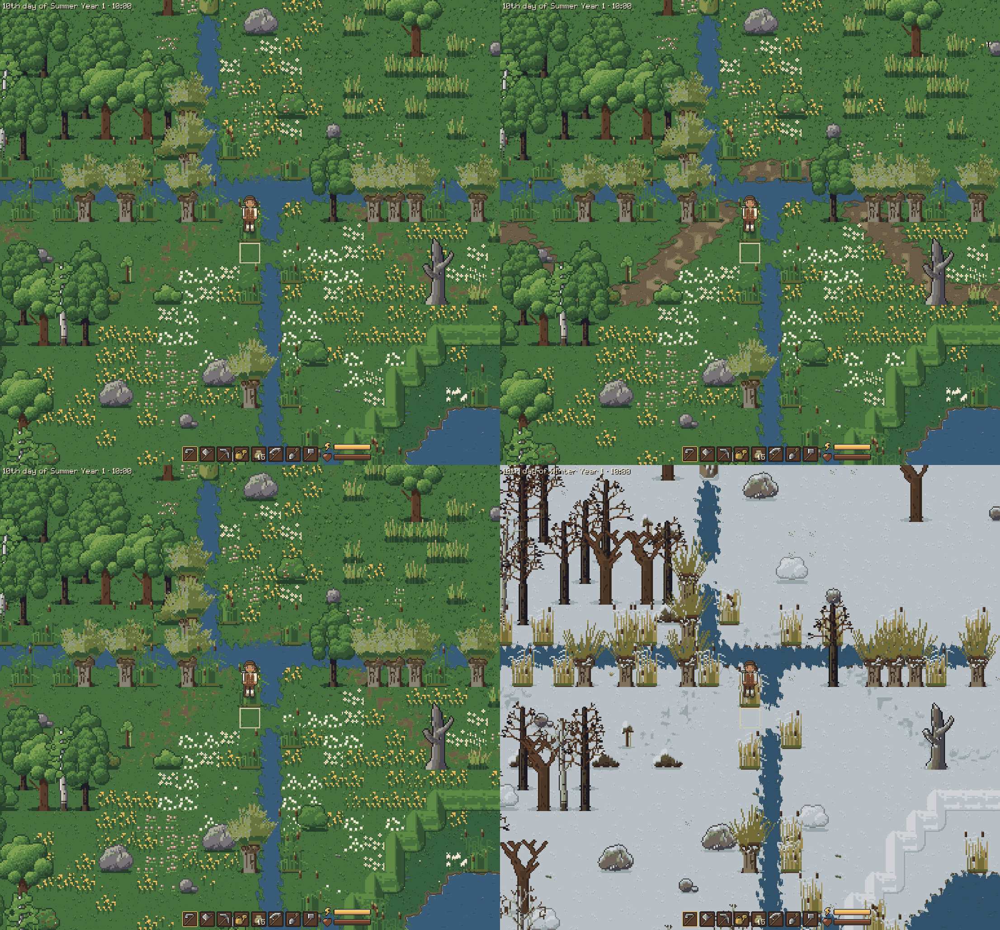

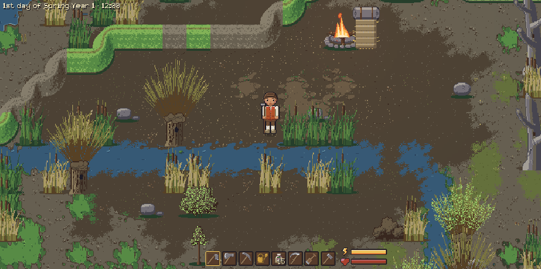

### Knicks, ditches and dykes

The land is worked, as in Schleswig-Holstein around 1700–1800. On the dry Geest the fields
are bounded by Knicks, hedges of hazel and hawthorn on earth banks that blossom in spring,
turn yellow and brown in autumn and stand bare in winter, and here and there by a fieldstone
wall or a wattle fence. Down in the marsh along the river the fields are cut by straight
ditches of water lined with reeds and pollard willows, and turfed dykes run along the
floodplain, long green banks with a sheep track along the crest that bend round their corners
and wind along where the river runs on the slant. Every boundary has a gap or a crossing, so no
field is shut in. The axe cuts a Knick down for logs and fibre, the pickaxe takes a wall apart
for stone, and willows are felled like the other trees.


Tall grass, ferns and reeds have a ground shadow and a dark, dense foot that is rimmed in the
darkest green of their own ramp, so they stand out from the ground in every season, and so does
the pollard willow's dense crown with its dark edge (`make contrast-sheet` draws this sheet for
any plant):

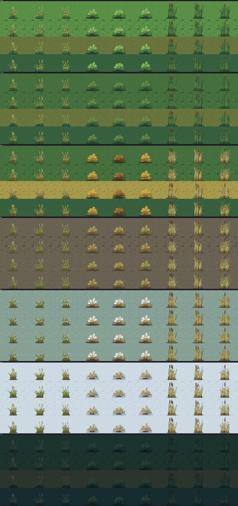

### The coast and the tidal flats

In the west the land ends at the North Sea. A sea dyke runs along the coast, and beyond it lie
the salt marsh, grey-green with sea purslane and glasswort, pink with thrift in early summer,
lilac with sea lavender later and red-purple in autumn; then the tidal mud of the Wadden Sea,
with ripple marks, lugworm casts and shells, cut by tideways that widen towards the open sea.
The tide comes in and goes out twice a day: the water fills the hollows first, then the flats
are under, and at low water the mud dries again. Mud under water can't be walked on, like the
sea, so the flats open and close with the tide: whoever the rising water catches can still wade out
to the shore, and the villagers and farm animals keep to the same rule. Out on the
salt marsh a Warft rises here and there, a dwelling mound with a pond on top, and now and then
an Ewer, a flat-bottomed sailing barge, lies on the mud. Storks and geese come to the salt marsh,
and oystercatchers, dunlin, gulls and terns to the mud and the sea (see [Wildlife](#wildlife)).

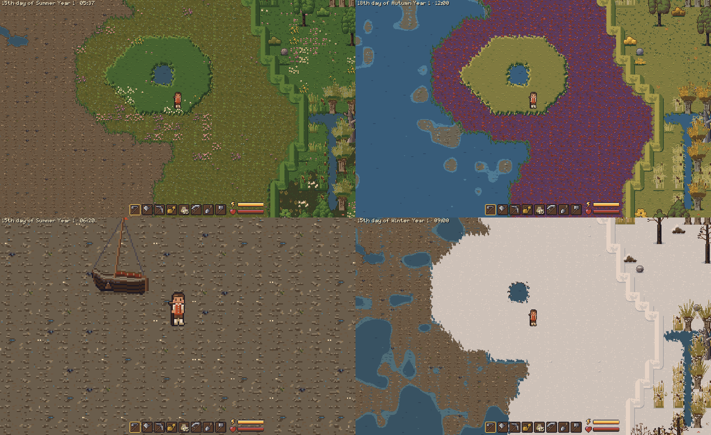

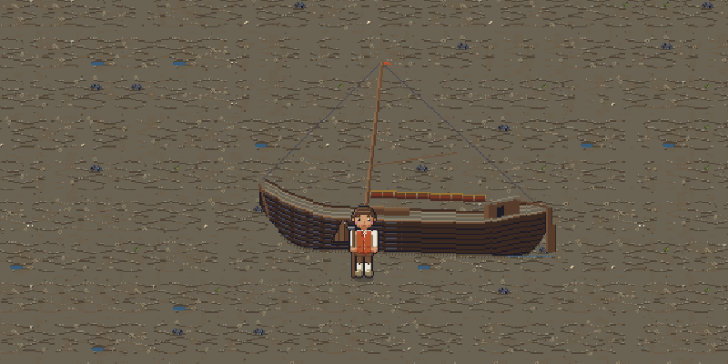

### Weather

The weather is simulated from humidity, wind, temperature and sunlight. It brings rain,
snow, drifting fog, wind, storms and thunderstorms with lightning. The climate is mild:
frost and snow only come in winter, and late winter thaws quickly into spring. The
weather is worked out from the world seed and the time, so the same world always has the
same weather.

The world moves with the wind: trees, bushes, grass, reeds and crops sway, barely on a
calm day and hard in the gusts of a storm; the water ripples and glints, choppier in wind;
the campfire and the hearth burn, their flames licking up and falling back, and throw
sparks; the campfire's flames lean and stretch downwind, more in a strong wind; rain
splashes on the ground; lily pads drift and bob.

In windy autumn weather, and a little in late summer and early winter, the trees near you shed
leaves in the colours of their season: some drop and sway down beside the tree, some are carried
off downwind, tumbling, more in a gust and none in calm. Spruces and pines only drop a rare
needle. The numbers are in `data/leaf_fall.cfg`.


### Day, night and light

The days follow a Nordic year: about 16 hours of daylight in midsummer and 8 in
midwinter, with dawn and dusk following sunrise and sunset. The night is dark: away from a
light you see little more than shapes. When it gets dark, the campfire, the hearth and the lit
windows glow, and clouds dim the daylight. Under a partly clouded sky soft cloud shadows drift
over the ground with the wind, more of them the more cloud there is (a look only: plants and
drying don't care). A setting lets you shrink or switch off the change in
day length. How dark the night gets and when dusk and dawn come is in
[data/lighting.cfg](data/lighting.cfg).

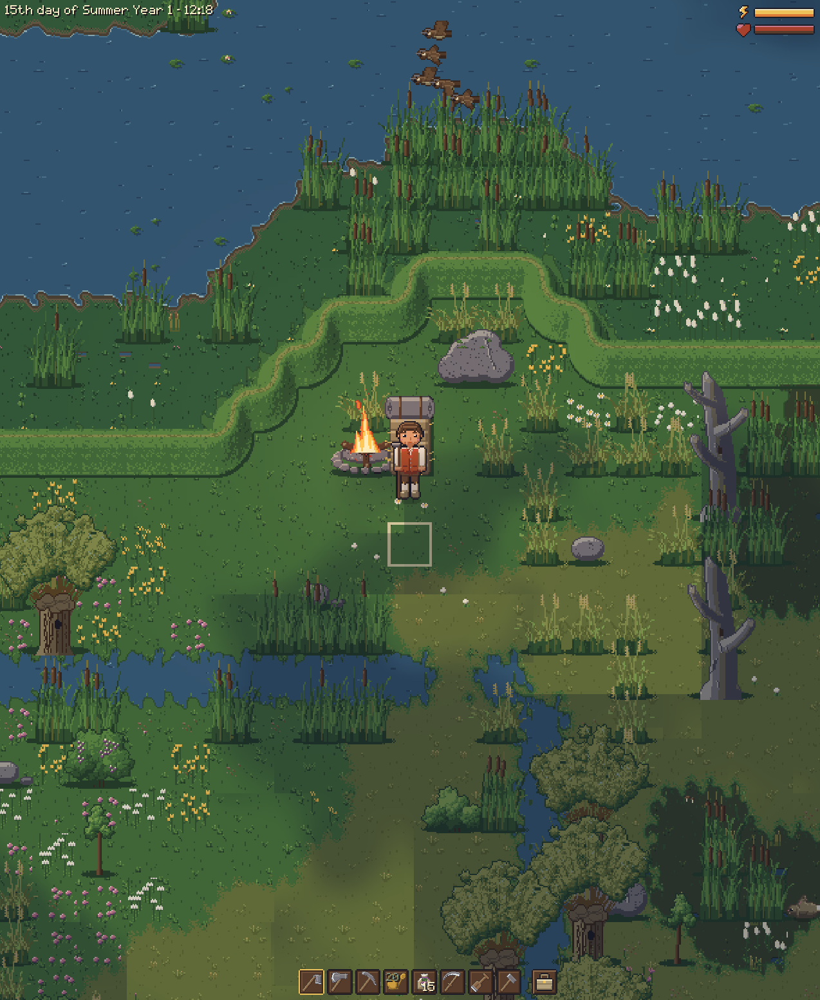


To see in the dark, carry a lantern (for now from the console: `give lantern`). Select it and
press the use key (space) to light it or put it out; lit, it casts a warm, flickering circle of
light around you while you hold it. It needs no fuel.

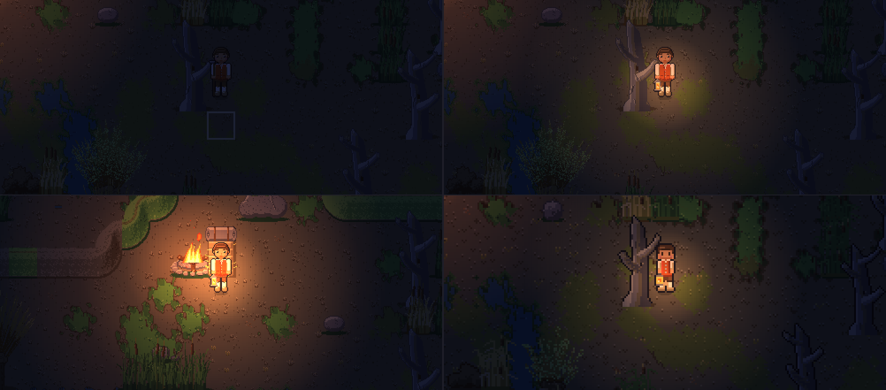

### Farming

You till the soil with the hoe, plant seeds, water them, and pick the crops by hand; a dead
crop is pulled up by hand or hoed away, which leaves tilled soil ready for the next crop; the
tool you hold is in the character's hand. There
are thirteen crops: turnips, potatoes, carrots, cabbage, onions, wheat, rye and buckwheat
(the grains of the sandy Geest, ground to flour like wheat), peas, beans, flax (for its fibre,
not to eat), wild strawberries and small green squashes (pumpkins). Each
grows in its own seasons, and the weather (warmth, rain, frost) speeds it up, slows it
down or damages it. A ripe crop doesn't wait forever: left unpicked for as long as it took
to ripen, it withers and gives nothing. The growing times, seasons and the withering are
in [data/crops.cfg](data/crops.cfg).

A harvest gives each crop's usual amount (carrots, say, 2), with now and then a poor harvest of
one less or a good one of one more (never below 1), and only now and then a seed back, so a field
replanted from its own seeds slowly shrinks: keep a few spare seeds. Each crop's usual amount, the
chances of a poor and of a good harvest and the seed chance are in the same file.


Tilled soil is flat with straight furrows, and the whole tile's brown shows its moisture in four
steps: light brown when dry, darker with rain and the watering can, dark brown when soaked, and
lightening again day by day as the sun and wind dry it. Rain shows at once: after an hour of rain
the soil's wet surface is a step darker, a heavy shower soaks it in two hours, and a rainy hour
never dries it. A bed comes to a pixel or two of its tiles'
edges, ragged and softly rounded at its corners. A sown tile is a mound of dark earth with seeds on
it in the middle of the tile, so it reads as planted before anything shows, and the crops stand
centred on their tiles too. The shots show a row of soil from dry to soaked and sown and growing
crops on it, at noon, in the evening and in the classic art.

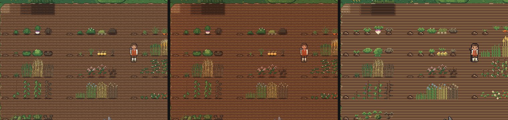

Where a tile is wetter than the tilled soil beside it, as after the watering can, the wet soil is a
patch: its edge wanders in and out across the tiles' edges, blotchy, steps through the browns
between and rounds off at its corners, so a few watered tiles never read as a square block; tiles
as wet as each other show no edge, and the field's rim against the turf stays as it is. The close-up shows
the row from dry to soaked over fresh soil, four times enlarged, in the 32 px and the classic art.

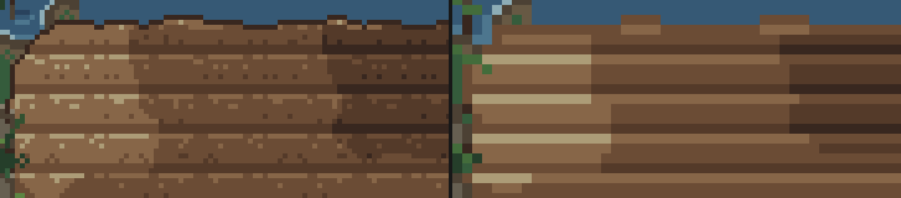

Tilled soil that nobody tends goes back over the days: with nothing on it, after 5 days a few
weeds and tufts of grass come up, and after 10 it is grass again, with the look its place had (the
items lying on it stay). Hoeing the weeds away, sowing, harvesting and watering start the count
anew, and a planted tile never grows over. The days of winter don't count. The numbers are in
[data/crops.cfg](data/crops.cfg). The shot shows a bed left fallow beside one just tilled, in the
32 px and the classic art.

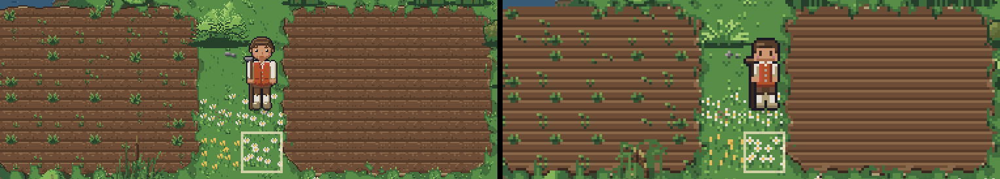

### Livestock

Cows, pigs, sheep, chickens and rabbits of the region: red-brown Angler, black pied and red pied
cattle; bristly pigs of the old breeds, red-brown, sandy, saddleback and spotted; white, grey and
black-faced sheep; brown and white hens, and a rooster for each flock (`spawn rooster` puts one;
he lays no eggs); agouti, white and Dutch rabbits, each with a slight tint of its own. They
wander, graze (the hens peck for seeds and worms), keep out of water and away from anything solid, and the rabbits hop off
when you come close. At night they lie down and sleep until the morning, with a few small "z"s
rising over their heads now and then. For now they come
from the console (`spawn cow 3`); they are saved with the game. Milk and wool come later (see
the farm yard below for eggs, food, water and the pig pen). The numbers are in [data/livestock.cfg](data/livestock.cfg). Like the
people, the animals are drawn at 32 pixels per tile, with legs that bend at the joints, an eye
with a glint and the marks of their coats.


`make screenshot SIZE=1000x560 AT=68,-17 TIME=12:00 ZOOM=1.25 ARGS="--yard=40,-20 --day=45"` (and
with `--classic-art`) puts the hens of the farm yard in view, each cropped to x 35 to 460, y 190 to
360, one above the other and doubled; the hens wander, so each shot looks a little different.

Dogs, cats and horses keep them company: a farm collie, a spitz and a hunting dog; tabby,
black and ginger cats; a heavy marsh horse, nearly three tiles long and taller than you at the
head, in bay, black or grey, and a dun pony. Dogs and cats sniff about, horses graze, and all of them dash off at a run now and
then; cats roam furthest. A dog barks now and then, a cat rarely meows, a horse whinnies or
snorts. Hold a **bone** (`give bone`) and press the use key at a dog in front of you: it takes
the bone and follows you for three game hours, day and night, keeping a tile or two from you
and running to catch up (left more than 15 tiles behind, it turns up at your side; stuck behind a
fence or water, it waits facing you).


Cats hunt the mice. A cat that sees a mouse a few tiles off crouches low with its tail flat,
creeps up on it and pounces; about half the pounces catch the mouse, and the others are seen
coming and the mouse dashes off into cover. Then the cat rests a minute before it hunts again.
Mice are out mostly at dusk and at night, and the cats sleep from a while after sunset, so
dusk is the hunting hour. The numbers are in the `[hunting]` section of
[data/livestock.cfg](data/livestock.cfg).


Horses can be ridden. Hold a **saddle** (`give saddle`) and press the use key at a horse in front
of you to saddle it; the use key with an empty hand takes the saddle off again. Press **E** at a
saddled horse to get on, and E again to get off: you land on free ground beside it, and the
horse stays there. A horse sets off at a walk and trots at twice your walking speed once you
keep riding; it costs no energy and tiredness doesn't slow it. On horseback you can only use
the inventory and the hotbar (dropping things too), and eat: no tools, no building, no
crafting, no doors, and nothing is picked up from the ground. Get off first. A game
saved on horseback loads with you standing beside the horse.


You can pet the cows, horses, sheep, pigs, hens, tame rabbits, dogs and cats: the use key with an empty hand at
the animal (it comes last of what an empty hand does: a saddled horse is unsaddled first, a pen
gate opens, a ripe crop is picked). Each animal keeps a **friendship** with you from 0 to 100,
starting at 0. The first petting of a day while it is awake adds 10 and a small heart floats up
over its head; more that day show and change nothing. Petted while it sleeps, it loses 5 and a
black comic anger mark rises over it, once a day too. Each day you don't pet it takes 5, even over the nights you
sleep through, and it never goes below 0. Nothing uses the friendship yet, but the console's
`friendship` shows it (or sets it, `friendship 80`) for the animal nearest to you. The numbers are
in the `[friendship]` section of [data/livestock.cfg](data/livestock.cfg).


### The farm yard

The watering can holds water: 20 waterings (a new game starts with it full), one for each tile
of soil you wet. Fill it with the use key at a **draw well** (a fieldstone ring under an oak sweep,
made at the workbench with masonry 20 from 12 stone, 3 planks, 2 logs and 2 fibre, and put down
outdoors) or at fresh water: a river, a pond or a ditch, never the sea or the salt marsh. With
an empty can the use key says so and waters nothing. The water in the can is saved and shows as a
small number on the can in the hotbar.

A **trough** (a plank box on two feet, woodworking 10: 5 planks and a log) and a **hay rack**
(oak posts with slats, woodworking 15: 4 planks and 2 logs) stand outdoors on two tiles and hold
a stock of up to 100 units. Their pictures show how full they are: empty, low, half and full.
Fill a trough with the watering can (a pour is 10 units and takes one of the can's 20) and a hay
rack with hay (10 units each) by the use key; a full one takes no more. A **feeding trough** (made
as the trough) holds feed instead of water: hay, turnips, acorns or beech mast, for the pigs and any
that eat feed.

The farm animals get hungry and thirsty as game time passes (a cow takes 12 hours to go from fed
to hungriest, 8 to thirstiest; the numbers are in [data/livestock.cfg](data/livestock.cfg)); the
needs are saved and, for now, have no other effect. A thirsty animal walks to fresh water nearby
(a river, a pond or a ditch; never the sea, the mud flats or the salt marsh) or to a trough with
water, and drinks; a hungry one that eats feed goes to a hay rack or a feeding trough, and those
that graze eat as they graze. Each drink and meal takes a few units from the trough or rack (a cow 5, a hen 3), whose
picture shows what is left. Sleeping counts the meals of the animals that could reach food and
water. `noneeds` in the console stops the needs from rising.

The **chicken coop** (a building: 12 logs and 4 stone, 2x2, low and boarded with a ramp up to the
hens' hatch and a nest box with its lid propped open) is where the hens sleep: at bedtime each hen
within twelve tiles of a coop with a free roost (six to a coop) walks to it and goes in, out of
sight, and comes out in the morning; going in she lays an egg, 7 times in 10, in a nest (a hay
pile of the room inside, four eggs to a nest). Go in and press the use key at a nest with an empty
hand to take the eggs. A night of sleeping or skipping counts the eggs too.

**Pigs** of the old breeds (red-brown, sandy, a black saddleback and a spotted one) root about with
their snouts for most of the day, which feeds them a little, and eat at a feeding trough. Keep them
in a **pig pen**: make pen fences (a log splits into two), a pen gate and a pig shelter at the
workbench and put them down piece by piece round a few tiles, with a trough and a feeding trough
inside. The fence joins up as you lay it. You walk through the gate whether it is shut or open; the
animals only through an open one, so a pen with its gate shut keeps its pigs in, whatever they
look for and however long you sleep. The use key with an empty hand opens and shuts the gate.


`make screenshot SIZE=1120x500 AT=73,-6 TIME=12:00 ZOOM=1.25 ARGS="--yard=40,-20 --day=45"` (and
with `--classic-art`) puts the pen in view, each cropped to its left 700 px.


`make screenshot SIZE=1000x700 AT=69,-15 TIME=12:00 ZOOM=0.75 ARGS="--yard=40,-20 --day=45"` puts
it in view (`--yard` also shows the stations and the lines across the land, 22 tiles west of it).

### Villagers

The first people of the coast: villagers dressed in the clothes of the period, the men in
knee breeches, waistcoats and felt hats, tricornes or red and white stocking caps, the women
in long skirts, laced bodices, white, blue or striped aprons, shawls and white coifs or
headscarves, each with a skin, hair and clothes of their own and a North Frisian or Low
German name (Antje Boysen, Momme Ketels). Like you they are drawn at 32 px per tile, with
faces, buttons, stockings and clogs, and stand on a small shadow. They keep to within about
six tiles of the house or campfire nearest to where they came, stand about and stroll by day
and stand still at night; you walk through them, so they never shut you in. For now they come
from the console; they are saved with the game.

They all live in Wehlsbüll, a made-up marsh parish two hours north of Husum in 1750, which
[data/village.cfg](data/village.cfg) describes as everyone there knows it: the church, the Krug,
the mill, the dyke and its sluice, the Koog, the creeks and the Geest; who is who (Pastor
Johann Martens, the Deichgraf Peter Momsen, the Deichvogt Brar Feddersen, the innkeeper, the
Amtmann at Husum); prices in Schilling and Mark; this year's news (the cattle plague, the dyke
broken last autumn); the church year; and what people of the time know of the world (the Danish
king, the Duke of Gottorf, who speaks what).

Each villager has a sheet: age, trade, personality, background, home, how they speak (a manner,
so it holds in any language), lines in their voice, their family and friends with what they
think of each, likes, wants, their day, what they don't know or won't talk about, and a secret or
two. Eight are written by hand in [data/villagers.cfg](data/villagers.cfg), two families and
their friends, and come with `spawn npc <id>`: `antje` (Antje Boysen, a farmer's wife),
`hinrich` (her husband) and `boy` (their son), `momme` (Momme Ketels, a fisherman of the tidal
creeks) and `inken` (his daughter, Boy's sweetheart), `ocke` (Ocke Hansen, the miller) and
`gesche` (his wife, Antje's friend), and `kerrin` (Kerrin Paulsen, the late Deichvogt's widow,
Gesche's aunt, who lived through the Christmas flood of 1717). Everyone a sheet names as kin or
close friend is one of them, and the sheets agree with each other (a test checks that each names
the other back, the ages and the homes). Edit their sheets freely: a saved game takes them from
the file each time it loads. `spawn npc 3` makes villagers up, with a sheet drawn
from the tables of [data/npcs.cfg](data/npcs.cfg) once and kept: newcomers and people of the
outlying farms, kin to none of the families.

Face a villager and press E to talk: the name over their head shows whom E speaks to. The
chat is laid out like a messenger: the villager's portrait on the left and yours on the
right, and between them the talk as bubbles, the villager's on the left under their name,
yours on the right, each with the game time in its corner; a "..." bubble shows the villager
is still answering. The chat never outgrows the window, also at a larger UI scale: it gets
narrower and shorter and the lines wrap. Type a line and press Enter; Escape leaves. The game
stands still while you talk. A villager keeps the latest lines of your chat (24 by default, set under
Settings → Language model) for the next time, so a reopened chat goes on where it left off;
the older lines are summed up in one remembered line (by the model, else it is what you
said), and later talks build on it. Type `/clear` in a chat to make that villager forget
the chat and their memories (for debugging). With a language model set under Settings →
Language model (see [Talking NPCs](#talking-npcs-with-a-language-model)) villagers answer
in their own words; without one they say short scripted lines ("Aye.", "Is that so?").
While one villager is still answering you may leave and talk to another; the answer waits
in the first one's chat.

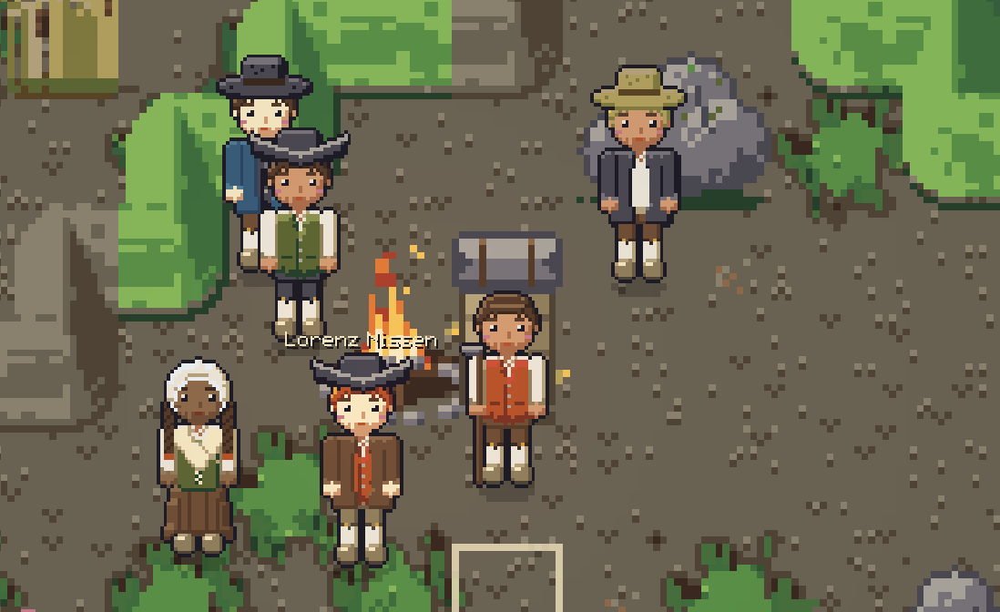

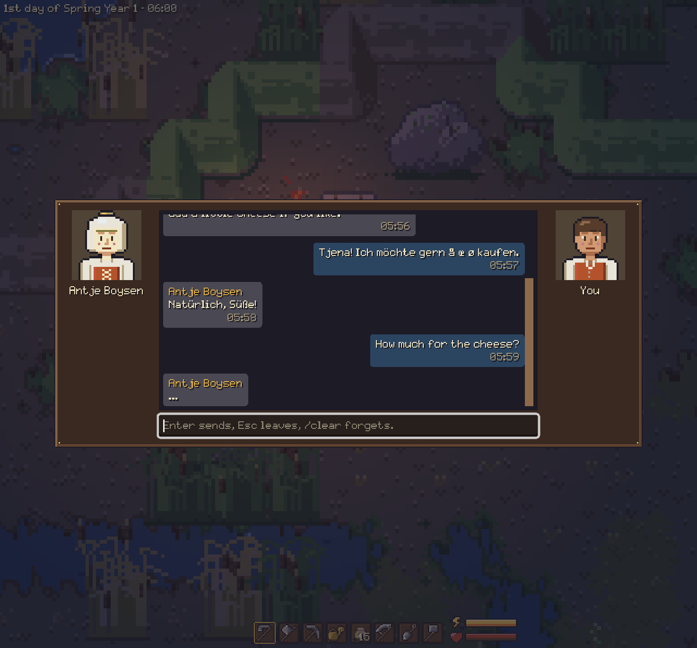

The pixel font has the Latin-1 letters (ä ö ü ß å æ ø é ç ñ ...), the Latin Extended-A letters
of the neighbours' languages (Polish, Czech, Turkish and others) and the typographic quotes,
dashes and « » ¿ ¡ …, so the villagers' German, Danish and Dutch show as written.

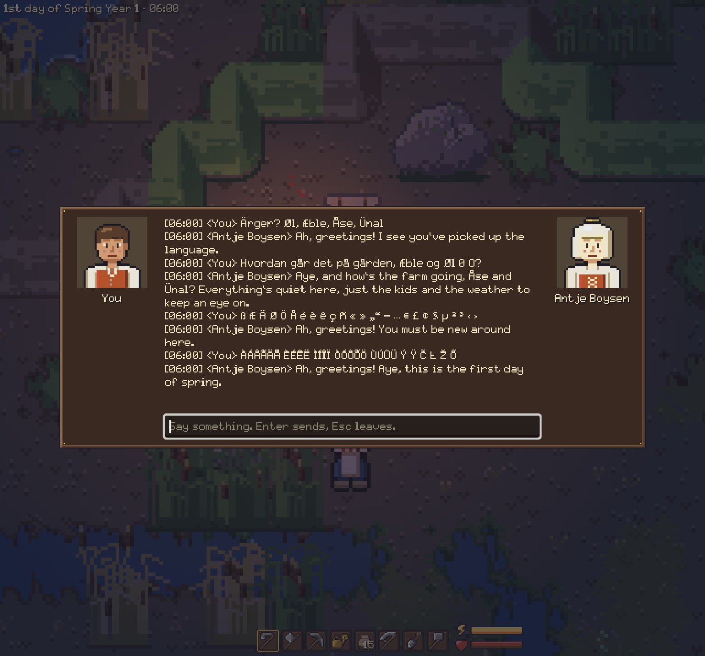

### Wildlife

Birds hop and peck on open ground and small flocks cross the sky: south in autumn, north in
spring, any way in summer and not at all in winter. Rabbits graze the meadows, squirrels dart
between the trees, roe deer come out at the edge of the woods at dawn and dusk, and bees and
butterflies keep to the flowers. On the marsh and the wet meadows white
storks hunt in spring and summer, stepping slowly with the head down; they come to stand on
the roofs of the houses, clatter their bills now and then and fly off on slow wingbeats.
Some houses (about four in ten of the kates, longhouses, hall houses and barns, by where they
stand) carry a stork's nest on the ridge. It is empty in winter; in early spring a pair flies in
and clatters on it, in late spring the young hatch, grey heads over the rim that grow larger and
whiter through the summer while the parents fly off to the meadows and back, in late summer the
grown young stand on the rim and flap and leave one by one, and in autumn the nest is empty
again. Each nest has its own days, so they are not in step.
In autumn and winter flocks of greylag geese graze the marsh and the floodplain, raise their
heads when you come near and take off together, and skeins of them fly over in a V, south in
autumn and north in spring, as the flocks of small birds do. Mice
live by the fields, the Knicks, the walls and the houses, out mostly at dusk and at night, and
dash off into cover when you come close; frogs sit and hop at the water's edge and on the wet
meadows from spring to early autumn, and a hunting stork that sees one walks up to it,
strikes and swallows it; the cats hunt the mice (see [Livestock](#livestock)). On the coast
oystercatchers in black and white probe the tidal mud all year, and tight flocks of dunlin in
the spring and autumn migration, swinging round together when you come near; herring gulls
walk and peck on the mud and swim on the sea, and in summer common terns fish over the
tideways, hovering and plunging in with a splash. When the tide comes in the waders leave the
mud and the gulls swim where they stood. On warm, calm, dry summer evenings fireflies
drift over the meadows by the trees, the Knicks and the water from dusk until a few hours after
sunset, each blinking its own light on and off. Wild animals never stand on a building, the door
included, and apart from the mice they don't appear near houses or villagers and run from
villagers as they do from you. The animals come and go around you by the season, the time of day
and the weather; the numbers are in [data/wildlife.cfg](data/wildlife.cfg).


### Felling, mining and gathering

Use the axe on trees and the pickaxe on stones and boulders. A better tool needs fewer
hits, and some resources need a better tool. Every tool comes in five grades, rusty iron
(the ones you start with), iron, brittle steel, steel and sharp steel, drawn in their metal. A
better grade needs fewer hits and tires you less with every use, and the pine and the boulders
need at least an iron axe or pickaxe. A Roman numeral from I (rusty iron) to V (sharp steel) at
the bottom left of the tool's slot tells the grade. For now you can only get the grades from the
console (`give iron_axe`, `give sharp_steel_hoe`); the numbers are in `data/tools.cfg`. Everything
you hit trembles and throws leaves, snow or splinters. A felled tree topples to the side and leaves a stump and a
trunk (a dead tree a grey, splintered one); cut both into logs. A stump left alone rots
away over about two weeks and may sprout a sapling of its kind (not a dead tree's), and
now and then a tree drops a seed (an acorn, a beechnut, a catkin or a cone) you can plant
on grassland. Stones and boulders break into pieces of stone; a boulder needs a better
pickaxe.

The scythe mows tall grass into hay and cuts reeds on river banks (reeds grow back in
their season). The shovel digs clay, but only where a faint patch on the ground hints at
it. Berry bushes bear fruit again a few days after picking, and shrubs and ferns give
fibre. The shovel also digs a berry bush, a shrub or a fern out whole in a few hits (fewer
with a better shovel); plant it on free grass elsewhere with the use key, and it is the same
bush again (a replanted berry bush bears after its regrowth days).

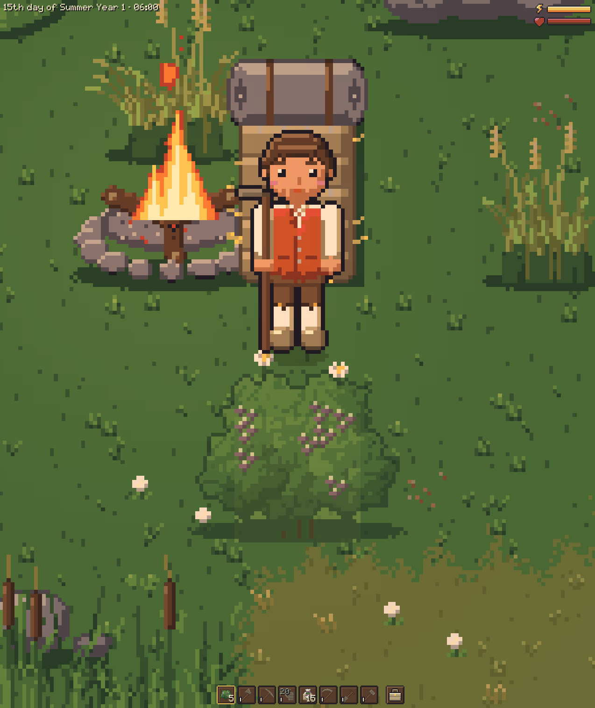

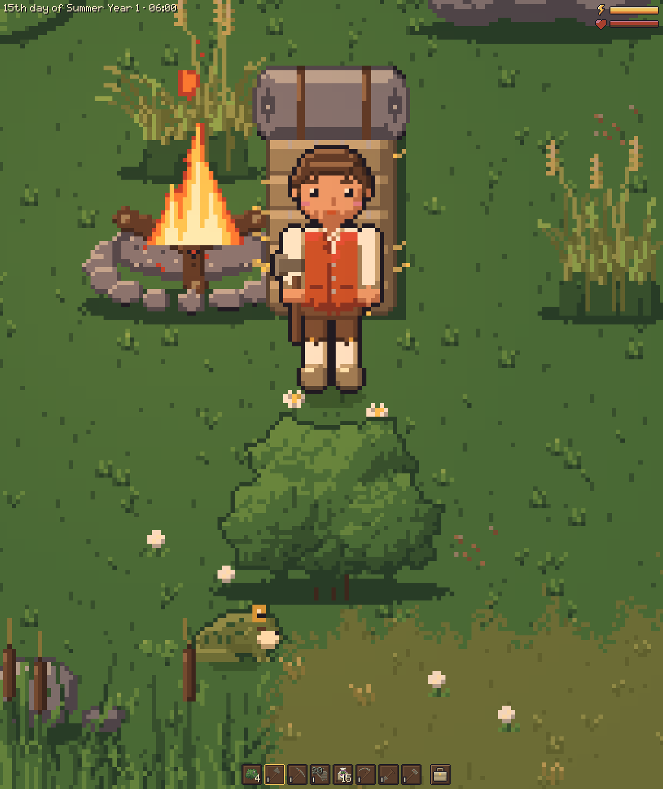

In the classic art: [the ghost](docs/screenshots/bush-ghost-classic.png) and [the planted
bush](docs/screenshots/bush-replanted-classic.png).

What you gather hops out onto the ground: logs, stone, clay, hay, reeds, seeds and produce
lie there until you walk over them and pick them up.

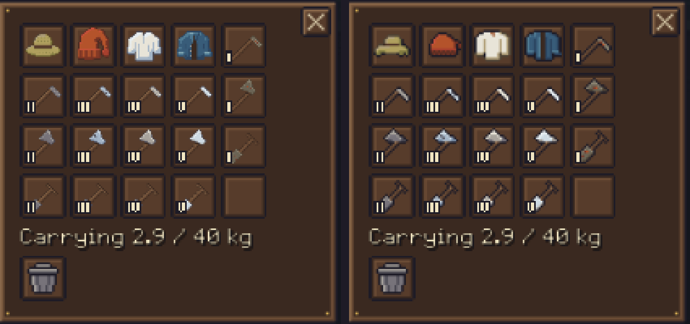


### Build anywhere

Take the hammer from the hotbar (its slot key or the mouse wheel; B is the bag now) and the build menu opens just above the
hotbar: a row of the buildings, each with a small picture and its name (shack, fisherman's hut,
Kate, longhouse, hall house, barn, church, bell frame and chicken coop). Pick one with Q and E, the left and
right arrows or a click; a building that comes in more styles shows them in a column above it
(the Kate: a brick Kate and a Geest Kate), which the up and down arrows or a click pick. Beside
it a larger picture of your choice lists the logs, stone, clay and reeds it takes against what
you carry. While the menu is open the arrows belong to it and you walk with WASD; Escape closes
it. A row wider than the window scrolls sideways (drag its bar; your choice always stays in
view, and the mouse wheel still steps through the hotbar). A ghost of the building follows the
mouse; the spot is refused while something is missing, and a click or Space builds it and
takes the materials. The ghost shows where it fits, and a note beside the mouse pointer tells
you why a spot doesn't work, for example when it is unsafe wetland. Hold something else (or press Escape or right click) to stop building. You can walk
inside every building but the bell frame, and each has its own room: a bare shack with a straw
mat on a clay floor, a cottage room in the Kate, the longhouse with a living end and an animal
end, the hall house with its long Diele between the stalls and the Flett with the hearth at its
end, the barn with stalls and hay, and the church with its pews and altar. The rooms are
furnished like 18th-century farmhouses of the coast: brick floors in the living rooms and beaten
clay in the work rooms, an open hearth under a smoke hood with Dutch tiles behind the fire,
plate racks with Delft and pewter, a wall bench and box beds with curtains. The last bed you
slept in becomes your home. A new game starts at the camp with your tools and the hammer, so the
materials for the first house have to be gathered first. The buildings, their sizes, costs and
insides are in [data/buildings.cfg](data/buildings.cfg).

The buildings follow the reed-thatched farmhouses of Denmark and northern Germany: the Kate
with white lime walls, a split door and braced teal shutters (or, as the brick Kate, red brick
with green paint and a brick chimney, or as the Geest Kate, lime over a foot tarred black
under a turf ridge), the brick longhouse with its
arched door on the long side, the
half-timbered barn, and the shack: tarred black boards under a turf roof, which greens in
spring, browns in autumn and winter and lies under snow like the thatch. The biggest is the
Low German hall house of Holstein: its half-timbered gable to the front with red brick in
herringbone, the big arched barn door (the Grote Door), the owl hole under a little hip and
white bargeboards crossing in a pair of horse heads, under a huge thatch. The doors are
tall enough for the people to walk through, and the thatch lies in courses with hanging reed
ends, moss and a rolled edge at the eaves.
It is also the dearest: 100 logs, 40 stone, 50 clay and 80 reeds (the shack takes 20 logs
and 5 stone, the Kate 30, 15, 15 and 25).

The fisherman's hut is the shack's kin at the water: tarred boards under a reed thatch with a
turf ridge (25 logs, 5 stone, 15 reeds). Its landing is laid piece by piece: a plank jetty on
oak piles over the water or the mud, which you walk out on, joined up as you lay it and with
mooring posts at its head (a piece takes 3 planks and a log at the workbench); a flat rowing
boat to lie beside it (10 planks, 4 fibre); and, made by hand, a net frame with a tarred net
hung to dry (2 logs, 8 fibre) and wicker eel traps (4 reeds, 1 fibre).

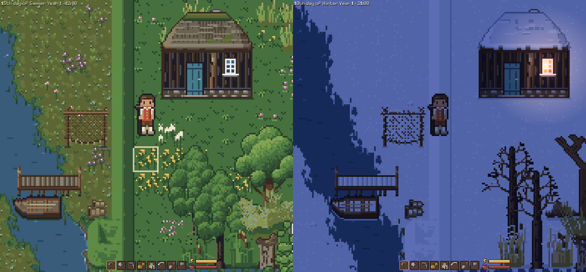

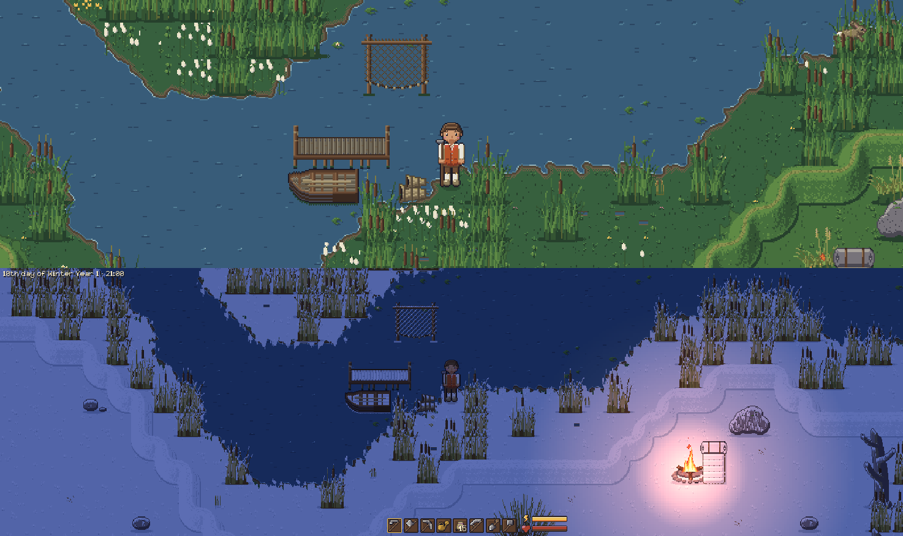


The village church follows the small marsh churches of North Frisia: a nave of grey-brown tuff
with a lower chancel, steep red pantile roofs, small arched windows of leaded glass that light
at night, and a white porch on the south side with the door (70 logs, 35 stone, 45 clay).
These parishes had no tower; the bell hangs in a wooden bell frame of its own, an oak frame
on a brick base under a shingled pyramid, which nobody goes into. Stand within a tile of it and
press E, or click on it, to ring the bell: it swings in its frame for a few seconds (in both arts),
and a bronze strike rings on for ten seconds, heard far across the marsh (and faintly from inside
a house); ring again and the strikes add up (up to three sound at once; a fourth cuts off the oldest) while
the swing starts anew from where the bell is. E leaves the bell to a bed in reach (it sleeps), and a
click while holding food eats it instead of ringing. Nothing else happens yet. For the churchyard, the
workbench makes grave markers (2 planks, 2 stone), which stand outdoors as an oak cross.

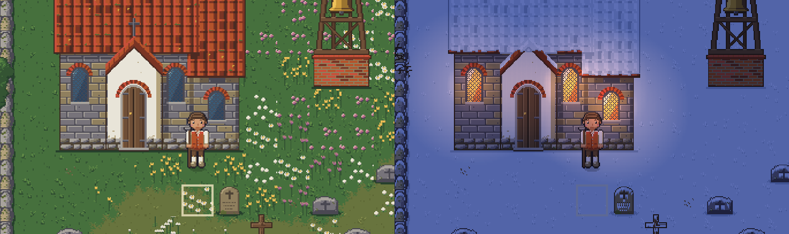


Press X with the hammer in hand to switch from building to taking down: the menu gives way to
a panel at the top left that reads
"Taking down", the tile under the mouse gets a red frame, and the building or the thing you
placed (a chest, a workbench, a kiln) under it is tinted red, with a message of what it gives.
Hold Space or the click for a second to take it down. A building gives back half of each
material, rounded down, in front of its door; the furniture it came with goes with it. It
stands while you are inside, or while anything you put in it is left (the message says so).
If your bed was in it, your home goes back to the spot of the camp's bedroll: you wake in it if
it still lies there, else at the world's start point. A placed thing goes into the
inventory whole, with what it holds, or onto the ground when the inventory is full. The
camp's campfire and bedroll are taken down the same way and come back as items to set up
elsewhere (the home bed follows a bedroll you set up when your own is gone; with no bed at
all you wake at the world's start point, where a new game begins, decided 2026-11-09). Held
like a chest, the bedroll shows its ghost where it fits. X again goes back to building.

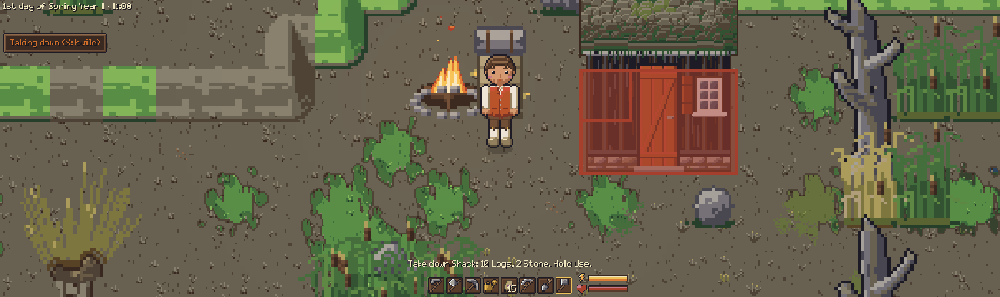

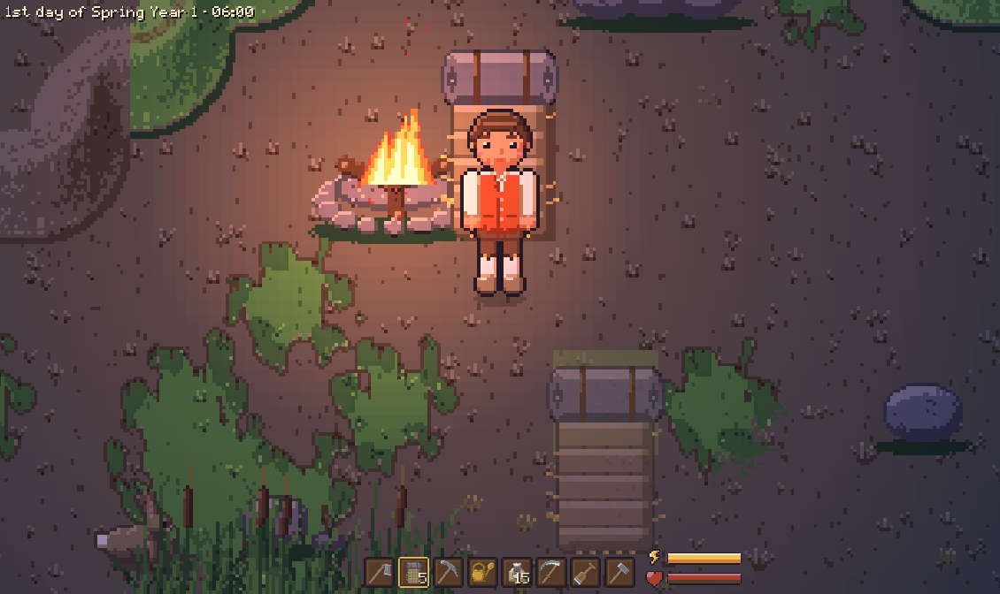

### Character, inventory and equipment

The character is drawn in layers, so anything they wear shows in the world. They dress as
on the North Sea coast in the 18th century: a red waistcoat over a linen shirt, knee breeches
with white stockings, wooden clogs, and a short blue jacket and hats to put on. Press B (or click the bag icon
beside the hotbar) to open the bag with the backpack, and C to open the character window with
the figure and the equipment slots. You move items between slots by dragging, and wear or take
off by right click. The two are windows of their own, the character window in the middle of the screen and the bag
at the bottom right above the hotbar, and they can be open at the same time, each closed by its own
key (Escape closes both; you keep playing meanwhile, walking and using the hotbar and tools as
usual, and a click outside the windows goes to the world; in a very small window or at a large UI
scale they do not fit side by side, and opening one closes the other): drag an item from the
backpack or the hotbar (which both windows keep lit) onto its equipment slot in the character window
to wear it, drag worn gear back into the bag to take it off, or use a right click. The hotbar (the
eight slots at the bottom of the screen, keys 1 to 8) holds your tools
and seeds and is extra room: it takes nothing from the backpack's 20 slots (4 rows of 5), so
you carry 28 stacks. New items fill the hotbar first (onto the same item, then free slots,
except the one in your hand), then the backpack. The screen shows the backpack
and the hotbar stays lit at the bottom, where you use it as the quick bar: drag an item with
the mouse onto a slot of the backpack, the hotbar or the equipment to put it there (it follows
the mouse only while you hold the button; a click alone picks nothing up). A different item in
that slot swaps places, the same item stacks, and a stack let go anywhere else goes back.
Shift+click sends a whole stack from the backpack to the hotbar and back (onto the same item first, if there is
room). Let go of a dragged stack outside the screen, or press T for the held stack, and it lies
on the ground in front of you; walk away and back to pick it up again (a game saved right
after a drop picks the pile up when it loads). This works inside a house too: the items lie on its
floor (never on a wall, in the way of furniture or on the doormat), are picked up the same way and
stay there when you leave and come back.
Every window has a small cross in its top right corner; it, and a click on the dimmed area
outside the window, do what Escape does.

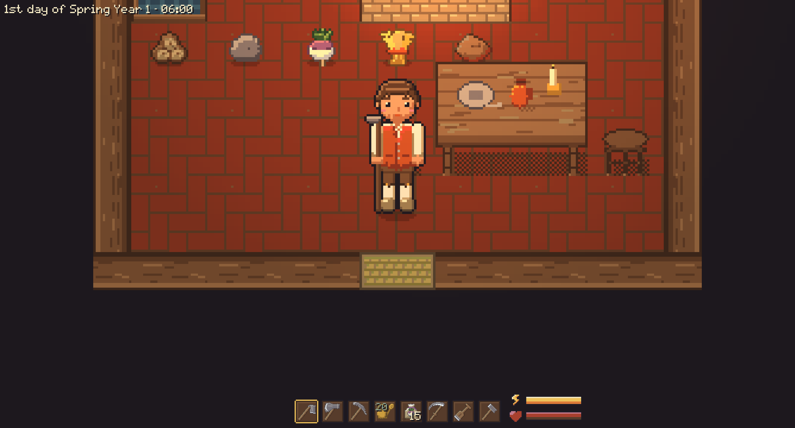

To get rid of a stack for good, drag it onto the
trash can (the bin slot under the backpack and on the chest's screen): the game asks "Destroy
Logs (12)?" and Destroy removes the stack; Keep, Escape or a click elsewhere leaves it where it was,
and Escape does not close the screen while the question is up. A hotbar stack can be thrown away the
same way; a worn item is taken off into the backpack first.
Windows (crafting, chest, bag, character, chat) can be dragged aside by their frame, to see the
game behind them (buttons, slots and the rows of a list are not handles; the empty area of a list
and the gaps between rows are). They stay on the screen and open in the middle again each time.
The pause menu, the settings and the questions stay where they are. Energy and health bars in the top right corner track how tired you are,
and the more you carry, the more each action costs: up to 40 kg is free (the bag shows "Carrying x / 40 kg"; Strength raises the 40), and tools weigh
nothing. Below 20 % energy the character sweats with every action, and below 10 % even more. A "zzz" thought bubble pops up over the
head at midnight and again at half past, while you are still awake: you pass out an hour
after midnight.

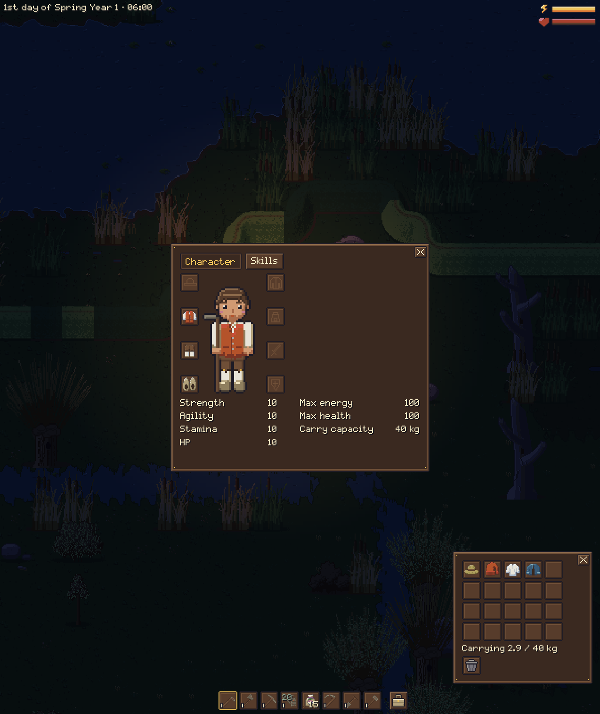


The items are drawn at 32 px like the world, so in the slots an icon's pixel is as big as a
world pixel at the widest view; an item on the ground is its icon at half size, on a small
shadow.

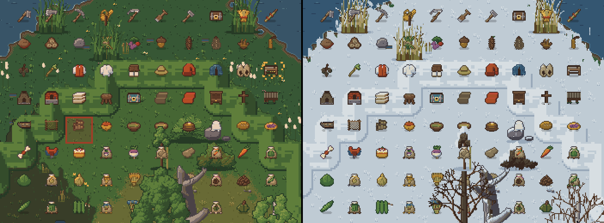

### Sleeping and passing out

Press E next to a bed to sleep: the screen fades to black, shows the new day and wakes you
at 06:30 the next morning (or the same morning, if it is already past midnight). A bed fills
your energy and health, and the last one you slept in is home.

Don't run out of energy, and don't stay up past 01:00: you sink to your knees, tip over and
fall asleep where you stand. You sleep until 06:30 but at least ten hours, and wake in your
home bed, still worn out for the rest of that day: walking slowly, with low health and half
your energy. A message says what happened before the morning fades in.


After sleeping or passing out you wake lying in the middle of the bed, head on the pillow
and under the blanket (also on the bedroll at the camp), and get up with your first step.
Beds don't block walking, so you can't get stuck behind one.


### Crafting and professions

Press Shift+C for the crafting menu (C is the character window's) of what you make by hand: a chest, a campfire (6 stone, 3 logs),
a bedroll (6 hay, 4 fibre), the stations below, flour (from wheat, rye or buckwheat) and a **piece of
dry stone wall** (3 stone, masonry 5). A **wattle fence** (half a log and 2 fibre a piece, two pieces
to a craft, woodworking 5) is made at the workbench. Both are put down tile by tile like a pen fence,
and join each other and the walls and fences the land is laid out with; the axe takes a wattle
fence down for its 2 fibre and the pickaxe a wall for its 3 stone, never more than they cost.
It lists what you can make with what you carry; a recipe you can't afford yet is greyed, with
the missing materials marked, and hovering shows what is missing. With a full inventory a craft still goes ahead: what does not fit is dropped at your feet, and the menu says so. A long list scrolls (mouse
wheel, the bar, or the arrow keys) instead of outgrowing the window. The recipes are in
[data/recipes.cfg](data/recipes.cfg).


Three crafts can be learnt, each at its own **station**: press E at one for its menu.

- **Cooking** at the hearth of a house or the camp's fire (anyone can roast a turnip; buckwheat
  pancakes, pottage and pea soup take practice) and at the **bake oven** (bread from flour in an hour, a berry tart,
  a feast cake). Cooked food gives more energy than what it is made of, eaten raw.
- **Woodworking** at the **workbench**: planks, a stool for the house, a grave marker for the
  churchyard, clogs, a painted Frisian chest with 20 slots, and as the master's piece a
  joined cupboard with 25.
- **Masonry**: clay is moulded into raw bricks at the workbench and fired in the **kiln**,
  6 raw bricks and 2 logs a load. A skilled mason gets more bricks from the same fire: a
  quarter more from masonry 50, half again from 70. The bake oven is built of those bricks.

The kiln and the bake oven are **process stations**: E opens a window with their recipes on the
left, a 3x3 grid in the middle and your bag on the right. Put in what a recipe takes, by
dragging or Shift+click, or click a recipe to move its materials for the amount below it (type
it, or use -, + and Max). Only what fits a recipe goes in: once the oven holds berries, the
bread is ruled out, and the recipes and bag items that can't go in now are greyed. The
fire button starts the run when the grid holds whole loads of a recipe (otherwise it says what
is missing); the run takes the recipe's hours (12 for bricks, an hour for bread) while a bar
fills over the locked grid, and goes on while you are away. Then the grid holds what was made:
take it out like from a chest. Nothing new goes in until all of it is out. The logs are just
one of the materials, the fuel.

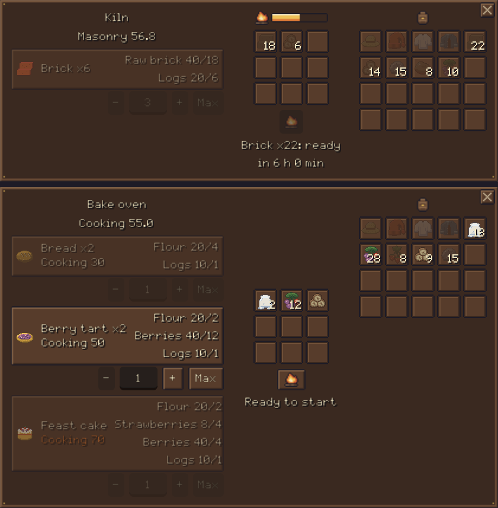

A recipe is only made at a station of its kind within your reach: planks are not made at the
campfire ("Made at the Workbench"), and the game refuses a craft at a station that is
out of reach or not on your map, whoever asks.

The workbench, kiln and bake oven are made by hand and placed like a chest (the kiln only
outdoors); the axe or the pickaxe takes them down again.

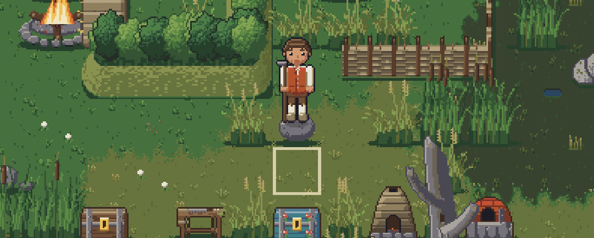

Crafting raises the recipe's skill: the most at the recipe's level, less the further you are
above it, nothing from a recipe 40 points below you. Better recipes need a skill level (the
master recipe of each craft 70, which teaches it to 100); the
menu shows them greyed with the level they need, and the tooltip what a craft teaches.

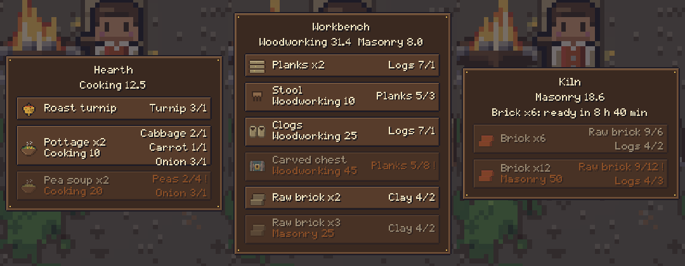

Each skill goes up to 100, but all of them together only to 200: one craft at the top and
two at half, or three around two thirds. Press K for the skills tab of the character window.
At 200, a skill only grows by taking points from one you marked **Fade** there; nothing
fades on its own. The skills are in [data/skills.cfg](data/skills.cfg), the stations in
[data/stations.cfg](data/stations.cfg).

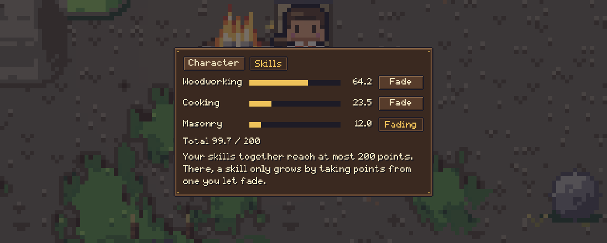

### Chests

Hold a chest and a ghost shows where it would go: green where it fits, red where it
doesn't (not on water, wetland or floodplain, not on something else, not in front of a
door). Use it to place the chest, outdoors or inside a house. Press E in front of a chest
to open it: your backpack is on the left (the hotbar below stays usable) and the chest's 15
slots (20 in a carved chest) on the right. Drag an item onto a slot to move it, or
Shift+click to send a whole stack across (from the chest it goes to the backpack first, so the
hotbar isn't flooded). Drag a stack of either side onto the trash can under the backpack
to destroy it, after the same question. A chest too big for the window scrolls its slots (mouse wheel or bar). The
axe takes a chest down: outdoors what it held spills onto the ground, inside a house the
chest and its contents go into your inventory (or you are told there is no room).


### Settings and controls

You can rebind every key, including mouse buttons. You can also switch between fullscreen
and windowed, scale the UI from 0.5× to 2× without touching the world view, and set the
energy drain, the day length variation and how often the game saves by itself (every 10 to
60 minutes of play), cap the frame rate (10 to 240 in steps of 10, or no limit; it starts at 60, so
the processor stays cool), and set the language model villagers talk through. Hover over a setting, a
key or an item in the hotbar, inventory or equipment for a short explanation: an item's kind,
weight, what food gives back, what seeds grow and where they are planted. The game starts at its widest view,
1280×720 art pixels (40×22 tiles of 32×32, an art pixel is 1.5 screen pixels on a 1080p
screen); `=` and `-` (also the keypad's + and −) or Ctrl and the mouse wheel zoom smoothly in
to 4× that, 320×180 art pixels. The wheel alone steps through the hotbar.


The art is being redrawn at 32 px per tile, group by group. Settings → Display → Art, or F7
while playing, switches between the new art and the classic art, the 16 px art it replaces
(doubled); so far the people, the farm and the wild animals, the flames, the ground, the
plants, the buildings and the interiors have both. Everything not redrawn yet looks the same in
both.

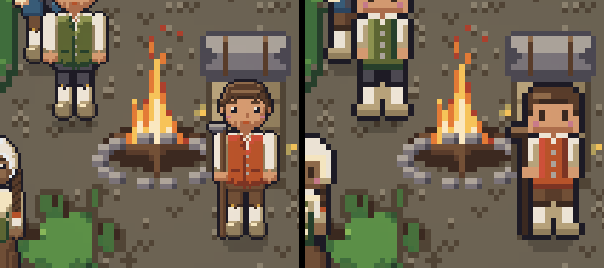


### Console

Press `/` to open a console for testing and cheats. Tab completes commands and their
arguments. The log scrolls with the mouse wheel and its bar, and with Page Up and Page Down;
it keeps the newest 500 lines and follows new output unless you scrolled up to read.

| Command | What it does |
|---|---|
| `help`, `help <command>` | List the commands, or show what one takes (the names it accepts too). |
| `tp <x> <y>` | Teleport to a world tile; from inside a house you step out there (F3 shows your coordinates). |
| `reset` | Put yourself in your bed, the one you wake in, inside or out. |
| `give <item> [count]` | Put items in the inventory (e.g. `give bone` for a dog, `give saddle` for a horse, `give steel_pickaxe` for a tool of the fourth grade: `rusty_iron_`, `iron_`, `brittle_steel_`, `steel_` or `sharp_steel_` and the tool). |
| `god`, `nodrain`, `noweight`, `nocost`, `nolate` | Toggle invincibility, free actions, weight costing nothing, buildings and crafting needing no materials, and staying up past 01:00 passing no one out (no late warnings either). |
| `noneeds` | Toggle the farm animals' hunger and thirst standing still (they rise with game time otherwise). |
| `freeze` | Toggle time standing still: the clock, the day, the crops and the weather wait; you and the animals still move. `skip`, sleeping and passing out still move time on (the animals and villagers move on with it, as below). |
| `noclip` | Toggle walking through anything: water, trees, rocks, buildings, furniture (indoors within the room, outdoors on loaded ground). Turned off where you don't fit, it puts you on the nearest free ground. |
| `weather`, `weather <condition>`, `weather auto` | Show the weather, force a condition, or go back to the simulation. |
| `snow`, `snow <0..1>`, `snow auto` | Show the snow cover, force it, or go back to the weather. |
| `spawn npc [count]` | Put villagers nearby, each with a look, a name and a sheet of their own; they stay. |
| `spawn [npc] <villager>` | Put a villager written by hand nearby (`spawn kerrin` or `spawn npc kerrin`): `antje`, `momme`, `ocke`, `kerrin`, `hinrich`, `boy`, `inken` or `gesche`; each comes once. |
| `spawn <animal> [count]` | Put animals nearby: farm animals that stay (`cow`, `sheep`, `chicken`, `rabbit`, `dog`, `cat`, `horse`) or wild ones that come and go (`bird`, `wild_rabbit`, `squirrel`, `deer`, `bee`, `butterfly`, `flock`, `stork`, `roof_stork` on the nearest roof, `geese` grazing, `flying_geese`, `mouse`, `frog`, and on the coast `oystercatcher`, `dunlin`, `gull`, `tern`). `spawn` alone, or with an unknown name, lists them. |
| `killall <animal>` | Remove every animal of that kind (the kinds of `spawn`) from the game and from the save, and say how many. Wild animals are not saved, so only those alive now go and more may come by the usual rules. A horse you ride is not removed: get off first. |
| `killall npc <id>` | Remove that named villager (`killall antje` works too), with their chat and memories, from the game and the save. |
| `killall npc` | Remove every villager without an id (the made-up ones of `spawn npc`) and say how many; the named villagers stay and need `killall npc <id>`. |
| `skip <n>m\|h\|d` | Let minutes, hours or days pass, e.g. `skip 2h` or `skip 3d`. Only the world moves on: crops, soil, weather, kilns, animals, villagers and the wildlife follow, your energy, tiredness, debuff and position stay as they are. |
| `crop` | Show the growth, damage and needs of the nearest crop. |
| `skill <skill> <points>` | Set a skill's points (`woodworking`, `cooking`, `masonry`). |
| `attribute <attribute> <level>` | Set an attribute's level (`strength`, `agility`, `stamina`, `hp`; 1 to 100) and show the maximum energy, maximum health and carry capacity it leaves. |
| `play <track>` | Play a piece of music in a loop: `sketch_tide`, `sketch_harbour` or `test_reel`, also by the name without the prefix (`play tide`). The piece is rendered first (the log says `Rendering...`, then `Playing ...`), so the game doesn't stall; another piece crossfades from the first on the beat. An unknown name lists the tracks. Nothing plays unless you ask; the volume is Settings → Audio → Music. |
| `stop` | Fade the music out. |


## Controls

These are the default keys; all of them can be changed under Settings → Controls.

| Key | Action |
|---|---|
| WASD or arrow keys | Walk (with the hammer building, only WASD: the arrows pick in the build menu until Escape) |
| Space or left click | Use the held item on the targeted tile |
| 1–8 | Pick a hotbar slot; the hammer's slot starts build mode, and a hotbar key or the mouse wheel takes build mode up again after Escape or a right click |
| Left mouse button, dragged | In the bag, character and chest windows: move a stack onto a slot, the trash can (not in the character window), or (let go outside the screen) the ground |
| Shift + left click, right click | In the bag, character and chest windows: send a stack to the other side; in the bag and character window right click wears or takes off an item |
| T | Drop the held stack on the ground in front of you (picked up again by walking away and back) |
| B, or click the bag icon beside the hotbar | The bag: the backpack (bottom right, beside the character window; the same key closes it) |
| C | The character window: the figure and the equipment (the same key closes it) |
| K | Skills tab of the character window |
| Shift + C | Crafting menu (by hand) |
| E | Get off the horse you ride; else talk to the villager in front of you, else get on the saddled horse in front of you, else open the chest or the station (its crafting menu) in front of you, else sleep until morning (next to a bed); with the hammer in hand it picks the next building |
| Enter, Escape | In a chat: send the line, leave the chat (Page Up and Down scroll back); `/clear` makes the villager forget the chat |
| X | Switch the hammer between building and taking down (hold Space or click to take down) |
| Q, E or left and right arrows | Previous and next building (while holding the hammer) |
| Up and down arrows | The building's next and previous style (while holding the hammer) |
| Mouse wheel | Next or previous hotbar slot |
| `=`, `-` (also keypad + and −) | Zoom in, zoom out (hold to keep zooming) |
| Ctrl + mouse wheel | Zoom |
| Escape | Pause menu |
| `/` | Console |
| F3 | Show coordinates, weather values and the frames per second |
| F7 | Switch between the new and the classic art |
| F9 | Quick save: save the game now, in the background |
| F8 | Quick load: go back to the last save at once, without asking ("No save to load" if there is none; a save that holds things the game no longer has asks first) |

## Running the game

The game uses Godot 4.7.2 with GDScript. Make targets wrap every multi-step job.

```sh
make setup   # checks for Godot, Python 3, git and curl (Tiled is optional); downloads GUT;
             # creates a Python venv, builds assets/ and imports the project
make run     # starts the game
```

The pictures and sounds Godot reads are in `assets/`, which is not in git: `make assets` builds
it from the art in `art/` (see [tools/README.md](tools/README.md)). `make setup`, `run`, `test`
and `screenshot` do that themselves when `assets/` is missing or older than `art/`, so after
pulling nothing needs doing by hand; the first Godot import of a fresh `assets/` takes about a
minute. To replace the art of one entity by hand, drop a file in `art/hand/` (see
[art/hand/README.md](art/hand/README.md)); `make assets` uses it over the generated one. Start
the game with `make run`: it imports new art first. Starting Godot directly makes the game stop
with a list of pictures that aren't imported yet; run `make assets` and `godot --headless
--import` once then.

On Linux the game uses the X11 display driver (XWayland under a Wayland desktop), set in
project.godot: Godot 4.7.2's Wayland driver sometimes never finishes quitting, leaving the
window open. The game has saved by then. To try Wayland anyway:
`godot --path . --display-driver wayland`.

`make setup` never installs system packages. If something is missing, it prints what to
install, with Gentoo package names where there are some. If your Godot binary has a
different name, pass its path: `make GODOT=/path/to/godot run`.

The game saves when you sleep, pass out and quit, and by itself every 10 minutes of play (Settings
→ Game → Autosave every, 10 to 60 minutes in steps of 10; time in the pause menu or a chat does not
count, and a save waits for a fade or an open window to end). The save is written in the
background, so the game does not stop: "Saving..." and then "Saved" show at the top left, a failed
save in red. Quitting waits for a save that is running. If the save before quitting fails (disk
full, no permission), the game does not quit: it says so and asks whether to try again, keep
playing, or quit anyway, which loses the progress since the last save and says so. The last
good save is never replaced by a failed one.

A save is checked before the game is built from it. One that is damaged (a negative count, a
missing field, a map that is not there...) is not loaded: the game says what is wrong and where,
moves the file to a dated backup such as `world.2026-11-09_21-45-03.json.bak` and starts
a new world. A save that is whole but holds things the game no longer has (an item or object that
was removed) asks you: load it anyway, leaving those things out (playing on may run into problems;
the file only changes when the game next saves, and a copy of the old save is kept as a dated
backup of that kind first), or cancel, which closes the game without touching the file.

Saves go to `user://saves/world.json` and settings to `user://settings.cfg`. To start a
fresh world, run `godot --path . -- --new-game`.

### Releases

`make export` builds the game for Linux and Windows (x86_64) into `build/export/`, one zip per
platform: `sandbox-game-<version>-linux-x86_64.zip` and `sandbox-game-<version>-windows-x86_64.zip`
(the executable has its data inside). `make export VERSION=1.2.3` names the version, which is also
written into the build's `application/config/version`; without it `git describe` does. It needs the
export templates of the pinned Godot (`.godot-version`): in the editor Editor → Manage Export
Templates, or unpack the `templates/` folder of `Godot_v<version>-stable_export_templates.tpz`
(from the Godot release page) into `~/.local/share/godot/export_templates/<version>.stable/`.
`export_presets.cfg` lists the files the game reads at run time that Godot would drop from an
export (`data/*.cfg`, the Tiled maps, the music); a new kind of such file goes into its
`include_filter`.

To cut a release, tag the commit and push the tag:

```sh
git tag v1.2.3 && git push origin v1.2.3
```

The workflow `.github/workflows/release.yml` runs on tags of the form `vX.Y.Z` (any other tag
fails its first step). It installs the pinned Godot and its export templates, runs `make assets`
and `make export VERSION=1.2.3`, and publishes a GitHub release of the tag with the two zips.

### Talking NPCs with a language model

Villagers talk through an OpenAI-compatible chat endpoint, or through Claude. Out of the box the game asks the
test LLM on `http://127.0.0.1:11434/v1` (see below); when nothing answers there, or a reply
takes longer than 30 seconds, villagers say short scripted lines instead, so the game never
needs a model. With a model you set up yourself it is different: if it fails, the villager says
nothing (see "When the model fails" below).

**Configuring it.** Settings → Language model has a choice of profile with New, Copy and Delete
buttons, a name, a provider, five fields and the chat length, each stored as you type or pick. A profile is a provider (OpenAI-compatible, Claude or Gemini) with
its own endpoint, model, max tokens, temperature and chat length, so the same provider can have
several: say Gemini with a flash and with a pro model, or one model warm and one steady. There is
one profile for each provider to begin with, named after it. The key belongs to the provider,
not to the profile: type it once, and it is only ever sent to that provider's endpoint.

| Field | Default | What it is |
|---|---|---|
| Profile | OpenAI-compatible | The profile in use; choosing one shows its settings and the key of its provider. The three to begin with are OpenAI-compatible (the test LLM, Ollama, LM Studio, hosted APIs), Claude (starting with `https://api.anthropic.com/v1` and `claude-opus-5-5`) and Gemini. New adds one of the same provider with that provider's endpoint and model, Copy one with the same settings (named "<name> copy"), Delete removes the one in use (the last stays). |
| Name | the provider's | What the profile is called in the list; typed in and kept when you press Enter or leave the field. Every profile has a name of its own: an empty one or one another profile has is refused, and the page says why. |
| Provider | OpenAI-compatible | OpenAI-compatible, Claude or Gemini. Choosing another gives the profile that provider's endpoint and model; the rest stays. |
| Endpoint | `http://127.0.0.1:11434/v1` | The base address of the chat API; the game posts to `<endpoint>/chat/completions`. Empty it to turn the model off (villagers then always speak scripted lines). |
| Model | `qwen2.5:7b-instruct` | The model name the endpoint should use: typed, or picked from the drop-down below it, which lists what `<endpoint>/models` answers (Claude's `/v1/models` with the key), asks again a moment after the endpoint or key is typed and by the Refresh button, and shows only the saved model with a note when the endpoint can't be asked. |
| Lines a villager keeps | 24 | A number from 2 to 200, one for each profile: how many of the latest chat lines a villager keeps in the save and tells the model. Older lines are summed up in a memory; lowering it sums up the lines it drops, once the menu is closed. Every kept line is sent with each question, so higher values make the answers slower (and cost more with a hosted model). |
| Key | empty | Only for endpoints that need one: sent as the header `Authorization: Bearer <key>`, and never sent along a redirect. One for all the profiles of a provider. |
| Max tokens per answer | empty | The most tokens a villager's line or memory may take, a number from 1 to 32000. Empty is the game's own: 60 for a line and 40 for a memory, 1000 with Claude. A model that thinks first counts its thinking too, so give one such as Gemini's Flash a few hundred or more. |
| Temperature | empty | How freely a villager's reply varies, a number from 0 to 2: lower is steadier, higher more surprising. Empty is the game's own, 0.5. It does not change the memory summaries, which keep their own low temperature, and Claude's API takes none. |

The same live in `settings.cfg` (in Godot's user folder, e.g.
`~/.local/share/godot/app_userdata/Sandbox Game/settings.cfg` on Linux): the profiles and the
name of the one in use under `[language_model]`, the key of the OpenAI-compatible provider next
to them (where it was before there was a choice), Claude's under `[language_model.claude]` and
Gemini's under `[language_model.gemini]`. Only what differs from the defaults is written. A file
from before the profiles is upgraded when it is read: each provider's endpoint, model and tokens
become the profile named after it, the provider in use the profile in use, and the one number of
chat lines goes into each profile.

```
[language_model]
active="Gemini pro"
profiles=[{"name": "OpenAI-compatible", ...}, {"name": "Gemini pro", "provider": "gemini",
"endpoint": "https://generativelanguage.googleapis.com/v1beta/openai", "model": "gemini-2.5-pro",
"max_tokens": "", "temperature": "0.3", "chat_history_lines": 24}]
api_key="sk-..."

[language_model.claude]
api_key="sk-ant-..."

[language_model.gemini]
api_key="AIza..."
```

The key is stored as plain text there (never in the save, never logged; `make lint` fails on
anything that looks like a key in the repository, and `.gitignore` keeps any `settings.cfg`
out), and what you say to
villagers goes to that endpoint. Ollama, LM Studio (`http://127.0.0.1:1234/v1`), llama.cpp's
server and hosted OpenAI-compatible APIs work as the OpenAI-compatible provider. To try an
endpoint and key by hand:

```
curl -s <endpoint>/chat/completions -H 'Content-Type: application/json' \
  -H 'Authorization: Bearer <key>' \
  -d '{"model": "<model>", "messages": [{"role": "user", "content": "Moin!"}]}'
```

(Leave out the `Authorization` line for an endpoint without a key, like the test LLM.) When
the endpoint can't be reached, the game's output says so once, not for every line.

**When the model fails.** If a model you set up yourself is busy, refuses the key, can't be
reached, takes too long or gives nothing, a red notice at the top left says so, like "Villagers'
language model is busy (HTTP 503): This model is currently experiencing high demand." (the
message is the API's own, cut short; the game's output has it in full). The model's notices
share one line, the same trouble is shown again only after 5 minutes, and a quiet "Villagers'
language model answers again" follows when it works again. A failed request adds nothing to the chat:
your line stays, the "..." of the villager typing goes at once and you can write again. The test
LLM on the default endpoint never shows a notice and, as before, gets a scripted line. The times are in `[request]` of `data/npc_talk.cfg`.

**Claude.** Pick the profile Claude under Settings → Language model and paste an Anthropic
API key (console.anthropic.com) into Key; the endpoint becomes `https://api.anthropic.com/v1`
and the model `claude-opus-5-5`. Everything the villager is told and everything you say to
villagers then goes to Anthropic over the internet, and the key sits in `settings.cfg` as plain
text. A line costs about 2,500 tokens in (the full sheets, more with a long chat) and 40 out: roughly 1 cent with `claude-opus-5-5`
($4 / $20 per million tokens), roughly 0.03 cents with `claude-haiku-5-5` ($0.10 / $0.50),
which is plenty for small talk: pick it from the model list. The game sends the Messages API's
`x-api-key` and `anthropic-version` headers, no temperature (current models refuse it), low
effort and room for 1000 tokens (a model's thinking counts against that; the reply is trimmed
to two sentences anyway); on Opus and Sonnet a refusal falls back server-side. A refusal, an
error or a time-out gives no line and a notice, as with any endpoint you set up. The numbers are in `[claude]`
of `data/npc_talk.cfg`. `ANTHROPIC_API_KEY=... make test` also asks the real Claude once.

**Gemini.** Free within Google's limits, with an API key from AI Studio
(aistudio.google.com/apikey: Create API key, in an existing or new Google Cloud project; without
billing the key stays on the free tier). Pick the profile Gemini under Settings → Language model
and paste the key (it starts with `AIza`); the endpoint becomes Gemini's OpenAI-compatible
`https://generativelanguage.googleapis.com/v1beta/openai` and the model `gemini-2.5-flash-lite`,
which answers fast and doesn't think first: a model that thinks may spend a line's 60 tokens
before saying anything (raise Max tokens per answer for one). The model list shows what the key may use. What villagers are told and
what you say goes to Google, and on the free tier Google may use it to improve its models. To
check a key: `curl -s https://generativelanguage.googleapis.com/v1beta/openai/models -H
"Authorization: Bearer <key>"`.

**The test LLM.** `make llm-up` runs Ollama with Qwen2.5 7B Instruct (4.7 GB, Apache-2.0) in a
podman or docker container on `http://127.0.0.1:11434/v1`, the default endpoint, so villagers
talk as soon as it is up; `make llm-check` asks it one question and `make llm-down` stops it.
The container image (5.5 GB) and the model live in the container tool's storage and the volume
`sandbox-game-llm-models`; `make llm-down PURGE=1` deletes the model. Details in
[tools/README.md](tools/README.md). A reply takes a second or two on the GPU (NVIDIA or AMD,
found by itself; `make llm-gpu-setup` prepares it, see the same page), a few seconds on the CPU;
one that takes longer than 30 seconds, or fails, becomes a scripted line. To try another model,
run `make llm-pull LLM_MODEL=qwen2.5:3b-instruct` (twice as fast, but its lines are less
sensible) and set it as the model in Settings; [tools/README.md](tools/README.md) lists some
that fit, and says how `make llm-eval` compares models on the villagers' prompts.

What the model is told for each reply (the words are in [data/npc_talk.cfg](data/npc_talk.cfg),
shaped like a prompt that worked well with the test model): a system line (1750 on the North
Frisian coast, one or two sentences of small talk that answer what you said, in your language,
never break character, puzzled by what did not exist then; keep to the sheets and to what was
said earlier in the talk, never make up relatives, names or places that are not on them but say
they don't know, speak in one's own manner, of which the sample lines show the manner and not
the language) with the village's sheet and the villager's, one example exchange (of a
blacksmith who is not one of the villagers, so that the model does not copy a villager's words
into the others' mouths), the lines of your chat with them that they keep (24 by default; the
older ones are in their memories), and then the villager's name, trade, age, look in words and
what they remember of earlier talks, the moment
(the date as the clock shows it and how far into the season, the time and part of the day by the
sun, the weather as it is: rain, snow, fog or the sky, the temperature, frost, the wind and
where it blows from; and the house or fire they stand by), that you are a newcomer whose name
they don't know, what you said, and the language they answer in. The game tells that itself: it
recognises English, German and Danish by common words and letters (the lists are in the data
file), so the prompt says "Antje answers in German." right before the answer, and a line too
short to tell ("Moin", "Hej") keeps the language of your last line that could be told. A
language it does not know (Swedish) is not named; the villager is then only asked to answer in
the language you spoke (switch language mid-chat and they follow). Only the reply and the memory
lines are kept (a memory is one sentence the villager writes in the first person); nothing else
in the game changes by what the model says.

**Full or cut-down sheets.** A hosted model (a provider that needs a key: Gemini, Claude) is
told the full sheets, about 2,000 tokens a line. A local model (the OpenAI-compatible provider,
such as the test LLM) is told cut-down ones, so that a 3B or 7B stays fast: the villager's
essentials, family and friends by name, manner of speaking and one sample line, and the
village facts most likely needed (where it is, who is who). The rule is `needs_key`
of the provider's row in `GameSettings.LANGUAGE_MODEL_PROVIDERS` (`NpcDialogue.has_full_sheets`).

To screenshot a talk, start the test LLM (`make llm-up`; screenshots read
`build/settings.cfg`, where the default endpoint applies) and run

```
make screenshot SCREENSHOT_TIMEOUT=120 ARGS="--villager=antje '--chat=Moin, Antje!;Do you have butter?'"
# or canned lines, no model asked (you and the villager in turn; a last "..." is them typing)
make screenshot ARGS="--villager=antje '--chat-script=Moin, Antje!;Moin!;...'"
```

`SANDBOX_LLM_URL=http://127.0.0.1:11434/v1 make test` also runs the tests that ask the real
model.

### For developers

Start with [docs/architecture.md](docs/architecture.md): how the code is organised and where
to look, and [docs/ui.md](docs/ui.md) for how to build a window. `make help` lists the targets
and their variables.

| Command | What it does |
|---|---|
| `make help` | Lists the targets and variables (the default). |
| `make test` | Runs the GUT test suite headless, in `TEST_JOBS` parallel Godot processes (default 8; `TEST_JOBS=1` runs one process). A shard running longer than `TEST_TIMEOUT` seconds (default 600) is killed and fails. `build/test.log` is the shard logs joined plus a summary; `build/test-<i>.log` are the single logs, and `build/test-times` the file durations that balance the next run. |
| `make test-changed` | Runs only the tests the changes since `BASE` (default `main`) need: the whole branch plus uncommitted files. Prints what it picked and why; runs everything when it can't place a path. Run `make test` before reporting a task. See [tools/README.md](tools/README.md). |
| `make lint` | Runs `gdlint` and `gdformat --check`. |
| `make format` | Formats the GDScript. |
| `make assets` | Builds assets/ (what Godot reads) from art/generated/ and the hand-drawn art in art/hand/, in seconds; `run`, `test` and `screenshot` do it when needed. Needs Python only, not Godot. |
| `make art` | Draws all pixel art from the palette and all sounds into art/generated/ (deterministic, minutes). Needs Python only, not Godot. |
| `make llm-up`, `llm-check`, `llm-down` | A local test LLM in a container (see above); no test needs it. |
| `make llm-pull`, `llm-models`, `llm-rm` | Fetch, list and delete other models for it, e.g. `LLM_MODEL=qwen2.5:7b-instruct`; then set that model under Settings → Language model. |
| `make clean` | Deletes build/ (test log, screenshots). |
| `make screenshot` | Saves one frame, e.g. `make screenshot AT=40,-20 TIME=21:00`. Muted (`SOUND=1` keeps the sound), the window doesn't take the focus, and it uses its own save in build/ (`KEEP_SAVE=1` loads yours). The window is titled `Sandbox Game (test)` (the game flag `--with-working-window-title`), so window rules can tell it from your game; `make run ARGS=--with-working-window-title` does the same. `SIZE=1000x1040` makes the picture exactly that size and shows what a window of that size shows, whatever size the window manager gives the window (on Wayland it decides). |

- **Art and sound:** all art is generated by Python scripts, from a small fixed palette, and all sounds are synthesised. [tools/README.md](tools/README.md) has the
  module map and how to add things; the entry points are
  [tools/art/generate.py](tools/art/generate.py) and
  [tools/audio/generate.py](tools/audio/generate.py).
- **Interiors:** the rooms inside the buildings are Tiled maps, see
  [maps/README.md](maps/README.md).
- **Art style:** period, place, materials and what to avoid are in [docs/art-style.md](docs/art-style.md); `make contrast-sheet` shows plants over the ground of every look.
- **Data files:** gameplay numbers you might want to tune live in
  [data/](data/) (energy, crops, buildings, recipes, weather, seasons, vegetation, flowers, wildlife, sounds, ambience).
- **Items and objects:** their definitions (`game/state/item_types.gd`, `world_object_types.gd`) are read-only and checked at start with their references and pictures (both art sets); a mistake is named by item and field, see "Adding a data file" in [docs/architecture.md](docs/architecture.md).
- **Design:** the design is in [design/](design/README.md): one folder per category.
- **Debug flags:** command-line flags for screenshots and debugging (time, day, weather,
  position and more) are listed in the header of [game/scenes/startup_options.gd](game/scenes/startup_options.gd).
