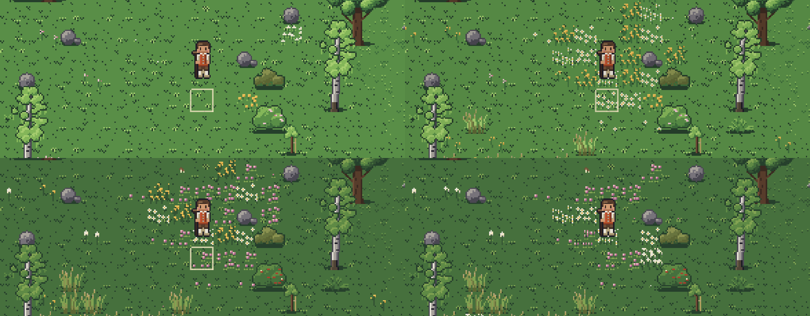
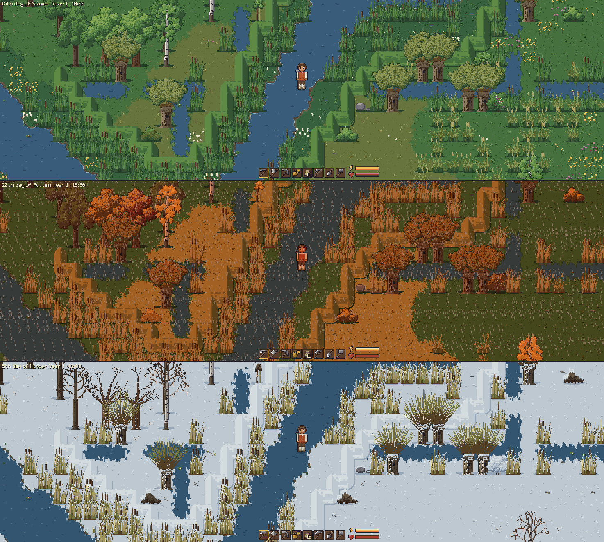
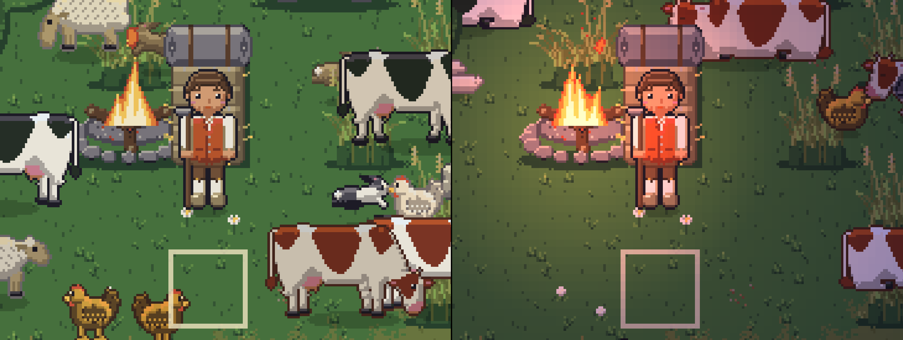
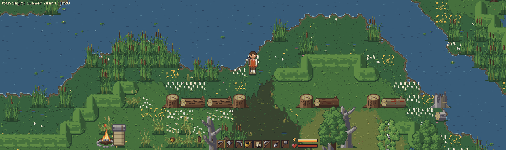
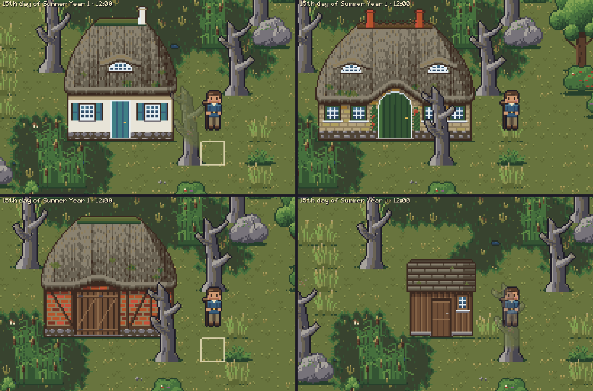
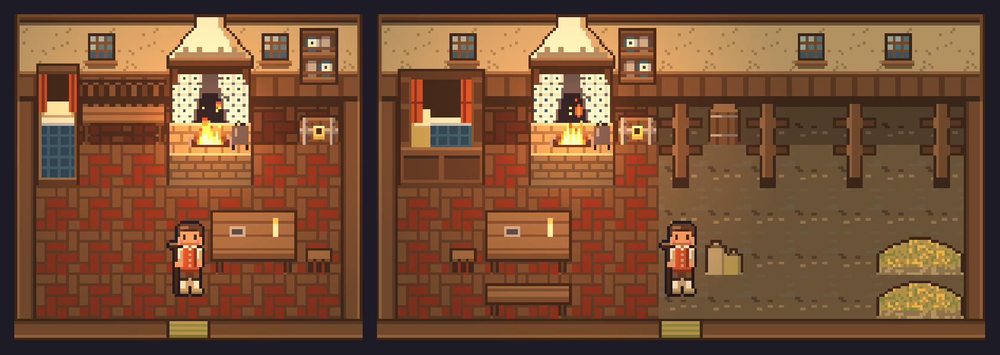
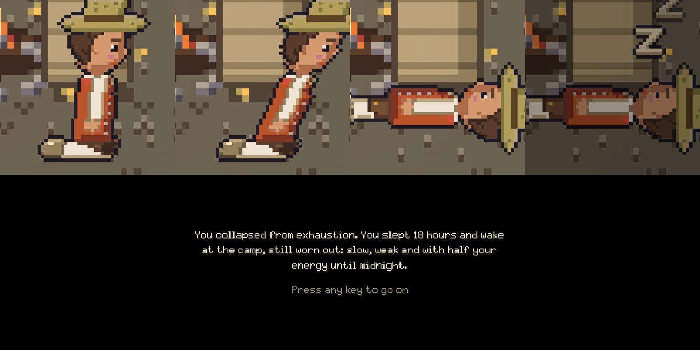
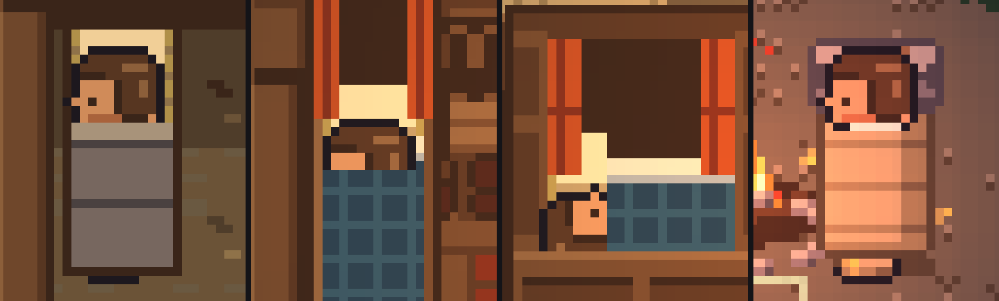
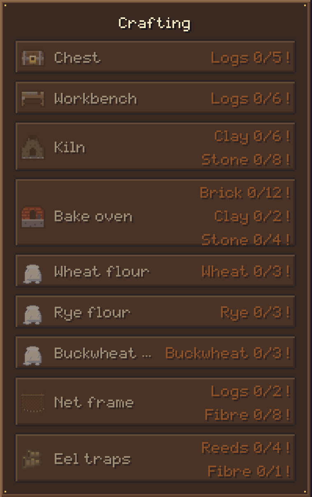
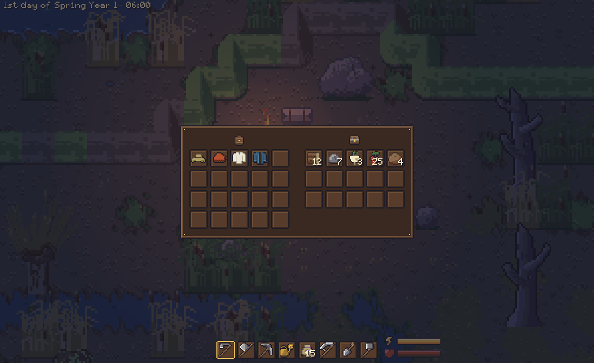

# Sandbox Game (working title)

A top-down farming and life sim with 16-bit pixel art, set in a semi-fantasy Nordic
countryside. It follows the tradition of Stardew Valley and Harvest Moon, but leans further
into exploration, and you can build anywhere you like. The weather, the seasons and the
light change the world as you play.

> **Status:** early prototype, under active development. The core loop works: you can
> walk, farm, fell, mine, gather, build and sleep through the seasons. There is no shop,
> combat or story yet.


## Features

### Sound

Footsteps follow the walk and the ground (grass, soil, sand, wetland, ice, snow, a wooden
floor), and every tool, pickup, building and menu has a sound, played from where it
happens. Inside a house the world outside is muffled. Settings → Audio has Master, Effects
and Ambience volumes and "Sound in background" (off: silent while the window is not
focused). Which file each sound plays is in [data/sounds.cfg](data/sounds.cfg), so any
sound can be swapped for a recording.

The world has an ambience too: rain and wind loops that follow the weather (and swell with
gusts), thunder some seconds after each flash of lightning, birds chirping by day, deer,
rabbits and squirrels, bees buzzing at their flowers, frogs croaking near water on
warm spring and summer evenings and nights, and now and then a quiet moo, baa or cluck from
the farm animals. How often and how loud is in
[data/ambience.cfg](data/ambience.cfg).

### A world that changes with the seasons

There are four seasons of 30 days each. The ground, the trees, the bushes and the
buildings each have a look for every season: fresh green in spring, full summer foliage,
autumn colours of the North Sea, and snow in winter. The woods are those of the region: grey
beeches under broad domes that turn copper, white birches that turn yellow, dark alders on
wet ground that stay green late and hang with cones in winter, and oaks in brown, ochre and
copper. A new season comes in over its first three days, tile by tile and tree by tree: in
spring the trees and bushes leaf out in steps, from bare twigs to a haze of buds, thin young
leaves and then the full crown. Scots pines, tall with a loose flat crown, and spruces stay
green all year; they are rare, in clumps on the dry Geest. Ground cover thins and fills over the year, ferns die back in
winter, and berry bushes only bear fruit in their season.


The meadows flower from spring to late summer, in drifts and patches rather than sprinkled
evenly: the first daisies, dandelions and, in the beech woods, wood anemones in early spring,
cuckooflower on the wet meadows, then buttercups, red campion and red and white clover, and in
high summer yarrow, knapweed, meadowsweet by the water and the heather on the Geest. Each
drift has its few species that take over from each other, so a patch changes colour with the
weeks; the first and the last flowers of a species are small ones, and autumn sees them fade.
Fields, water and the woods have none or few. Bees keep to the flowers: they come only where
something blooms, more where more does, and their quiet buzz comes from where they are. Where
the flowers grow is in [data/flowers.cfg](data/flowers.cfg), when they bloom in
[data/vegetation.cfg](data/vegetation.cfg).



### Knicks, ditches and dykes

The land is worked, as in Schleswig-Holstein around 1700–1800. On the dry Geest the fields
are bounded by Knicks, hedges of hazel and hawthorn on earth banks that blossom in spring,
turn yellow and brown in autumn and stand bare in winter, and here and there by a fieldstone
wall or a wattle fence. Down in the marsh along the river the fields are cut by straight
ditches of water lined with reeds and pollard willows, and turfed dykes run along the
floodplain. Every boundary has a gap or a crossing, so no field is shut in. The axe cuts a
Knick down for logs and fibre, the pickaxe takes a wall apart for stone, and willows are
felled like the other trees.



### Weather

The weather is simulated from humidity, wind, temperature and sunlight. It brings rain,
snow, drifting fog, wind, storms and thunderstorms with lightning. The climate is mild:
frost and snow only come in winter, and late winter thaws quickly into spring. The
weather is worked out from the world seed and the time, so the same world always has the
same weather.

The world moves with the wind: trees, bushes, grass, reeds and crops sway, barely on a
calm day and hard in the gusts of a storm; the water ripples and glints, choppier in wind;
the campfire and the hearth burn, their flames licking up and falling back, and throw
sparks; the campfire's flames lean and stretch downwind, more in a strong wind; rain
splashes on the ground; lily pads drift and bob.


### Day, night and light

The days follow a Nordic year: about 16 hours of daylight in midsummer and 8 in
midwinter, with dawn and dusk following sunrise and sunset. When it gets dark, the
campfire, the hearth and the lit windows glow, and clouds dim the daylight. A setting
lets you shrink or switch off the change in day length.


### Farming

You till the soil with the hoe, plant seeds, water them, and pick the crops by hand. There
are eleven crops: turnips, potatoes, carrots, cabbage, onions, wheat, peas, beans, flax
(for its fibre, not to eat), wild strawberries and small green squashes (pumpkins). Each
grows in its own seasons, and the weather (warmth, rain, frost) speeds it up, slows it
down or damages it. A ripe crop doesn't wait forever: left unpicked for as long as it took
to ripen, it withers and gives nothing. The growing times, seasons and the withering are
in [data/crops.cfg](data/crops.cfg).


### Livestock

Cows, sheep, chickens and rabbits of the region: red-brown Angler, black pied and red pied
cattle; white, grey and black-faced sheep; brown and white hens and a rooster; agouti, white
and Dutch rabbits, each with a slight tint of its own. They wander, graze (the hens peck for
seeds and worms), keep out of water and away from anything solid, and the rabbits hop off
when you come close. At night they lie down and sleep until the morning. For now they come
from the console (`spawn cow 3`); they are saved with the game. Milk, wool, eggs, pens and
feeding come later. The numbers are in [data/livestock.cfg](data/livestock.cfg).



### Felling, mining and gathering

Use the axe on trees and the pickaxe on stones and boulders. A better tool needs fewer
hits, and some resources need a better tool. Everything you hit trembles and throws
leaves, snow or splinters. A felled tree topples to the side and leaves a stump and a
trunk (a dead tree a grey, splintered one); cut both into logs. A stump left alone rots
away over about two weeks and may sprout a sapling of its kind (not a dead tree's), and
now and then a tree drops a seed (an acorn, a beechnut, a catkin or a cone) you can plant
on grassland. Stones and boulders break into pieces of stone; a boulder needs a better
pickaxe.

The scythe mows tall grass into hay and cuts reeds on river banks (reeds grow back in
their season). The shovel digs clay, but only where a faint patch on the ground hints at
it. Berry bushes bear fruit again a few days after picking, and shrubs and ferns give
fibre.

What you gather hops out onto the ground: logs, stone, clay, hay, reeds, seeds and produce
lie there until you walk over them and pick them up.




### Build anywhere

Hold the hammer (press B to take it from the hotbar) and a ghost of a building follows the
mouse. Q and E pick the building: shack, Kate, longhouse or barn. A small panel lists the
logs, stone, clay and reeds it takes against what you carry; the spot is refused while
something is missing, and a click or Space builds it and takes the materials. The ghost
shows where it fits, and the game tells you why a spot doesn't work, for example when it
is unsafe wetland. Hold something else (or press Escape or right click) to stop building.
You can walk inside every building, and each has its own room: a bare shack with a straw
mat on a clay floor, a cottage room in the Kate, the longhouse with a living end and an
animal end, and the barn with stalls and hay. The rooms are furnished like 18th-century
farmhouses of the coast: brick floors in the living rooms and beaten clay in the work rooms,
an open hearth under a smoke hood with Dutch tiles behind the fire, plate racks with Delft
and pewter, a wall bench and box beds with curtains. The last bed you slept in becomes your home. A new game
starts at the camp with your tools and the hammer, so the materials for the first house
have to be gathered first. The buildings, their sizes, costs and insides are in
[data/buildings.cfg](data/buildings.cfg).

The buildings follow the reed-thatched farmhouses of Denmark and northern Germany: the Kate
with white lime walls and teal shutters, the brick longhouse with its arched barn door, the
half-timbered barn, and the shack: tarred black boards under a turf roof, which greens in
spring, browns in autumn and winter and lies under snow like the thatch.






### Character, inventory and equipment

The character is drawn in layers, so anything they wear shows in the world. They dress as
on the North Sea coast in the 18th century: a red waistcoat over a linen shirt, knee breeches
with white stockings, wooden clogs, and a short blue jacket and hats to put on. Press Tab to
open the character screen, where you move items between the inventory and the equipment
slots. The hotbar (the eight slots at the bottom of the screen, keys 1 to 8) holds your tools
and seeds and is extra room: it takes nothing from the backpack's 20 slots (4 rows of 5), so
you carry 28 stacks. The screen shows the backpack with the hotbar as its own row below it, and
new items fill the free hotbar slots first. Energy and health bars track how tired you
are, and the more you carry, the more each action costs: up to 40 kg is free, and tools
weigh nothing. Below 20 % energy the character
sweats with every action, and below 10 % even more. A "zzz" thought bubble pops up over the
head at midnight and again at half past, while you are still awake: you pass out an hour
after midnight.


### Sleeping and passing out

Press E next to a bed to sleep: the screen fades to black, shows the new day and wakes you
at 06:30 the next morning (or the same morning, if it is already past midnight). A bed fills
your energy and health, and the last one you slept in is home.

Don't run out of energy, and don't stay up past 01:00: you sink to your knees, tip over and
fall asleep where you stand. You sleep until 06:30 but at least ten hours, and wake in your
home bed, still worn out for the rest of that day: walking slowly, with low health and half
your energy. A message says what happened before the morning fades in.



After sleeping or passing out you wake lying in the middle of the bed, head on the pillow
and under the blanket (also on the bedroll at the camp), and get up with your first step.
Beds don't block walking, so you can't get stuck behind one.



### Crafting and chests

Press C for the crafting menu. It lists what you can make with what you carry; a recipe you
can't afford yet is greyed, with the missing materials marked, and hovering shows what is
missing. The first recipe is the chest, for 5 logs. The recipes are in
[data/recipes.cfg](data/recipes.cfg).



Hold a chest and a ghost shows where it would go: green where it fits, red where it
doesn't (not on water, wetland or floodplain, not on something else, not in front of a
door). Use it to place the chest, outdoors or inside a house. Press E in front of a chest
to open it: your backpack and hotbar are on the left and the chest's 15 slots on the
right. Click an item and click a slot to move it, or Shift+click to send a whole stack
across (from the chest it goes to the backpack first, so the hotbar isn't flooded). The
axe takes a chest down: outdoors what it held spills onto the ground, inside a house the
chest and its contents go into your inventory (or you are told there is no room).



### Settings and controls

You can rebind every key, including mouse buttons. You can also switch between fullscreen
and windowed, scale the UI from 0.5× to 2× without touching the world view, and set the
energy drain and the day length variation. Hover over a setting, a key or an item in the
hotbar, inventory or equipment for a short explanation: an item's kind, weight, what food
gives back, what seeds grow and where they are planted. The mouse wheel zooms smoothly
from 0.5× to 2×.


### Console

Press `/` to open a console for testing and cheats. Tab completes commands and their
arguments.

| Command | What it does |
|---|---|
| `help`, `help <command>` | List the commands, or show what one takes (the names it accepts too). |
| `tp <x> <y>` | Teleport to a world tile; from inside a house you step out there (F3 shows your coordinates). |
| `reset` | Put yourself in your bed, the one you wake in, inside or out. |
| `give <item> [count]` | Put items in the inventory. |
| `god`, `nodrain`, `noweight`, `nocost` | Toggle invincibility, free actions, weight costing nothing, and buildings and crafting needing no materials. |
| `weather`, `weather <condition>`, `weather auto` | Show the weather, force a condition, or go back to the simulation. |
| `snow`, `snow <0..1>`, `snow auto` | Show the snow cover, force it, or go back to the weather. |
| `spawn <animal> [count]` | Put animals nearby: farm animals that stay (`cow`, `sheep`, `chicken`, `rabbit`) or wild ones that come and go (`bird`, `wild_rabbit`, `squirrel`, `deer`, `bee`, `butterfly`, `flock`). `spawn` alone, or with an unknown name, lists them. |
| `skip <n>m\|h\|d` | Let minutes, hours or days pass, e.g. `skip 2h` or `skip 3d`. |
| `crop` | Show the growth, damage and needs of the nearest crop. |


## Controls

These are the default keys; all of them can be changed under Settings → Controls.

| Key | Action |
|---|---|
| WASD or arrow keys | Walk |
| Space or left click | Use the held item on the targeted tile |
| 1–8 | Pick a hotbar slot |
| Tab | Character screen and inventory |
| C | Crafting menu |
| E | Open the chest in front of you, else sleep until morning (next to a bed); with the hammer in hand it picks the next building |
| B | Take the hammer: build mode |
| Q, E | Previous and next building (while holding the hammer) |
| Mouse wheel | Zoom |
| Escape | Pause menu |
| `/` | Console |
| F3 | Show coordinates and weather values |

## Running the game

The game uses Godot 4.7.2 with GDScript. Make targets wrap every multi-step job.

```sh
make setup   # checks for Godot, Python 3, git and curl (Tiled is optional); downloads GUT;
             # creates a Python venv
make run     # starts the game
```

Start the game with `make run`: it imports new art first. Starting Godot directly after
pulling new art makes the game stop with a list of pictures that aren't imported yet; run
`godot --headless --import` once then.

On Linux the game uses the X11 display driver (XWayland under a Wayland desktop), set in
project.godot: Godot 4.7.2's Wayland driver sometimes never finishes quitting, leaving the
window open. The game has saved by then. To try Wayland anyway:
`godot --path . --display-driver wayland`.

`make setup` never installs system packages. If something is missing, it prints what to
install, with Gentoo package names where there are some. If your Godot binary has a
different name, pass its path: `make GODOT=/path/to/godot run`.

Saves go to `user://saves/world.json` and settings to `user://settings.cfg`. To start a
fresh world, run `godot --path . -- --new-game`.

### For developers

Start with [docs/architecture.md](docs/architecture.md): how the code is organised and where
to look. `make help` lists the targets and their variables.

| Command | What it does |
|---|---|
| `make help` | Lists the targets and variables (the default). |
| `make test` | Runs the GUT test suite headless. |
| `make lint` | Runs `gdlint` and `gdformat --check`. |
| `make format` | Formats the GDScript. |
| `make assets` | Regenerates all pixel art from the palette and all sounds (deterministic). Needs Python only, not Godot. |
| `make clean` | Deletes build/ (test log, screenshots). |
| `make screenshot` | Saves one frame, e.g. `make screenshot AT=40,-20 TIME=21:00`. Muted (`SOUND=1` keeps the sound), the window doesn't take the focus, and it uses its own save in build/ (`KEEP_SAVE=1` loads yours). |

- **Art and sound:** all art is generated by Python scripts, from a small fixed palette, and all sounds are synthesised. [tools/README.md](tools/README.md) has the
  module map and how to add things; the entry points are
  [tools/art/generate.py](tools/art/generate.py) and
  [tools/audio/generate.py](tools/audio/generate.py).
- **Interiors:** the rooms inside the buildings are Tiled maps, see
  [maps/README.md](maps/README.md).
- **Art style:** period, place, materials and what to avoid are in [docs/art-style.md](docs/art-style.md).
- **Data files:** gameplay numbers you might want to tune live in
  [data/](data/) (energy, crops, buildings, recipes, weather, seasons, vegetation, flowers, wildlife, sounds, ambience).
- **Design:** the design is in [SPEC.md](SPEC.md).
- **Debug flags:** command-line flags for screenshots and debugging (time, day, weather,
  position and more) are listed in the header of [game/scenes/startup_options.gd](game/scenes/startup_options.gd).
