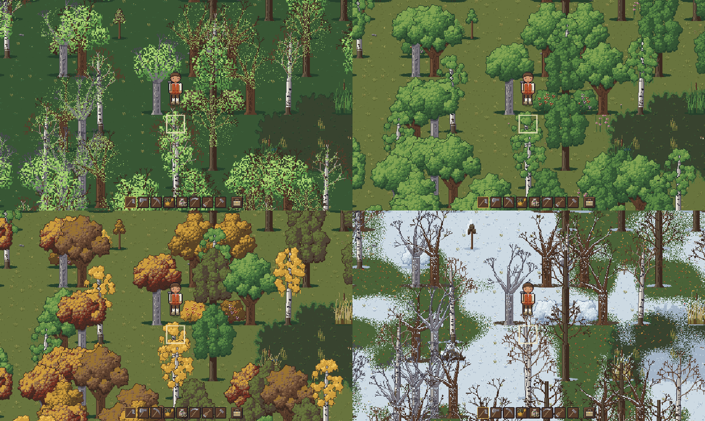
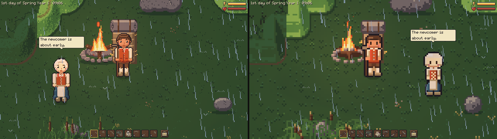
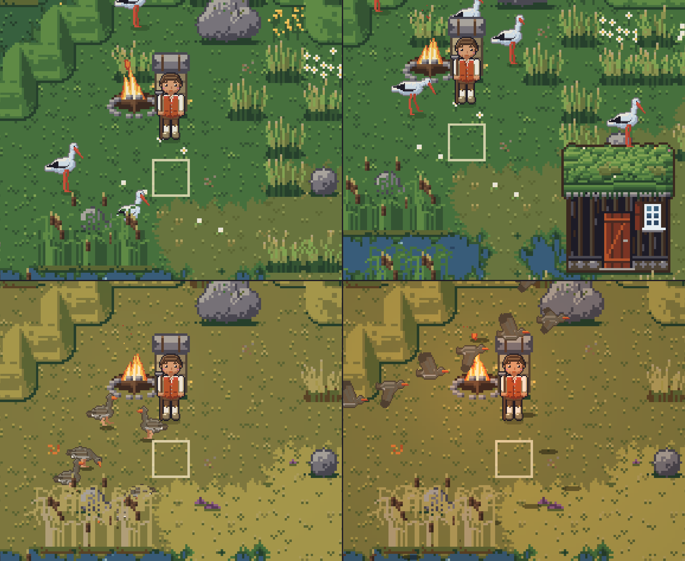

# Sandbox Game (working title)

A farming and village game on the North Frisian coast in 1750. You till fields, keep animals, fell
trees and build houses anywhere you like, and get to know the people of a marsh village, while the
seasons, the weather and the light change the world around you. It follows the tradition of
Stardew Valley and Harvest Moon, with more room for exploring. The pixel art comes in two sets: the
new one at 32 px per tile, and the classic 16 px one (F7 switches).

> **Status:** early prototype, under active development. The core loop works: you can walk, farm,
> fell, mine, gather, build and sleep through the seasons. There is no shop, combat or story yet.










## Features

- Four seasons of 30 days, with trees, flowers, snow and frost: [the world](handbook/world-and-seasons.md).
- A simulated weather with rain, snow, fog, storms and lightning, a Nordic day and a dark night:
  [the world](handbook/world-and-seasons.md).
- Marsh, dykes, Knicks, and a tidal coast with a Warft: [the world](handbook/world-and-seasons.md).
- Thirteen crops that grow with the weather: [farming](handbook/farming.md).
- Cows, pigs, sheep, hens, horses you can ride, dogs and cats, and a wildlife of storks, geese, deer,
  gulls and fireflies: [animals](handbook/animals.md).
- Villagers who notice what you do, gossip, chat in their own words, and can talk through a language
  model: [villagers](handbook/villagers.md).
- Build a shack, Kate, longhouse, hall house, barn or church anywhere, craft and cook, learn three
  trades: [building and crafting](handbook/building-and-crafting.md).
- Tools in five grades, a bag, equipment, energy and sleep:
  [character and items](handbook/character-and-items.md).
- Footsteps, weather, animals and two pieces of chiptune music: [sound](handbook/sound.md).

## Running the game

You need Godot 4.7.2, Python 3, git and curl (Tiled is optional).

```sh
make setup   # checks the tools, downloads GUT, builds assets/ and imports the project
make run     # starts the game
```

`make help` lists all targets. More in [docs/development.md](docs/development.md).

## Controls

All keys can be changed under Settings → Controls; the [handbook](handbook/controls.md) lists them all.

| Key | Action |
|---|---|
| WASD or arrow keys | Walk |
| Space or left click | Use the held item |
| 1–8 or mouse wheel | Pick a hotbar slot |
| E | Talk, open, ride, sleep |
| B, C, K | Bag, character window, skills |
| Shift + C | Crafting menu |
| = and - | Zoom |
| F7 | New or classic art |
| Escape | Pause menu |
| / | Console |

## More

- [The handbook](handbook/README.md): how to play, by topic.
- [The design](design/README.md): what the game is and where it is going.
- [Developer docs](docs/development.md): running, testing, releasing, and the code
  ([architecture](docs/architecture.md), [UI](docs/ui.md), [art style](docs/art-style.md),
  [tools](tools/README.md)).
