# Sandbox Game (working title)

A top-down farming and life sim with 16-bit pixel art, set in a semi-fantasy Nordic
countryside. It follows the tradition of Stardew Valley and Harvest Moon, but leans further
into exploration, and you can build anywhere you like. The weather, the seasons and the
light change the world as you play.

> **Status:** early prototype, under active development. The core loop works: you can
> walk, farm, forage, build a house and sleep through the seasons. There is no shop,
> combat, story or sound yet.

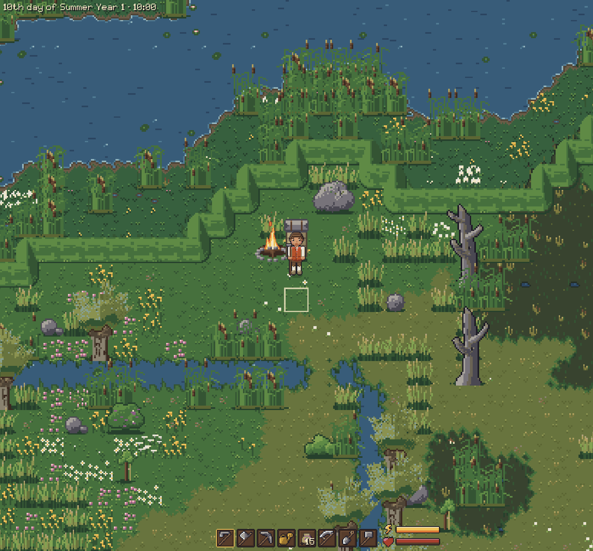

## Features

### A world that changes with the seasons

There are four seasons of 30 days each. The ground, the trees, the bushes and the house
each have a look for every season: fresh green in spring, full summer foliage, red and
gold autumn forests, and snow in winter. Ground cover thins and fills over the year, ferns
die back in winter, and berry bushes only bear fruit in their season.

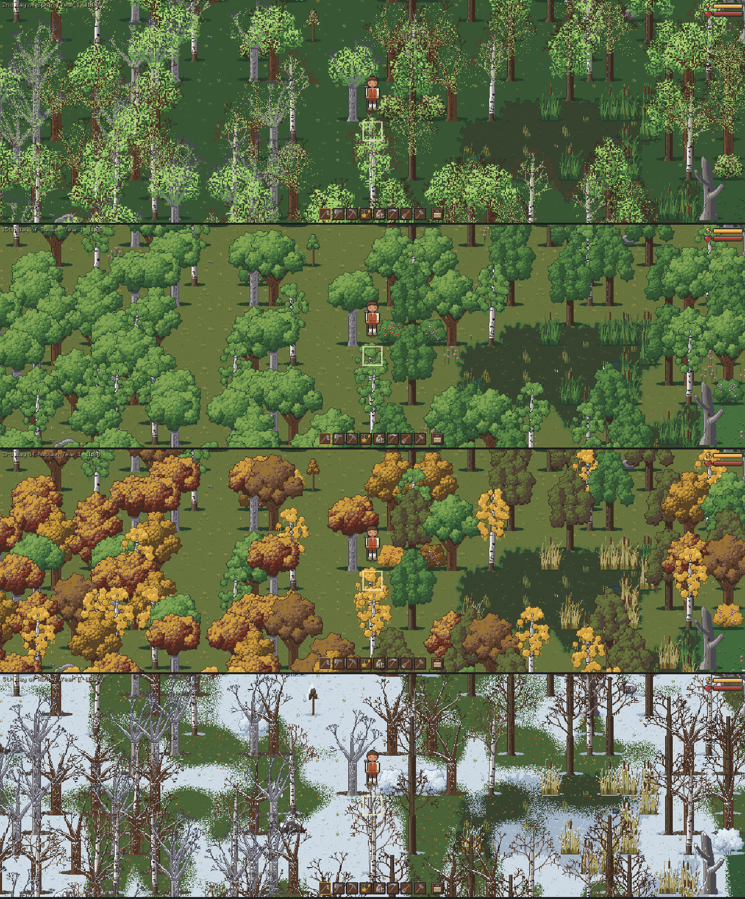

### Weather

The weather is simulated from humidity, wind, temperature and sunlight. It brings rain,
snow, drifting fog, wind, storms and thunderstorms with lightning. The climate is mild:
frost and snow only come in winter, and late winter thaws quickly into spring. The
weather is worked out from the world seed and the time, so the same world always has the
same weather.

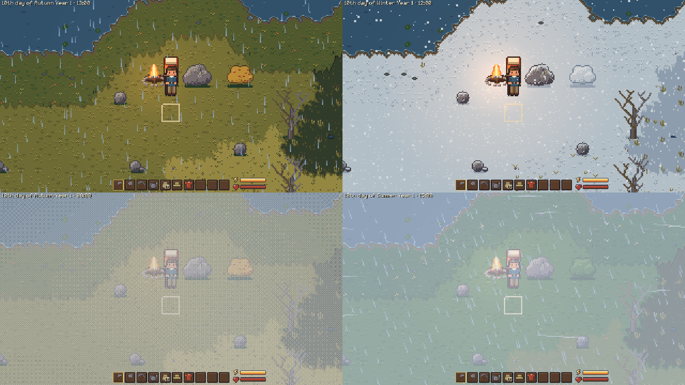

### Day, night and light

The days follow a Nordic year: about 16 hours of daylight in midsummer and 8 in
midwinter, with dawn and dusk following sunrise and sunset. When it gets dark, the
campfire, the hearth and the lit windows glow, and clouds dim the daylight. A setting
lets you shrink or switch off the change in day length.

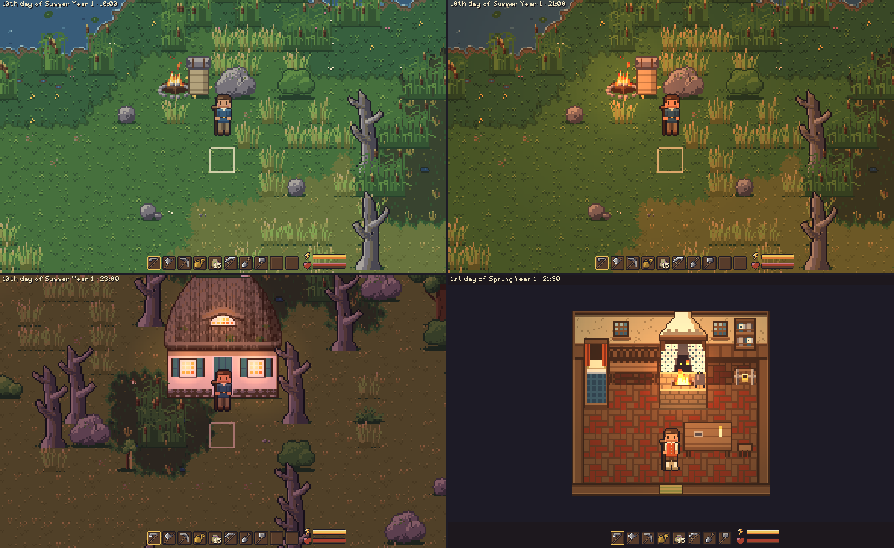

### Farming

You till the soil with the hoe, plant seeds, and harvest your crops. Crops grow day by day.

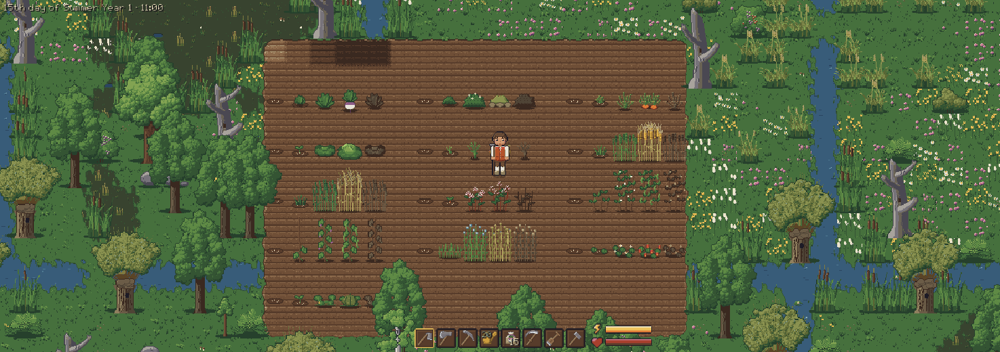

### Felling, mining and foraging

Use the axe on trees and the pickaxe on stones and boulders. A better tool needs fewer
hits, and some resources need a better tool. A felled tree leaves a stump and a trunk
to cut into logs; the stump rots away over about two weeks, and trees seed new saplings.
Berry bushes bear fruit again a few days after picking, and shrubs and
ferns give fibre.

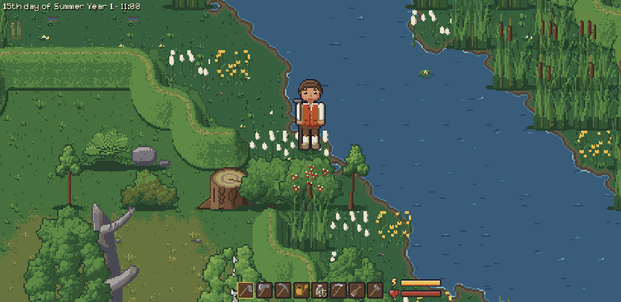

### Build anywhere

Hold the hammer (press B to take it from the hotbar) and a ghost of a building follows the
mouse. Q and E pick the building: shack, Kate, longhouse or barn. A small panel lists the
logs, stone, clay and reeds it takes against what you carry; the spot is refused while
something is missing, and a click or Space builds it and takes the materials. The ghost
shows where it fits, and the game tells you why a spot doesn't work, for example when it is
unsafe wetland. Hold something else (or press Escape or right click) to stop building. You can
walk inside a house, and the last bed you slept in becomes your home. The buildings, their
sizes and costs are in `data/buildings.cfg`.

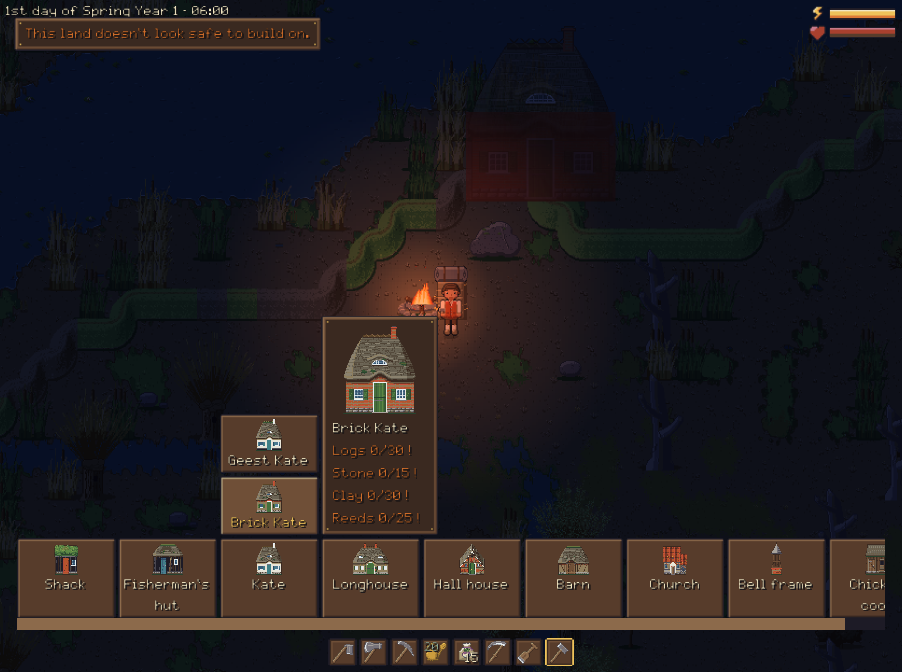

### Character, inventory and equipment

The character is drawn in layers, so anything they wear shows in the world. Press Tab to
open the character screen, where you move items between the inventory and the equipment
slots. The hotbar holds your tools and seeds. Energy and health bars track how tired you
are, and the more you carry, the more each action costs.

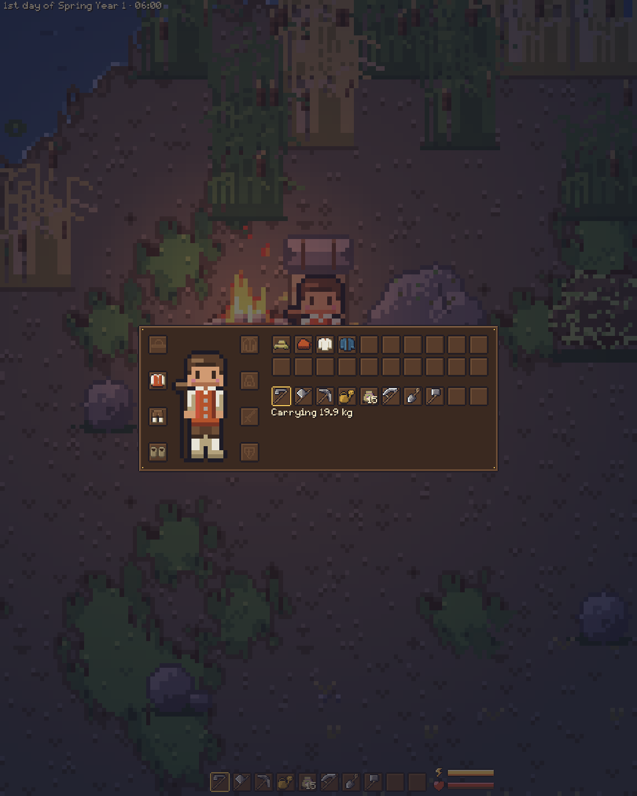

### Settings and controls

You can rebind every key, including mouse buttons. You can also switch between fullscreen
and windowed, scale the UI from 0.5× to 2× without touching the world view, and set the
energy drain and the day length variation. The mouse wheel zooms smoothly from 0.5× to 2×.

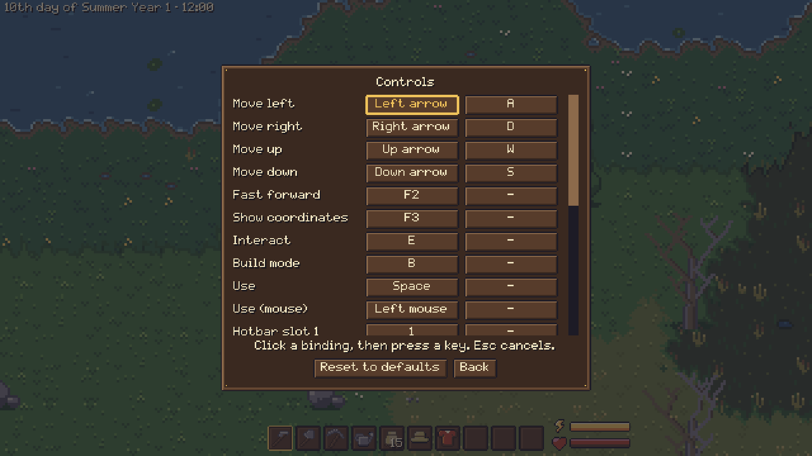

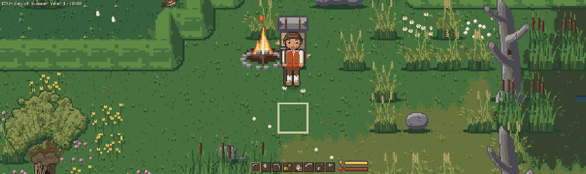

### Console

Press `/` to open a console for testing and cheats. Tab completes commands and their arguments.

| Command | What it does |
|---|---|
| `help` | List the commands. |
| `tp <x> <y>` | Teleport to a world tile outside (F3 shows your coordinates). |
| `give <item> [count]` | Put items in the inventory. |
| `god`, `nodrain`, `noweight`, `nocost` | Toggle invincibility, free actions, weight costing nothing, and buildings needing no materials. |
| `weather`, `weather <condition>`, `weather auto` | Show the weather, force a condition, or go back to the simulation. |
| `snow`, `snow <0..1>`, `snow auto` | Show the snow cover, force it, or go back to the weather. |
| `spawn <animal> [count]` | Put animals nearby. |
| `skip <n>m\|h\|d` | Let minutes, hours or days pass, e.g. `skip 2h` or `skip 3d`. |
| `crop` | Show the growth, damage and needs of the nearest crop. |

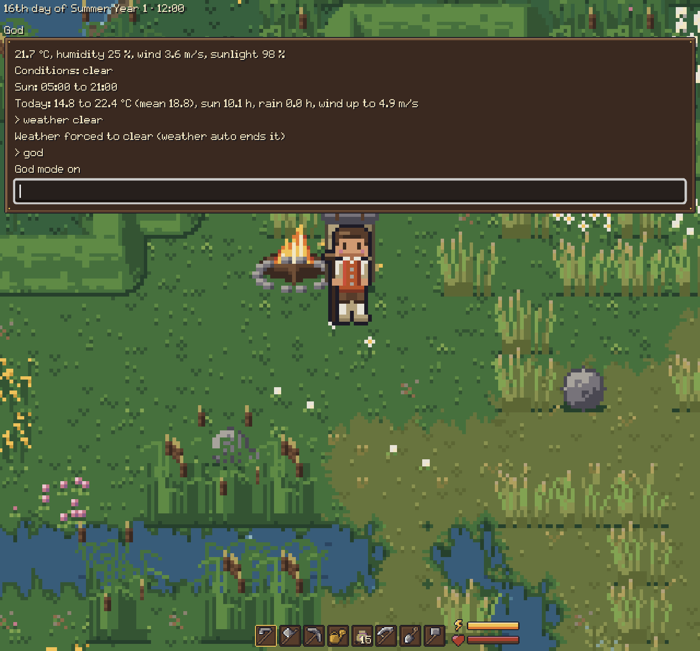

## Controls

These are the default keys; all of them can be changed under Settings → Controls.

| Key | Action |
|---|---|
| WASD or arrow keys | Walk |
| Space or left click | Use the held item on the targeted tile |
| 1–0 | Pick a hotbar slot |
| Tab | Character screen and inventory |
| E | Sleep (next to a bed; with the hammer in hand it picks the next building) |
| B | Take the hammer: build mode |
| Q, E | Previous and next building (while holding the hammer) |
| Mouse wheel | Zoom |
| Escape | Pause menu |
| `/` | Console |
| F3 | Show coordinates and weather values |

## Running the game

The game uses Godot 4.7.2 with GDScript. Make targets wrap every multi-step job.

```sh
make setup   # checks for Godot, Python 3, git, curl and Tiled; downloads GUT; creates a Python venv
make run     # starts the game
```

`make setup` never installs system packages. If something is missing, it prints what to
install, with Gentoo package names where there are some. If your Godot binary has a
different name, pass its path: `make GODOT=/path/to/godot run`.

Saves go to `user://saves/world.json` and settings to `user://settings.cfg`. To start a
fresh world, run `godot --path . -- --new-game`.

### For developers

| Command | What it does |
|---|---|
| `make test` | Runs the GUT test suite headless. |
| `make lint` | Runs `gdlint` and `gdformat --check`. |
| `make format` | Formats the GDScript. |
| `make assets` | Regenerates all pixel art from the palette and all sounds (deterministic). |
| `make screenshot` | Saves one frame, e.g. `make screenshot AT=40,-20 TIME=21:00`. |

- **Art:** all art is generated by a Python script, [tools/art/generate.py](tools/art/generate.py),
  from a fixed palette of at most 64 colours.
- **Sound:** all sounds are synthesised by [tools/audio/generate.py](tools/audio/generate.py)
  into assets/sounds/; its docstring explains how to tune or replace one.
- **Data files:** gameplay numbers you might want to tune live in
  [data/](data/) (energy, weather, vegetation).
- **Design:** the design is in [SPEC.md](SPEC.md).
- **Debug flags:** command-line flags for screenshots and debugging (time, day, weather,
  position and more) are listed at the top of [game/scenes/main.gd](game/scenes/main.gd).
