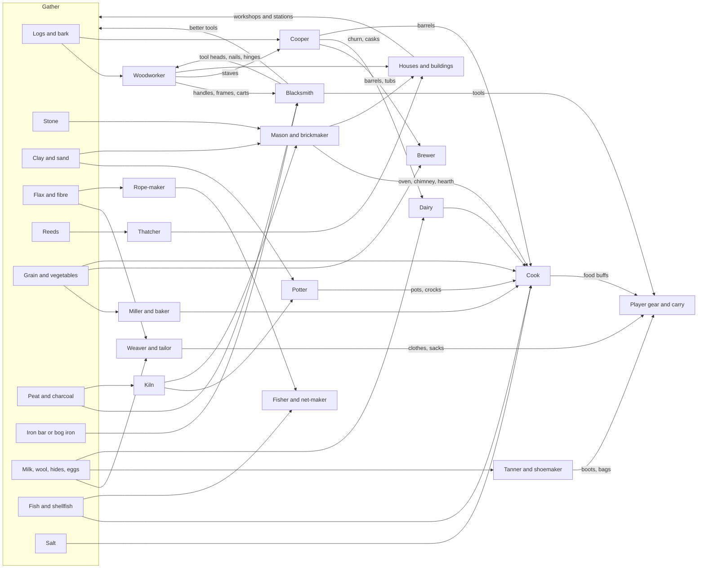

# Crafting and professions: ideas

**Ideas, not decided.** An idea collection. For the user and the coordinator to discuss which
ideas fit. Setting: North Sea coast (North Frisia, Schleswig, Denmark), about 1700-1800,
before industry. Fantasy hooks are optional and for later. Other games are inspiration only;
no names, art or content are taken from them.

Tags used below: **[cheap]** = data-only or small code, **[medium]** = new system or UI,
**[big]** = new world objects, art, NPCs or save changes.

---

## 1. What Ultima Online did, and what to borrow or avoid

**Worth borrowing**

| Idea | Why it fits here |
|---|---|
| Use-based skill gain: you get better at what you do | No XP menu to learn; matches the "do it and see" feel of the energy system |
| Gathering skills feed crafting skills (mining -> smithing, lumberjacking -> carpentry, sheep -> cloth -> tailoring) | We already have gathering with tool levels; chains are natural |
| Resource tiers with the same recipe (iron, then better ores; plain wood, then rarer woods) | Same recipe, new material = cheap content. Fits "harvest level" already in the design |
| One tool per craft (tongs/hammer, saw, sewing kit), a crafting menu per tool | Clear mental model; a menu per workstation is just a filter over `recipes.cfg` |
| Quality: normal and "exceptional" (chance rises with skill), plus an optional maker's mark | Gives crafted goods a reason to be made by the player rather than bought |
| Tool wear (tools have uses and break) and repair | Gives smith and woodworker a steady job; a gold-sink-like loop |
| Bulk order deeds: an NPC asks for N items of a kind and quality, pays a reward and reputation | A ready-made quest and trade loop; fits the existing NPC reputation idea in the design |
| Runic/enchanted tools (UO's runic tools give magic-metal items) | A later fantasy hook: a rare tool that adds a property |
| Skill cap (700 total, 100 per skill) forces a template/profession choice | Makes "which crafter am I" a real choice and gives trade a reason (others make what you do not) |

**Worth avoiding**

- **Grind and macroing.** Raising a skill by crafting thousands of cheap items is the thing
  players automated. Options to avoid it: gain chance falls when the recipe is too easy (no
  gain from trivial recipes), each recipe gives skill only for the first N crafts per
  season, or progress comes from unlocks and bulk orders instead of repetition.
- **Pure skill gating of everything.** Players hated being locked out by a hidden number.
  Show the needed skill in the menu.
- **Single-player makes the trade reason disappear.** UO's cap works because other players
  fill your gaps. Here NPCs would have to (see open questions).
- **Item-bloat.** UO has hundreds of near-identical recipes. Prefer fewer recipes with
  more meaning.

---

## 2. Core system options

Each block lists variants; none is chosen.

### 2.1 How skills progress

| Variant | How it works | Pros | Cons |
|---|---|---|---|
| A. Use-based | Crafting raises the skill; chance falls near the top; trivial recipes give nothing | Natural, no menu, UO-proven | Grind risk; needs anti-trivial rule; hidden numbers |
| B. Recipe unlocks | Recipes unlock by quest, book, learning from an NPC, or finding a plan | No grind, fits a story and discovery; data-only | Less feeling of getting better; unlock sources need content |
| C. Both | Skill level gates tiers (e.g. iron needs smithing 30) and plans/books unlock specific recipes | Best of both; matches how real trades work (apprenticeship plus pattern) | Two systems to build and balance |
| D. Tool/workstation is the progression | No skill at all; a better anvil or loom unlocks recipes | Simplest; matches existing tool levels | Less "profession" feel |

Fit note: existing tool levels (1 hand, 2 copper, 3 iron) already work as variant D for
gathering.

### 2.2 Skill cap or profession choice

| Variant | Description | Pros | Cons |
|---|---|---|---|
| A. Do everything | Every skill can reach max | No regret; simple | Professions blur; no reason to trade or hire |
| B. Total cap (UO style) | e.g. 3-4 skills at max, or many at half | Meaningful specialisation, replayable | Needs NPC trade to fill gaps; punishes exploration |
| C. Guild-style choice | Pick 1 main craft (apprenticeship), others stay at basic level | Strong identity, period flavour (guilds, journeyman years) | Less freedom; one-way choice |
| D. Soft cap | Everything can grow but later levels cost more; time (seasons) is the real cap | Gentle, no lockout | Needs a time pressure to matter |

Also: hiring or befriending NPC crafters (a smith in town) instead of learning it yourself.

### 2.3 Quality tiers and maker's marks

| Variant | Description | Pros | Cons |
|---|---|---|---|
| A. None | One quality | No save or UI work | Flat |
| B. Three tiers (poor / normal / fine) | Chance by skill and by tool/workstation quality | Simple; shows in tooltip; trade value | Items need a quality field (save impact, stacking splits) |
| C. Fine only + maker's mark | Chance of "fine"; fine items carry the maker's name | Pride and identity; period-authentic (guild mark, smith's stamp) | Needs the player's name stored on items |
| D. Quality as a number (0-100) | Continuous | Deep; supports durability and price | Heavy on UI, stacking and balance |

Stacking is the main cost: quality splits stacks (a stack of 10 nails with different
qualities). Variant: quality only on tools, weapons, furniture and clothes, not on raw
materials or food.

### 2.4 Workstations

Idea: a recipe has an optional `station`. Without a station, only basic recipes show.

| Variant | Description | Pros | Cons |
|---|---|---|---|
| A. Placed objects | Anvil, workbench, kiln, loom, oven are objects placed (like chests) that open their own menu | Fits chest placement; gives the home yard shape; sellable layout | New object types, art, interaction |
| B. Buildings | Smithy, bakery, mill are buildings (like Kate) with interior | Fits building system and interior maps | Heavy per craft |
| C. Hybrid | Small stations are objects, big ones (mill, smithy, salt works) are buildings | Scales with game progress | Two paths to build |
| D. Hand-craft anywhere | Menu stays as is, stations only add bonuses | Zero friction | No sense of place |

A fuel and time step (kiln burns, bread bakes over hours) can run on the game clock, like
crops: put items in, come back later. This gives an excuse for a day plan.

### 2.5 Tool tiers and wear

| Variant | Description | Pros | Cons |
|---|---|---|---|
| A. Tiers only (today) | Level 1/2/3 by purchase or craft | Done already | Tools never need attention |
| B. Wear with repair | Tools have durability; a smith or the player repairs them | Smith has constant work; resource sink | Annoying if too harsh; tools weigh nothing today so tool items need a durability field |
| C. Sharpening/whetting | Axe and scythe go blunt (slower hits) and are restored at a whetstone, never break | Authentic (whetstone for the scythe); no lost tool | Another small minigame |
| D. Break at low chance | Rare breakage, craft a new one | Simple | Frustrating without a spare |

Variation: tool quality (fine hoe saves energy) ties into energy costs in `data/energy.cfg`.

### 2.6 Recipe discovery

| Variant | Description | Pros | Cons |
|---|---|---|---|
| A. All visible | Menu lists everything, greyed | Easy; current behaviour | No discovery |
| B. Unlock by skill | Appears when skill is reached | Predictable | Hidden until then |
| C. Learn from NPCs/books | A neighbour teaches, an almanac or pattern book is found or bought | Ties in NPC reputation and exploration | Needs NPC and item content |
| D. Experiment | Combine items at a station; what works is learned (like a cooking pot with free ingredients) | Fun, surprising | Hard to balance; some risk of opaque UX |
| E. Use ingredients | Learn a recipe by first eating or seeing the item (a dish tasted at a neighbour's) | Charming for cooking | Needs source dishes |

### 2.7 Other mechanics, optional

- **Minigames** (inspired by smithing and alchemy minigames in other games): timing at the
  anvil, a stirring or timing minigame for brewing. Pro: engagement. Con: repetitive,
  accessibility, hard on mouse/keyboard top-down feel. Option: minigame only for "fine"
  quality, plain click for the normal result.
- **Time and the seasons as a crafting limit.** Flax rets in autumn, thatching in dry
  weather, salt boiling in summer, slaughter and smoking in late autumn. Cheap and
  authentic.
- **Bulk orders / commissions** from NPCs (see section 1). [medium]
- **Batch crafting** (craft x5, repeat) to remove tedium.
- **Weight as a limit.** Metals, bricks and logs are heavy; fits the existing weight system.
  Wheelbarrow and cart as a later craft for a settler.

---

## 3. Professions

Gathering inputs that already exist: logs, stone, clay, fibre, hay, reeds, flax, wheat,
turnips, potatoes, carrots, cabbage, onions, peas, beans, strawberries, berries, pumpkins.
Not yet in the game: ore and metal, charcoal, peat, sand, shells, salt, wool, milk, eggs,
meat, fish, hides, honey, bark, herbs. Each profession below lists what it would need.

### 3.1 Blacksmith

- **Inputs:** bog iron or iron bars (period: most iron came as bar iron from Sweden or
  Norway, via ports, or from bog iron), charcoal, coal later, clay for the forge lining,
  water.
- **Workstation:** forge (hearth with bellows) plus anvil; tongs, hammers.
- **Progression:**
  1. Nails and horseshoe nails, simple hooks (iron bar).
  2. Hinges, latches, chain, knife, sickle blade.
  3. Tool heads: hoe, axe, shovel, scythe blade (level 2 and 3 tools; level 2 copper
     is the game's current plan, but copper is not authentic for tools: option to re-skin
     tier 2 as "wrought iron" and tier 3 as "steel" or keep copper as a game convention).
  4. Plough share, horseshoes, cart tyres, anchors and ship nails (coast).
  5. Fine: scissors, locks, a good axe.
- **Unlocks:** better tools (more power per hit, less energy), hinges and nails for
  buildings (better houses), tyres for the cart, trade goods.
- **Period detail:** the village smith also shod horses and repaired most of what farmers
  broke; much of the work was repair, not new items. Cold-short and red-short iron were
  real problems; steel was costly and often only edged tools (welded steel edge).
- **Fantasy hook (later):** a smith who can fold a charm or a rune into a blade; a meteoric
  iron lump found on the beach; a runic hammer that adds a property (borrowed idea).

### 3.2 Woodworker, carpenter

- **Inputs:** logs, planks (sawn), bark, split wood, willow rods (Knick/willow cutting
  exists), different species (oak, alder, birch, willow).
- **Workstation:** workbench, sawpit or trestle for planks, later a joiner's bench.
- **Progression:**
  1. Planks (axe and wedge), pegs, stakes, handles.
  2. Chest (exists), stool, bench, bed frame, simple door, shutters.
  3. Table, cupboard, spinning wheel parts, barrel staves (hand to cooper).
  4. Cart, wheelbarrow, plough frame (with wheelwright work), boat parts.
  5. Fine: carved chests (Frisian chests were painted and carved), panelling.
- **Unlocks:** furniture (comfort, storage slots, beds), building parts (windows, doors),
  tool handles for the smith, a cart (more carry capacity).
- **Period detail:** the split of work was by tool: the carpenter (Zimmermann) framed
  houses, the joiner (Tischler) made furniture, the wheelwright (Stellmacher) made wheels,
  carts and ploughs, with the smith adding iron tyres. Oak was for frames, beech and ash
  for tools, alder for wet places and clogs.
- **Fantasy hook:** a wood that never rots from a drowned forest; carved charm figures.
- **Related: clog maker.** Wooden clogs from alder or willow with a hollowing knife; could
  be a small recipe set, already visible in the player's outfit.

### 3.3 Stonemason, brickmaker, kiln

- **Inputs:** stone (field stone, boulders), clay, sand, lime (from burned shells or
  limestone), fuel (peat, wood), straw or reeds.
- **Workstation:** mason's bench (stone), brick moulds and drying yard, brick kiln
  (clamp kiln = a pile of bricks and fuel, burned for days).
- **Progression:**
  1. Cut stone blocks and a stone threshold or well curb from field stone.
  2. Mud bricks or unburned clay (Lehm) for infill, a clay oven base.
  3. Fired bricks in a clamp kiln (later a permanent kiln).
  4. Lime mortar (burn shells or limestone), plaster, tiles (roof tiles replace thatch for
     wealth), a chimney.
  5. Fine: a brick house, a dyke repair, a bridge.
- **Unlocks:** better houses (stone and brick walls, chimney and hearth), kiln and oven
  structures for the cook and potter, sea-defence work, wells.
- **Period detail:** brick (Backstein) was a coastal staple in Schleswig (Frisian
  brickworks on the clay marshes); bricks were fired in clamps (Feldbrand) and cheap
  Dutch-style yellow bricks came by ship. Field stone ("Findlinge") was split for
  foundations and churches. Many small farms were half-timbered with clay infill and
  reed thatch.
- **Fantasy hook:** a stone that holds heat for ever (hearthstone); a ruined cairn with
  old masonry marks.

### 3.4 Cook (see section 4)

### 3.5 Weaver and tailor (flax to linen, wool to cloth)

- **Inputs:** flax (exists), wool (needs sheep), dye plants (woad, madder, weld, onion
  skins, alder bark), hides for the tailor.
- **Workstation:** retting pond or ditch, flax brake, scutching board and heckle, spinning
  wheel, loom, sewing basket.
- **Progression:**
  1. Ret and dry the flax (a pond and a week); break, scutch, hackle -> linen fibre.
  2. Spin to thread; twine and cord (rope-maker's start).
  3. Weave coarse linen; sacks, a sail cloth later.
  4. Shirt, apron, cap, stockings (knitted wool).
  5. Fine: dyed cloth, a jacket, a blue-dyed waistcoat (blue-dye and indigo were costly,
     woad was local).
- **Unlocks:** clothes (appearance layers exist), warmth for winter, sacks (carry capacity
  or storage), sail cloth, nets, a trade good that fills the winter.
- **Period detail:** spinning and weaving were mostly household work done by women and in
  winter; a village weaver and a travelling tailor took bigger jobs. Flax retting stank, so
  it was done away from houses. Blue-print linen (Blaudruck) is a known later regional
  craft.
- **Fantasy hook:** cloth woven with moonlight or fog; a lucky thread.

### 3.5b Rope-maker (small)

- **Inputs:** flax tow, hemp, fibre. **Workstation:** a rope walk (long open strip) and a
  hand wheel. **Recipes:** twine -> cord -> rope -> net rope, cable for a ship. **Unlocks:**
  fishing nets, well rope, carts and sails. **Detail:** ropes were laid in long strips,
  which fits an open "rope walk" structure. **Fantasy:** a rope that never wets.

### 3.6 Cooper

- **Inputs:** staves (oak, ash), willow or hazel hoops, a little iron.
- **Workstation:** cooper's bench with a draw knife, truss hoops, fire to bend staves.
- **Progression:** bucket and pail -> tub, churn -> barrel for fish, beer, butter and
  salt meat -> a large vat for brewing and tanning.
- **Unlocks:** storage that keeps food (barrel keeps fish and salt pork), the dairy's
  churn, the brewer's vats, a trade good for ports.
- **Period detail:** most farms used wooden vessels for everything; barrel making was
  central to fishing ports (herring, butter casks for export).
- **Fantasy hook:** a barrel that holds more than it should.

### 3.7 Miller and baker

- **Inputs:** grain (wheat exists, plus rye, barley, oats), water or wind, salt, fat,
  yeast (sourdough, beer barm).
- **Workstation:** hand quern (home), then a windmill (Frisia: wind and polder mills),
  then a baking oven (clay or brick, shared village oven).
- **Progression:**
  1. Quern: coarse flour (slow, costs energy).
  2. Flat bread, porridge, gruel (no oven).
  3. Rye loaf and dark bread in a clay oven; pancakes (Pfannkuchen).
  4. Windmill grinds sacks for a toll; white bread and cakes on feast days.
  5. Fine: rusk (ship biscuit) for sale, festival cake.
- **Unlocks:** food buffs, a village mill as a milestone building, grain trade, the baker
  as an NPC buying surplus.
- **Period detail:** milling was a regulated trade (mill banalities and tolls) and the
  windmill was a coast icon; in Frisia many were drainage mills too. Rye bread was the
  daily food; white bread was rare.
- **Fantasy hook:** a mill that grinds at night by itself; a loaf that never goes stale.

### 3.8 Brewer

- **Inputs:** barley malt (germinated and dried), hops (or gruit herbs, bog myrtle),
  water, yeast (a keeper of barm).
- **Workstation:** malting floor, kettle over a fire, vat, cooper's barrel, cellar.
- **Progression:** small beer (daily, weak) -> ale -> strong beer for feasts -> mead from
  honey (with bees) -> brandy (distilling is later and licensed).
- **Unlocks:** a trade good and a social one (inn, feasts, mood), energy buff, a reason
  for the cooper and the barley field.
- **Period detail:** beer was a daily drink; small beer was safer than water; brewing
  was often a household task by farm women, with rights and fees from the lord.
- **Fantasy hook:** a ferment that sings; a drinking horn blessing.

### 3.9 Dairy (butter and cheese)

- **Inputs:** milk (cows, goats, sheep), salt, rennet, hay (animals need feeding).
- **Workstation:** milk room with a cool cellar, churn, cheese press, shelf for aging.
- **Progression:** milking -> cream, butter (churn) -> fresh cheese (quark) -> pressed
  cheese -> aged cheese and salted butter in a cooper's cask.
- **Unlocks:** durable trade food (butter export from Schleswig and Denmark was a main
  income), buffs, a stable and cowshed as a building (the barn exists).
- **Period detail:** the marsh coast was dairy country; butter and cheese went by ship
  to Hamburg and Holland. Milk needs cool storage, so a cellar or a spring house.
- **Fantasy hook:** an ever-warm cow; a cheese that attracts something.

### 3.10 Fisher and net-maker

- **Inputs:** twine (rope-maker), floats of wood and cork, lead or stone weights,
  bait, shells.
- **Workstation:** net-mending bench, a rod or a boat, smoking house, salting barrel.
- **Progression:** rod and line -> fish trap (weir, creel, eel trap) -> hand net -> a small
  boat and a drift net -> tidal fish weirs. Mussels and shrimp on the flats by hand.
- **Unlocks:** fish as food, hides of seals later, a new place to gather (water), a boat
  as a transport on rivers and the Watt (mudflats), preserved fish for winter.
- **Period detail:** the Wadden Sea gives plaice, herring, eel, shrimp, mussels and
  oysters; coastal villagers fished at low tide on foot with push nets. Smoked eel is a
  regional dish.
- **Fantasy hook:** a net that catches things not from the sea; a drowned bell.

### 3.11 Tanner and shoemaker

- **Inputs:** hides (from slaughter or hunting), bark (oak bark gives tannin), lime
  or urine for unhairing, fat, thread, awls.
- **Workstation:** tanning pits (long time: weeks), scraping beam, shoemaker's last bench.
- **Progression:** scraped hide -> rawhide, rope -> tanned leather (slow, on the game
  clock) -> belts, straps, bags (carry capacity) -> shoes, boots -> fine gloves.
- **Unlocks:** better boots (speed, wet ground?), bags and bandoliers (inventory size),
  leather for harness and tool grips, saddle later.
- **Period detail:** tanning was a smelly trade placed on the edge of a village near
  water; oak bark was ground in a bark mill. Most villagers wore wooden clogs and
  leather was a luxury for shoes and harness.
- **Fantasy hook:** a hide that keeps its owner dry.

### 3.12 Potter

- **Inputs:** clay (exists), sand or grog, water, fuel, glaze minerals (lead glaze, iron).
- **Workstation:** a wedging table, a slow wheel (kick wheel), a kiln (shared with
  brick).
- **Progression:** coil pots by hand -> storage jars and a cooking pot -> bowls and
  plates -> glazed earthenware (brown and green lead glaze) -> stove tiles (stoveware)
  -> Dutch-style blue and white tile (a well-known coastal luxury, and mentioned in the
  interior art notes).
- **Unlocks:** the cook's pots and storage, a trade good, tiles for a better hearth and
  warmth, a cheap way to use clay.
- **Period detail:** Frisian and Danish red earthenware was common; blue-white tiles
  from Holland lined good rooms, and were exported to the coast.
- **Fantasy hook:** a pot that keeps a spirit; a fired charm tile.

### 3.13 Thatcher

- **Inputs:** reed (reeds exist), straw, hazel spars, rope or willow ties, ridge turf.
- **Workstation:** none (a ladder and a tool kit: leggett, thatching needle).
- **Progression:** small shed roof of straw -> reed roof for a house -> ridge capping and
  repairs -> a large barn roof.
- **Unlocks:** roofs for buildings (reeds are already a building cost), roof repair
  (roofs degrade slowly), income as a service job for NPC houses.
- **Period detail:** reed thatch is typical for North Frisia; a good roof lasts about
  40 to 60 years and reed was cut in winter on frozen marsh.
- **Fantasy hook:** a thatch that sheds wind; storks that nest on a roof as luck.

### 3.14 Other trades, one line each

- **Salt boiler:** salt from salt-peat (Salztorf) or sea water boiled in a pan; big fuel
  user. Unlocks preserving. Fantasy: tide-salt.
- **Peat cutter:** cuts peat with a spade, dries it in stacks; the poor man's fuel on a
  treeless coast; fuels forge, kiln and salt boiler.
- **Charcoal burner:** wood stack burned slowly under turf for the smith.
- **Chandler (candles, tallow, rush light):** light for winter evenings; interior lights
  exist.
- **Beekeeper:** straw skeps, honey and wax; mead and candles.
- **Herbalist and healer:** a drying loft, a simple potion minigame inspired by alchemy
  in other games, healing health (the game has a health bar).
- **Shipwright and boat-builder:** clinker boats for the Watt; a late and big chain.
- **Cartwright (see wheelwright above).**

---

## 4. Cooking

### 4.1 Basic cooking everyone has

Idea: no skill needed; no oven needed.

- **Campfire** (craftable object, or a spot on the ground): roast and boil simple things.
  Recipes: roast turnip, baked potato, boiled egg, porridge from grain, toasted bread
  later, roast fish and skewered meat.
- **Hearth** in a house (placed in the interior or part of the building): same recipes,
  plus a pot: soup and stew from any vegetables; a pot hangs over the fire.
- **Energy:** cooked food restores more energy than raw, and gives a small buff.
  Eating already exists (berries, turnips; values in `data/energy.cfg`).
- **No fail state.** Every settler can cook; it just is not great.
- **Ingredient-based soup.** Option: any 2-3 vegetables in a pot make "soup"; value comes
  from number of different ingredients (a hint of discovery, no recipe list). [medium]

### 4.2 Extended cook profession

A learnable progression on top of the basic, gated by skill, tools or places (variants from
section 2).

| Step | Station | Examples | What it adds |
|---|---|---|---|
| 1. Pot cooking | hearth, pot | pottage, gruel, pea soup, cabbage and potato stew | stronger buff than raw; uses crops |
| 2. Baking | clay or brick oven | rye bread, pancakes, fruit tart | food that keeps; sells |
| 3. Dairy and egg | cellar, churn | butter, quark, omelette | needs animals |
| 4. Smoking | smokehouse (stone/wood) | smoked eel, ham, sausage, smoked fish | long shelf life, winter food |
| 5. Salting and pickling | barrel (cooper), crock (potter) | sauerkraut, salt herring, salt pork, pickled beans | preserve harvest for winter |
| 6. Drying and jam | drying rack, pot | dried apples, dried peas, berry jam | cheap storage |
| 7. Feast dishes | oven plus guests | goose, duck, roast pork, Frisian tea (Teetied) with candy sugar, spice cakes | festival buffs, reputation |

**Mechanics options**

- **Recipe list** (data file, "ingredients -> dish"). [cheap]
- **Free combination** in the pot with a quality from variety. [medium]
- **Freshness:** food spoils over game days; preservation extends it. Needs a timestamp
  on the item, which hurts stacking. [big] Variant: spoil only for raw meat, fish and
  milk; everything else keeps. [medium]
- **Buffs for energy** (ties to the energy system): food gives (a) instant energy,
  (b) a timed buff such as "well fed": energy costs -10 %, higher max energy for the day,
  weight limit +X kg, cold resistance in winter, slower hunger or faster regeneration
  while sleeping. Keep the number of buffs small and readable. A rule of one meal buff at
  a time avoids stacking.
- **Meal slot:** eat before leaving; a lunch packed in the backpack.
- **Cooking minigame:** none, or a simple heat control at the hearth. Optional.
- **Skill effect:** better cook = more energy from the same dish, fewer wasted ingredients,
  unlocks (not a chance to fail).

**Period detail.** Daily food was rye bread, porridge, buttermilk soup, peas, beans,
cabbage, potatoes (spreading in the 18th century), salt pork, smoked or salted fish and
herring, butter and cheese. Tea (the Frisian tea ceremony) is a coastal ritual: but check
the date, it fits more from the mid 18th century.
**Fantasy hook:** a dish that gives a vision; a bread that heals a particular curse.

---

## 5. How professions interlock

**Chains a settler would need early** (a suggestion for discussion, not a decision):

1. **Wood and basic tools:** logs -> chest (exists) -> workbench -> handles and pegs. No
   metal is needed yet; the starting tools exist.
2. **Cooking:** campfire -> hearth -> pot meals; energy loop with the farm. First buff.
3. **Clay and stone:** stone blocks and a clay oven; bricks later. Houses and oven.
4. **Fibre:** flax -> linen -> sacks and shirt (winter job). Rope for builds.
5. **Smith:** needs iron source and fuel (peat or charcoal), so it is an early mid-game
   gate: the existing plan says smith in a settlement upgrades tools. Option: first via
   an NPC smith (buying), later the player's own forge.
6. **Late:** dairy, brewer, tanner, fisher, weaver's loom, boat.

---

## 6. Fit with what exists

**Today:** the crafting menu (C) lists recipes from `data/recipes.cfg` (sections with
`result`, `count`, `materials`), validated at start; crafting works anywhere; the chest is
the only recipe; code is `game/state/crafting.gd` and `recipe_rules.gd`. Tools are
level 1 to 3 and weigh nothing; the hotbar and backpack have a weight limit; energy costs
are in `data/energy.cfg`; foods have energy values; buildings are in
`data/buildings.cfg` with material costs of logs, stone, clay and reeds.

**What the recipe file would need (all optional, grouped):**

| Need | Effect | Size |
|---|---|---|
| New items (planks, bricks, nails, iron bar, flour, bread, linen, rope, barrel...) | New item types and icons; data-driven in ItemTypes | [medium], art heavy |
| `station` key in a recipe | Menu filters by the station the player is at; `none` stays today's behaviour | [cheap] |
| `skill` and `min_skill` keys | Menu shows requirement and greys out | [medium], needs skill state |
| `time` (game minutes) and `fuel` | A running job: the station holds the item and finishes later | [medium], like crop growth |
| `tool` key (needs hammer, saw) | Check an item in the hotbar | [cheap] |
| Several results or byproducts | e.g. buttermilk from butter | [cheap] |
| Menu with tabs by station or category | Replace the flat list | [medium] |
| Search, favourites, craft x5 | Comfort | [cheap] |

**Data files (all gameplay data stays in `data/*.cfg`):** `recipes.cfg` grows sections or
splits by station (e.g. `recipes_smith.cfg`); a new `skills.cfg` (skills, caps, gain
rates); a new `stations.cfg` (object, menu name, fuel, slots); `foods.cfg` or extend
`energy.cfg` (food buffs, spoilage); `quality.cfg` (tiers, chances); tool wear in
`tools.cfg` or `energy.cfg`.

**Save implications (high level, not designed):**
- A skills dictionary on the player (skill id to number) -> save version bump with an upgrade
  step, like version 7 and 8 did.
- Station objects need placement, state (contents, timer, fuel) and persistence like chests
  and crops.
- Quality and maker's mark mean item stacks carry extra fields; the stacking rule must
  treat them as different. Today items are id and count, so this is the largest change.
- Spoilage means an item timestamp (same issue).
- Tool durability: tools are single items, so a durability field fits more easily.
- Unlocked recipes: a set of ids in the save.
- Console commands (`give`, `nocost`) should respect new rules; `nocost` already covers
  materials.
- Tests and README and design updates follow the existing practice.

---

## 7. Open questions for the user

1. **Skills:** use-based, recipe unlocks, or both? Do you want visible skill numbers at all?
2. **Specialising:** can the settler learn every craft (variant A) or is there a cap or
   apprenticeship choice? If capped, who fills the gaps: NPC craftspeople you buy from?
3. **NPC smith:** should the first iron tools be bought from a smith (as the design says now) and the
   player only later gets a forge? Which metals: keep copper as tier 2, or use
   period-correct iron and steel?
4. **Iron source:** bog iron dug and smelted (a nice long chain), bar iron bought from
   traders, or found as an item?
5. **Quality:** none, fine-only with maker's mark, or three tiers? Okay with the stacking
   cost?
6. **Stations:** placed objects, buildings, or hybrid? Is waiting (a kiln burns for a day)
   fun, or should crafting be instant at the station?
7. **Tool wear:** none, whetting only, or breakage with repair?
8. **Cooking:** should basic cooking be recipe-free (free pot combos) or a list? One meal
   buff at a time? Is food spoilage wanted?
9. **Animals:** milk, wool, hides and eggs need livestock. Is livestock planned? It gates
   dairy, weaver (wool), tanner and part of the cook.
10. **Bulk orders:** do you want NPC commissions with rewards and reputation? Fits the
    reputation idea in the design.
11. **Minigames:** any (smithing timing, brewing), or none?
12. **Scope and order:** which three professions first? A suggestion for discussion:
    woodworker (workbench), cook (hearth and oven), then mason and kiln, because they use
    what is already gathered.
13. **Tone and fantasy:** how early do fantasy hooks appear; should they be separate recipes
    or properties of items (runic tools)?
14. **Authenticity vs fun:** accept simplifications (instant retting, short tanning) or
    follow real time scales scaled to game days?

---

## Sources

Inspiration, read for ideas only. Pages for the period history were not found at a
village level; the period details above come from general knowledge and should be checked
before they go into the game or its text.

- UOGuide, [Bulk Order Deed](https://www.uoguide.com/Bulk_Order_Deed)
- UOGuide, [Blacksmithy](https://www.uoguide.com/Blacksmithing)
- UOGuide, [Exceptional](https://www.uoguide.com/Exceptional)
- UOGuide, [Tailor BOD](https://www.uoguide.com/Tailor_BOD)
- UOGuide, [Publish 14](https://www.uoguide.com/Publish_14)
- UOGuide, [Skill Cap](https://www.uoguide.com/Skill_Cap)
- UOAlive Wiki, [The Crafter Deep Dive](https://uoalive.com/wiki/PlayerGuide:The_Crafter_Deep_Dive)
- UO King, [Skill System](https://www.uoking.com/guides/skill-system)
- Wikipedia, [Gold sink](https://en.wikipedia.org/wiki/Gold_sink)
- Vintage Story Wiki, [Smithing](https://wiki.vintagestory.at/Special:MyLanguage/Smithing),
  [Clay forming](https://wiki.vintagestory.at/Special:MyLanguage/Clay_Forming),
  [Anvil](https://wiki.vintagestory.at/Anvil)
- Ostfriesische Landschaft, [Ostfriesland im Mittelalter: Wohnen auf dem Bauernhof](https://www.ostfriesischelandschaft.de/fileadmin/user_upload/BILDUNG/Dokumente/Unterrichtsmaterial/Geschichte/Mittelalter_Sek/WEB_Sek_1_Mittelalter_K2.pdf) (salt peat and the salt boiler)
- Heimatverein Friedewald, [Handwerk im 20. Jahrhundert](https://www.museum-friedewald.de/museum/handwerk_im_20_jahrhundert/handwerk_im_20_jahrhundert.html) (wheelwright and smith repair work)
- Zunftbild, [Geschichte des Schmiedehandwerks](https://zunftbild.de/pages/geschichte-des-schmiedehandwerks)
- Schleswig-Holstein 24, [Altes Handwerk in Schleswig-Holstein](https://schleswigholstein24.com/2021/12/22/altes-handwerk-in-schleswig-holstein/)
- Wikipedia, [North Frisia](https://en.wikipedia.org/wiki/North_Frisia)

Not looked up on the web (from general knowledge, only as inspiration): Stardew Valley
(skills by use, professions chosen at levels 5 and 10, machines with timers), Valheim
(workbench tiers, stations that need upgrades nearby), Haven & Hearth (skills by use, no
fixed recipes), Kenshi (skills by use, trade), Medieval Dynasty (buildings as workshops,
village), Banished (production chains and seasons), Kingdom Come: Deliverance (alchemy
and smithing minigames).
