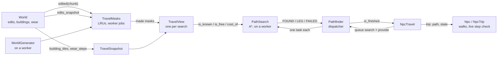
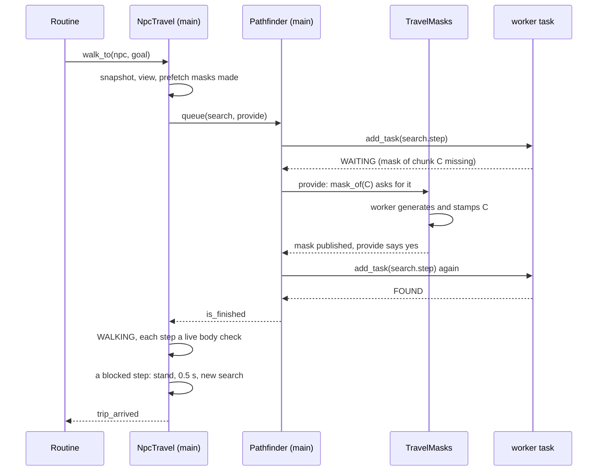

# Pathfinding: how villagers find their way

How a villager's way from one tile to another is found and walked, as it is built (tasks 238 and
#68, steps 1 and 2). The plan and the reasons for it are in
[../villagers/travel.md](../villagers/travel.md) (the decision record, with the measurements) and
[../villagers/routines.md](../villagers/routines.md) (task 238's plan); this page says what the
code does and how to change it without breaking it. What is **not built yet** is marked so.

## The idea in one paragraph

A search for a way is an A\* over tiles that runs on a **worker thread**. It never reads the
`World`, which the main thread changes all the time: it reads **immutable** data handed over when
it starts: a `TravelMask` for each chunk (one byte of flags per tile) and a `TravelSnapshot` (the
buildings and the wear of the grass). The main thread only starts searches, hands over what a
search waits for, and collects the results. A villager stands while its search runs, then walks the
way it found, checking each step against the live world as it goes.

## The pieces and who owns what

| Piece | File (in `game/state/`) | Owns | Thread |
|---|---|---|---|
| `World` | `world.gd` | the edits, the buildings, the wear; raises `edited(chunk)` | main |
| `TravelMask` | `travel_mask.gd` | the flags of one chunk | built on a worker, read-only after |
| `TravelMasks` | `travel_masks.gd` | the caches of masks and raw chunks, the worker jobs | main, with one worker task |
| `TravelSnapshot` | `travel_snapshot.gd` | copies of the building tiles and the wear | made on main, read-only after |
| `TravelView` | `travel_view.gd` | the answers a search reads (`is_known`, `is_free`, `cost_of`) | worker (search), main (`provide`) |
| `PathSearch` | `path_search.gd` | one A\* and its state | a worker while it runs |
| `Pathfinder` | `pathfinder.gd` | the queue, the tasks, the finished set | main |
| `NpcTravel` | `npc_travel.gd` | the trips: starting, walking, blocking | main |
| `NpcTrip` | `npc_trip.gd` | one villager's trip state | main |

### `TravelMask`: the flags

One `PackedByteArray` of 1024 flags (a chunk is 32 x 32), in the order of the chunk's tiles. It
answers, for a tile, what `Npcs.can_stand_at` answers on the loaded chunk, except for buildings
(the snapshot has them) and the tide and the season (given to each question):

- `BLOCKED`: the ground (water, wetland) or an object that blocks walking.
- `MUD`: tidal mud; blocked while `Tide.floods(tile, tide_level)`.
- `DECK`: a deck (the jetty): free whatever the ground and the tide. Checked first.
- `OBJECT`: something that does not block but that feet spoil (a crop, a flower): +2.0 cost
  (`NpcTravel.is_trampled`). A gate and a deck are made to be walked on and are not.
- `SEASONAL`: a plant that is there only in its season; the flags are those of the ground alone
  and the plant is kept aside, its effect counted only on a day it is present
  (`Vegetation.is_present`).
- `WEARS`: grass or floodplain, which wears to a lane where it is walked.

A mask is stamped from the generated chunks of its own chunk and of **W, N and NW** of it
(`TravelMasks.SOURCE_STEPS`), because a big object (7 x 2 tiles at the most) reaches east and south
from its own tile. So a loaded tile whose west neighbour is not loaded is still answered right.

### `TravelMasks`: making and keeping masks

- **Two LRUs**: masks (`far_masks_kept`, 256, about 1.6 KB each) and raw chunks
  (`far_chunks_kept`, 32, about 300 KB each). A raw chunk is what `WorldGenerator` makes, with no
  edit ever applied, so it never goes stale.
- **One worker job at a time**, from `update()` (once a frame, from `NpcTravel.tick`): a stamp job
  for the oldest request whose four raw chunks are all there, else a generation job for the first
  chunk the oldest request lacks. Generating (9 to 13 ms a chunk) and stamping (3 ms) are both off
  the main thread.
- **Stamping** works on copies of the raw chunks and a **snapshot of the edits** of those four
  chunks (`World.edits_snapshot`: terrain by position, object type by position), copied on the
  main thread when the job starts (0.3 ms at most).
- **Publish or drop:** each chunk has an edit **version**, bumped by `World.edited`. A job notes
  the versions of the four chunks it copied; its mask is published only if they are all still the
  same, else dropped and made again (the request stays). An edit also **drops** the masks of its
  chunk and of E, S and SE of it. So a published mask is never stale.
- `mask_of(coords)` returns the mask or null, and asks for it. `made_mask(coords)` returns it
  without asking. `wait_for_mask` waits for the worker (tests, skips).

### `TravelSnapshot`

`World.building_tiles()` (every tile a building covers, the door included: all closed to
villagers) and `World.wear_steps()` (the steps of wear of the worn tiles), copied. `NpcTravel` keeps
one and makes it again when `World.change_count` has moved or it is older than `snapshot_seconds`
(the wear grows with every step and a search does not mind it a little late).

### `TravelView`: what a search reads

Made for one search, from the snapshot, the rules and the **time the search starts at** (the tide
and the day are those, not the clock's). It holds a dictionary of the masks it has been given.

- `is_known(tile)`: true if its chunk's mask is held (or the tile is outside the world). If not, it
  notes the chunk in `missing` and says false.
- `is_free(tile)`: not a building tile, and the mask says free at the view's tide and day.
- `cost_of(tile)`: 1.0, 0.8 on trodden grass, 0.6 on a lane (the wear in the snapshot), plus
  `cost_object` where the mask has `OBJECT`. **This is the only copy of the cost rule.**
- `provide(masks)` (main thread, only while no search runs on the view): takes the masks of the
  `missing` chunks that are made, asks for the rest, and says whether nothing is missing.
- `prefetch(masks, start, goal)`: takes the masks already made for the chunks of the way and two
  chunks round it, asking for none, so a search does not stop for each chunk in turn.

### `PathSearch`: the A\*

Own A\* over tiles, four directions, tile centre to tile centre (a villager's body on a centre
stands on that tile only). `is_free`, `cost_of` and `is_known` are Callables, so the search knows
nothing of the world. Heap in packed arrays; ties go to the larger cost so far; the guess is the
Manhattan distance times `heuristic_weight` (1.0, knowingly a little inadmissible where lanes
exist). It is a state machine: `step(n)` looks at up to n more tiles and returns one of

- `RUNNING`: not done.
- `WAITING`: a neighbour of the node it was about to expand is not known. The node goes back into
  the heap unclosed, nothing was done, and `step` called again looks at it from the start: no
  neighbour is lost. The goal is checked once it is known (a goal that is not free is no way).
- `FOUND`: `path` leads to the goal.
- `LEG`: `max_nodes` (2500) tiles looked at without finding it: `path` leads to the tile seen
  nearest the goal, and the walker searches again from its end. A leg that gets no nearer is
  `FAILED`; `max_legs` (6) bounds a chain.
- `FAILED`: no way.

The start tile is not asked: someone in a doorway or on mud must be able to leave it.

### `Pathfinder`: the dispatcher

`queue(search, provide)` puts a search in. Each `tick()` (main thread, once a frame):

1. collects the tasks that are done (`WorkerThreadPool.wait_for_task_completion`; every task is
   reaped, dropped ones too). A search that is over joins the **finished** set; one that is
   `WAITING` is **parked**;
2. for each parked search calls its `provide` Callable; when it says everything is there, the
   search goes back to the queue;
3. starts queued searches, oldest first, as tasks (`WorkerThreadPool.add_task`, one each) while
   fewer than `max_tasks` (`search_tasks`) run.

A search that waits **never blocks a pool thread**: it comes back from its task as `WAITING` and is
parked on the main thread's side. `is_finished(search)` and `take(search)` are how whoever queued it
reads the result; its state is not to be read before (a worker may be writing it). `drop(search)`
forgets a search: a queued or parked one is removed, a running one finishes and its result is
thrown away. Freeing the Pathfinder waits for the tasks that run.

### `NpcTravel` and `NpcTrip`: the trip

`Npcs.walk_to(npc, tile, map)` calls `NpcTravel.start`. A trip is in one state:

- `SEARCHING`: the villager stands while its search is queued, parked or running.
- `WALKING`: along `path`, tile centre to tile centre at `walk_speed`.
- `WAITING`: for the player to move off or to finish talking (not being stuck).
- `BLOCKED`: no way was found (`NO_WAY`) or it got stuck (`STUCK`): it stands and looks again when
  the world has changed (not sooner than `blocked_min_seconds`) and anyway every
  `blocked_fallback_seconds` (the tide changes without an edit). `trip_blocked` is told once.

Walking is **live and on the main thread**: before each step the body's tiles are checked by
`Npcs._fits` (the player's body rule, never a building tile, with the exception that someone
standing in flooded mud may wade out). A step that does not fit makes the villager **stand and
think**: after `blocked_give_up_seconds` (0.5) it makes a new search from where it stands, which
sees every edit (an edit drops the masks, so the new search waits for the new ones), at most
`retries` (2) times in a row, and is then `BLOCKED` as `STUCK`. A LEG ends in a new search from its
end. Other walkers are ignored (no collisions); the player is stood off by `personal_space`.
`NpcTravel.tick()` runs the masks' `update()` and the Pathfinder's `tick()` once per
`Npcs.update`.

**Not built yet (step 3 and on):** walking over chunks that are not loaded (far walking in
`NpcTrip`, far wear), time skips, and trips while the player is inside. Until step 3 a villager on
ground that is not loaded finds its way and then stands stuck.

## The life of one trip

1. The routine says `walk_to`. `NpcTravel` cancels any trip, makes the snapshot and a view at the
   clock's minute, takes the masks that are made, and queues the search. The villager is
   `SEARCHING`.
2. The search runs on a worker. If it meets a chunk whose mask the view lacks it returns `WAITING`
   with the chunk in `view.missing`.
3. Each frame the dispatcher calls `provide`, which asks `TravelMasks` for those masks. When they
   are published (the worker generated and stamped them, unless an edit made the stamp stale) the
   search is run again where it left off.
4. `FOUND` or `LEG`: the trip walks `path`, first to the middle of the tile it stands on. `FAILED`:
   `BLOCKED` (`NO_WAY`).
5. Each step is checked live. A blocked step: stand, after 0.5 s search again from here.
6. The end of the path: `trip_arrived` (or the next leg's search).

## Threading rules

**What runs where.** Main thread: the game, `World`, everything of `NpcTravel` and `NpcTrip`,
`TravelMasks`' bookkeeping, `Pathfinder.tick`, `TravelView.provide` and `prefetch`, the live step
check. Worker threads: `PathSearch.step` (and the Callables it calls: the view's methods), the
stamping of a mask and the generating of a raw chunk (one task at a time in `TravelMasks`).

**What may be shared, and why it is safe.**

- Published `TravelMask`s, the `TravelSnapshot` and a `TravelView`'s dictionary of masks are
  **read-only** while a search runs: the main thread only changes a view in `provide` and
  `prefetch`, which it calls only for a search that is not running (queued or parked).
- A `PathSearch` is touched by one thread at a time: the worker while its task runs, the main
  thread before and after. The main thread reads its state only after `Pathfinder.is_finished`.
- Raw chunks are never changed after they are made, so a stamp job may read them while the main
  thread keeps them in the LRU. The edits go to the worker as a **copy** (`edits_snapshot`); the
  worker makes new `WorldObject`s from the types.
- Statics the worker reaches are either loaded before (`StationRules`, `LandscapeRules`,
  `WorldObjectTypes.TYPES`, `PathRules` are warmed by the main thread) or behind a mutex
  (`Tide.flood_height`'s kept heights, `Vegetation.density`'s last answers).
- Every task is reaped with `wait_for_task_completion`; the destructors of `TravelMasks` and
  `Pathfinder` wait for the task that runs.

**Never off the main thread:** reading `World`, a `Node`, a `Resource` or the scene tree; changing
anything the main thread reads; calling `mask_of` (it changes the LRU and the requests); waiting
for something inside a pool task (a task that waits for a mask can block every worker: return
`WAITING` instead).

### Checklist: adding a walking rule or a cost

1. **Where does it live?** If it depends on what is on the ground (an object, the terrain), it goes
   into `TravelMask` (a flag, set in `_stamp_object` or `_ground_flags`) and into the live rule it
   must equal (`World.is_walkable_at`, `Npcs.can_stand_at`).
2. **Parity:** add a case to `tests/test_travel_mask_cases.gd`; `assert_parity` compares the mask
   with the loaded chunk on every tile. A rule that is only live (not in the mask) is a rule the
   search does not know.
3. **Dynamic things** (the tide, the season, anything that changes with the clock) are
   **arguments** to the question (`tide_level`, `day`), never read from the clock off the main
   thread.
4. **Things that change often or are not per chunk** (buildings, wear) go into `TravelSnapshot`,
   copied on the main thread.
5. **A cost** goes into `TravelView.cost_of`, nowhere else (there is one copy of the rule).
6. **Shared mutable state** the worker would reach: put a mutex round it or make it immutable and
   copy it before the search starts; add a case to `tests/test_travel_threads.gd`.
7. Update this page and the plan's measurements.

## The numbers: `[travel]` of `data/npcs.cfg`

| Key | Trades |
|---|---|
| `max_nodes` (2500) | the length of a leg: more sees further in one search, costs more time on a worker |
| `heuristic_weight` (1.0) | speed of the search against the way being the best one (0.6 is exact and searches fields all over) |
| `search_tasks` (1) | searches at once: more finishes a crowd's searches sooner but, measured, costs the main thread's frames (workers compete for memory); each is a pool task |
| `snapshot_seconds` (2) | how old the wear and the buildings a search sees may be, against the cost of copying them |
| `cost_trodden`, `cost_path`, `cost_object` | how much villagers keep to lanes and walk round fields |
| `max_legs` (6) | how long a chain of legs may be |
| `blocked_give_up_seconds` (0.5), `retries` (2) | how fast a villager with a blocked step thinks again, and how often before it gives up |
| `blocked_min_seconds`, `blocked_fallback_seconds` | when a blocked villager looks again |
| `far_masks_kept` (256), `far_chunks_kept` (32) | memory (1.6 KB a mask, 300 KB a raw chunk) against making masks again; the raw chunks should hold the chunks round the player, as an edit drops four masks that are made again from them |

## Debugging and measuring

- **F4** draws the path overlay; `Npcs.path_text` gives the line for the villager nearest the
  cursor: from and to, `searching`, `n of m tiles`, `waiting` or `blocked (reason)`, the leg and how
  many tiles the finished searches looked at. It never reads a running search.
- **Console** `goto <villager> <x>,<y>|here` sends a villager somewhere.
- **Parity tests** (`tests/test_travel_mask_*.gd`, `test_travel_view.gd`) compare the masks with
  the loaded world, and a search over the view with one over the live world.
- **Benches** (`make bench` runs `frames.gd`; the others by hand, headless):
  - `tools/bench/far_search.gd`: the cost of a search over warm masks on one thread (microseconds a
    tile, milliseconds a 300-tile way), and 30 villagers leaving at once through the Pathfinder,
    masks warm and cold: seconds to the first and the last way, and the main thread's share of a
    frame.
  - `tools/bench/travel_masks.gd`: making masks (generating, stamping, the copy of the edits,
    `update` on the main thread).
  - `tools/bench/frames.gd -- ... --far-trips=<n>`: the frames of the game with n villagers sent
    over and over to chunks that are not loaded; compare the 99th percentile and the longest frame
    with a run without (run each a few times: the scenes are noisy).
  - `tools/bench/paths.gd` (task 238): villagers sent over loaded ground.

  Run them with `taskset -c 0-10 nice -n 19` to leave the machine alone, and with fewer cores to
  see what a small machine does.
