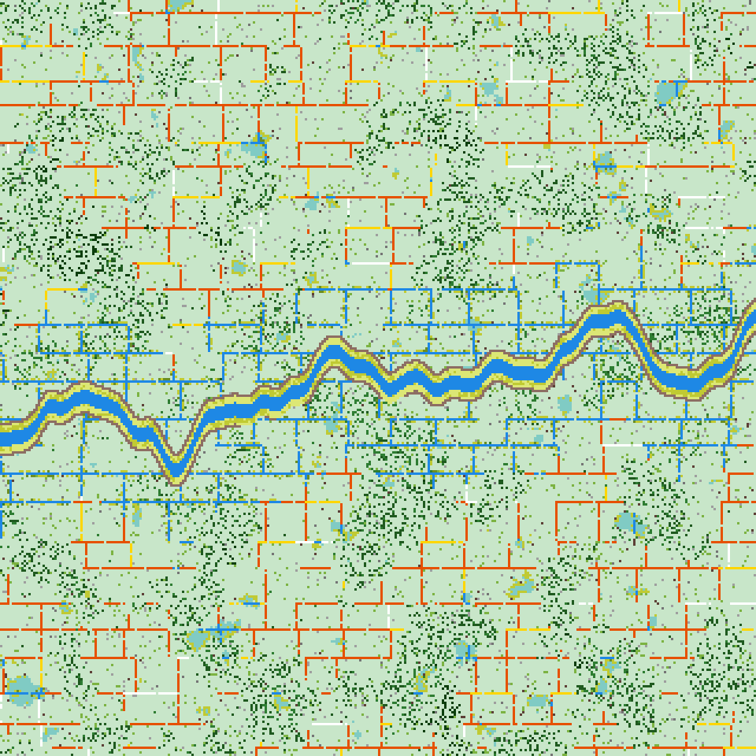
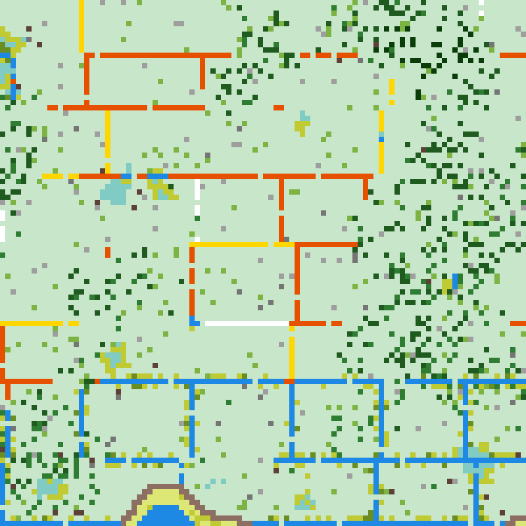
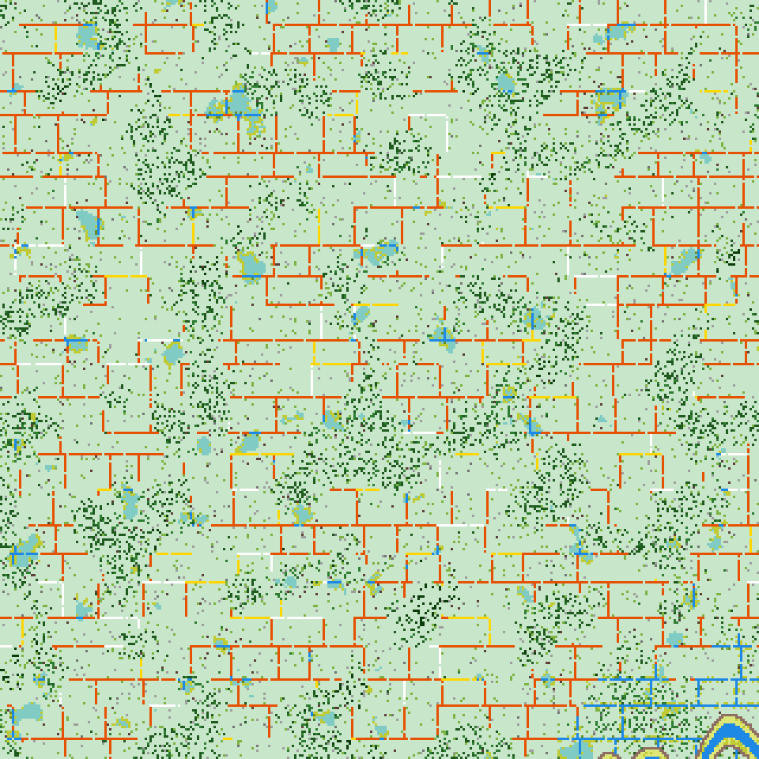

# Map generation review

[#60](https://github.com/gentoomaniac/sandbox-game/issues/60). **Plan first: nothing here is built.**
This page says what the generator does now, how the region looks, and in which steps to get from
one to the other. It waits for the user's approval (the open questions are at the end).

The maps below come from `tools/world_map.gd` (headless, no save is touched):

```
godot --headless --path . -s tools/world_map.gd -- --seed=42 --center=0,0 --size=320 --scale=3 --out=map.png
```

One block is one tile. Ground: light green grass, blue river and ditches, teal wetland, yellow
floodplain, beige mud, dark blue sea. On it: dark green trees, light green bushes, **orange Knicks,
white stone walls, yellow wattle fences**, brown dykes, yellow-green reeds.

## 1. What the generator does now

`game/world/world_generator.gd` is a pure function of the seed and the tile position. It has these
layers, in this order. Each layer looks at the tile and its neighbours only. None knows about the
others' purpose.

1. **River.** A centre line `y = f(x)` from one noise (amplitude 150 tiles, frequency 0.004), 3
   tiles half width, always the same width. One river, no creeks, no tributaries, no springs.
2. **Floodplain and wetland.** A band of 3 tiles beside the river; wetland where a second noise
   is above 0.45. The wetland patches are round blobs, joined to no stream.
3. **Coast.** West of a wandering line: salt marsh, mud, tideways (Priele), Warften, the sea. This
   part is good: it is made of lines that wind and widen, and it looks like the Wadden Sea.
4. **Trees and bushes.** One roll per grass tile. A forest is where the forest noise (frequency
   0.02) is above 0.1. The tree chance rises from 5 % at the edge to 22 % in the core. Outside the
   forest every tile still has 0.3 % for a tree. The species depend on wet or dry ground.
5. **Field layout** (`field_layout.gd`). The whole world is cut into a brick wall of fields:
   east-west boundaries 13 to 17 tiles apart, north-south ones 18 to 24 apart, in rows. Each
   stretch between two crossings is there with 80 %, has its own kind (Knick 80 %, wall 10 %,
   fence 10 %, rolled per stretch) and one gap.
6. **What a boundary becomes.** On dry Geest grass outside the forest noise > 0.1: its kind. In the
   marsh (within 36 tiles of the floodplain or the sea dyke) and on wetland: a ditch (water). In
   forests, on the floodplain, in the river: nothing.
7. **Dykes.** Land beside the floodplain, in stretches of a slow noise; the sea dyke along the
   whole coast.
8. **Things beside ditches.** Pollard willows (10 %) and reeds (30 %) on tiles next to a ditch.
9. **Stones, boulders, dead trees, tall grass, clay.** More rolls per tile.

### Why it looks chaotic



- **No woods, only speckle.** Every tile rolls alone. Inside a forest 22 % of the tiles hold a
  tree, at the edge 5 %. There is no edge (a rim of shrubs, then thinning trees), no clearing
  (nothing carves a hole into a forest), no minimum or even spacing, and the forest noise has
  one scale. Outside the forests 0.3 % of the tiles are a lone tree: that is the "loads of
  single trees". Bushes are scattered the same way.
- **Fields have no purpose.** The grid covers everything, also where nobody could farm and
  where there is no farm. No farm, yard, village or lane exists in the generator, so a field
  belongs to nobody. The grid is the same everywhere, brick-like, axis-aligned, and it does not
  follow the land (the river, a forest, a slope).
- **Boundaries stop and start for no reason.** Each stretch has 80 % chance, so isolated
  pieces stand loose: a wall with no field on either side. The grid line stops where the forest
  noise crosses 0.1 and where the marsh ends (36 tiles from the floodplain). Each stretch has its
  own kind, so one field is bounded by orange, yellow and white pieces in turn.
- **Ditches are the same grid, in water.** In the marsh the grid becomes ditches. They are
  straight, in a brick pattern, ten of them side by side, every stretch with a gap, ending
  nowhere (not at the river, not at a Sielzug), and cut off where the marsh reach ends. Nothing
  drains into anything.
- **Rivers do not wind like water.** One smooth noise curve, constant width. Wetland patches
  are blobs without a stream to or from them. There are no creeks.
- **The layers disagree at their seams.** A boundary meets a forest edge, a wetland patch or
  a dyke, and then is cut or turns into a different thing at once. Marsh and Geest boundaries
  meet along a line, so a ditch grid runs against a Knick grid.






The coast (right half of the seed 7 picture, left side) is the model of what the rest should be
like: lines that wind, and a structure that has a reason.

## 2. How the region looks

The setting is North Frisia in Schleswig-Holstein, about 1700 to 1800 (see
[generation.md](generation.md), [coast.md](coast.md)). The land has three zones, west to east.

**The Marsch** (marsh) is flat, treeless land behind the sea dyke and along the rivers, made of
silt. There are no woods. Trees stand only at a farm: ash, willows, elder around a Warft or a
farmstead. It is cut by **Gräben** (ditches) into long, narrow parcels. The Gräben run
at right angles to the dyke or the river and meet in bigger drains, the **Sielzüge**, which lead
to a **Siel** (sluice) in the dyke. A parcel is bounded by ditches, not by hedges, and the ditch
is also the fence for the cattle. The **Priele** (natural tideways) and old creek beds wind
through the land and the salt marsh, and a Koog (reclaimed land) is bounded by the dyke on its
seaward side. **Warften** (dwelling mounds) carry the farms, with a pond (Fething) on top. The
lanes run on the dykes (Deichweg), on the Warften and along a Sielzug. Farms stand beside them.

**The Geest** is the higher, sandy land behind the marsh. The fields (**Koppeln**) are small and
irregular, bounded by **Knicks**: a bank of earth about a metre high, planted with hazel,
blackthorn, hawthorn, with oaks left to grow tall at intervals (Überhälter). They were
planted in the "Verkoppelung" (land consolidation) from about 1770 and cut back every 10 to 15
years. Between two Knicks a lane runs, the **Redder**, sunken, and it leads from farm to farm and
to the village. Fieldstone walls are rare and where the stones are. Wattle fences are for
pastures near a farm. Hedges follow the shape of the land: they bend round a wetland or a wood.

**Woods** on the Geest are small, compact patches: oak and beech (hornbeam, birch), with a dark
inside and a clear **edge**: a mantle of shrubs and a skirt of herbs, then the tall trees. A wood
has a **clearing** (Lichtung) or a meadow inside now and then, and a path to the nearest field.
Between woods and fields lies a Knick or a bank. A lone tree outside a wood is rare: one beside a
farm, one oak in a Knick, one at a crossing.

**Water.** Streams on the Geest are small, wind, are fed from wetland and spring patches, and
run to the river. The river in the marsh is canalised and straighter; it meanders and is
wider at the coast. The ditches of the marsh flow into it through sluices.

### References

- Wikipedia (de), *Wallhecke* (the Knick, its build and its upkeep): https://de.wikipedia.org/wiki/Wallhecke
- Wikipedia (de), *Marsch*: https://de.wikipedia.org/wiki/Marsch
- Wikipedia (de), *Geest*: https://de.wikipedia.org/wiki/Geest
- Wikipedia (de), *Warft*: https://de.wikipedia.org/wiki/Warft
- Wikipedia (de), *Priel*: https://de.wikipedia.org/wiki/Priel
- Wikipedia (de), *Sielzug*: https://de.wikipedia.org/wiki/Sielzug
- Wikipedia (de), *Koog*: https://de.wikipedia.org/wiki/Koog
- Wikipedia (de), *Nordfriesland* (landscape): https://de.wikipedia.org/wiki/Nordfriesland
- Not fetched, titles from memory (to check before they are quoted anywhere): *Verkoppelung*
  (Schleswig-Holstein land reform, from 1766 on); *Redder*; *Marschhufendorf*.

The pages above load (checked), but only their titles and my knowledge of them went into this
page: the facts about Knicks, Redder and the drainage are the usual ones and should be read there
once before the numbers are tuned. The wiki rate limit stopped further checks.

## 3. The plan

Each step is one commit, passes `make test` and `make lint` on its own, and ends with new
"after" maps of the three seeds. The generator stays a pure function of seed and position.
Numbers go into `data/landscape.cfg`. Order: first the safe base, then the layers from the
natural land towards the worked land.

### Saves and determinism

A save holds the seed and the edits (`World.to_dict`: terrain edits, object edits with `null`
for a removed generated object, buildings). **Chunks are not saved**: they are generated again
from the seed with the edits replayed on top. So every change of the generator changes every
tile of an old save that has no edit, visited or not. Two more places read the generator and not
the save: `CampSite.spawn_of_seed` and `sleeping_bag_of_seed` (the wake-up point of a player
with no bed, found by searching the generated land) would move, and `World.object_at` of an
unloaded chunk asks the generator.

Handling (open question 1): step 1 is a save upgrade that **freezes the known land** before the
first generator change. It writes the old generator's terrain and objects as edits (`null`
where it had nothing) in an area around everything the player did, and stores the old start
point. Everything after that may change the generator. This is the way version 10 did it ("further
out an old world gets the new land"), but exact instead of clearing. The cost is a bigger save
(about 1 000 tiles for a radius of 16 around the work) and some edits that are not the
player's. The unvisited land of old saves changes. A new game with the same seed also looks
different from before.

### Steps

1. **Save: freeze the land the player knows.** Save version 43. The upgrade step takes the old
   generator (this step still has it) and, within R tiles of the buildings, edits, camp and the
   player, writes a terrain edit and an object edit (`null` for none) for every tile; and
   `player.home_bed` for a save without a bed. Files: `save_file.gd`, a helper next to it, `save_validator.gd`, `tests/test_save_upgrade*.gd`
   (an old save loads, its home area is as before after a generator change simulated by another
   seed). Drop the oldest upgrade step in a commit of its own, as the save rules say.
2. **Map tool and `make map`.** `tools/world_map.gd` (made in this review) goes into the Makefile
   as `make world-map SEED=.. AT=.. SIZE=..` and into `docs/development.md`, so every later step can
   produce its after-pictures. No test needed beyond lint; it is a tool.
3. **Woods.** Replace the per-tile roll in `_rolled_type_at` by a wood shape:
   - a *wood mask* from the forest noise, warped by a second noise so the outline is not a
     contour of one frequency, thresholded higher than now (woods are about 12 to 15 % of the
     land, not 35 %), and a minimum size: small blobs are dropped (a coarse noise cell decides);
   - the *depth* inside the mask (distance to the edge, by a few probes or by the noise slope)
     gives the zones: an **edge** of 2 to 3 tiles with shrubs and a few young trees; a **core**
     with trees at about 25 %, spaced (the roll is per 2 x 2 cell with a jittered tile, so no
     two trunks stack and no big gap stays);
   - **clearings**: a high-frequency noise above a threshold inside the core carves holes of 4
     to 10 tiles, with grass and bushes and nothing taller;
   - outside the wood: no lone trees, but for `CLEARING_TREE_CHANCE` cut to about 0.03 %, an oak
     in a Knick row and trees at a farm (steps 5 and 6 add these).
   Files: `world_generator.gd` (this may be the moment to move the tree layer to its own
   `WoodLayout` class like `FieldLayout`; the file is 745 lines), `data/landscape.cfg`
   (`[woods]`), `design/world/generation.md`. Tests: same seed, same woods; the share of the
   land that is wood; trees outside woods less than 0.1 % of the tiles; the largest wood is a
   connected area of at least 200 tiles and the smallest at least 40; clearings exist and are
   free of trees; the species shares stay as in design (28 % beech and so on, within tolerance);
   the camp is still found.
4. **Land use cells.** Keep the grid, but make each cell of it (field of `FieldLayout`) *something*:
   by a noise per cell: arable, pasture, wood, common (heath, no boundary). A cell with a wood
   mask over most of its area is wood. `FieldLayout` answers a boundary tile only where one of
   its two sides is arable or pasture, and the kind belongs to the field, not the stretch: Knick
   by default, wall where the boulder noise is high, fence for the pastures next to a farm.
   The random "80 % of the stretches" goes away: a boundary is there or it is not because of the
   cells beside it. Fields on the Geest get a jitter on the boundary lines so they are not
   a rectangular grid (a line wobbles by one tile per 6 by a noise, which the Knick follows).
   Files: `field_layout.gd`, `world_generator.gd` (`_is_geest_field`), `landscape.cfg`,
   `tests/test_field_layout.gd`, `test_world_generator.gd`, `test_landscape_data.gd`, design docs.
   Tests: **no boundary tile has a non-field cell on both its sides** (the rule of the issue);
   no boundary in a wood; one kind along one field; every field still has a gap (no field shut
   in, as now); same seed same result.
5. **Farms and lanes.** In some arable cells (about one in eight) stands a *farm site*: a yard
   of about 7 x 7 tiles in the middle of its cell, kept free, with a ring of trees (the farm
   grove: oak, ash, elder), a pond (Fething) at times, and a gap in the boundary beside it. A
   **lane** (Redder) runs along the grid lines from every farm site to the next crossing, then
   along a main line to the dyke or the river: 1 tile of path between two Knicks. The lanes are
   the only boundaries that exist for their own sake, so a wall is never loose. A lane is walkable,
   a gap at every crossing. Whether the farm site holds buildings is open question 4. Files: a new
   `farm_layout.gd`, `field_layout.gd`, `world_generator.gd`, `landscape.cfg`, tests (each farm
   has a lane that ends at a dyke or lane network; the yard is free and walkable; lanes never
   shut a field in). Check how a lane is shown: a path is a ground cover now (`path_rules.gd`),
   so either a lane is a worn path from the start or a new terrain: to be settled at this step.
6. **The marsh: parcels and ditches that drain.** In the marsh (and no longer on the same grid)
   the layout is in the coordinates of the water: *along* the dyke or river and *across* it.
   - Parcels are long strips across the dyke (about 12 to 20 tiles wide, 60 to 120 long), bounded
     by ditches along their long sides (the field edges) and one cross ditch at the far end;
   - every 4th to 6th ditch is a **Sielzug**, 2 tiles wide, that leads to the river or to the
     sea dyke and ends in a **Siel** (a gap in the dyke with water through it) and never ends
     anywhere else; the other ditches end in a Sielzug or the river, never loose;
   - a ditch is only where it has a field beside it: none on a Warft, none in a farm yard;
   - a crossing (gap) beside each farm and at least one every 40 tiles, so nothing is shut in;
   - no Knicks in the marsh; trees only at farms (the grove) and the pollard willows by the ditches
     as now; the Marsch is open.
   The old `_is_marsh` reach of 36 tiles stays as the zone, with the edge softened by noise so
   marsh and Geest meet in a wavy line, and with a Geest-side Knick where they meet. Files: a new
   `marsh_layout.gd`, `world_generator.gd` (`_is_ditch`, `_is_marsh`), `landscape.cfg`
   (`[marsh]`, `[sielzug]`), `design/world/generation.md`, `coast.md`. Tests: every ditch tile
   connects through water to a river, a sea dyke Siel or the coast, by flood fill on a sample
   area; no ditch tile at a Warft or yard; same seed same result.
7. **Creeks and a river that winds.** Add octaves to the river centre line so it has small
   bends (2 noises: the big one as now, a second at frequency ~0.02, amplitude ~6 tiles) and a
   width that changes (3 to 5 tiles half width, by a slow noise). Add **creeks** (Bäche): 1
   to 2 tiles wide, from a source (a wetland patch or a spring in a wood) to the river, as a
   centre line with noise bends, found by a rule that does not need a search: a creek per
   band of x (like the tideways do per band of y), flowing from its source towards the river
   along the slope of the river-distance with noise added, so it always reaches the river.
   Wetland patches get a creek out and sit at the sources. Files: `world_generator.gd` (or a new
   `creek_layout.gd`), `landscape.cfg`, docs. Tests: a creek reaches the river by flood fill,
   it is not straight (turns at least N times per 100 tiles), it is crossable (fords: a gap in
   the water, or the field gaps are still reachable; check with the existing "no field shut in"
   test over seeds). Fords are open question 6.
8. **Tuning and docs.** Compare "before" and "after" maps of the three seeds and a few
   screenshots in the game at zoom, adjust the numbers in `landscape.cfg` (wood share, field
   size, farm density, creek density), update `design/world/generation.md`,
   `coast.md`, `design/building/fences-and-walls.md`, the handbook and `docs/screenshots` that
   show the land. Put the after-pictures here, beside the before-pictures.

Each of steps 3 to 7 can be dropped or reordered without breaking the others, but 4 has to come
before 5 and 6 (they use its cells). The user can stop after any step and have a better
land than now.

### Other concerns

- **Speed.** The generator already probes neighbours a lot (`_is_beside_ditch` calls `is_ditch` on
  4 tiles, each of which asks the field layout). New layers must answer per chunk, not per tile,
  as `FieldLayout.cover` does: compute the cell data of a chunk and its rim once. Check with
  `make bench`.
- **Walking.** The travel masks and the pathfinder read the same terrain and objects, so a new
  layer needs no change there. #68 (travel in unloaded chunks) must call the same generator
  functions: nothing here should add a second source of the land.
- **No field shut in** is an invariant of the tests today; each step keeps it (gates and crossings
  are made by the same layout that makes the boundary).
- **Art.** A Knick, wall, fence and ditch have art. Lanes (step 5) may want a path look and a
  gate; the Siel may want a small object. They can use the current ones first.

## 4. Open questions

1. **Old saves.** The generator change changes the unvisited and the not-edited land of every
   old save. Step 1 freezes an area around everything the player did and stores the old start
   point. Or keep the old generator for old saves (a "generator version" in the save; two
   generators in the code), or accept the change with no protection. Default: freeze the land
   within 24 tiles of all buildings, edits, the camp and the player; the rest gets the new land.
2. **How much wood?** The woods are about 35 % of the land now (noise above 0.1). The region
   has less: about one tile in five or six on the Geest and almost none in the marsh. Default:
   about 15 % wood on the Geest, none in the marsh but groves at the farms.
3. **Conifers.** Keep the pine and spruce clumps (7 % of the trees, answer to #57 question 3 was
   "keep")? In the new woods they would stand in their own patches inside a wood. Default: keep, as
   patches inside woods on the Geest only.
4. **Farms.** Should the generator make farms, that is, yards with a grove and a lane (step 5),
   but no buildings, or also generated farm houses and barns that someone lives in? Default:
   yards, groves, ponds and lanes only; no generated buildings (the buildings are the player's
   and the villagers' work, and a generated house needs interiors and owners).
5. **Lanes.** Lanes (Redder) are a path between two Knicks from each farm to the net of lanes
   and the dyke. Wanted, as a real path on the ground from the start? Default: yes, a worn path
   look, 1 tile wide, with Knicks on both sides, and a Deichweg on top of the river and sea dykes
   as a path too.
6. **Creeks and crossings.** Creeks block walking like the river. Should they have **fords**
   (shallow places that can be walked, say one every 30 to 50 tiles), or only the gaps of the
   boundaries where one crosses? Default: fords, 1 tile, shown as a stone bed, so no land is cut
   in two by a creek.
7. **A Knick as the border of a wood.** In reality a wood is fenced by a Knick or bank towards the
   field. Default: yes, where a field touches a wood, the boundary runs along the edge of the
   wood (the wood side has the shrub mantle of the edge).
8. **The map tool.** It is committed in this review (`tools/world_map.gd`) so that the "before"
   pictures can be made again. Default: keep it, add `make world-map` in step 2, and use it for
   the "after" pictures.
9. **Order.** Default as above: save freeze, woods, land use, farms and lanes, marsh, creeks,
   tuning. Do you want a different first step (for example the marsh ditches, which are the
   ugliest)?
