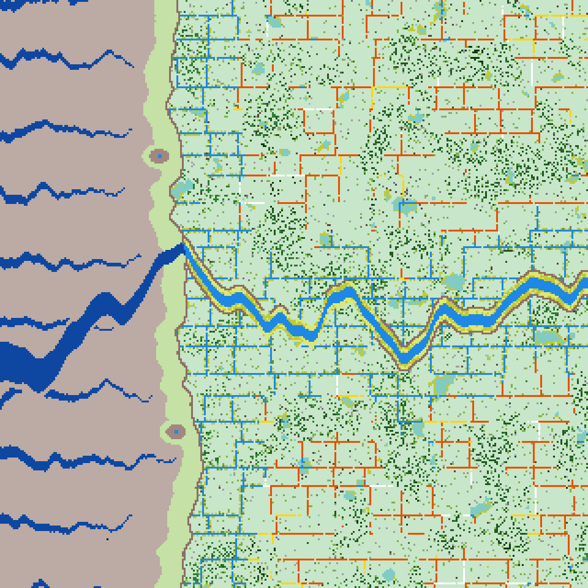
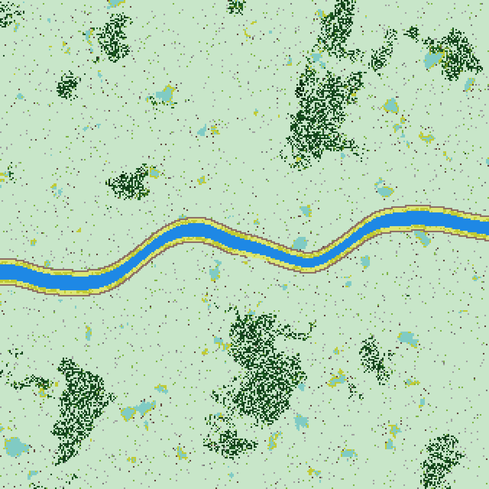
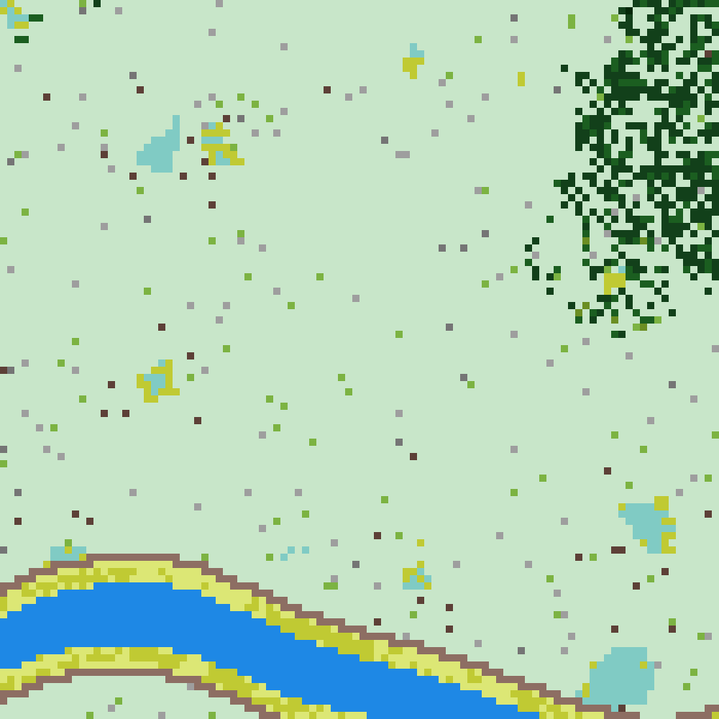
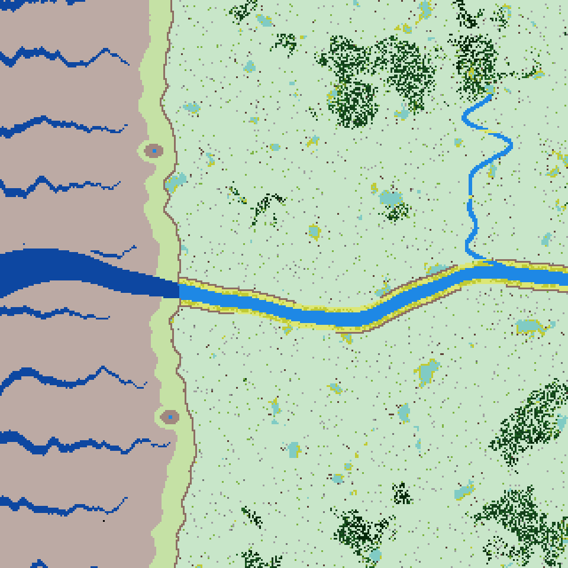
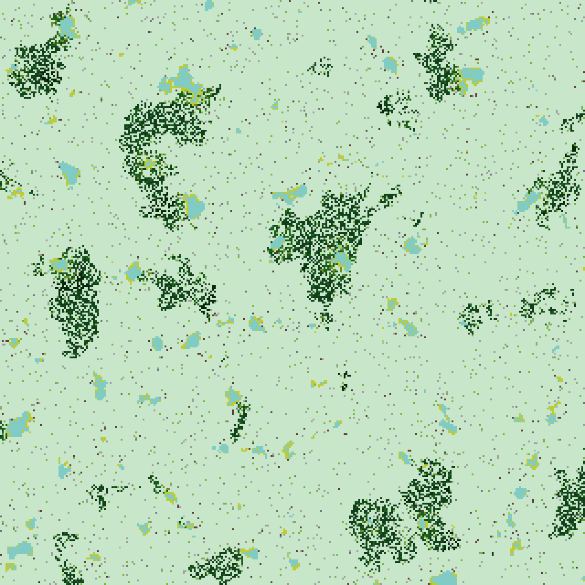
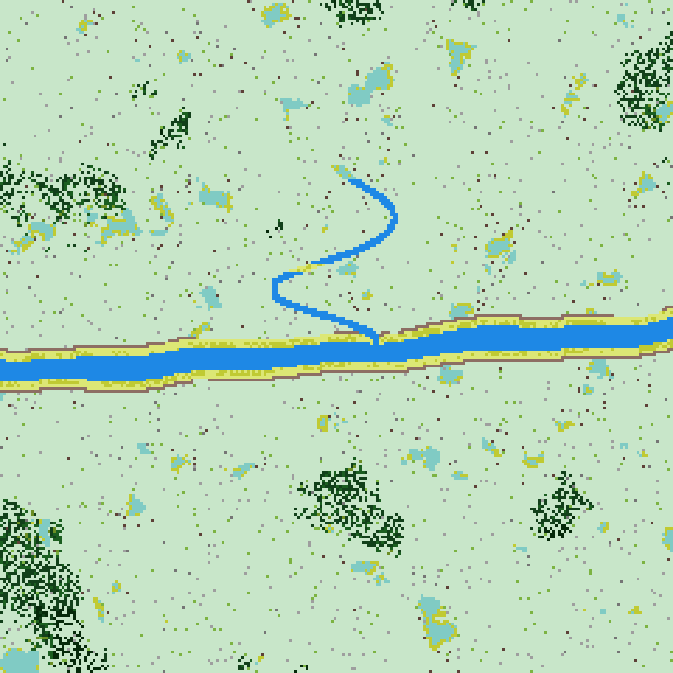
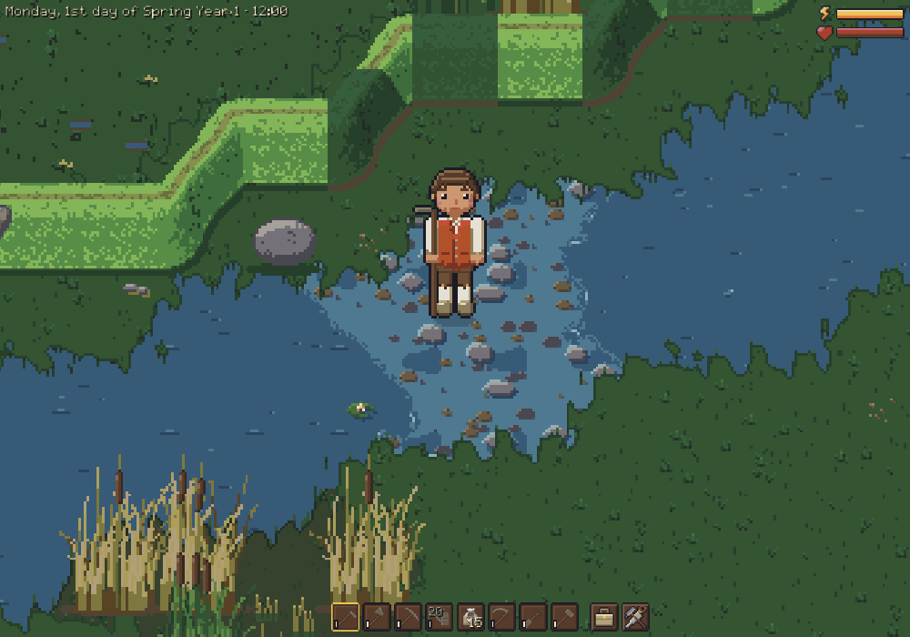
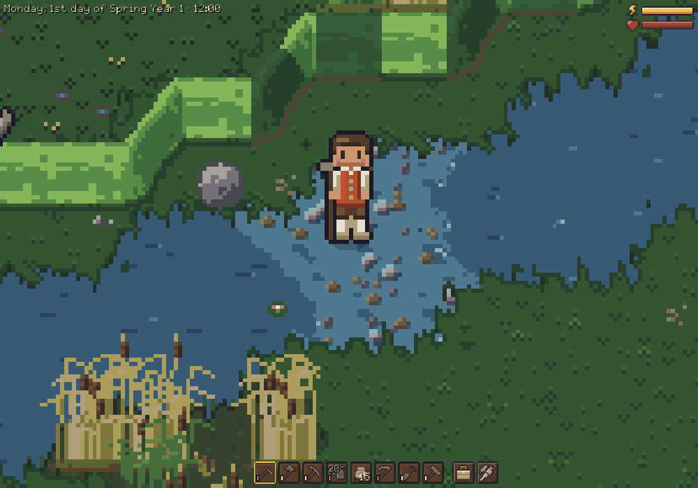

# Map generation review

[#60](https://github.com/gentoomaniac/sandbox-game/issues/60). This page says what the generator
did before, how the region looks, what the user decided (#71 to #74) and the steps that were
built from it.

The maps below come from `tools/world_map.gd` (headless, no save is touched):

```
godot --headless --path . -s tools/world_map.gd -- --seed=42 --center=0,0 --size=320 --scale=3 --out=map.png
```

One block is one tile. Ground: light green grass, blue river and ditches, teal wetland, yellow
floodplain, beige mud, dark blue sea. On it: dark green trees, light green bushes, **orange Knicks,
white stone walls, yellow wattle fences**, brown dykes, yellow-green reeds.

## 1. What the generator did before

`game/world/world_generator.gd` is a pure function of the seed and the tile position. It has these
layers, in this order. Each layer looks at the tile and its neighbours only. None knows about the
others' purpose.

1. **River.** A centre line `y = f(x)` from one noise (amplitude 150 tiles, frequency 0.004), 3
   tiles half width, always the same width. One river, no creeks, no tributaries, no springs.
2. **Floodplain and wetland.** A band of 3 tiles beside the river; wetland where a second noise
   is above 0.45. The wetland patches are round blobs, joined to no stream.
3. **Coast.** West of a wandering line: salt marsh, mud, tideways (Priele), Warften, the sea. This
   part is good: it is made of lines that wind and widen, and it looks like the Wadden Sea.
4. **Trees and bushes.** One roll per grass tile. A forest is where the forest noise (frequency
   0.02) is above 0.1. The tree chance rises from 5 % at the edge to 22 % in the core. Outside the
   forest every tile still has 0.3 % for a tree. The species depend on wet or dry ground.
5. **Field layout** (`field_layout.gd`). The whole world is cut into a brick wall of fields:
   east-west boundaries 13 to 17 tiles apart, north-south ones 18 to 24 apart, in rows. Each
   stretch between two crossings is there with 80 %, has its own kind (Knick 80 %, wall 10 %,
   fence 10 %, rolled per stretch) and one gap.
6. **What a boundary becomes.** On dry Geest grass outside the forest noise > 0.1: its kind. In the
   marsh (within 36 tiles of the floodplain or the sea dyke) and on wetland: a ditch (water). In
   forests, on the floodplain, in the river: nothing.
7. **Dykes.** Land beside the floodplain, in stretches of a slow noise; the sea dyke along the
   whole coast.
8. **Things beside ditches.** Pollard willows (10 %) and reeds (30 %) on tiles next to a ditch.
9. **Stones, boulders, dead trees, tall grass, clay.** More rolls per tile.

### Why it looks chaotic


- **No woods, only speckle.** Every tile rolls alone. Inside a forest 22 % of the tiles hold a
  tree, at the edge 5 %. There is no edge (a rim of shrubs, then thinning trees), no clearing
  (nothing carves a hole into a forest), no minimum or even spacing, and the forest noise has
  one scale. Outside the forests 0.3 % of the tiles are a lone tree: that is the "loads of
  single trees". Bushes are scattered the same way.
- **Fields have no purpose.** The grid covers everything, also where nobody could farm and
  where there is no farm. No farm, yard, village or lane exists in the generator, so a field
  belongs to nobody. The grid is the same everywhere, brick-like, axis-aligned, and it does not
  follow the land (the river, a forest, a slope).
- **Boundaries stop and start for no reason.** Each stretch has 80 % chance, so isolated
  pieces stand loose: a wall with no field on either side. The grid line stops where the forest
  noise crosses 0.1 and where the marsh ends (36 tiles from the floodplain). Each stretch has its
  own kind, so one field is bounded by orange, yellow and white pieces in turn.
- **Ditches are the same grid, in water.** In the marsh the grid becomes ditches. They are
  straight, in a brick pattern, ten of them side by side, every stretch with a gap, ending
  nowhere (not at the river, not at a Sielzug), and cut off where the marsh reach ends. Nothing
  drains into anything.
- **Rivers do not wind like water.** One smooth noise curve, constant width. Wetland patches
  are blobs without a stream to or from them. There are no creeks.
- **The layers disagree at their seams.** A boundary meets a forest edge, a wetland patch or
  a dyke, and then is cut or turns into a different thing at once. Marsh and Geest boundaries
  meet along a line, so a ditch grid runs against a Knick grid.





The coast (right half of the seed 7 picture, left side) is the model of what the rest should be
like: lines that wind, and a structure that has a reason.

## 2. How the region looks

The setting is North Frisia in Schleswig-Holstein, about 1700 to 1800 (see
[generation.md](generation.md), [coast.md](coast.md)). The land has three zones, west to east.

**The Marsch** (marsh) is flat, treeless land behind the sea dyke and along the rivers, made of
silt. There are no woods. Trees stand only at a farm: ash, willows, elder around a Warft or a
farmstead. It is cut by **Gräben** (ditches) into long, narrow parcels. The Gräben run
at right angles to the dyke or the river and meet in bigger drains, the **Sielzüge**, which lead
to a **Siel** (sluice) in the dyke. A parcel is bounded by ditches, not by hedges, and the ditch
is also the fence for the cattle. The **Priele** (natural tideways) and old creek beds wind
through the land and the salt marsh, and a Koog (reclaimed land) is bounded by the dyke on its
seaward side. **Warften** (dwelling mounds) carry the farms, with a pond (Fething) on top. The
lanes run on the dykes (Deichweg), on the Warften and along a Sielzug. Farms stand beside them.

**The Geest** is the higher, sandy land behind the marsh. The fields (**Koppeln**) are small and
irregular, bounded by **Knicks**: a bank of earth about a metre high, planted with hazel,
blackthorn, hawthorn, with oaks left to grow tall at intervals (Überhälter). They were
planted in the "Verkoppelung" (land consolidation) from about 1770 and cut back every 10 to 15
years. Between two Knicks a lane runs, the **Redder**, sunken, and it leads from farm to farm and
to the village. Fieldstone walls are rare and where the stones are. Wattle fences are for
pastures near a farm. Hedges follow the shape of the land: they bend round a wetland or a wood.

**Woods** on the Geest are small, compact patches: oak and beech (hornbeam, birch), with a dark
inside and a clear **edge**: a mantle of shrubs and a skirt of herbs, then the tall trees. A wood
has a **clearing** (Lichtung) or a meadow inside now and then, and a path to the nearest field.
Between woods and fields lies a Knick or a bank. A lone tree outside a wood is rare: one beside a
farm, one oak in a Knick, one at a crossing.

**Water.** Streams on the Geest are small, wind, are fed from wetland and spring patches, and
run to the river. The river in the marsh is canalised and straighter; it meanders and is
wider at the coast. The ditches of the marsh flow into it through sluices.

### References

- Wikipedia (de), *Wallhecke* (the Knick, its build and its upkeep): https://de.wikipedia.org/wiki/Wallhecke
- Wikipedia (de), *Marsch*: https://de.wikipedia.org/wiki/Marsch
- Wikipedia (de), *Geest*: https://de.wikipedia.org/wiki/Geest
- Wikipedia (de), *Warft*: https://de.wikipedia.org/wiki/Warft
- Wikipedia (de), *Priel*: https://de.wikipedia.org/wiki/Priel
- Wikipedia (de), *Sielzug*: https://de.wikipedia.org/wiki/Sielzug
- Wikipedia (de), *Koog*: https://de.wikipedia.org/wiki/Koog
- Wikipedia (de), *Nordfriesland* (landscape): https://de.wikipedia.org/wiki/Nordfriesland
- Not fetched, titles from memory (to check before they are quoted anywhere): *Verkoppelung*
  (Schleswig-Holstein land reform, from 1766 on); *Redder*; *Marschhufendorf*.

The pages above load (checked), but only their titles and my knowledge of them went into this
page: the facts about Knicks, Redder and the drainage are the usual ones and should be read there
once before the numbers are tuned. The wiki rate limit stopped further checks.

## 3. Decisions

The user's answers (issues #71 to #74) settle what the plan builds:

- **The open land is bare, with nature only.** No generated farms, yards, fields, lanes, walls,
  fences, hedges (Knicks) or ditches anywhere in the open land. Fields come only around the
  generated villages, and lanes only in and around villages and between them: that is the village
  task ([#9](https://github.com/gentoomaniac/sandbox-game/issues/9)), not this one. The player
  digs ditches to water fields later ([#86](https://github.com/gentoomaniac/sandbox-game/issues/86)),
  so the generator makes no ditch. What the review found wrong with the field grid, the loose
  boundaries and the ditch grid therefore goes away with the grid itself.
- **Natural creeks, few, winding, with fords.** A creek is natural water: it starts at a wetland
  patch, winds and reaches the river. Fords let a walker cross it.
- **Woods: the plan's defaults.** About 15 % of the Geest is wood, none in the marsh. The pine
  and spruce clumps stay, as patches inside the woods of the Geest. The groves at the farms and
  the Knick along a wood's edge wait for the villages: with no village, there is none yet.
- **The map tool stays,** as `make world-map`, and the steps keep the planned order.
- **Saves.** Today's saves are test saves, so a breaking change is fine; it goes into the release
  notes. Old saves keep loading, and the land they have not edited comes from the new generator
  (the seam between old edits and new land may look odd). No land freeze, no second generator,
  no village for old saves. The save version goes up by one (the next free number).

### Saves and determinism

A save holds the seed and the edits (`World.to_dict`); chunks are not saved but generated again
from the seed with the edits replayed. So a change of the generator changes every tile of an old
save that has no edit. `CampSite.spawn_of_seed` and `sleeping_bag_of_seed` read the generator
too, so the wake-up point of a player with no bed moves. All new layers are pure functions of the
seed and the tile position, with their own noise instances, so chunks still come out the same in
any order.

## 4. What was built

Each step is one commit that passes `make test` and `make lint` on its own.

1. **`make world-map`.** `tools/world_map.gd` (made in this review) goes into the Makefile and
   `docs/development.md`, so every step can make its after-pictures.
2. **Bare open land.** The generator stops laying the field grid, its boundaries, the ditches,
   and the willows and reeds beside ditches. `FieldLayout` and `[fields]`, `[kinds]`, `[ditches]`
   of `data/landscape.cfg` are deleted: the villages will lay their own fields. The dykes stay.
   The marsh keeps its reach (`[marsh]`), which still decides which trees stand on wet ground.
   The willow, which stood beside the ditches, is now a tree of wet ground (weight 2).
3. **Woods** (`game/world/wood_layout.gd`, numbers in `[woods]`):
   - a wood mask from the forest noise read at a position pushed up to 8 tiles by a warp noise,
     above 0.27, which makes about 15 % of the Geest wood; none in the marsh (the warp makes the
     marsh edge wavy, not a line along the river);
   - the depth inside the mask gives an edge of shrubs and few young trees (a tuft where the noise
     barely clears the threshold has no trees at all: the minimum size) and a core: a tile holds
     a trunk with a chance of 0.15 at the edge to 0.55 in the core (not above about 0.6, so a
     walker gets through); the forest noise has a wavelength of about 80 tiles;
   - clearings carved into the core by a fine noise, with grass and bushes only;
   - no lone trees outside a wood (the lone tree chance is gone);
   - pine and spruce stay as patches inside the woods of the Geest.
4. **A river that winds, and creeks** (`game/world/river_line.gd`, `creek_layout.gd`, `[creeks]`):
   - the river's centre line gets a second, finer bend (5 tiles at most; both noises with two octaves, so the
     meanders are smooth and the line moves under 1.5 tiles per column) and a width that changes
     (up to 2 tiles more per bank); the distance from it is measured with the widening taken
     off, so the half width, the floodplain and the dykes are the same numbers everywhere;
   - creeks: one in 60 % of the bands of 160 tiles along x, from the river north or south for 50
     to 130 tiles, from a small wetland (the source) down through the floodplain and the dyke, 2
     tiles wide, in S-bends of about 35 tiles up to 22 tiles either side of the band's middle; where
     the line moves more than a tile per row a row's water spans to the rows beside it, so the
     water is always joined (tested); a **ford** (floodplain terrain, a
     walkable crossing; its stone-bed art came with #96) once in every 36 rows: a round patch
     about 3 tiles across on the creek's middle line, so it crosses the creek and is no band
     where the creek runs east to west (#99).
5. **Docs, save version and release note.** `design/world/generation.md`, `coast.md`, the
   handbook and the after-pictures; the save version goes up and the release note says the land
   of old saves is new.

### What changed from the first plan

- The plan's land-use cells, farms, lanes and marsh parcels (steps 4 to 6 of the first plan) are
  not built: #73 put fields and lanes with the villages (#9) and ditches with the player (#86).
- The save freeze (step 1 of the first plan) is not built either (#71): old saves load, and the
  land they did not edit is the new generator's.
- Creeks come from wetland sources they bring themselves (a small patch at the creek's head), not
  from the existing wetland blobs: those stay as they are. The creeks are one per band of x
  rather than a search, so a tile asks only its own band.
- A ford is floodplain terrain: a new terrain would need art, tile sets and rules in many places.

## 5. Not built here

Farms, farm yards, lanes (Redder), land-use cells, the marsh parcels with their Sielzüge and
Sielen, and groves at farms. They need a village to belong to ([#9](https://github.com/gentoomaniac/sandbox-game/issues/9)).
The marsh stays open grass behind the dyke, with the river's reeds and the wetland patches.

The generator keeps asking the terrain per tile, so a new layer must answer cheaply (see
`make bench`); the travel masks and the pathfinder read the same terrain and objects and need no
change.

## 6. Before and after

The same seeds and places as the before maps of section 1, made by `make world-map` (see
[docs/development.md](../../docs/development.md); the commands are in the file names: seed, place).
The before maps are in `docs/screenshots/map-generation/before-*.png`, the after maps beside them.

Seed 42, 320 x 320 tiles around the middle of the world:




Seed 42, 100 x 100 tiles (before: loose fences and walls, a ditch grid; the place of the after
map is 45 tiles north of the middle, as the before map's place was not kept):




Seed 7, the coast and the river, around x = -200 (two creeks run into the river):




Seed 1234, around (300, -200):




Seed 1, 240 x 240 tiles around (-80, 0): a creek from its source to the river in S-bends (it has
fords, two rows of floodplain, drawn in the floodplain's colour):



Seed 1, a ford where the creek runs east to west, at (82, -1) (#99), in both arts: a patch about
3 tiles long across the creek, not a band along it:




The maps show trunks only, as dark green dots; the crowns are about 3 tiles wide in the game, so a
wood reads denser there. Tall grass is not drawn.
