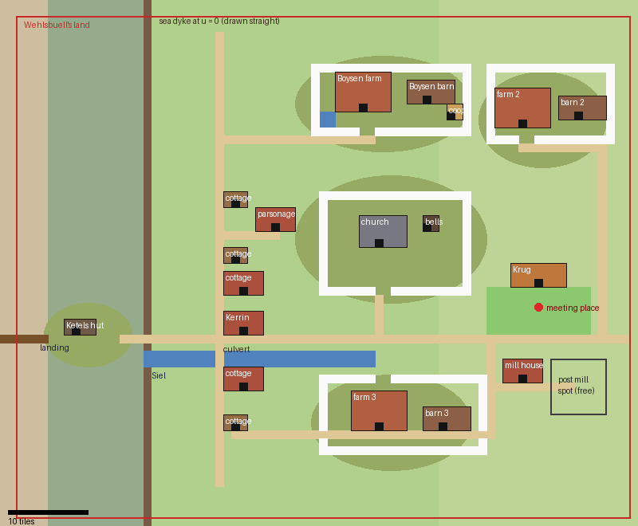

# Wehlsbüll in the world

[#9](https://github.com/gentoomaniac/sandbox-game/issues/9) (task 234). **Plan first: nothing here
is built.** This page says where the village stands, which buildings it has, how it gets into the
world, and in which steps. It waits for the user's approval (the open questions are at the end).
It was written to fit two plans that wait for answers too: the
[map generation review](map-generation-review.md) (#60) and the routines plan (#7, "Routines: the
plan" in [../villagers/routines.md](../villagers/routines.md)).

## 1. The proposal in short

- **Where:** at the coast, west of the camp, on the first row north or south of it where the land
  fits. The church is about 230 tiles from the camp in x, so a walk of about a minute (the player
  walks 5 tiles a second).
- **How:** the village is **not part of the generator**. A `VillageBuilder` writes it into the
  world when a new game starts: terrain edits, object edits and placed buildings, saved like
  anything else the player does. The place is found from the seed, the same every time.
- **What:** three farms on Warften in the Koog, the church with its churchyard and bell frame, the
  parsonage, the Krug, six cottages by the dyke and the sluice, the landing, a free spot for the post
  mill, lanes, walls and fences. 19 buildings, all of types that exist; where none fits, a placeholder.
- **Who:** the eight villagers of `data/villagers.cfg` are spawned once, at their doors, and get
  their homes and workplaces. The other houses stand empty.
- **The village is not the player's:** its land is a record in the world. Building there costs
  goodwill, its houses can't be taken down, and build mode shows the land's edge.
- **Meeting place:** the village green by the Krug (weekday evenings, Saturday) and the churchyard
  (Sunday). The world record names the spot; #7's routines read it.
- **Old saves** keep their world as it is. A console command may add the village later (step 9).

The picture is drawn by [wehlsbuell-layout.py](wehlsbuell-layout.py), which also checks the layout:
no two buildings overlap, every door has its free tile in front, and from every door one can walk to
the main lane round the fences. Brown on the left is the sea dyke, green-grey the salt marsh, tan the
mud. White is wall and fence, tan lanes, blue water, the red dot the meeting place.

## 2. Where

### How far from the camp

The player walks 5 tiles a second (`PlayerState.SPEED`), so a minute is 300 tiles. The coast line runs
about 260 tiles west of the centre (`line_x=-260`, wandering 40 either way), and the camp is at the
centre. A village at the coast is a walk of 45 to 60 seconds. The Koog is behind the sea dyke and the
Geest edge is 36 tiles from it, so the whole village is within 60 tiles of the dyke.

### Finding the site (`VillageSite`, a pure function of the seed)

Starting at the camp's row and going north and south in steps of 4 rows, the first row `y0` where the
layout fits. The layout fits when, with `dyke_x` the first land tile east of the salt marsh in a row:

1. **The coast is straight enough:** `dyke_x` in every second row from -30 to +36 is within 8 tiles of
   that of `y0`. The inland part is laid out 9 or more tiles behind the dyke of `y0`, so the wandering
   coast never reaches it.
2. **The inland land is dry:** every tile from 9 to 58 east of the dyke, rows -26 to +32, is grass,
   Warft, wetland (the village drains it) or a ditch of the generated grid (the village fills it).
   No river, floodplain, mud or sea.
3. **The landing has salt marsh:** the 11 by 9 tiles seaward of the dyke at the landing's rows.
4. **The camp can walk there:** no river on the straight line from the camp (32 samples). Step 2 checks
   it with a real path search, not only the line.

It needs nothing from the world's edits, so the same function answers for a new game of any seed.
The search stops at the first fit, so its cost is a few hundred thousand `terrain_at` calls at most
(to be measured in step 2).

**Checked on the current generator** with a scratch script (rules 1 to 3, in rows of 4, over seeds 1
to 20): a site exists for all 20. The offset from the camp's row is 24 to 448 rows, the median 122.
So the church is 230 to 510 tiles from the camp: a median of 52 seconds, 17 of 20 seeds within 70
seconds, the worst 100 seconds. With a coast slack of 4 instead of 8 only 18 of 20 seeds fit and
the offsets were far larger (up to 750 rows), which is why the layout stays 9 tiles from the dyke.

## 3. The buildings

All on the layout above. `u` is tiles east of the dyke's nominal line, `v` rows south of `y0`. The
plan lives in `data/village_plan.cfg` (step 1), one section per thing, so the layout is data and not
code.

### Farms on their Warften (the Koog, behind the dyke)

| Building | Type | Where | Lives there |
|---|---|---|---|
| Boysen farm | `hall_house` (7x5) | Warft (30, -17), 22x12 tiles, with a pond | Antje, Hinrich, Boy |
| Boysen barn | `barn` | same Warft | works: Hinrich, Boy |
| coop | `chicken_coop` | same Warft, in the yard | nobody |
| Farm 2 | `hall_house`, `barn` | Warft (50, -15) | nobody |
| Farm 3 | `hall_house`, `barn` | Warft (31, 23), south of the main lane | nobody |

Each farm yard has a wattle fence with a gap at its gate, trees (alder, willow, oak) and a draw well
on the Boysen yard. The Warften are `WARFT` terrain edits in an oval, the same terrain as the
generated Warften of the salt marsh. A pond (Fething) is a `WATER` edit, 2x2.

### The church, the churchyard and what is by it

| Building | Type | Notes |
|---|---|---|
| Church | `church` (6x4) | on the highest Warft, 24x16 tiles, middle of the village |
| Churchyard | stone wall, 19x13 tiles | one gate on the south side, graves (`grave`) inside |
| Bell frame | `bell_frame` | inside the yard, east of the church (task 102) |
| Parsonage | `kate`, style `brick` | **placeholder:** the pastor has no house type; nobody lives there |
| Krug | `longhouse` | **placeholder:** an inn is not a type; nobody lives there. By the green |

The sexton's house with the school is left out (no villager, no type).

### By the dyke and the sluice

| Building | Type | Lives there |
|---|---|---|
| Kerrin's house | `kate`, style `brick` | Kerrin ("a small brick and thatch house at the foot of the dyke, by the sluice road": task 120 made the style for her) |
| Five cottages along the Deichweg | `shack` x3, `kate` (style `geest`), `kate` | nobody; for the made-up cottagers and day labourers later |
| Landing: Ketels hut | `fisher_hut` on a small Warft **outside** the dyke, on the salt marsh | Momme, Inken |
| Landing: jetty, rowing boat, net frame, eel traps | the objects of task 103 | the jetty runs over the mud |
| Sluice (Siel) | **placeholder:** a two-tile gap in the dyke with the Sielzug (a 2-tile ditch behind it, 28 tiles long) running through, water ending two tiles beyond | |

### The mill

- The post mill does not exist as a type. Its spot is a free 7x7 square at the Geest edge, in the
  record (`mill_spot`), kept clear. Nothing is built on it by the village. The player may build on
  it (it is the village's land; see section 6).
- The mill house at its foot is a **placeholder**: `kate`, style `geest`, with room for two. Ocke
  and Gesche live in it. When the mill house is a type of its own (the sheets say "not a building
  yet"), the plan changes the type and nothing else.

### Lanes, fences and walls

- **Lanes**, one tile wide, laid as worn path: the **Sielweg** from the landing through the dyke gap
  across the whole village to the Geest, the **Deichweg** along the dyke (north to south), and a
  lane from each farm gate and from the churchyard gate to them. A lane over the Sielzug is a
  culvert: the lane tile stays land. Section 8 says how they stay.
- **Walls and fences:** the churchyard is a `stone_wall` ring, the farm yards `wattle_fence`. Each
  has a gap at its gate, and the door of every house has its free tile in front. Nothing shuts anyone
  in (a test, like the rule for the fields).
- **Placed from the generator's land:** the grid of boundaries, ditches, reeds, willows, trees and
  stones inside the village's rectangle are removed first (object edits `null`, drained wetland and
  filled ditches as terrain edits), so the village stands on clean ground. About 1 500 edits are
  expected (to be measured in step 3); the village itself adds about 800.

## 4. Generated or placed: placed, at new-game time

Two ways: a layer of the generator (`generate_chunk`) or edits and buildings written once.
**Proposed: written once, when a new game starts.**

- **Buildings can't be generated.** A building is an entity of the world with an interior, residents
  and a save entry, not a tile. The generator makes terrain and objects only. A village in the
  generator would still need a second step for its buildings; written once, one mechanism does it all.
- **It keeps the generator free for #60.** #60 changes the layers of the generator, one step at a
  time. A village built into them would have to be rewritten each time. A village of edits sits on
  top of whatever the generator makes, and the old village of a save stays as it was.
- **Edits are saved already.** Terrain edits, object edits (`null` for removed) and buildings are in
  `World.to_dict`; the far view (#68) sees them, as [../villagers/travel.md](../villagers/travel.md)
  asks ("from `generate_chunk` or an edit or a building of `World`").
- **It is deterministic.** `VillageSite` and `VillageBuilder` read only the seed and the generator's
  public functions (`terrain_at`, `is_ditch`, the object roll of a tile). Every random choice is a
  hash of the seed and a tile, never the global random generator, and the search goes row by row so a
  tie is always broken the same way. A test builds twice and compares the edits.
- **The cost:** the village's edits and buildings make the save bigger (a few hundred KB of JSON at
  most, to be measured), and the new game builds 12 chunks more than today. Both are measured in step 3.
- **What stays outside:** the *land* of the village is not generated, so a new game with the same
  seed and a newer generator gets a village on the newer land. That is right: it is built when the game
  starts, not remembered.

## 5. The eight villagers

Spawned once, in `GameState.new_game`, after the village is built, each at its door with
`Npcs.spawn_villager`. `Households.settle` (the signal of the spawn) then finds the house of their
sheet's type nearest to where they stand, so Boy and Antje join Hinrich's hall house and each
workplace is the nearest of its type. Where the sheets say nothing the plan does it by name.

| Villager | Home (building type) | Workplace | Interior |
|---|---|---|---|
| Antje Boysen | `hall_house`, Boysen farm | the hall house itself (the dairy) | `boysen.tmx` (her sheet) |
| Hinrich Boysen | the same | `barn`, Boysen barn | the same |
| Boy Boysen | the same | `barn` | the same |
| Momme Ketels | `fisher_hut` at the landing | spot "the landing at the sluice" (the jetty's root) | the type's room |
| Inken Ketels | the same | none | the type's room |
| Kerrin Paulsen | `kate`, style `brick` | none | the type's room |
| Ocke Hansen | `kate`, style `geest` (**placeholder mill house**) | spot "the post mill" (at the free spot) | the type's room |
| Gesche Hansen | the same | the same spot | the type's room |

- **Sheet changes:** Ocke and Gesche get `workplace_spot="the post mill"` (the plan gives the spot its
  tile, as it does for the landing). Their `home_building` stays empty: `spawn npc ocke` must not
  put them into Kerrin's kate. The village plan names their house instead.
- **Interiors (task 237):** only the Boysens have their own map. The others use the room of their
  house type. More maps are Tiled work, not this task.
- **Once:** the spawn is in `new_game` only. A save holds the villagers, so a load never spawns them
  again. A flag in the village record (`populated`) keeps the old-save command (step 9) from doing it
  twice.
- **Tests:** every villager has a home that is a building of the village, the Boysens share one, the
  workplaces are as the table says, and the door of every home leads by path to the church gate and
  to the green (a real search over the generated land).
- **Home search:** `home_search` is 40 tiles. The villagers spawn at their own doors, so the longest
  search is a few tiles.
- **The made-up villagers:** `spawn npc N` and the crowd are not part of this task. The six cottages and
  two farms are for them. Question 4.

## 6. Reputation and showing the village's land

[reputation.md](../villagers/reputation.md) says "building inside a settlement's territory costs
reputation with its NPCs" and "the world generator marks territory". Reputation itself is not in
the code yet ([../villagers/relationships.md](../villagers/relationships.md)). What is there: the
deed log and the villagers' opinions of the player (`data/gossip.cfg`: `[built]` is +1 now).

**Proposed first version:**

- **The land is a record.** `World.village` holds the name, `area` (a rectangle, here from `u` -16 to 60
  and `v` -28 to 34, about 76 x 62 tiles, clipped to the land), the meeting spot, the mill spot, the
  lanes and the buildings the village put there. `World.is_village_land(tile)` answers. It is the
  territory of reputation.md, written by the builder and not by the generator, because the village is
  made at the start of a game.
- **Deeds in the land weigh otherwise.** A new section `[village_land]` in `data/gossip.cfg` has a
  `change` for `built` (-2), `fenced` (-1) and `felled` (-1) done inside the land, used instead of
  the section's own. The witnesses are as ever (who saw it). The story the language model judges says
  "on the village's own land". The one-hop spread through friends and enemies is the reputation task's
  and not this one's.
- **Its houses are not the player's.** The hammer's take-down refuses a building of the record
  ("That is the village's."). Walls and fences are not protected (no deed kind for them yet).
- **Shown before building.** With the hammer in hand the land's edge is drawn as a line over the
  terrain (like the build ghost), and while the ghost is inside the land the hint line says
  "Wehlsbüll's land: the villagers will not like it". A console command `village` says where it is
  ("about 232 tiles west, 120 south") and what it holds.
- **The land of the post mill's spot** is inside the line. A player who builds the mill there does
  it on the village's land and pays in goodwill like anyone.

## 7. The meeting place

The issue wants a place where villagers come together now and then, so gossip has meetings.

- **The place:** the green, a 13 x 6 tile grass patch between the Krug, the churchyard and the Sielweg,
  with a draw well in the middle and four benches. Its centre is `meeting_spot` in the record. It
  is open, so it is "in the open" for the rain rule of the routines.
- **When:** the routines of #7 say it: the `meeting` step (weekday 19:00, Saturday evening at the
  Krug, Sunday afternoon) goes to the green, the `church` step (Sunday 9:30) to the churchyard.
  Section "Which places are where" of the routines plan takes `meeting` from "the place the village
  names for it": that is this spot. Until #9 lands, #7's fallback (the church yard) stays.
- **Order of the two plans:** both orders work. If #9 comes first, the record has `meeting_spot` and
  nothing reads it, so nobody comes together until #7 (the villagers still stroll about their yards,
  and gossip needs no more than two of them to be near). If #7 comes first, one line of
  `RoutinePlaces` and its test change to read the record.
- **Distances:** a tile is a game minute. The longest daily walk is the landing to the Krug (about 65
  tiles, an hour of game time, 43 seconds of play); the mill house to the church is about 32. The
  routine's "leave early" estimate covers both. If the village feels too wide, the Krug moves west,
  next to the church (question 5).

## 8. Lanes that stay

A lane is a path on the ground today only if it is walked: desire paths wear in and grow back in two
weeks ([../../data/paths.cfg](../../data/paths.cfg)). The village sets its lane tiles to full wear at
build time (the wear map is saved) and the nightly regrowth skips tiles of the record's lanes. So a
lane stays a lane without walking. This is the smallest way. #60 (question 5) may give lanes a terrain
or an object of their own; then the village uses that and the skip goes. Step 5.

## 9. How it fits the other plans

### #60, the map generation review

- **The village needs from #60:** the map tool, step 2 (`make world-map`), first. It draws what the
  generator makes, and with a `--village` option (added in step 3 here) it would build the village
  into a scratch world and draw that too, so the site and its seams can be looked at for any seed
  before the village is built.
- **Not needed first:** step 1 (the freeze of the known land). A new game builds the village on the
  generator as it is then, and nothing in it depends on later layers.
- **The freeze must include the village.** Old saves with a village (new games from this task on)
  have edits that sit on today's land. When #60 changes the generator, the unedited tiles of the
  village's rectangle would change under it (a new ditch grid across the green). So #60's step 1
  freezes the **whole `area`** of `World.village`, not 24 tiles around each edit. Cheap to add: one
  more region.
- **Generated farms and the village's farms** (the proposal in the brief: generated farms near the start
  become the village's farms). **Proposed instead: they stay separate.** Reasons: the village's farms
  need exact things (the Boysen yard with a pond, the barn that Hinrich works in, a door that lies on a
  lane), and #60's farms are yards without buildings (its question 4). The village is in the queue now
  and #60's step 5 and 6 are far. Where they meet, the generated farm sites outside the village's
  rectangle are the **outlying farms** of the Geest (village.cfg: "Cottagers and day labourers live on
  the outlying farms of the Geest"), and the village's rectangle, cleared by edits, shows no generated
  farm, lane or ditch grid inside it. If the user prefers the brief's way, the village would wait for
  #60's step 6 and take its farm sites (question 2).
- **Lanes and Sielzug at the seams:** #60's lanes (Redder, Deichweg on the dykes) end at the dyke or at
  a lane. The village's Deichweg and Sielweg are paths on the same ground, so a generated lane that
  reaches them meets them. The ditches of #60's step 6 end loose at the border of the cleared
  rectangle, unless the village's Sielzug and the culverts are made for them: not planned, to be
  looked at in the after-maps.
- **Woods (step 3), land use (step 4):** no effect on the marsh part. The mill spot is at the Geest
  edge and cleared by edits, so a wood that #60 plants later does not grow on it in an old save.

### #7, routines

- **`meeting`:** `World.village.meeting_spot`, section 7.
- **`church`:** the church building of the village, found by the routines as "the church nearest to
  their home".
- **`home`, `work`:** the homes and workplaces of section 5 (`Households`, `Workplace.spot()`).
- **A spot as workplace** (the landing, the post mill) is a tile: `Workplace.of_spot`.
- **Nothing in #7 changes** for this task but the one `meeting` line when #7 comes first.

## 10. Old saves and the save version

**Proposed: an old save keeps its world as it is.** Its record `village` is empty, and the world
works as before. Reasons: the village changes ground that the player has perhaps worked on and that
the old save's own villagers (`spawn npc antje`) may already stand on; the generator is going to
change under it (#60), and a village put in at load would be the first edit to freeze.

- **Save version:** one bump, to 43 (`World.village`: the record, or `null`; the upgrade sets `null`).
  #60's step 1 also names 43; whichever is merged first takes it and the other 44. The commit that
  drops the oldest upgrade is its own, as the save rules say. The validator checks the record: the
  area, the buildings it names stand, the meeting spot is inside the area.
- **Where the land is still untouched:** step 9, optional, a console command `village build` in an old
  save finds the site by the same function, builds only if no edit, object edit or building lies in
  the rectangle, and handles villagers that exist already (it moves them to their homes instead
  of spawning them again). Not in the first version (question 3).

## 11. Tests

One file for each part, short, in `tests/`:

- `test_village_plan.gd`: `data/village_plan.cfg` parses; every building type exists; no overlaps; every
  door has its free tile; lanes join; no fence or wall shuts a door in (the checks of the mock script);
  a bad file is reported, not a crash.
- `test_village_site.gd`: a site is found for 20 seeds; the same seed gives the same site (and a different
  seed a different one); the site is inside the world and within 330 tiles of the camp for the seeds
  of the test list; the camp is where it was (the village is outside its search radius).
- `test_village_builder.gd`:
  - **same for a seed:** build twice, compare the terrain edits, object edits and buildings;
  - **never on water:** every tile of a building, lane, wall, Warft and the meeting spot is dry land
    (or the Warft, or the jetty over the mud) in the built world; the pond and the Sielzug are the
    only water inside the rectangle that was not there;
  - **never on the player's buildings or edits:** a world with a player's shack inside the
    rectangle is refused (nothing built, a reason returned);
  - a Warft ring of salt marsh stays round the landing; the dyke has only the Siel's gap;
  - every door has its free tile; the lanes join; the churchyard has its gate.
- `test_village_people.gd`: each of the eight has a home and the workplace of the table; the Boysens share
  one house; spawned once (a save and a load spawns none); a villager's door reaches the church gate by a
  real path search for 5 seeds (`NpcRoadCase`'s helpers over the generated land).
- `test_village_record.gd`: the record's save round trip; a save of the version before loads with none;
  the validator names a bad area; `is_village_land` on the edge; the lanes skip the regrowth; the
  take-down is refused for the village's buildings and allowed for the player's.
- `test_village_deeds.gd`: a `built` deed inside the land has the village's change, one outside the
  usual.
- The far-view parity case of travel.md ("The parity test gets a village case"): the masks over the
  village equal the loaded chunks'.
- A bench (`tools/bench/`): the new game's build time and the save's size, numbers written here.

## 12. Screenshots

Both arts, taken with `make screenshot` (the classic 16 px art with `ARGS=--classic-art`), saved to
`docs/screenshots/`, as `wehlsbuell-<what>.png` and `wehlsbuell-<what>-classic.png`:

- the village from above (zoomed out, `ZOOM`), the church and the green by the Krug at dawn, the Boysen
  farm yard with the villagers, the landing and the sluice at low water, and build mode with the land's
  edge.
- Checked by eye for both arts: a Warft, the wall, the fence, the jetty, the buildings in each. No new
  art is drawn: every building type and object exists in both arts. Where the classic art misses
  something (the Warft or the jetty), the picture says so and it becomes an art task.

## 13. Handbook and design pages

- **Handbook:** [villagers.md](../../handbook/villagers.md) ("Who lives here": they live in Wehlsbüll from
  the start; "Homes and workplaces"; the village's land and the hammer), [world-and-seasons.md](../../handbook/world-and-seasons.md)
  (a section on the village and the Koog Warften), [building-and-crafting.md](../../handbook/building-and-crafting.md)
  (the land's edge and the refused take-down), [console.md](../../handbook/console.md) (`village`),
  [saving.md](../../handbook/saving.md) (old saves have no village).
- **Design:** [coast.md](coast.md) (the village's Warften), [generation.md](generation.md) (the village is
  not generated; the site search), [../villagers/reputation.md](../villagers/reputation.md) (the territory
  is the record; the first rule), [../villagers/villagers.md](../villagers/villagers.md) ("Where none stands
  (there is no village yet, task 234...)"), [../villagers/travel.md](../villagers/travel.md) ("The village" is
  done), [../tech/saving.md](../tech/saving.md), and the comments of `data/villagers.cfg` that say "until the
  village does (task 234)". This page is marked as built, step by step.

## 14. The steps

Each is a commit that passes `make test` and `make lint` on its own, with its tests and doc lines.

1. **The plan as data.** `data/village_plan.cfg` and `VillagePlan`: the buildings, Warften, lanes, fences,
   the green and the spots, in the `u`/`v` frame, with the checks of the mock script (`problems`). No
   world change. Tests: `test_village_plan.gd`. Doc: the file's header.
2. **The site.** `VillageSite.find(seed)`: the row search of section 2. Tests: `test_village_site.gd`.
   Needs #60's step 2 for pictures, not for code. The search cost is measured and written here.
3. **The ground.** `VillageBuilder.build_land`: clears the rectangle, drains, writes the Warften, the pond,
   the Sielzug, the dyke gap, walls, fences, trees, graves, the well and the landing objects. The map tool
   gets `--village`. Tests: the land part of `test_village_builder.gd`. Edit count and time written here.
4. **The buildings and the record.** `World.village`, `VillageBuilder.build`, buildings placed, save
   version 43 with the upgrade and the validator, `GameState.new_game` builds it. Tests: the rest of
   `test_village_builder.gd`, `test_village_record.gd`. Doc: [../tech/saving.md](../tech/saving.md).
5. **Lanes that stay.** The lane tiles worn to a path and kept. Tests: the regrowth skip.
6. **The people.** The eight spawned in `new_game`, the sheets' spots (`workplace_spot` for Ocke and Gesche),
   `populated`. Tests: `test_village_people.gd`. Doc: villagers.md, `data/villagers.cfg`'s comment.
7. **The land and the reputation rule.** `is_village_land`, the edge in build mode, the hint, the refused
   take-down, `[village_land]` in `data/gossip.cfg`, console `village`. Tests: `test_village_deeds.gd` and the
   record test. Doc: reputation.md, the handbook.
8. **The meeting place and the handbook.** The routines read `meeting_spot` (if #7 is merged, else only the
   accessor and its test), the screenshots in both arts, the handbook pages, the design pages of section
   13, this page marked as built. The bench numbers.
9. **Optional: `village build` in an old save** (question 3).

Steps 3 and 4 may be dropped into one if the first is too small to stand alone. The user can stop after
step 4 and have the village standing, empty.

## 15. Open questions

1. **Placed at new-game time, not generated** (section 4). Default: placed. Or a layer of the generator,
   with the buildings put in at the first load: more coupling with #60, no gain.
2. **Generated farms as the village's farms** (the brief's proposal). Default: the village's farms are its
   own, the generated farms outside are the outlying farms. Or the village waits for #60's step 6 and takes
   its farm sites.
3. **Old saves.** Default: they keep their world as it is, no village. Or step 9, the console command, where
   the rectangle is untouched. Or a village at the first load of every old save where it is untouched.
4. **Are the empty houses to be filled?** Six cottages and two farms stand empty. Default: empty (the
   issue asks for the eight). Or a made-up villager in each at the start (they come with no sheet, a
   house to themselves).
5. **The size.** The village is about 60 tiles wide and the longest daily walk is an hour of game time.
   Default: as drawn. Or the Krug and the green move next to the church, the farms closer (a smaller
   village, shorter walks, less to build).
6. **The reputation rule.** Default: the first version of section 6 (a `[village_land]` change on `built`,
   `fenced` and `felled`, houses protected, the edge shown). Or only the edge and the hint, no cost until
   the reputation task exists.
7. **Taking down the village's houses.** Default: refused. Or allowed, with a big cost in goodwill.
8. **Lanes that stay** (section 8). Default: the village's lane tiles do not regrow. Or wait for #60's lane
   decision and ship the village with the lanes it has.
9. **The placeholders.** Default: the Krug is a `longhouse`, the parsonage and the mill house a `kate`, the
   sluice a gap in the dyke, the post mill a free spot. Or new types first (a mill house, an inn, a
   Siel), which are art and Tiled work of their own.
10. **Finding the village.** Default: the player walks west to the sea dyke; the console's `village` and the
    handbook say where. Or a worn track from the camp to the village (the wear map, 230 tiles), or the
    church bell heard from afar.
11. **The minute.** The player walks 5 tiles a second, so a minute is 300 tiles and the village is 230 to 510 tiles away
    (median 52 seconds). Default: accept, the search already takes the row nearest the camp. Or take only
    sites within 350 tiles (3 of the 20 seeds would then have no village, or a smaller one).
12. **Save version.** Default: 43 for the village; #60's freeze takes 44 if it comes second.
