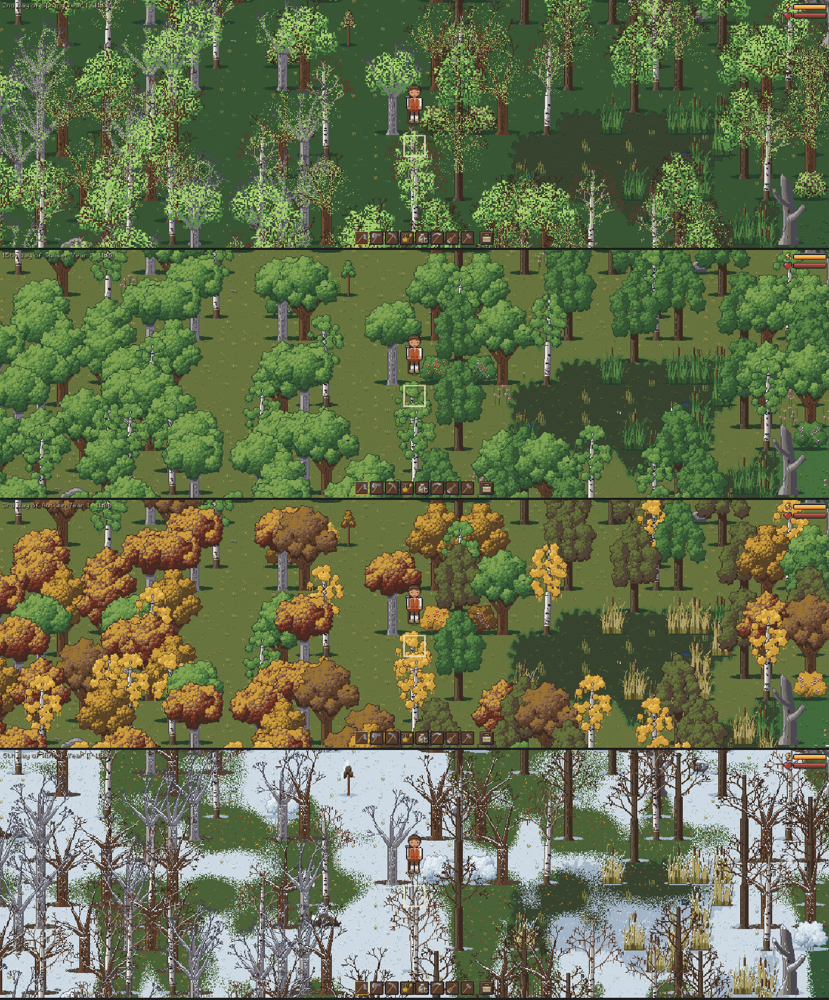
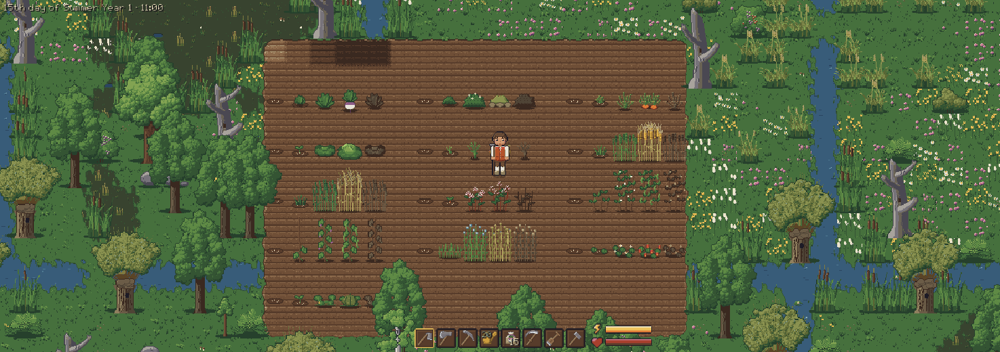
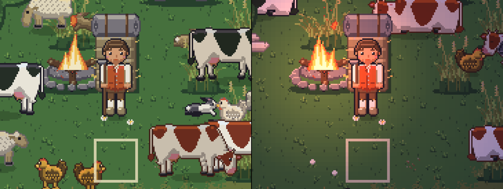
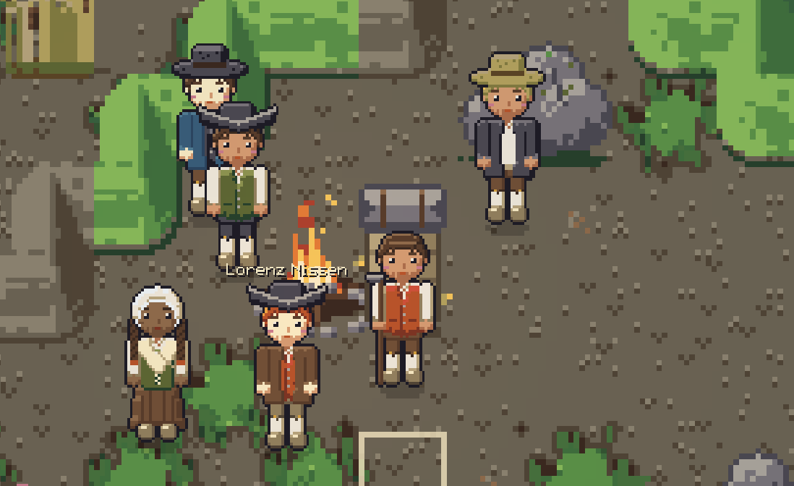
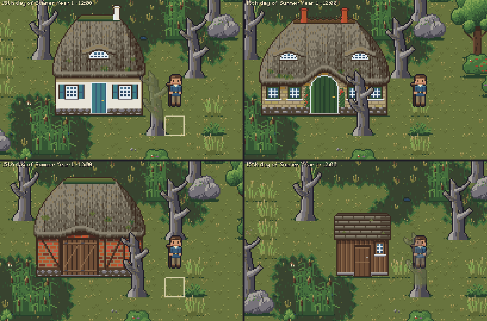
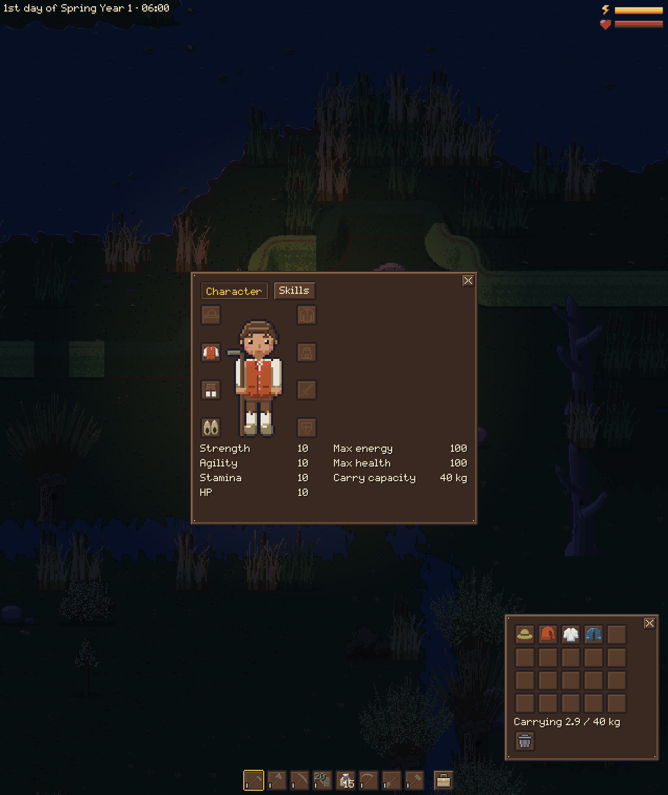
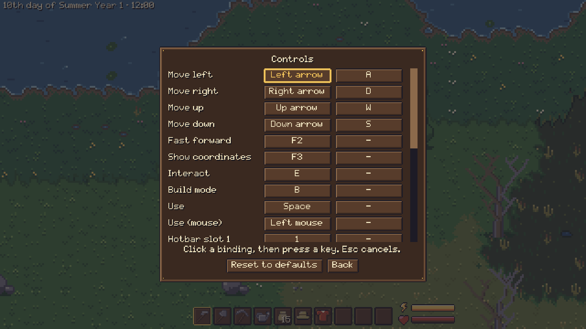
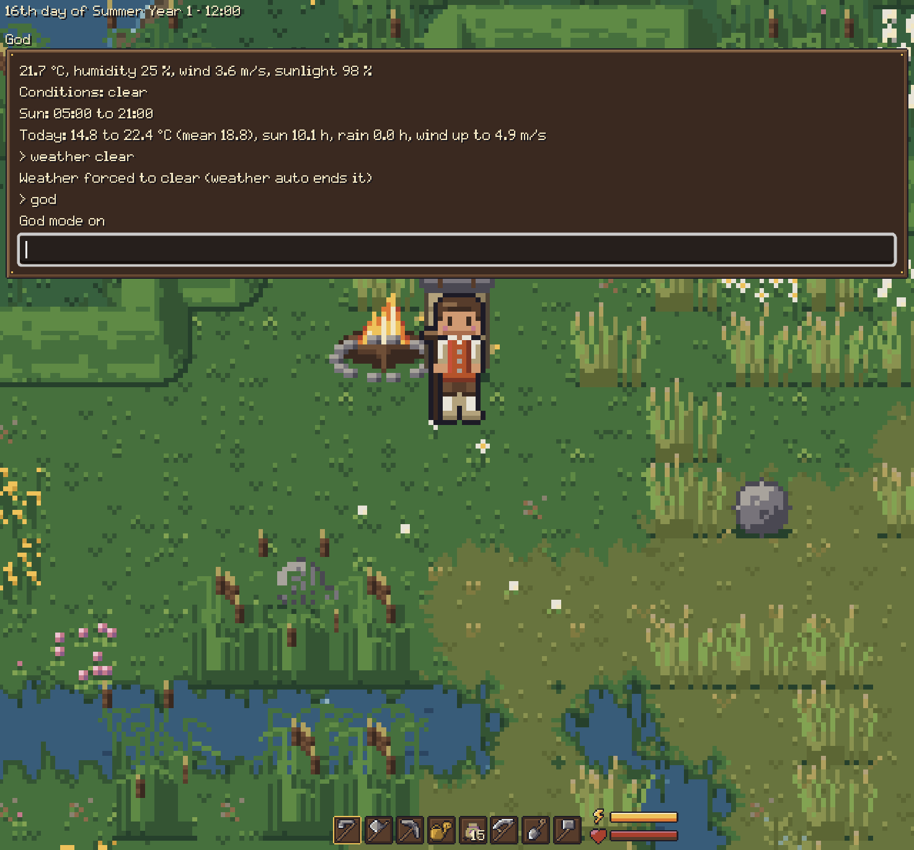

# Sandbox Game: Handbook

Everything a player needs to know, one page per topic. What the game is and how to start it is in
the [README](../README.md).

| | Page | What is in it |
|---|---|---|
|  | [The world](world-and-seasons.md) | Seasons, paths, dykes, the coast and tides, weather, day and night. |
|  | [Farming](farming.md) | Sowing, watering, the thirteen crops, weeds and fallow soil. |
|  | [Animals](animals.md) | Livestock, dogs, cats and horses, the farm yard, wildlife, crows and scarecrows. |
|  | [Villagers](villagers.md) | The people of Wehlsbüll, talking, gossip, and setting up a language model. |
|  | [Gathering, building and crafting](building-and-crafting.md) | Tools, building and taking down, crafting, stations, skills, chests. |
|  | [Character, items and sleep](character-and-items.md) | The bag, equipment, energy, sleeping and passing out. |
|  | [Controls and settings](controls.md) | All keys, the settings, zoom and the two art sets. |
| | [Sound and music](sound.md) | Volume, effects, music and ambience. |
| | [Saving](saving.md) | When and where the game saves, and damaged saves. |
|  | [The console](console.md) | The cheat and test commands. |

The game is a prototype: milk and wool, a shop, combat and a story are not in yet, and a few things
can only be reached from the [console](console.md) for now. The [design](../design/README.md) says
where the game is going; the [developer docs](../docs/development.md) say how to run and build it.
