# Animals

Farm animals, the farm yard and the wild animals of the coast.

## Livestock

Cows, pigs, sheep, chickens and rabbits of the region: red-brown Angler, black pied and red pied
cattle; bristly pigs of the old breeds, red-brown, sandy, saddleback and spotted; white, grey and
black-faced sheep; brown and white hens, and a rooster for each flock (`spawn rooster` puts one; he
lays no eggs); agouti, white and Dutch rabbits, each with a slight tint of its own. They wander,
graze (the hens peck for seeds and worms), keep out of water and away from anything solid, and the
rabbits hop off when you come close. At night they lie down and sleep until the morning, with a few
small "z"s rising over their heads now and then. For now they come from the console (`spawn cow 3`);
they are saved with the game. Milk and wool come later (see the farm yard below for eggs, food,
water and the pig pen). The numbers are in [data/livestock.cfg](../data/livestock.cfg). Like the
people, the animals are drawn at 32 pixels per tile, with legs that bend at the joints, an eye with
a glint and the marks of their coats.

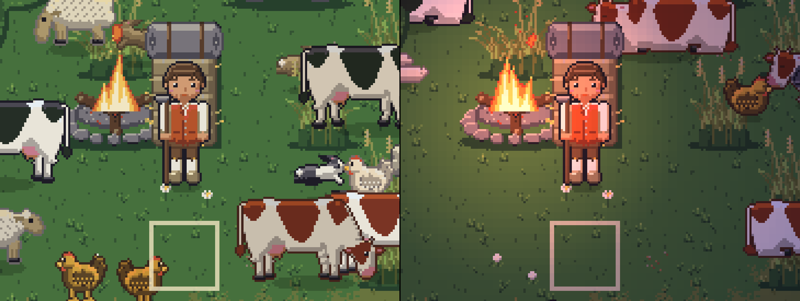

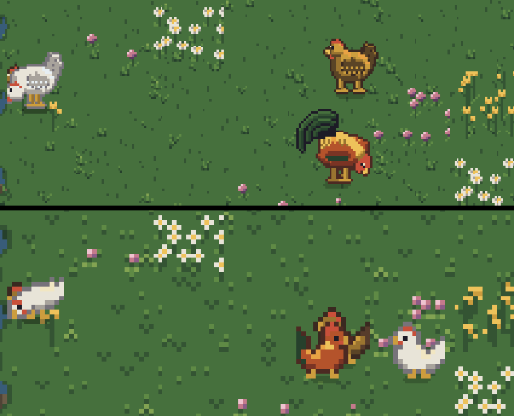

Dogs, cats and horses keep them company: a farm collie, a spitz and a hunting dog; tabby, black and
ginger cats; a heavy marsh horse, nearly three tiles long and taller than you at the head, in bay,
black or grey, and a dun pony. Dogs and cats sniff about, horses graze, and all of them dash off at
a run now and then; cats roam furthest. A dog barks now and then, a cat rarely meows, a horse
whinnies or snorts. Hold a **bone** (`give bone`) and press the use key at a dog in front of you: it
takes the bone and follows you for three game hours, day and night, keeping a tile or two from you
and running to catch up (left more than 15 tiles behind, it turns up at your side; stuck behind a
fence or water, it waits facing you).

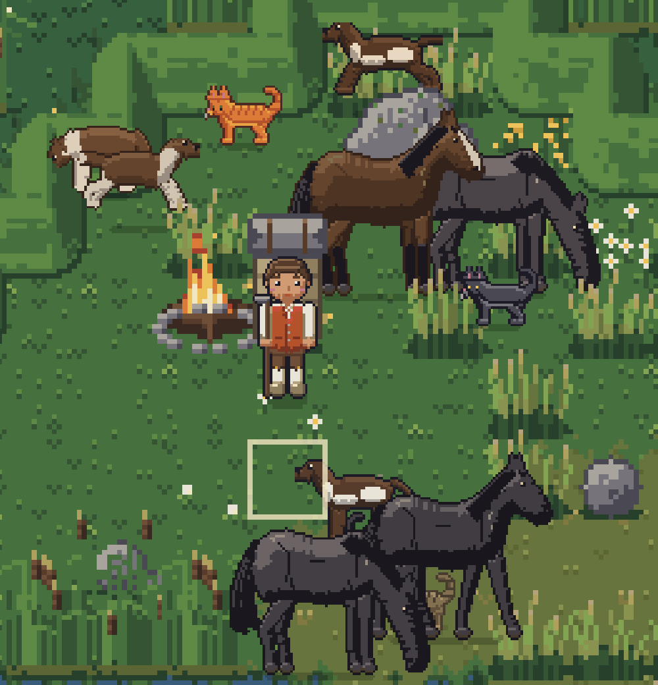

Cats hunt the mice. A cat that sees a mouse a few tiles off crouches low with its tail flat, creeps
up on it and pounces; about half the pounces catch the mouse, and the others are seen coming and the
mouse dashes off into cover. Then the cat rests a minute before it hunts again. Mice are out mostly
at dusk and at night, and the cats sleep from a while after sunset, so dusk is the hunting hour. The
numbers are in the `[hunting]` section of [data/livestock.cfg](../data/livestock.cfg).

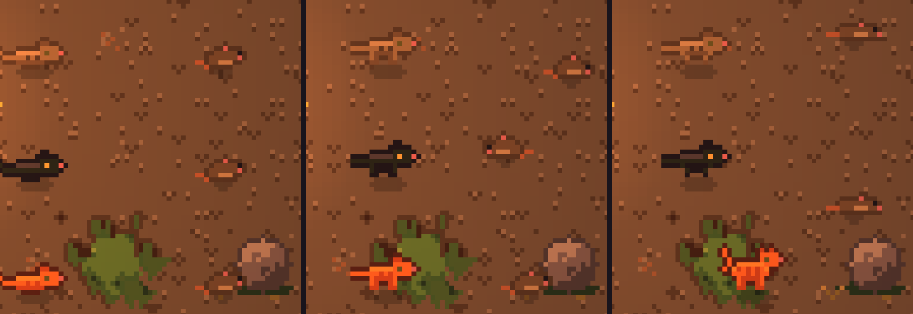

Horses can be ridden. Hold a **saddle** (`give saddle`) and press the use key at a horse in front of
you to saddle it; the use key with an empty hand takes the saddle off again. Press **E** at a
saddled horse to get on, and E again to get off: you land on free ground beside it, and the horse
stays there. A horse sets off at a walk and trots at twice your walking speed once you keep riding;
it costs no energy and tiredness doesn't slow it. On horseback you can only use the inventory and
the hotbar (dropping things too), and eat: no tools, no building, no crafting, no doors, and nothing
is picked up from the ground. Get off first. A game saved on horseback loads with you standing
beside the horse.

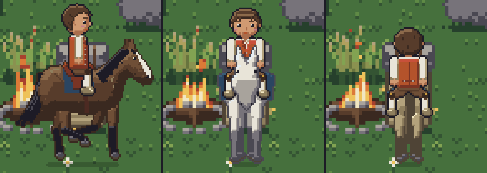

You can pet the cows, horses, sheep, pigs, hens, tame rabbits, dogs and cats: the use key with an
empty hand at the animal (it comes last of what an empty hand does: a saddled horse is unsaddled
first, a pen gate opens, a ripe crop is picked). Each animal keeps a **friendship** with you from 0
to 100, starting at 0. The first petting of a day while it is awake adds 10 and a small heart floats
up over its head; more that day show and change nothing. Petted while it sleeps, it loses 5 and a
black comic anger mark rises over it, once a day too. Each day you don't pet it takes 5, even over
the nights you sleep through, and it never goes below 0. Nothing uses the friendship yet, but the
console's `friendship` shows it (or sets it, `friendship 80`) for the animal nearest to you. The
numbers are in the `[friendship]` section of [data/livestock.cfg](../data/livestock.cfg).

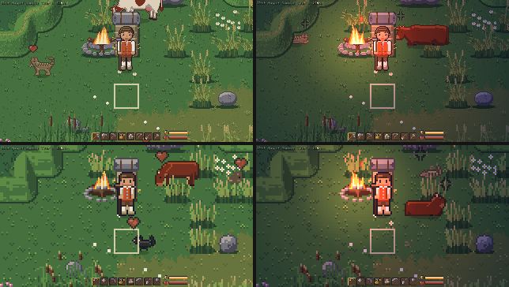

## The farm yard

The watering can holds water: 20 waterings (a new game starts with it full), one for each tile of
soil you wet. Fill it with the use key at a **draw well** (a fieldstone ring under an oak sweep,
made at the workbench with masonry 20 from 12 stone, 3 planks, 2 logs and 2 fibre, and put down
outdoors) or at fresh water: a river, a pond or a ditch, never the sea or the salt marsh. With an
empty can the use key says so and waters nothing. The water in the can is saved and shows as a small
number on the can in the hotbar.

A **trough** (a plank box on two feet, woodworking 10: 5 planks and a log) and a **hay rack** (oak
posts with slats, woodworking 15: 4 planks and 2 logs) stand outdoors on two tiles and hold a stock
of up to 100 units. Their pictures show how full they are: empty, low, half and full. Fill a trough
with the watering can (a pour is 10 units and takes one of the can's 20) and a hay rack with hay (10
units each) by the use key; a full one takes no more. A **feeding trough** (made as the trough)
holds feed instead of water: hay, turnips, acorns or beech mast, for the pigs and any that eat feed.

The farm animals get hungry and thirsty as game time passes (a cow takes 12 hours to go from fed to
hungriest, 8 to thirstiest; the numbers are in [data/livestock.cfg](../data/livestock.cfg)); the
needs are saved and, for now, have no other effect. A thirsty animal walks to fresh water nearby (a
river, a pond or a ditch; never the sea, the mud flats or the salt marsh) or to a trough with water,
and drinks; a hungry one that eats feed goes to a hay rack or a feeding trough, and those that graze
eat as they graze. Each drink and meal takes a few units from the trough or rack (a cow 5, a hen 3),
whose picture shows what is left. Sleeping counts the meals of the animals that could reach food and
water. `noneeds` in the console stops the needs from rising.

The **chicken coop** (a building: 12 logs and 4 stone, 2x2, low and boarded with a ramp up to the
hens' hatch and a nest box with its lid propped open) is where the hens sleep: at bedtime each hen
within twelve tiles of a coop with a free roost (six to a coop) walks to it and goes in, out of
sight, and comes out in the morning; going in she lays an egg, 7 times in 10, in a nest (a hay pile
of the room inside, four eggs to a nest). Go in and press the use key at a nest with an empty hand
to take the eggs. A night of sleeping or skipping counts the eggs too.

**Pigs** of the old breeds (red-brown, sandy, a black saddleback and a spotted one) root about with
their snouts for most of the day, which feeds them a little, and eat at a feeding trough. Keep them
in a **pig pen**: make pen fences (a log splits into two), a pen gate and a pig shelter at the
workbench and put them down piece by piece round a few tiles, with a trough and a feeding trough
inside. The fence joins up as you lay it. You walk through the gate whether it is shut or open; the
animals only through an open one, so a pen with its gate shut keeps its pigs in, whatever they look
for and however long you sleep. The use key with an empty hand opens and shuts the gate.

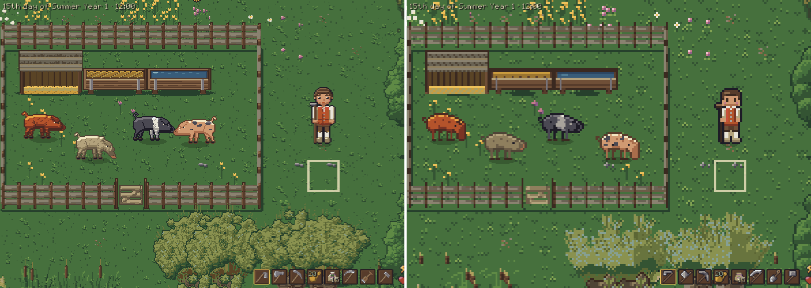

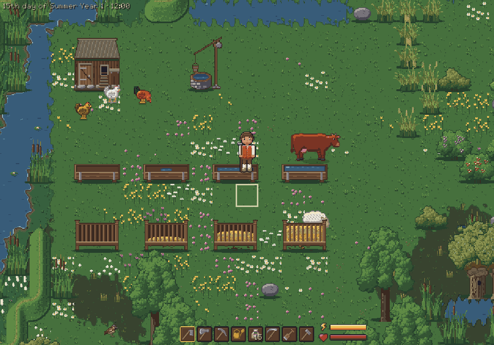

## Wildlife

Birds hop and peck on open ground and small flocks cross the sky: south in autumn, north in spring,
any way in summer and not at all in winter; flying down or up the screen they are seen from the
front or from behind, and so are the geese flying off the marsh. Rabbits graze the meadows,
squirrels dart between the trees, roe deer come out at the edge of the woods at dawn and dusk, and
bees and butterflies keep to the flowers. On the marsh and the wet meadows white storks hunt in
spring and summer, stepping slowly with the head down; they come to stand on the roofs of the
houses, clatter their bills now and then and fly off on slow wingbeats. Some houses (about four in
ten of the kates, longhouses, hall houses and barns, by where they stand) carry a stork's nest on
the ridge. It is empty in winter; in early spring a pair flies in and clatters on it, in late spring
the young hatch, grey heads over the rim that grow larger and whiter through the summer while the
parents fly off to the meadows and back, in late summer the grown young stand on the rim and flap
and leave one by one, and in autumn the nest is empty again. Each nest has its own days, so they are
not in step. In autumn and winter flocks of greylag geese graze the marsh and the floodplain, raise
their heads when you come near and take off together, and skeins of them fly over in a V, south in
autumn and north in spring, as the flocks of small birds do. Mice live by the fields, the Knicks,
the walls and the houses, out mostly at dusk and at night, and dash off into cover when you come
close; frogs sit and hop at the water's edge and on the wet meadows from spring to early autumn, and
a hunting stork that sees one walks up to it, strikes and swallows it; the cats hunt the mice (see
[Livestock](animals.md#livestock)). On the coast oystercatchers in black and white probe the tidal
mud all year, and tight flocks of dunlin in the spring and autumn migration, swinging round together
when you come near; herring gulls walk and peck on the mud and swim on the sea, and in summer common
terns fish over the tideways, hovering and plunging in with a splash. When the tide comes in the
waders leave the mud and the gulls swim where they stood. On warm, calm, dry summer evenings
fireflies drift over the meadows by the trees, the Knicks and the water from dusk until a few hours
after sunset, each blinking its own light on and off. Crow flocks come to the fields and meadows by
day, most in autumn and winter and when fields have just been sown, and eat from the crops that
nothing guards while you are far off: a sown seed is gone, a growing or ripe plant gives one item
less at the harvest (never fewer than one), at most a few a day (numbers in
[data/crows.cfg](../data/crows.cfg); `crows` in the console shows the flocks and what they ate). A
**scarecrow** (made by hand, put down anywhere outdoors) keeps the crows from the crops within 5
tiles of it: fully for its first 3 days, then less over the next 12 as the crows get used to it,
down to a quarter of the chance; take it down and put it up again, and it starts anew. No crow flock
settles where it guards. In a wind the scarecrow's coat and straw are blown about, more as the wind
rises. Wild animals never stand on a building, the door included, and apart from the mice they don't
appear near houses or villagers and run from villagers as they do from you. The animals come and go
around you by the season, the time of day and the weather; the numbers are in
[data/wildlife.cfg](../data/wildlife.cfg).

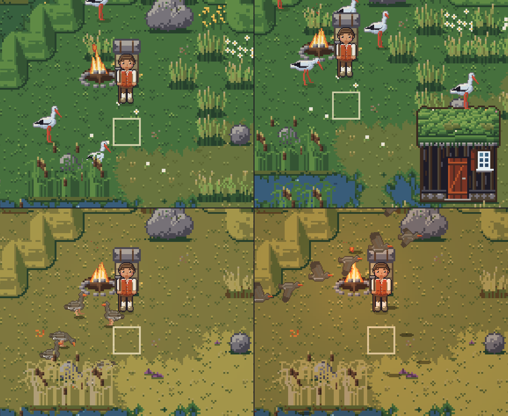

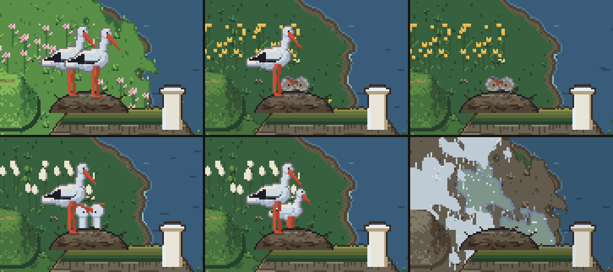

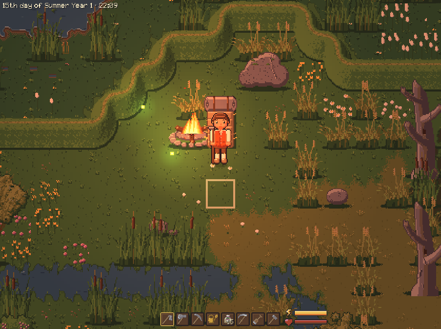

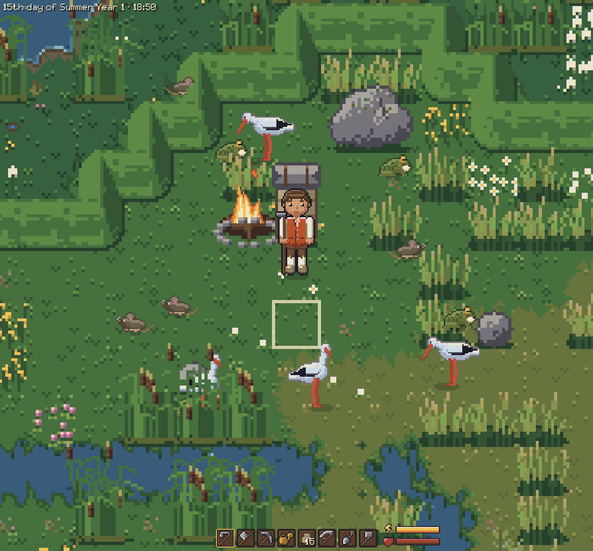

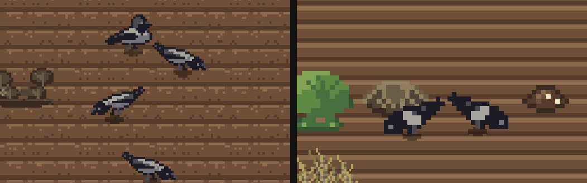

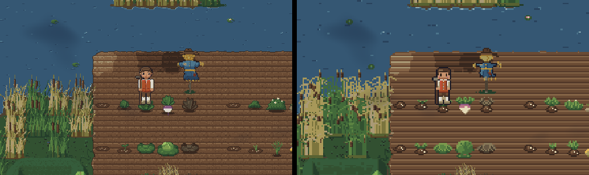

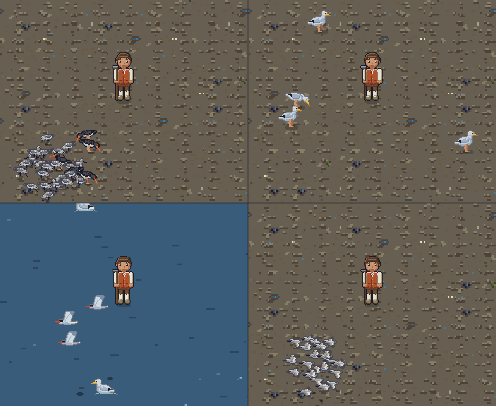
