# Gathering, building and crafting

Felling and mining, building houses anywhere, crafting stations, skills and chests.

## Gathering

- Axe: trees. Pickaxe: stones and boulders. Scythe: tall grass (hay) and river reeds (they grow
  back in their season). Shovel: clay, but only where a faint patch on the ground hints at it.
- What you gather hops onto the ground; walk over it to pick it up.
- A felled tree leaves a stump and a trunk (a dead tree a grey one): cut both into logs.
- A stump rots away in about two weeks and may sprout a sapling of its kind.
- Trees now and then drop a seed (acorn, beechnut, catkin or cone) to plant on grassland.
- Berry bushes bear again a few days after picking. Shrubs and ferns give fibre.
- The shovel digs a berry bush, shrub or fern out whole; plant it on free grass with the use
  key and it is the same bush again.

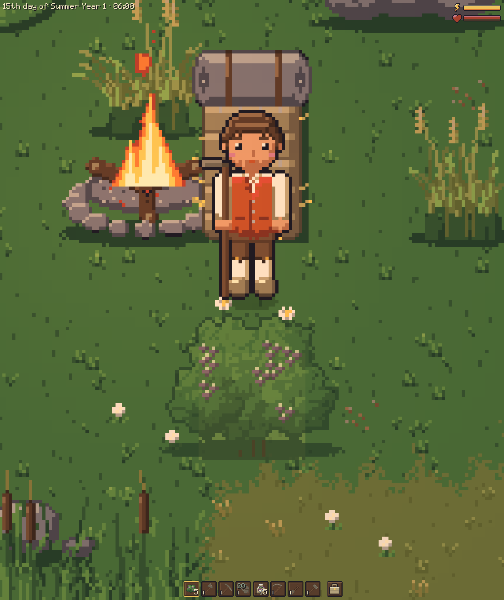

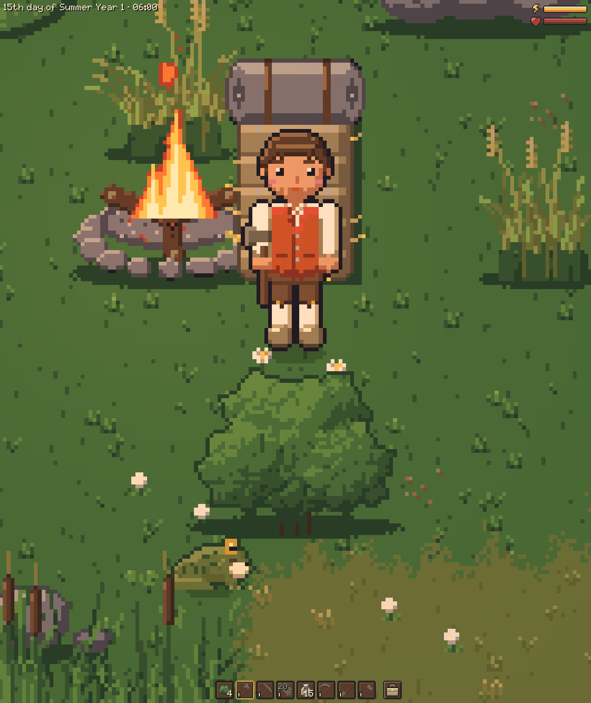

In the classic art: [the ghost](../docs/screenshots/bush-ghost-classic.png) and [the planted
bush](../docs/screenshots/bush-replanted-classic.png).

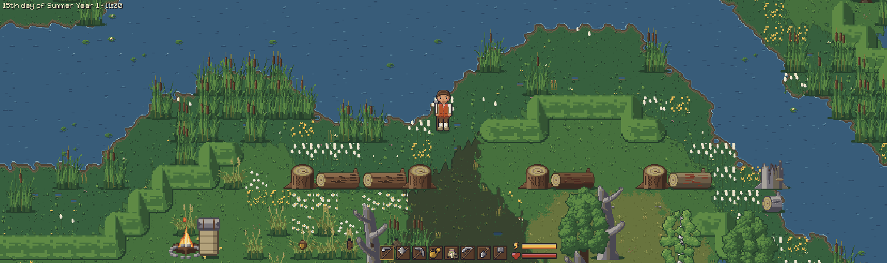

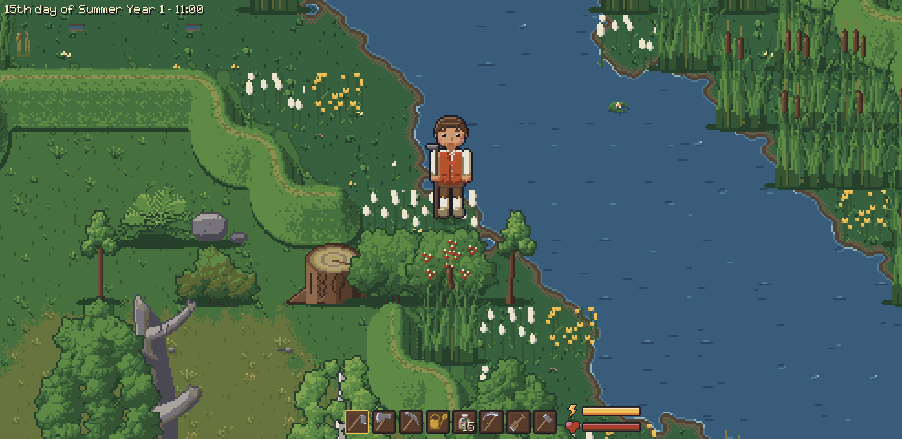

### Tool grades

- Every tool has five grades: rusty iron (you start with these), iron, brittle steel, steel,
  sharp steel. Better ones need fewer hits and tire you less.
- A Roman numeral I to V at the bottom left of the slot tells the grade.
- Pine trees and boulders need at least an iron axe or pickaxe.
- For now you only get better grades from the [console](console.md): `give iron_axe`,
  `give sharp_steel_hoe`.

| Grade | Numeral | Hit power | Energy per use |
|---|---|---|---|
| Rusty iron | I | 1 | 100 % |
| Iron | II | 2 | 95 % |
| Brittle steel | III | 3 | 95 % |
| Steel | IV | 3 | 85 % |
| Sharp steel | V | 4 | 75 % |

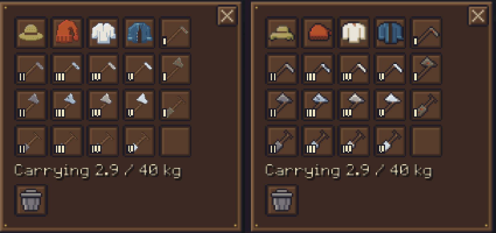

## Building

### Placing a building

1. Take the hammer from the hotbar. The build menu opens above it.
2. Pick a building with Q and E, the left and right arrows, or a click. A building with more
   styles shows them in a column above it (up and down arrows or a click).
3. The picture beside it lists the materials against what you carry.
4. A ghost follows the mouse: green where it fits. A note by the pointer says why a spot doesn't
   work, for example unsafe wetland.
5. Click or press Space to build; the materials are taken.
6. Press Escape, right click or hold something else to stop.

- While the menu is open the arrows belong to it: walk with WASD.
- You can walk inside every building except the bell frame.
- The last bed you slept in becomes your home.
- A new game starts with your tools and the hammer: gather the first house's materials first.

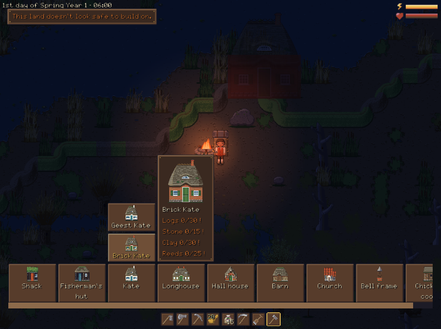

### The buildings

| Building | Logs | Stone | Clay | Reeds |
|---|---|---|---|---|
| Shack | 20 | 5 | | |
| Fisherman's hut | 25 | 5 | | 15 |
| Kate (brick Kate) | 30 | 15 | 15 (30) | 25 |
| Geest Kate | 35 | 5 | | 25 |
| Longhouse | 60 | 30 | 30 | 50 |
| Hall house | 100 | 40 | 50 | 80 |
| Barn | 30 | 15 | 5 | 25 |
| Church | 70 | 35 | 45 | |
| Bell frame | 25 | 5 | 10 | |
| Chicken coop | 12 | 4 | | |

- The shack is a bare hut with a straw mat on a clay floor.
- The Kate is a cottage room; the longhouse has a living end and an animal end.
- The hall house is the biggest: a long Diele between the stalls and the hearth at the Flett.
- The barn has stalls and hay; the church has pews and an altar.
- Rooms are furnished like 18th-century coast farmhouses: hearth, plate racks, box beds.

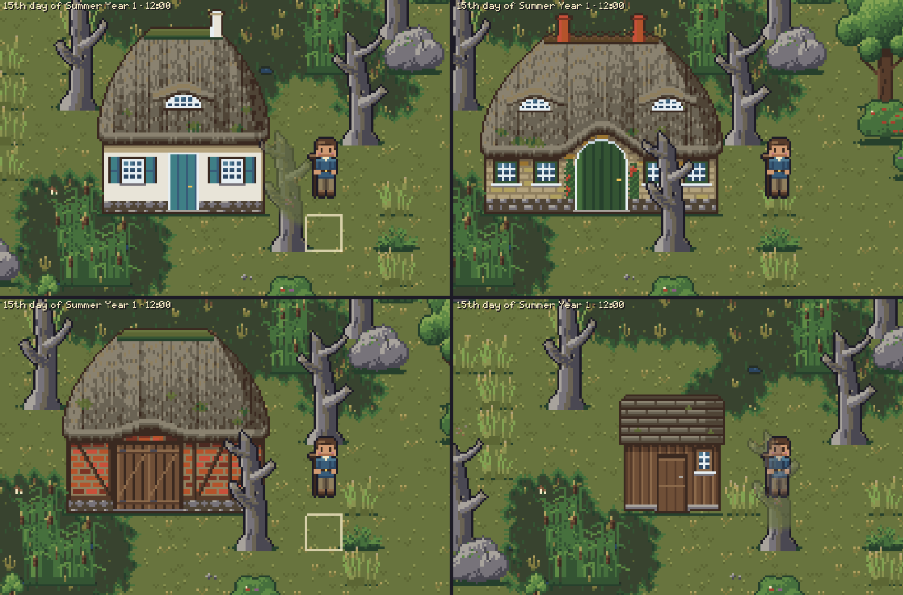

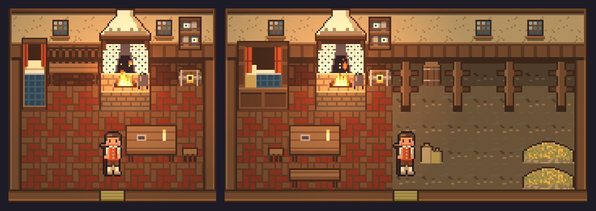

### The fisherman's hut and its landing

- The hut is at the water. Its landing is laid piece by piece.
- Jetty piece (workbench): 3 planks and a log, on piles over water or mud. You walk out on it.
  Pieces join up as you lay them; mooring posts are at the head.
- Rowing boat: 10 planks and 4 fibre.
- Net frame (by hand): 2 logs and 8 fibre. Eel traps: 4 reeds and 1 fibre.

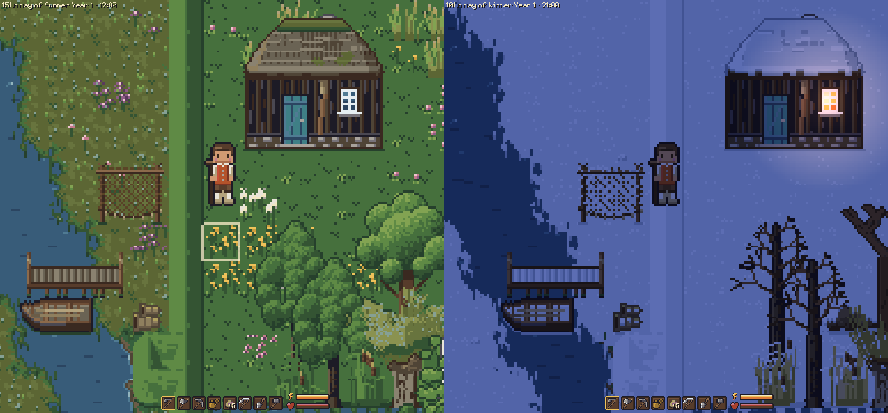

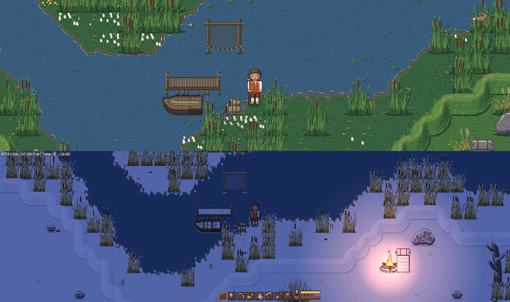

### The church and the bell

- The marsh church has no tower: the bell hangs in a bell frame of its own.
- Stand within a tile of the bell frame and press E, or click it, to ring the bell.
- It rings for ten seconds, heard far across the marsh. Ring again and the strikes add up (up to
  three at once).
- E leaves the bell to a bed in reach, and a click while holding food eats it. Nothing else
  happens yet.
- Grave markers for the churchyard are made at the workbench (2 planks, 2 stone).

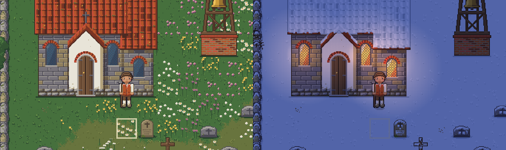

### Taking down

1. Press X with the hammer in hand. The menu gives way to a "Taking down" panel.
2. The thing under the mouse gets a red frame and says what it gives.
3. Hold Space or the click for a second.

- A building gives back half of each material, rounded down, in front of its door, with its
  furniture.
- It stands while you are inside or while anything you put in it is left.
- If your bed was in it, your home goes back to the camp's bedroll, else the start point.
- A chest, workbench or kiln goes into your inventory whole, with what it holds, or onto the
  ground if the bag is full.
- The camp's campfire and bedroll come back as items to set up elsewhere. Held like a chest, the
  bedroll shows its ghost.
- Press X again to go back to building.

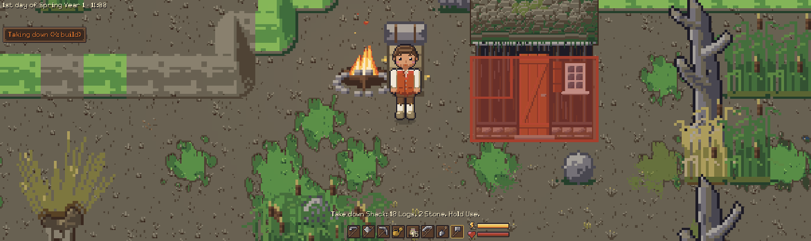

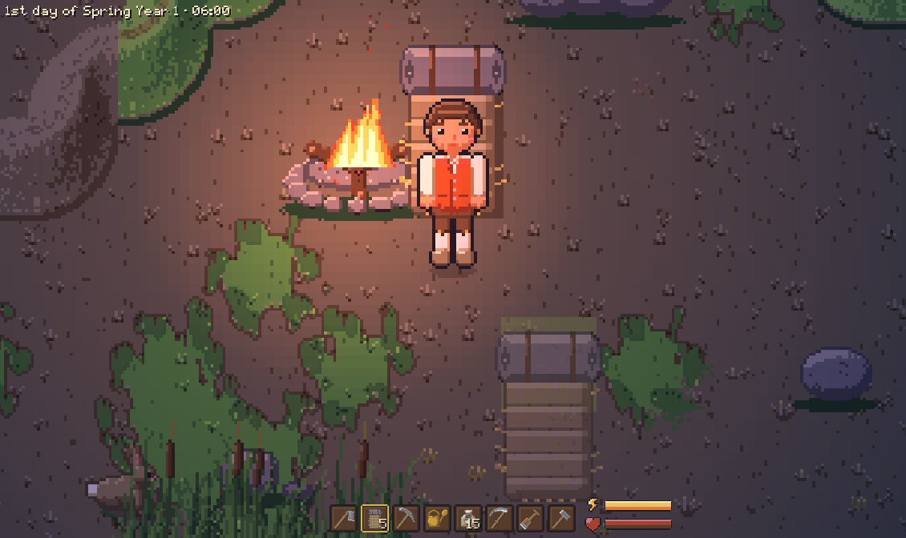

## Crafting

Press Shift+C for the crafting menu (C is the character window).

- By hand: a chest, campfire (6 stone, 3 logs), bedroll (6 hay, 4 fibre), flour (from wheat, rye
  or buckwheat), dry stone wall piece (3 stone, masonry 5), the stations below, a net frame and eel
  traps.
- Scarecrow: a log, 6 hay and 4 fibre. Put it down anywhere outdoors; the axe or hammer takes it
  down. See [animals](animals.md#crows-and-scarecrows).
- Wattle fence: made at the workbench, half a log and 2 fibre a piece, woodworking 5.
- Fences and walls are placed tile by tile and join up. The axe takes a fence down (2 fibre back),
  the pickaxe a wall (3 stone).
- The menu lists what you can make with what you carry. A recipe you can't afford is greyed with
  the missing materials marked.
- With a full bag a craft still goes ahead: what doesn't fit drops at your feet.

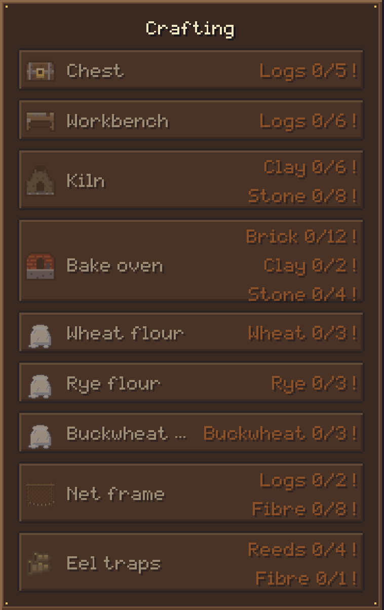

### Stations

Three crafts can be learnt, each at its own station. Press E at one for its menu. A recipe is
only made at a station of its kind within reach.

- **Cooking** at the hearth of a house, the camp fire or the bake oven. Anyone can roast a
  turnip; buckwheat pancakes, pottage and pea soup take practice. The oven bakes bread (from
  flour, in an hour), a berry tart and a feast cake. Cooked food gives more energy than raw.
- **Woodworking** at the workbench: planks, a stool, a grave marker, clogs, a painted Frisian
  chest with 20 slots, and as the master's piece a joined cupboard with 25.
- **Masonry**: clay becomes raw bricks at the workbench, fired in the kiln (6 raw bricks and 2
  logs a load). Masonry 50 gives a quarter more bricks, masonry 70 half again. The bake oven is
  built of these bricks.
- The workbench, kiln and bake oven are made by hand and placed like a chest (the kiln only
  outdoors). The axe or pickaxe takes them down.

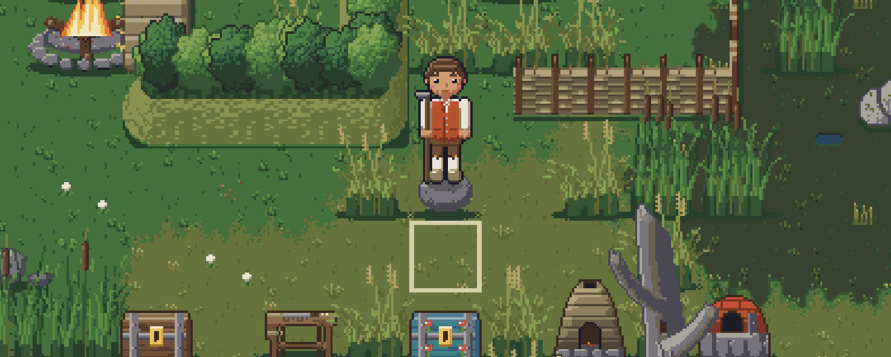

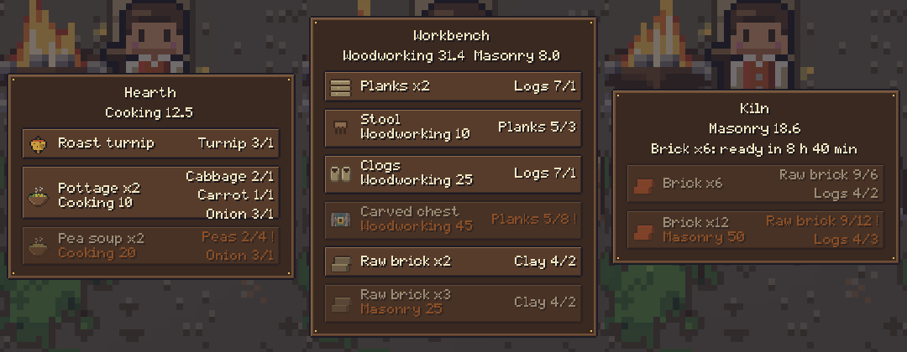

### The kiln and the bake oven

1. Press E at it. Recipes are on the left, a 3x3 grid in the middle, your bag on the right.
2. Put in what a recipe takes (drag, or Shift+click), or click a recipe to move its materials
   for the amount below it (type it, or use -, + and Max).
3. Only what fits a recipe goes in; the rest is greyed.
4. Press the fire button once the grid holds whole loads.
5. The run takes the recipe's hours (12 for bricks, 1 for bread) and goes on while you are away.
6. Take the result out like from a chest. Nothing new goes in until it is all out.

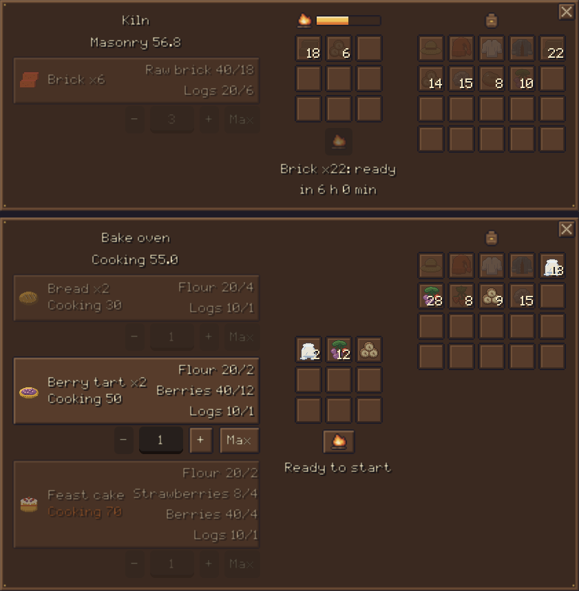

## Skills

- Crafting raises the recipe's skill: the most at the recipe's level, less the further above it
  you are, nothing from a recipe 40 points below.
- Better recipes need a skill level; the master recipe of each craft needs 70 and teaches it to
  100. The menu greys them with the level needed.
- Each skill goes to 100, but all together only to 200: one at the top and two at half, say.
- Press K for the skills tab. At 200, a skill only grows by taking points from one you marked
  Fade. Nothing fades on its own.

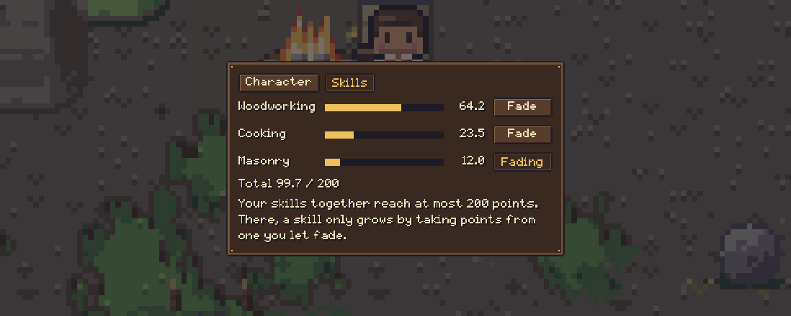

## Chests

- Hold a chest: a ghost shows where it fits, green or red (not on water, wetland, floodplain,
  something else, or in front of a door).
- Use it to place the chest, outdoors or in a house. Press E in front of it to open it.
- Your backpack is on the left (the hotbar stays usable), the chest's 15 slots (20 in a carved
  chest) on the right.
- Drag an item to move it, or Shift+click to send a stack across (from the chest it goes to the
  backpack first).
- Drag a stack onto the trash can to destroy it, after a question.
- The axe takes a chest down. Outdoors what it held spills onto the ground; inside a house the
  chest and its contents go to your inventory, or you are told there is no room.

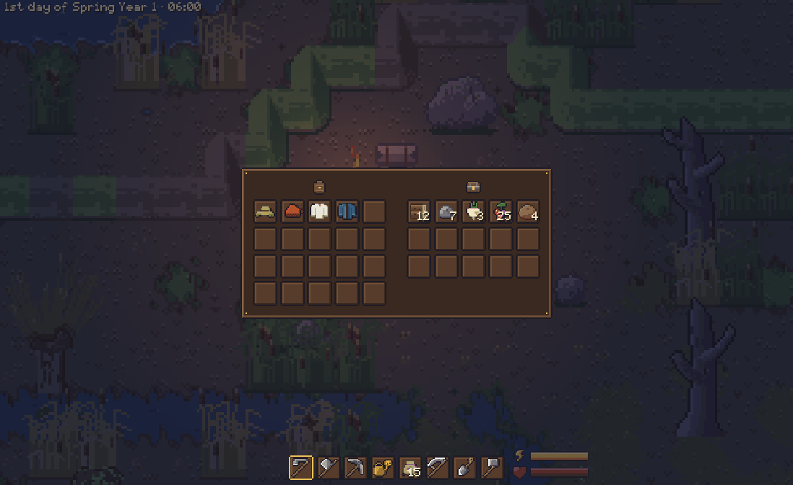
