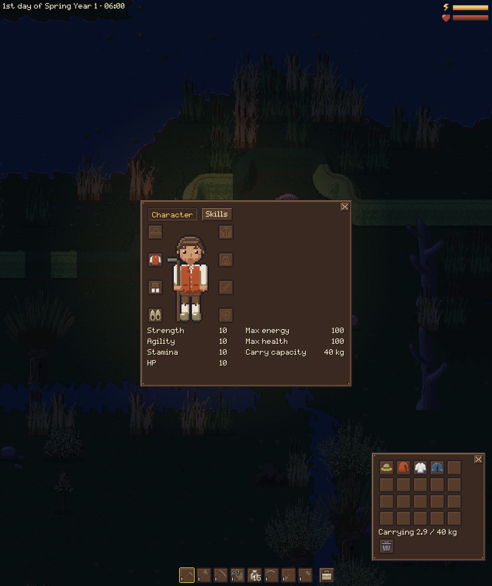
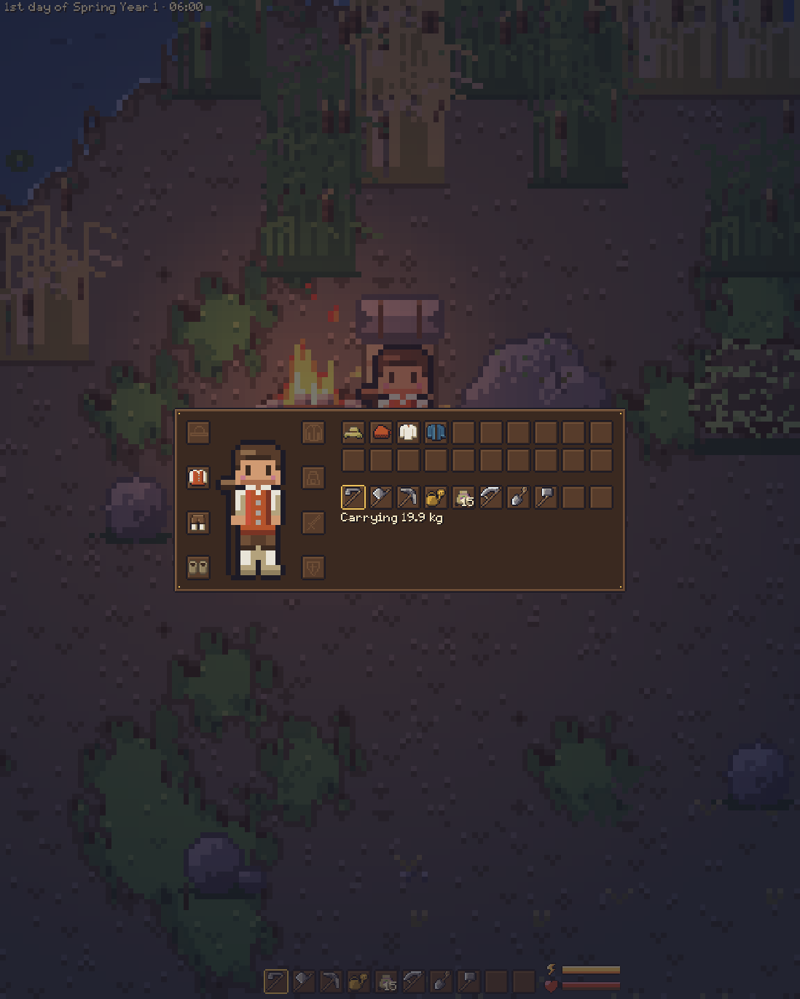
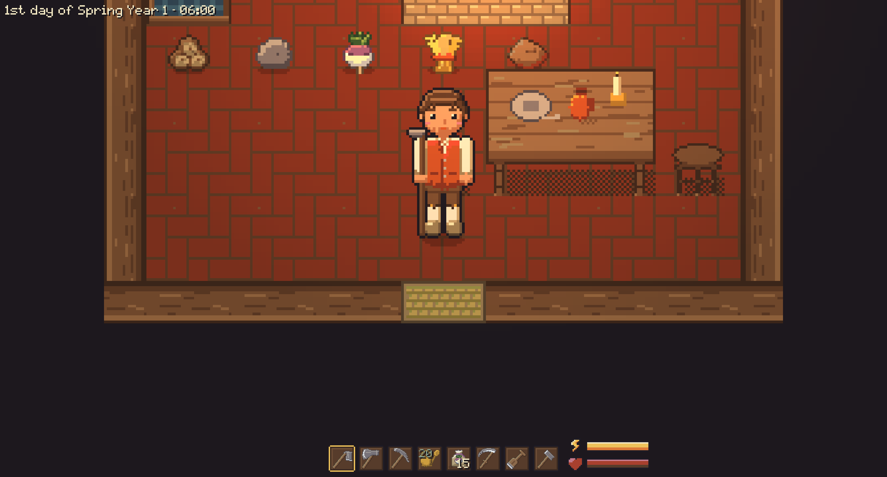
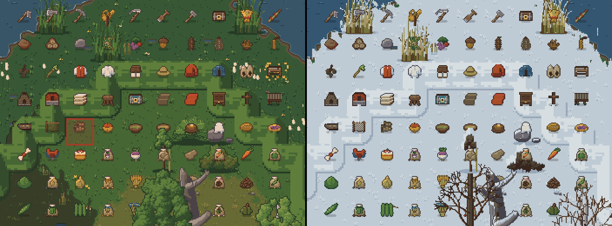
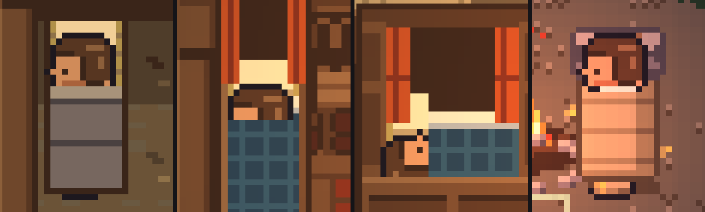
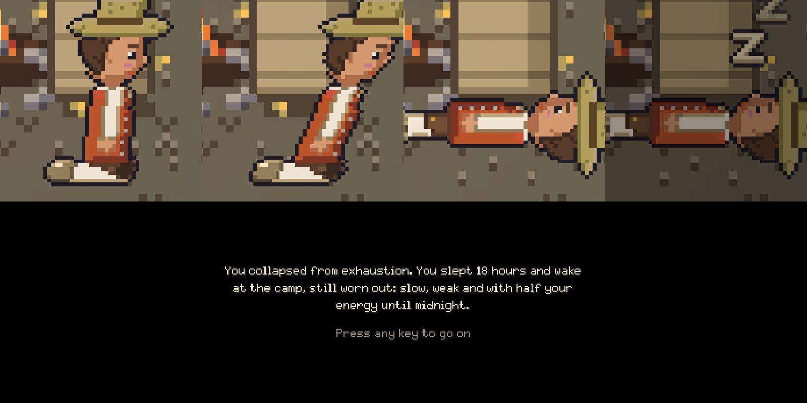

# Character, items and sleep

The bag, the equipment, energy and sleep.

## The bag and the character window

- Press B (or click the bag icon by the hotbar) for the bag, C for the character window with the
  figure and the equipment slots.
- Both can be open at once, each closed by its own key; Escape closes both. You keep playing
  meanwhile. In a very small window or at a large UI scale, opening one closes the other.
- Every window has a cross in its top right corner; it, and a click on the dimmed area outside,
  do what Escape does.
- Crafting, chest, bag, character and chat windows can be dragged aside by their frame, and open
  in the middle again each time.

## Slots and moving items

- The hotbar holds eight slots (keys 1 to 8) for tools and seeds. It is extra room: the backpack
  keeps its 20 slots (4 rows of 5), so you carry 28 stacks.
- New items fill the hotbar first (the same item, then free slots, not the one in your hand), then
  the backpack.
- Drag an item onto a slot of the backpack, hotbar or equipment to put it there. A different item
  there swaps, the same item stacks, a stack let go anywhere else goes back.
- Shift+click sends a whole stack from the backpack to the hotbar and back.
- Right click wears or takes off equipment. Dragging gear into the bag takes it off.

## Dropping and destroying

- Let go of a dragged stack outside the window, or press T for the held stack, and it lies on the
  ground in front of you. Walk away and back to pick it up again.
- Inside a house, items lie on the floor, never on a wall, in the way of furniture or on the
  doormat. They stay there when you leave.
- To destroy a stack, drag it onto the trash can (under the backpack and on a chest's screen).
  The game asks "Destroy Logs (12)?": Destroy removes it; Keep, Escape or a click elsewhere
  leaves it.
- A worn item is taken off into the backpack first.

## Clothes

- The character wears a red waistcoat over a linen shirt, knee breeches, white stockings and
  wooden clogs, as on the North Sea coast in the 18th century.
- A short blue jacket and hats are there to put on. Worn things show in the world.

## Energy and weight

- The energy and health bars are in the top right corner.
- The more you carry, the more each action costs. Up to 40 kg is free; the bag shows "Carrying
  x / 40 kg". Strength raises the 40. Tools weigh nothing.
- Below 20 % energy the character sweats with every action, below 10 % even more.
- At midnight, and again at half past, a "zzz" bubble pops up over your head while you are still
  awake. One hour after midnight you pass out.

## Sleeping and passing out

- Press E next to a bed. The screen fades, shows the new day, and wakes you at 06:30 the next
  morning (the same morning if it is already past midnight).
- A bed fills your energy and health. The last bed you slept in is your home.
- After sleeping you wake lying in the bed (or on the camp's bedroll) and get up with your first
  step. Beds don't block walking.

### Passing out

- Run out of energy, or stay up past 01:00: you sink to your knees, tip over and fall asleep
  where you stand.
- You sleep until 06:30 but at least ten hours, and wake in your home bed.
- You stay worn out the rest of that day: slow walking, low health and half your energy.
- A message says what happened before the morning fades in.

