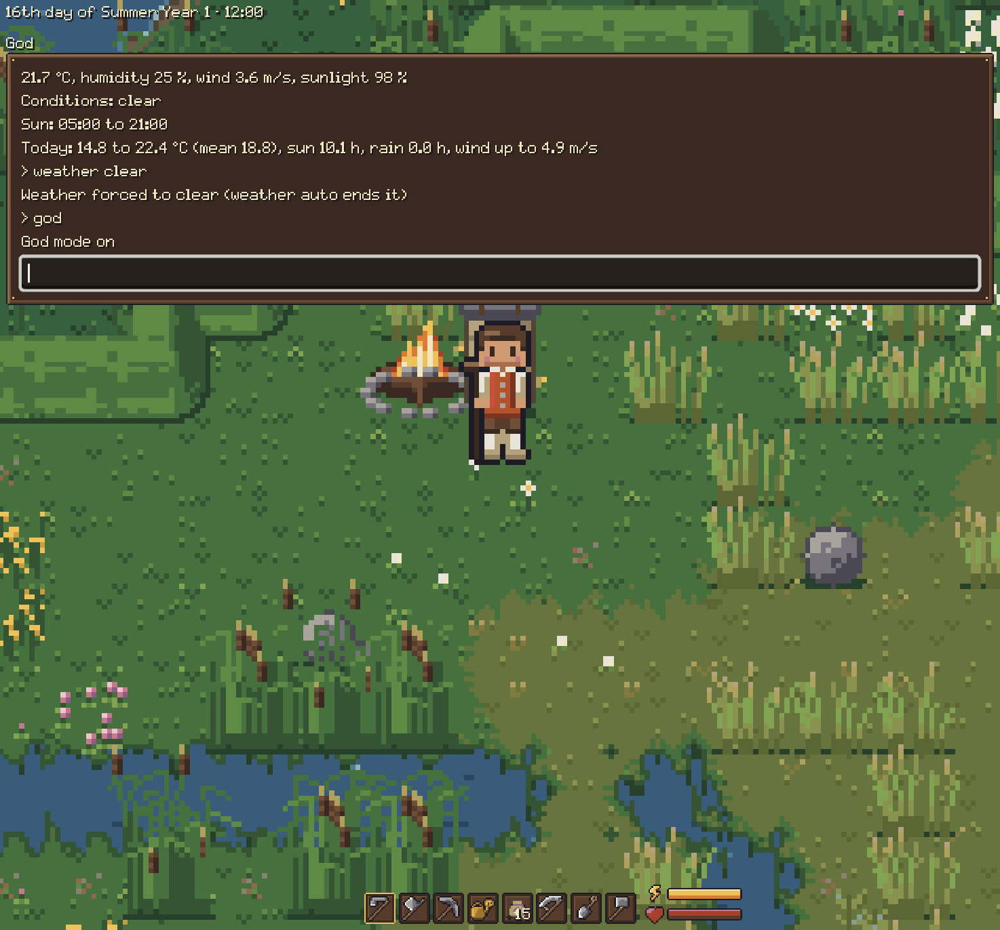

# The console

Cheats and test commands, all of them.

- Press `/` to open the console.
- Tab completes commands and their arguments.
- Scroll the log with the mouse wheel, its bar, or Page Up and Page Down.
- The log keeps the newest 500 lines and follows new output unless you scrolled up.
- Not everything is in the game yet: some things, like animals and better tools, can only be
  reached from here for now.

| Command | What it does |
|---|---|
| `help`, `help <command>` | List the commands (by name), or show what one takes (the names it accepts too). |
| `tp <x> <y>` or `tp <villager>` | Teleport to a world tile, or to a free tile next to a villager (`tp antje`, or a first name); from inside a house you step out there (F3 shows your coordinates). |
| `reset` | Put yourself in your bed, the one you wake in, inside or out. |
| `give <item> [count]` | Put items in the inventory (e.g. `give bone` for a dog, `give wax` for candles, `give saddle` for a horse, `give steel_pickaxe` for a tool of the fourth grade: `rusty_iron_`, `iron_`, `brittle_steel_`, `steel_` or `sharp_steel_` and the tool). |
| `god`, `nodrain`, `noweight`, `nocost`, `nolate` | Toggle invincibility, free actions, weight costing nothing, buildings and crafting needing no materials, and staying up past 01:00 passing no one out (no late warnings either). |
| `noneeds` | Toggle the farm animals' hunger and thirst standing still (they rise with game time otherwise). |
| `freeze` | Toggle time standing still: the clock, the day, the crops and the weather wait; you and the animals still move. `skip`, sleeping and passing out still move time on (the animals and villagers move on with it, as below). |
| `noclip` | Toggle walking through anything: water, trees, rocks, buildings, furniture (indoors within the room, outdoors on loaded ground). Turned off where you don't fit, it puts you on the nearest free ground. |
| `weather`, `weather <condition>`, `weather auto` | Show the weather, force a condition, or go back to the simulation. |
| `snow`, `snow <0..1>`, `snow auto` | Show the snow cover, force it, or go back to the weather. |
| `spawn npc [count]` | Put villagers nearby, each with a look, a name and a sheet of their own; they stay. |
| `spawn [npc] <villager>` | Put a villager written by hand nearby (`spawn kerrin` or `spawn npc kerrin`): `antje`, `momme`, `ocke`, `kerrin`, `hinrich`, `boy`, `inken`, `gesche` or `trienke`; each comes once. |
| `spawn <animal> [count]` | Put animals nearby: farm animals that stay (`cow`, `sheep`, `chicken`, `rabbit`, `dog`, `cat`, `horse`) or wild ones that come and go (`bird`, `wild_rabbit`, `squirrel`, `deer`, `bee`, `butterfly`, `flock`, `stork`, `roof_stork` on the nearest roof, `geese` grazing, `flying_geese`, `mouse`, `frog`, and on the coast `oystercatcher`, `dunlin`, `gull`, `tern`, and `crows`, flocks on the fields and meadows). `spawn` alone, or with an unknown name, lists them. |
| `killall <animal>` | Remove every animal of that kind (the kinds of `spawn`) from the game and from the save, and say how many. Wild animals are not saved, so only those alive now go and more may come by the usual rules. A horse you ride is not removed: get off first. |
| `killall npc <id>` | Remove that named villager (`killall antje` works too), with their chat and memories, from the game and the save. |
| `killall npc` | Remove every villager without an id (the made-up ones of `spawn npc`) and say how many; the named villagers stay and need `killall npc <id>`. |
| `skip <n>m\|h\|d` | Let minutes, hours or days pass, e.g. `skip 2h` or `skip 3d`. Only the world moves on: crops, soil, weather, kilns, animals, villagers and the wildlife follow, your energy, tiredness, debuff and position stay as they are. |
| `crop` | Show the growth, damage and needs of the nearest crop. |
| `crows`, `crows raid` | Show the crow flocks (where, how many crops in reach, how far you are), how many plants and items the crows ate today, and each scarecrow (its strength, how many crops it covers and how many of them are guarded today); `raid` lets every flock raid the crops near it now, with you standing by, and eat from each crop it tries. |
| `skill <skill> <points>` | Set a skill's points (`woodworking`, `cooking`, `masonry`). |
| `attribute <attribute> <level>` | Set an attribute's level (`strength`, `agility`, `stamina`, `hp`; 1 to 100) and show the maximum energy, maximum health and carry capacity it leaves. |
| `gossip <villager>` | List the stories (the gossip buffer) and the long-term memories a villager keeps, with their weights (low, medium, high) and, for a story, whether it was seen or heard. The villager is the id of one written by hand (`gossip antje`) or a first name; Tab completes the ids. |
| `opinion <villager> [points]` | Show what a villager thinks of you (cold, neutral or warm, and the points), or set the points (-100 to 1000). The villager is the id of one written by hand or a first name. |
| `home <villager> [here\|none]` | Show where a villager lives, give them the house you stand inside or at the door of (`here`), or free them of theirs (`none`). A house holds one household (a couple and their children) up to the residents of its kind: a hall house 5, a fisherman's hut 2, a shack 1. A made-up villager lives alone. The villager is the id of one written by hand or a first name; Tab completes it and `here` and `none`. |
| `work <villager> [here\|none]` | The same for the place a villager works: the building you are in or at, else a spot on the ground where you stand (Momme's is "the landing at the sluice"), or `none`. |
| `goto <villager> <x>,<y>\|here` | Send a villager to that tile, or to the tile you stand on (`here`): it finds its way, along worn lanes, round fences and through gates. "On its way" means a search is under way (that there is no way, or that the place is not loaded, comes later, or at once for a place far off); F4 shows its path (where from and to, how far, whether it is blocked, how many tiles the search looked at). |
| `routine <villager> [day]` | Say where a villager is going and why: what they are doing now and since when (standing, strolling or at work; there, on its way, or blocked), what comes next and when they leave for it, whether rain or the dark keeps them at home, and their trip. With `day`, every entry of their day, the one that is on marked. A villager with a house follows a default day (breakfast, work, dinner, supper, rest and sleep, church on Sunday, and what their trade adds); one with no house keeps near their anchor. |
| `shop`, `shop restock` | Open the trade with the shopkeeper, Trienke Lorenzen, whenever she is in the world (`spawn trienke` brings her to a world built before her), in hours or not; `restock` fills her stock and her room again. |
| `replan <villager>` | Have the language model plan the rest of today for a villager now, ahead of the others it is asked about; their day changes when its answer comes. Needs a model set in Settings; it asks even when the profile's Day plans switch is off. `routine` tells whether the plan came. |
| `village` | Say where Wehlsbüll lies from you ("about 232 tiles west, 120 south"), how big its land is, how many buildings it holds and where its town square is (with the `tp` for it). |
| `map` | Open the world map, a test tool: every chunk the game has loaded or generates for the map, in simple colours (sea, water, mud flats, floodplain, wood, grass, soil), with the creeks, fords, dykes, lanes and cobbles, buildings, the village's name, the villagers as dots (point at one for their name) and you as an arrow facing your way. Land you have not walked near (12 tiles round where you stood) lies under a soft grey fog that dims it but leaves it readable; it clears as you walk and is saved. Drag or use the arrow keys to move the map, the wheel to zoom; click a spot and confirm to teleport there (as `tp`). `map` again or Escape closes it. The map fills in from the middle out when it opens. |
| `deeds` | List what you did within sight of villagers in the last 7 days: the day and time, the deed, the place and who saw it. |
| `play <track>` | Play a piece of music in a loop: `sketch_tide`, `sketch_harbour` or `test_reel`, also by the name without the prefix (`play tide`). The piece is rendered first (the log says `Rendering...`, then `Playing ...`), so the game doesn't stall; another piece crossfades from the first on the bar. An unknown name lists the tracks. The game plays the everyday pieces by itself; a piece you ask for takes their place for at least a minute and a half, and then the everyday ones go on. The volume is Settings → Audio → Music. |
| `stop` | Fade the music out. It stays off until you `play` again. |

