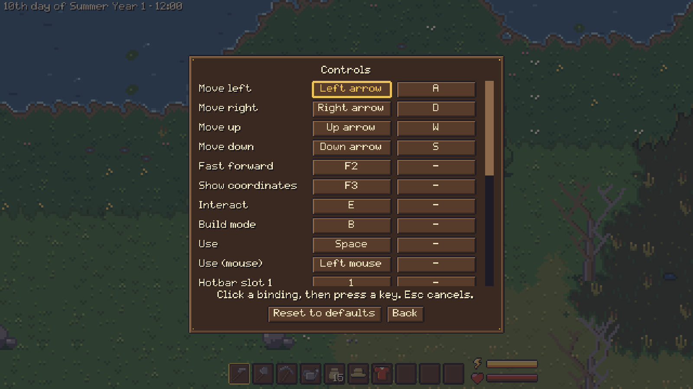
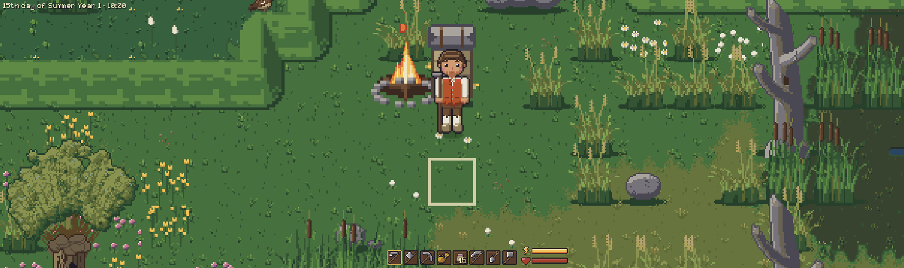
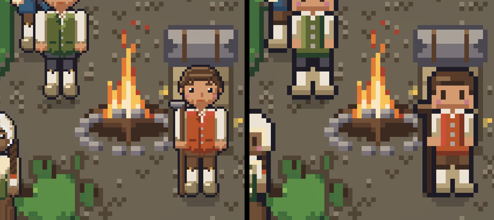

# Controls and settings

All the keys, the settings, the two art sets and zoom.

## Keys

These are the default keys. Change any of them, mouse buttons too, under Settings, Controls.

### Moving and using

| Key | Action |
|---|---|
| WASD or arrow keys | Walk. With the hammer in hand only WASD walks: the arrows pick in the build menu. |
| Space or left click | Use the held item on the targeted tile. A tool swings first and works on the tile when the blow lands; hold the key to keep swinging. |
| 1-8 | Pick a hotbar slot. |
| Mouse wheel | Next or previous hotbar slot. |
| E | See the list below. |
| T | Drop the held stack on the ground in front of you. |
| Shift (held) | Sprint, on a horse that is trotting. See Animals, Riding. |
| Escape | Pause menu (Resume, Load, Settings, Save and quit). |

What E does, in this order:

1. Get off the horse you ride.
2. Talk to the villager in front of you.
3. Get on the saddled horse in front of you.
4. Open the chest or the station in front of you.
5. Sleep until morning, next to a bed.
6. With the hammer in hand: pick the next building.

A small hint over the hotbar names what E and Space will do right now on the tile you face or point
at, such as "E: Talk to Antje", "E: Open chest" or "Use: Harvest". It says nothing when there is
nothing to do. A ripe crop is picked with an empty hand: with a tool or seeds in your hand the hint
says so, and whether to pick a free hotbar slot or to move an item off a full hotbar. Switch it off under Settings, Game, Action hint.

### Windows

| Key | Action |
|---|---|
| B, or click the bag icon | The bag. The same key closes it. |
| C | The character window. The same key closes it. |
| K | The skills tab of the character window. |
| J | The quests tab of the character window: the quests you have taken, who gave them, how far you are, the days left and the reward. |
| (click the tab) | The neighbours tab of the character window: every villager with their level of friendship with you and ten marks; hover a row to see what the next level brings. It has no key yet. |
| Shift + C, or click the workbench icon | The crafting menu (by hand). The icon sits beside the bag icon. |
| Left mouse button, dragged | Move a stack onto a slot, the trash can, or (outside the window) the ground. |
| Shift + left click | Send a stack to the other side (bag, character and chest windows). |
| Right click | Wear or take off an item (bag and character window). |

### Building

| Key | Action |
|---|---|
| The hammer's slot | Starts build mode. A hotbar key or the mouse wheel resumes it after Escape or a right click. |
| Q, E or left and right arrows | Previous and next building. |
| Up and down arrows | The building's next and previous style. |
| X | Switch between building and taking down (hold Space or click to take down). |
| Middle click on a building | Open its menu: who lives there, and giving it to a villager nearby as a home or a workplace. |

### Chat

| Key | Action |
|---|---|
| Enter | Send the line. |
| Escape | Leave the chat. |
| Page Up and Down | Scroll back. |
| `/clear` | The villager forgets the chat, their stories and memories. |

### Other

| Key | Action |
|---|---|
| `=`, `-` (also keypad + and -) | Zoom in and out (hold to keep zooming). |
| Ctrl + mouse wheel | Zoom. |
| `/` | The [console](console.md). |
| F3 | Show coordinates, weather values and frames per second. |
| F4 | Show the path of the villager nearest you that is on a trip (send one with the console's `goto`). |
| F7 | Switch between the new and the classic art. |
| F9 | Quick save: save now, in the background. |
| F8 | Quick load: go back to the newest save at once. "No save to load" if there is none; a save holding things the game no longer has asks first. |

## Settings

- Switch between fullscreen and windowed.
- Scale the UI from 0.5x to 2x without touching the world view.
- Set the energy drain and the day length variation.
- Set how often the game saves by itself: every 10 to 60 minutes of play.
- Show or hide the action hint over the hotbar.
- Cap the frame rate: 10 to 240 in steps of 10, or no limit. It starts at 60, so the processor
  stays cool.
- Set the language model villagers talk through: see [villagers](villagers.md).
- Hover over a setting, a key or an item for a short explanation: an item's kind, weight, what
  food gives back, what seeds grow and where they are planted.

## Zoom

- The game starts at its widest view: 40x22 tiles.
- Zoom smoothly in to 4x that with `=` and `-` or Ctrl and the mouse wheel. The wheel alone steps
  through the hotbar.

## The two art sets

- The art is being redrawn at 32 px per tile, group by group. The classic art is the 16 px art it
  replaces, doubled.
- Switch under Settings, Display, Art, or with F7 while playing.
- People, farm and wild animals, flames, ground, plants, buildings and interiors have both. What
  isn't redrawn yet looks the same in both.

