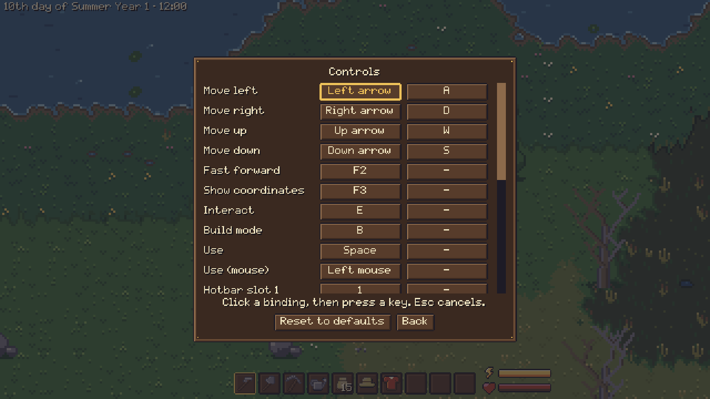
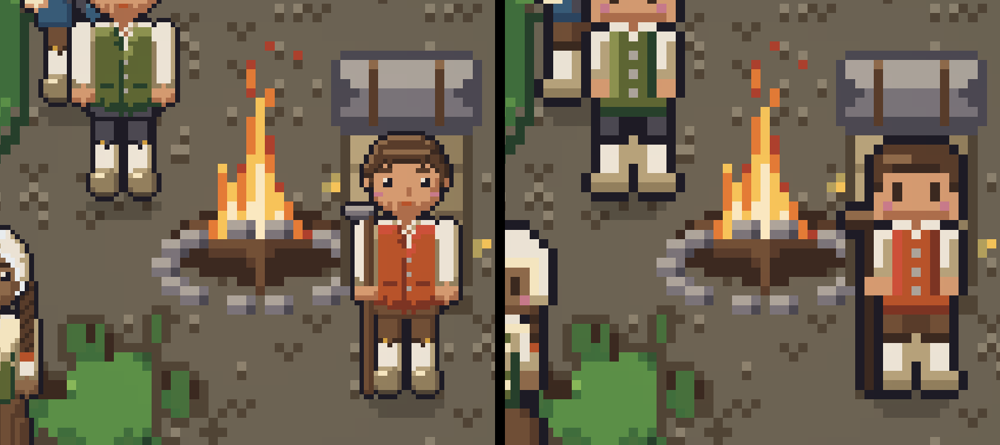
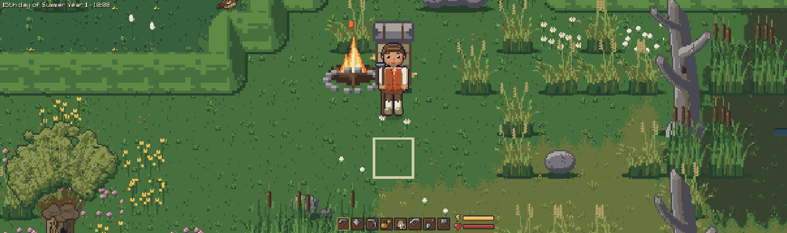

# Controls and settings

All the keys and the settings of the game.

## Settings

You can rebind every key, including mouse buttons. You can also switch between fullscreen and
windowed, scale the UI from 0.5× to 2× without touching the world view, and set the energy drain,
the day length variation and how often the game saves by itself (every 10 to 60 minutes of play),
cap the frame rate (10 to 240 in steps of 10, or no limit; it starts at 60, so the processor stays
cool), and set the language model villagers talk through. Hover over a setting, a key or an item in
the hotbar, inventory or equipment for a short explanation: an item's kind, weight, what food gives
back, what seeds grow and where they are planted. The game starts at its widest view, 1280×720 art
pixels (40×22 tiles of 32×32, an art pixel is 1.5 screen pixels on a 1080p screen); `=` and `-`
(also the keypad's + and −) or Ctrl and the mouse wheel zoom smoothly in to 4× that, 320×180 art
pixels. The wheel alone steps through the hotbar.

The art is being redrawn at 32 px per tile, group by group. Settings → Display → Art, or F7 while
playing, switches between the new art and the classic art, the 16 px art it replaces (doubled); so
far the people, the farm and the wild animals, the flames, the ground, the plants, the buildings and
the interiors have both. Everything not redrawn yet looks the same in both.

## Controls

These are the default keys; all of them can be changed under Settings → Controls.

| Key | Action |
|---|---|
| WASD or arrow keys | Walk (with the hammer building, only WASD: the arrows pick in the build menu until Escape) |
| Space or left click | Use the held item on the targeted tile |
| 1–8 | Pick a hotbar slot; the hammer's slot starts build mode, and a hotbar key or the mouse wheel takes build mode up again after Escape or a right click |
| Left mouse button, dragged | In the bag, character and chest windows: move a stack onto a slot, the trash can (not in the character window), or (let go outside the screen) the ground |
| Shift + left click, right click | In the bag, character and chest windows: send a stack to the other side; in the bag and character window right click wears or takes off an item |
| T | Drop the held stack on the ground in front of you (picked up again by walking away and back) |
| B, or click the bag icon beside the hotbar | The bag: the backpack (bottom right, beside the character window; the same key closes it) |
| C | The character window: the figure and the equipment (the same key closes it) |
| K | Skills tab of the character window |
| Shift + C | Crafting menu (by hand) |
| E | Get off the horse you ride; else talk to the villager in front of you, else get on the saddled horse in front of you, else open the chest or the station (its crafting menu) in front of you, else sleep until morning (next to a bed); with the hammer in hand it picks the next building |
| Enter, Escape | In a chat: send the line, leave the chat (Page Up and Down scroll back); `/clear` makes the villager forget the chat |
| X | Switch the hammer between building and taking down (hold Space or click to take down) |
| Q, E or left and right arrows | Previous and next building (while holding the hammer) |
| Up and down arrows | The building's next and previous style (while holding the hammer) |
| Mouse wheel | Next or previous hotbar slot |
| `=`, `-` (also keypad + and −) | Zoom in, zoom out (hold to keep zooming) |
| Ctrl + mouse wheel | Zoom |
| Escape | Pause menu |
| `/` | Console |
| F3 | Show coordinates, weather values and the frames per second |
| F7 | Switch between the new and the classic art |
| F9 | Quick save: save the game now, in the background |
| F8 | Quick load: go back to the last save at once, without asking ("No save to load" if there is none; a save that holds things the game no longer has asks first) |
