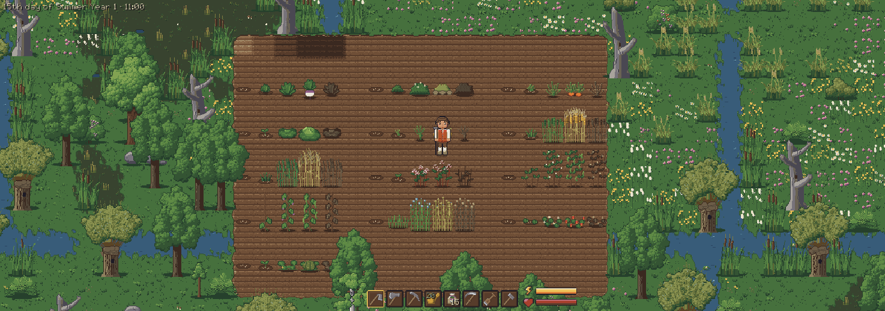
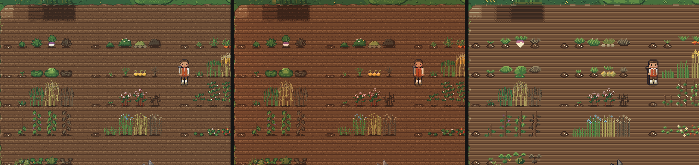
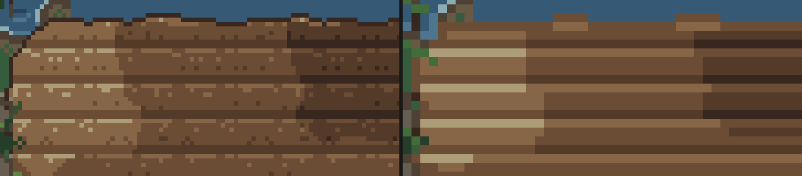
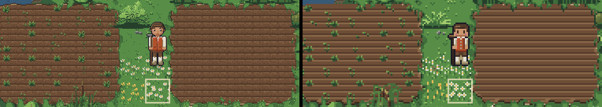

# Farming

Soil, seeds, crops and the farm's weeds.

You till the soil with the hoe, plant seeds, water them, and pick the crops by hand; a dead crop is
pulled up by hand or hoed away, which leaves tilled soil ready for the next crop; the tool you hold
is in the character's hand. There are thirteen crops: turnips, potatoes, carrots, cabbage, onions,
wheat, rye and buckwheat (the grains of the sandy Geest, ground to flour like wheat), peas, beans,
flax (for its fibre, not to eat), wild strawberries and small green squashes (pumpkins). Each grows
in its own seasons, and the weather (warmth, rain, frost) speeds it up, slows it down or damages it.
A ripe crop doesn't wait forever: left unpicked for as long as it took to ripen, it withers and
gives nothing. The growing times, seasons and the withering are in
[data/crops.cfg](../data/crops.cfg).

A harvest gives each crop's usual amount (carrots, say, 2), with now and then a poor harvest of one
less or a good one of one more (never below 1), and only now and then a seed back, so a field
replanted from its own seeds slowly shrinks: keep a few spare seeds. Each crop's usual amount, the
chances of a poor and of a good harvest and the seed chance are in the same file.

Tilled soil is flat with straight furrows, and the whole tile's brown shows its moisture in four
steps: light brown when dry, darker with rain and the watering can, dark brown when soaked, and
lightening again day by day as the sun and wind dry it. Rain shows at once: after an hour of rain
the soil's wet surface is a step darker, a heavy shower soaks it in two hours, and a rainy hour
never dries it. A bed comes to a pixel or two of its tiles' edges, ragged and softly rounded at its
corners. A sown tile is a mound of dark earth with seeds on it in the middle of the tile, so it
reads as planted before anything shows, and the crops stand centred on their tiles too. The shots
show a row of soil from dry to soaked and sown and growing crops on it, at noon, in the evening and
in the classic art.

Where a tile is wetter than the tilled soil beside it, as after the watering can, the wet soil is a
patch: its edge wanders in and out across the tiles' edges, blotchy, steps through the browns
between and rounds off at its corners, so a few watered tiles never read as a square block; tiles as
wet as each other show no edge, and the field's rim against the turf stays as it is. The close-up
shows the row from dry to soaked over fresh soil, four times enlarged, in the 32 px and the classic
art.

Tilled soil that nobody tends goes back over the days: with nothing on it, after 5 days a few weeds
and tufts of grass come up, and after 10 it is grass again, with the look its place had (the items
lying on it stay). Hoeing the weeds away, sowing, harvesting and watering start the count anew, and
a planted tile never grows over. The days of winter don't count. The numbers are in
[data/crops.cfg](../data/crops.cfg). The shot shows a bed left fallow beside one just tilled, in the
32 px and the classic art.

