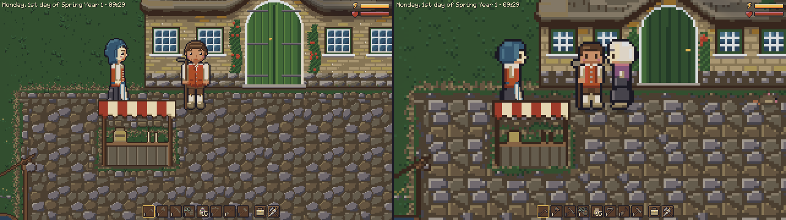
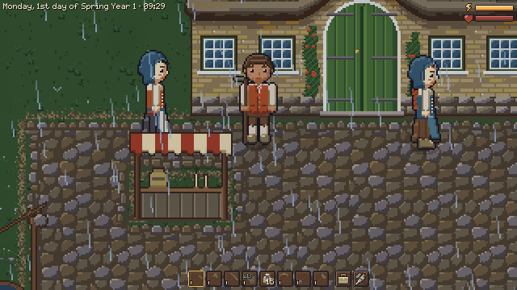
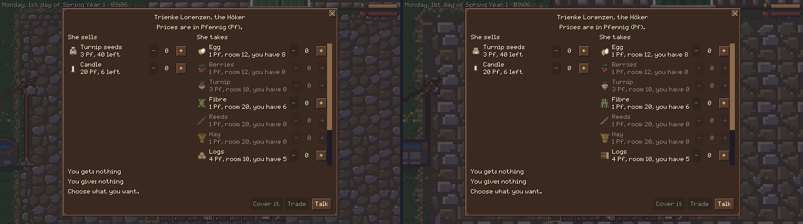

# The shop

Trienke Lorenzen, the Höker of Wehlsbüll, keeps a stall on the town square. You trade with her for
Schilling, the coin of the village, and in goods: the purse is in your bag.

## Where and when

- The stall stands on the town square, on the side of the Krug. Type `village` in the
  [console](console.md) to learn where the square is, and `tp` takes you there.
- She is at the stall from 7 till noon and from 1 till 6, Monday to Saturday, and goes home for
  dinner and supper. On Sunday the shop is shut: she is at church.
- The stall has an awning, so she keeps it in the rain too.
- Out of hours she tells you when she is back, if you find her at the stall. She goes her own way
  through the day like the other villagers, and her hours do not change.
- Only a new game has her stall. A world made before it has no stall; `spawn trienke` brings her
  and the console's `shop` opens the trade wherever she stands.

## Trading

- Stand by her while the shop is open and press E. The game stands still while you trade;
  E or Escape leaves.
- On the left is what she sells, with its price in Schilling (ß) and how much she has left. On the right
  is what she takes, with its value, how many more she takes today and how many you carry. Press `+`
  and `-` to choose how many of each, `Cover it` to fill what you give with the cheapest of your
  bag until what you get is paid, and `Trade` when the line below says the trade is fair. `Talk`
  turns to a chat with her instead. Rows with nothing to trade are grey.
- The difference between what you get and what you give is paid in coin. If what you give is worth
  less, you pay the rest from your purse (the screen shows it, and the bag too); if it is worth
  more, she pays you the rest in Schilling. You can give nothing and pay in coin, or get nothing
  and be paid. If your purse cannot pay, the line says "Short by N Schilling." `Cover it` fills in
  goods only as far as your purse does not reach.
- The trade is all or nothing: if your bag has no room for what you get, the line says so and
  nothing changes.
- She takes at 60 percent of what a thing is worth, and sells at 125 percent: the prices are in
  `data/shops.cfg`.

| She sells | Price | Has at most | Comes back each day |
|---|---|---|---|
| Turnip seeds | 3 ß | 40 | 10 |
| Carrot, onion, rye, wheat, buckwheat and flax seeds | 3 ß | 30 each | 8 each |
| Cabbage seeds | 4 ß | 30 | 8 |
| Pea and bean seeds | 4 ß | 20 each | 5 each |
| Seed potatoes | 5 ß | 25 | 6 |
| Pumpkin seeds | 5 ß | 12 | 3 |
| Strawberry plants | 7 ß | 12 | 3 |
| Candle | 20 ß | 6 | 1 |

| She takes | Value | A day |
|---|---|---|
| Egg | 1 ß | 12 |
| Berries | 1 to 2 ß | 12 |
| Turnip | 3 to 4 ß | 10 |
| Fibre, reeds, hay | 1 ß | 20 each |
| Logs | 4 ß | 10 |
| Clay | 2 ß | 10 |
| Flour | 4 to 7 ß | 6 |
| Bread | 6 to 8 ß | 6 |

- What a good is worth moves with the season, and so what she gives for it: grain (flour, bread) is
  cheap after the harvest in autumn and dear in spring, vegetables (turnips, berries) are cheap in
  autumn and dear in winter and spring, eggs a little dearer in winter. The tables show the range.
  Seeds, candles, wood, fibre, reeds, hay and clay cost the same all year.
- Her stock fills up over the days, and what she takes in a day is back to its number the next
  day. A shop you leave alone for a long time is full again when you come back; one you empty
  stays empty for the day. It is saved with the game.
- She sells the seeds of every crop all year round, in or out of season; one seed is one tile.
- A lost harvest is not the end of the farm: a day's fibre and logs alone (20 and 10) pay for 20
  seeds, wherever you found them, and one turnip pays for a seed. Eggs, berries, reeds, hay and
  clay pay too, so what she has of any one seed is never out of reach.
- She is a villager: you can talk to her as to the others (see [villagers.md](villagers.md)). She
  never names a price or moves an item in the chat: the screen does that.

