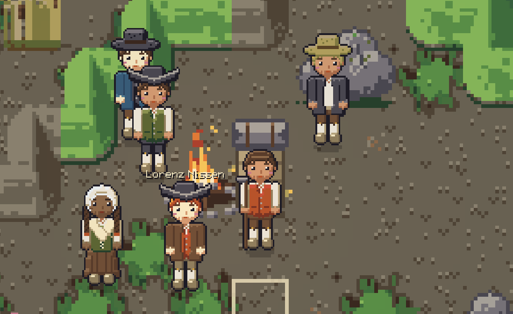
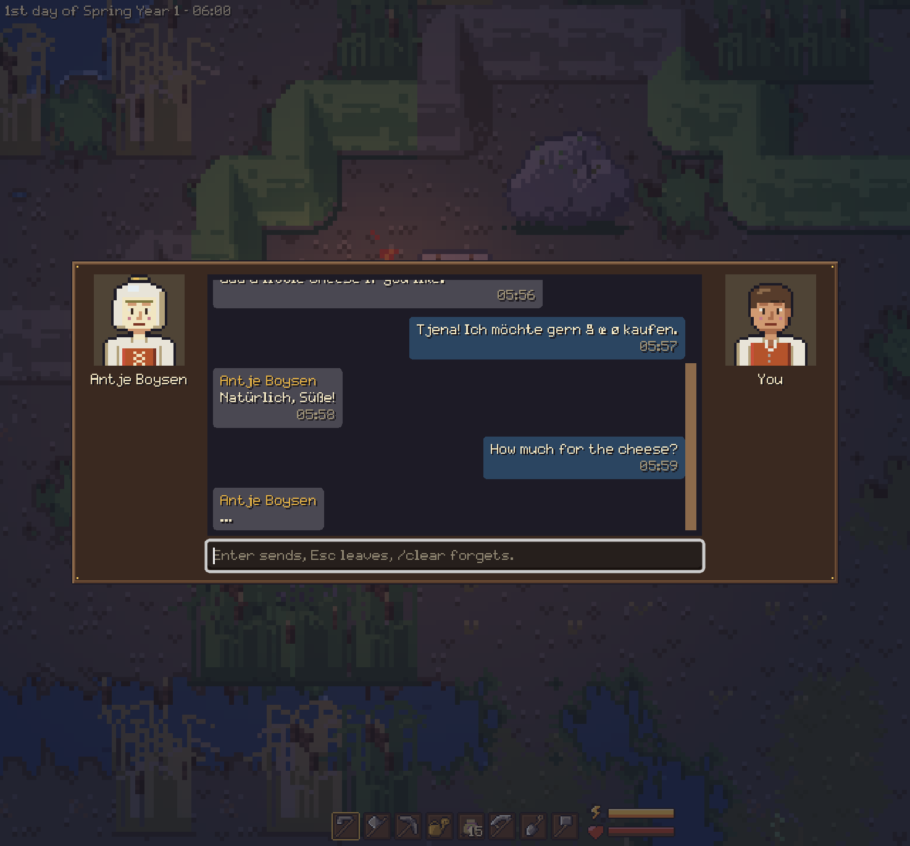
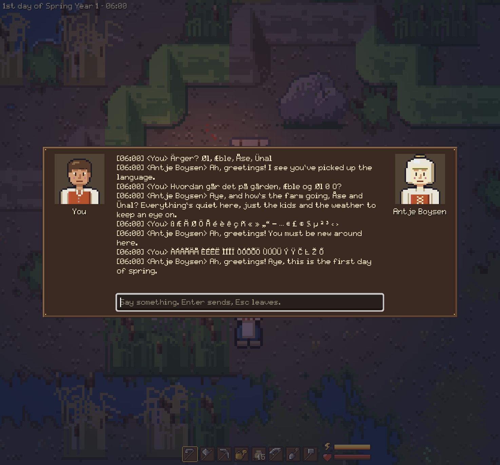
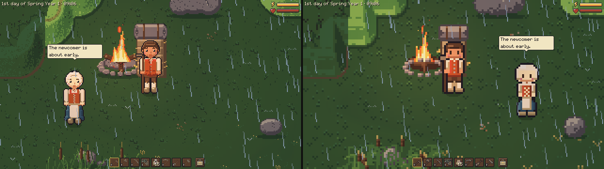

# Villagers

The people of Wehlsbüll: who they are, what they notice, and how to talk to them.

For now villagers come from the [console](console.md) and are saved with the game. They stay
within about six tiles of the house or campfire nearest to where they came, stroll about by day
and stand still at night. You walk through them, so they never shut you in.

## Who lives here

- Wehlsbüll is a made-up marsh parish two hours north of Husum, in 1750.
- Each villager has a name, age, trade, personality, family and friends, likes and secrets.
- Eight are written by hand. `spawn npc <id>` brings one:
  - `antje` (Antje Boysen, a farmer's wife), `hinrich` (her husband) and `boy` (their son)
  - `momme` (Momme Ketels, a fisherman) and `inken` (his daughter, Boy's sweetheart)
  - `ocke` (Ocke Hansen, the miller) and `gesche` (his wife)
  - `kerrin` (Kerrin Paulsen, a widow who lived through the flood of 1717)
- `spawn npc 3` makes up three newcomers or people of the outlying farms, kin to nobody. They
  start knowing nothing about the village and learn it from other villagers, one topic per
  meeting.
- The hand-written villagers know the village: the church, the Krug, the mill, the dyke, who is
  who, prices, this year's news and the church year.

## Talking

- Face a villager and press E. The name over their head shows whom E speaks to.
- The chat looks like a messenger: their portrait and bubbles on the left, yours on the right,
  each with the game time. "..." means they are still answering.
- Type a line and press Enter; Escape leaves. The game stands still while you talk.
- A villager keeps the latest 24 lines of your chat, so a reopened chat goes on where it left
  off. Older lines are summed up in a memory (they keep up to 20).
- `/clear` in a chat makes that villager forget the chat, the stories and the memories.
- Without a language model they say short scripted lines ("Aye.", "Is that so?"). With one they
  answer in their own words, in your language (English, German and Danish are recognised).
- You may leave while one is answering and talk to another; the answer waits in their chat.
- The font shows German, Danish, Dutch and other accented letters as written.

## Speech bubbles

- About once a minute, a villager in view says a short line in a bubble for five seconds.
- At most one bubble is on screen. They talk about the weather and the time of day, or about you
  when you are near.
- With a model, the line is worded by it; otherwise it is a scripted line.

## Gossip and opinions

- Everything you do is a deed: felling a tree, building or taking down a house or fence,
  tilling, sowing, harvesting, mowing, digging clay.
- Villagers within 20 tiles (6 at night) see it and keep it as a story. They keep 10 by
  default, for 7 days.
- A story weighs more when it happened by their own house or that of family or friends.
- Villagers who stand within 3 tiles pass on stories: to family and friends first, then
  neighbours. A rumour stops after 3 hops or when the deed is 7 days old.
- Rumours change on the way: a count grows, the place moves, or the deed becomes a similar one.
- Each villager has an opinion of you from -100 to 1000, starting at 0 and moving at most 20
  points a day. They answer cold (below -20), neutral or warm (20 or more).
- Felling a tree is -1, building a house +1 and taking one down -2 (a step is 10 points); what
  they only heard counts half.
- With a model, it also words the story in the villager's voice and judges how they take it.
- `deeds`, `gossip <villager>` and `opinion` in the console show all this.

## Setting up a language model

Villagers need no model: nothing answering means scripted lines. To have them talk freely, pick
one of three ways. All start in Settings, under Language model.

### Gemini (free within Google's limits)

1. Get an API key at aistudio.google.com/apikey (Create API key).
2. In Settings, Language model, pick the profile Gemini.
3. Paste the key (it starts with `AIza`) into Key.
4. The model is `gemini-2.5-flash-lite`: fast, and it doesn't think first.
5. On the free tier, Google may use what you say to improve its models.

### Claude

1. Get an Anthropic API key at console.anthropic.com.
2. In Settings, Language model, pick the profile Claude and paste the key into Key.
3. The model is `claude-opus-5-5`; for small talk `claude-haiku-5-5` is plenty and about 30
   times cheaper. Pick it from the model list.
4. A line costs about 1 cent with Opus and about 0.03 cents with Haiku.
5. Everything villagers are told and everything you say goes to Anthropic.

### The test model on your own machine

1. Run `make llm-up`. It starts Ollama with Qwen2.5 7B Instruct (4.7 GB) in a podman or docker
   container on `http://127.0.0.1:11434/v1`, the default endpoint.
2. `make llm-check` asks it one question; `make llm-down` stops it (`PURGE=1` deletes the model).
3. A reply takes a second or two on a GPU, a few seconds on the CPU. Slower than 30 seconds
   becomes a scripted line.
4. For another model run `make llm-pull LLM_MODEL=qwen2.5:3b-instruct`, then set it as the
   model in Settings. See [tools/README.md](../tools/README.md).

Ollama, LM Studio (`http://127.0.0.1:1234/v1`), llama.cpp's server and hosted OpenAI-compatible
APIs all work as the OpenAI-compatible provider.

### The settings

A profile is a provider with its own endpoint, model, token limit and temperature, so you can
keep several (say Gemini flash and pro). The key belongs to the provider.

| Field | Default | What it does |
|---|---|---|
| Profile | OpenAI-compatible | The profile in use. New adds one, Copy duplicates it, Delete removes it. |
| Name | the provider's | Must be unique and not empty. |
| Provider | OpenAI-compatible | OpenAI-compatible, Claude or Gemini. |
| Endpoint | `http://127.0.0.1:11434/v1` | The chat API's base address. Empty turns the model off. |
| Model | `qwen2.5:7b-instruct` | Typed, or picked from the list the endpoint offers. |
| Stories a villager keeps | 10 | 1 to 100. More stories make answers slower. |
| Memories a villager keeps | 20 | 1 to 200. The lightest is forgotten first. |
| Lines a villager keeps | 24 | 2 to 200. More lines make answers slower and dearer. |
| Key | empty | Only for endpoints that need one. Sent only to that provider. |
| Max tokens per answer | empty | 1 to 32000. Empty is 60 for a line (1000 with Claude). Give a thinking model a few hundred. |
| Temperature | empty | 0 to 2: lower is steadier. Empty is 0.5. Claude takes none. |

- The key is stored as plain text in your settings file, never in a save and never logged.
- A hosted model gets full character sheets (about 2,000 tokens a line); a local one gets
  cut-down sheets to stay fast.

### When the model fails

- A busy model, a refused key, no connection or a timeout shows a red notice at the top left.
- The same trouble shows again only after 5 minutes; a quiet notice follows when it works again.
- A failed request adds nothing to the chat: your line stays and you can write again.
- The default test model never shows a notice; it just gives a scripted line.
