# The world

Seasons, land, weather and light in the Schleswig-Holstein of about 1700-1800.

## Seasons

- A year has four seasons of 30 days each.
- Trees, bushes, ground and buildings change with the season: spring green, full summer, autumn
  colours, snow in winter.
- Trees leaf out over the first three days of spring. Scots pines and spruces stay green all year.
- Berry bushes only bear fruit in their season.
- Meadows flower from spring to late summer, and bees come only where something blooms.
- Frost and snow come only in winter; late winter thaws quickly.

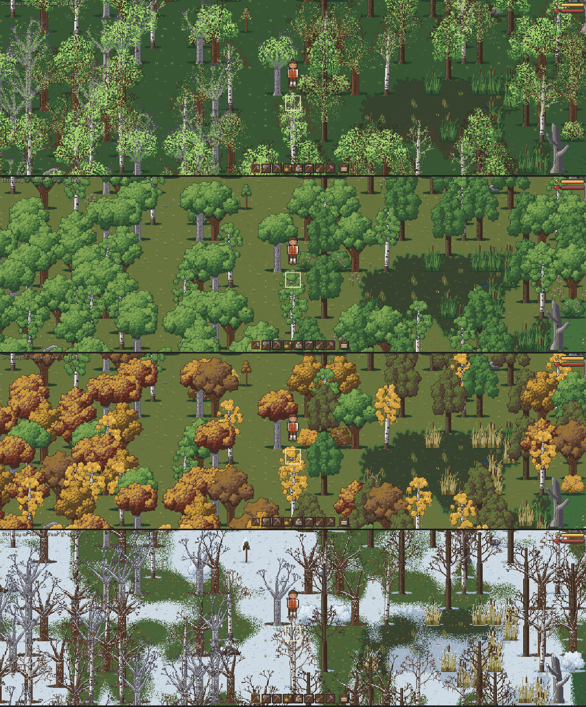

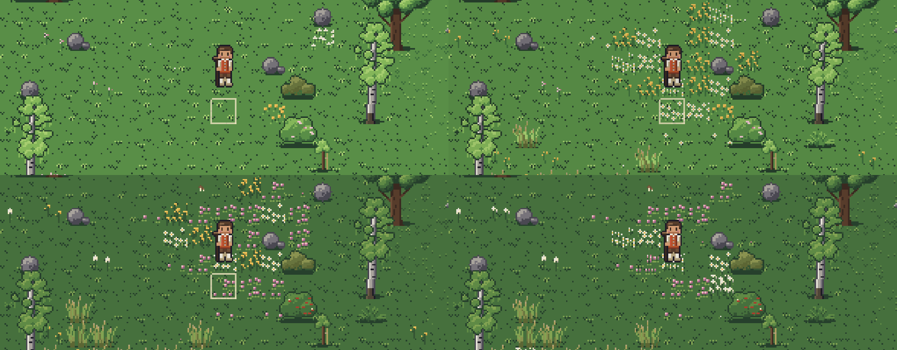

## Paths

- Grass wears where feet go: trodden first, then bare earth.
- A path forms in a few days of walking the same line; unused it grows back in a week or two.
- Animals and villagers wear paths too.
- A path is only a look: you walk, till and build on it as on grass.

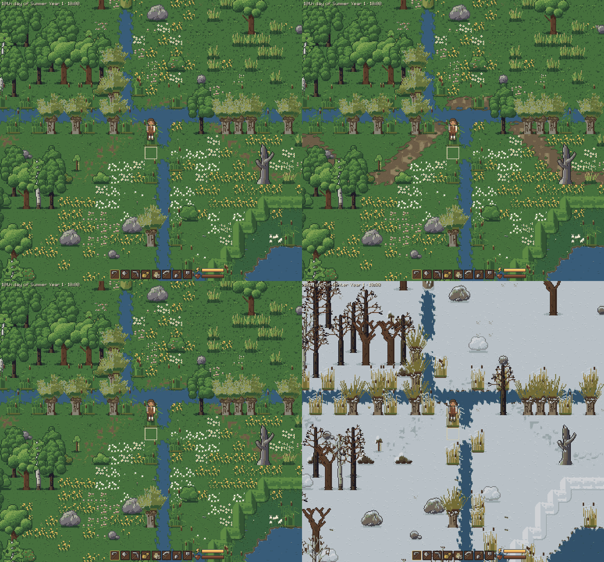

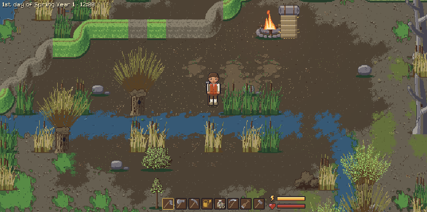

## Fields, Knicks and dykes

- On the dry Geest, fields are bounded by Knicks (hedges on earth banks), stone walls and wattle
  fences.
- In the marsh, fields are cut by ditches lined with reeds and pollard willows, with dykes along
  the floodplain.
- Every field has a gap or crossing, so none is shut in.
- The axe cuts a Knick down for logs and fibre; the pickaxe takes a wall apart for stone.
- Willows are felled like other trees.

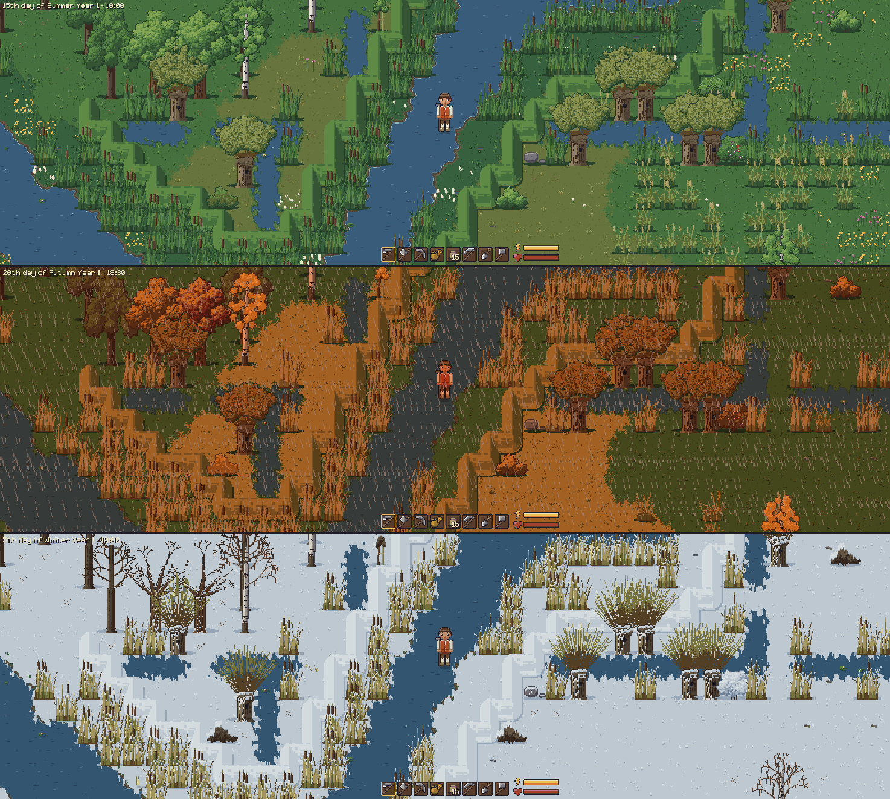

## The coast and the tides

- In the west, a sea dyke runs along the coast. Beyond it lie the salt marsh and the tidal mud
  of the Wadden Sea.
- The tide comes in and goes out twice a day.
- Mud under water can't be walked on, like the sea: the flats open and close with the tide.
- If the water catches you, you can still wade to the shore. Villagers and animals obey the same
  rule.
- A Warft (a dwelling mound) stands on the salt marsh, and now and then an Ewer (a sailing barge)
  lies on the mud.
- Storks, geese, oystercatchers, gulls and terns live here: see [wildlife](animals.md#wildlife).

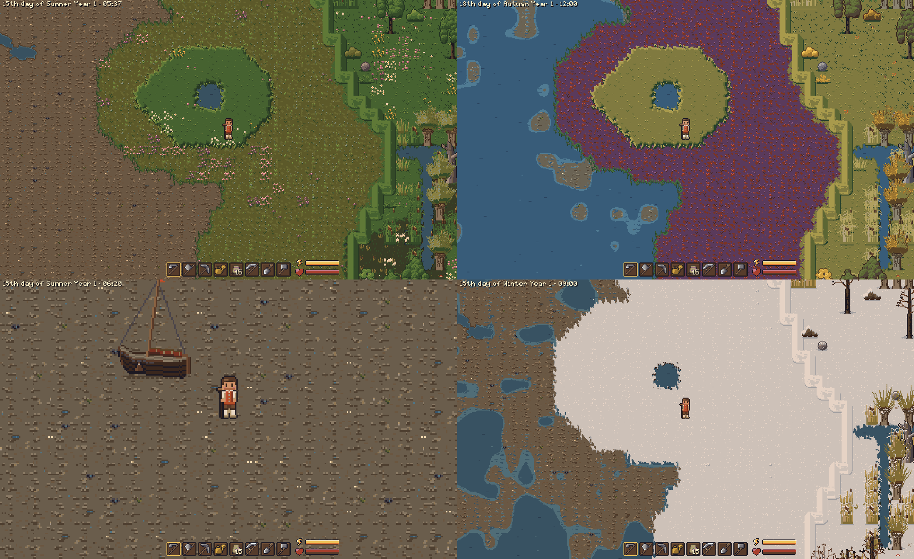

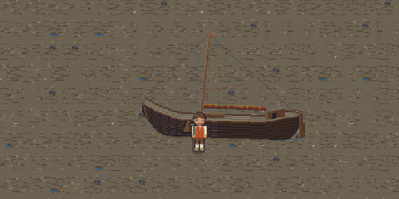

## Weather

- The weather brings rain, snow, fog, wind, storms and thunderstorms with lightning.
- Rain comes as showers and fronts of a few hours, seldom a whole day.
- Autumn is the wettest season, spring the driest.
- The same world seed always gives the same weather.
- Wind sways trees, grass, reeds and crops, and makes the water choppier and the campfire lean.
- In windy autumn, trees near you shed leaves.
- Weather matters to crops: see [farming](farming.md).

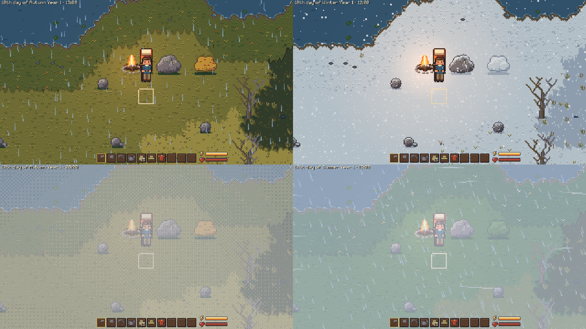

## Day, night and light

- Midsummer has about 16 hours of daylight, midwinter about 8.
- The night is dark: away from a light you see little more than shapes.
- The campfire, the hearth and lit windows glow after dark; clouds dim the daylight.
- Cloud shadows drift over the ground in partly clouded weather (a look only).
- A setting shrinks or switches off the change in day length.

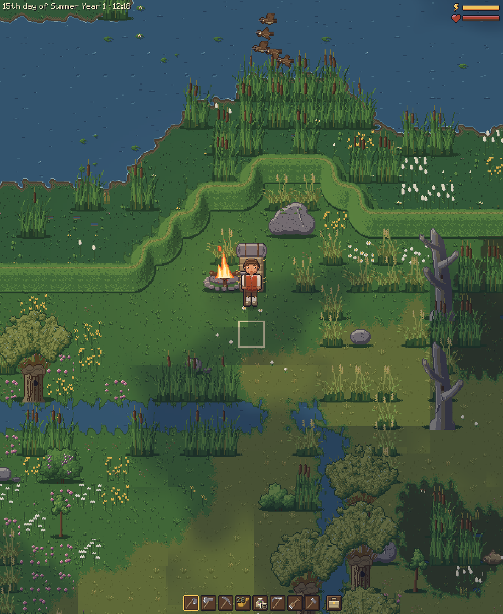

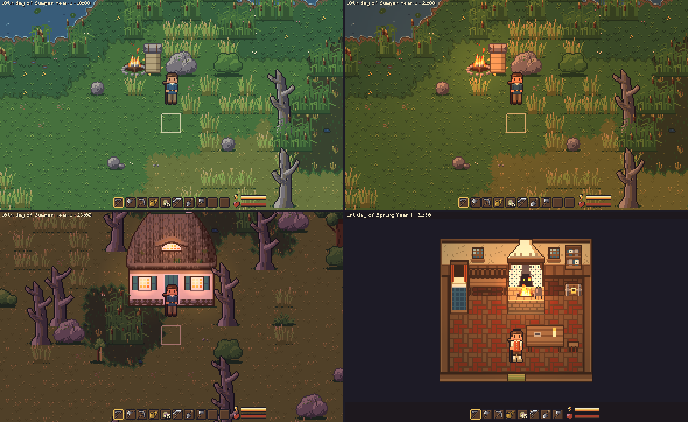

### The lantern

- Get one with `give lantern` in the [console](console.md) for now.
- Select it and press the use key (space) to light it or put it out.
- Lit, it throws a warm, flickering circle of light around you. It needs no fuel.

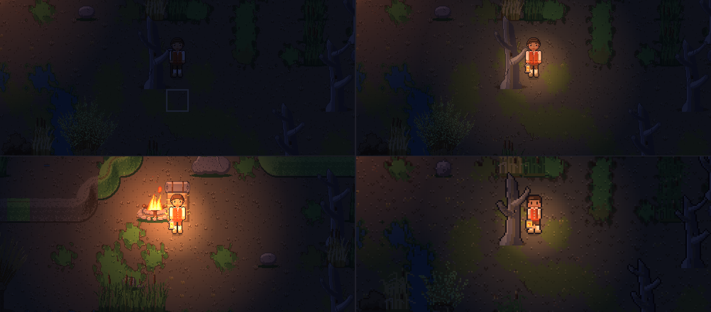
