# The world

Seasons, land, weather and light in the Schleswig-Holstein of about 1700-1800.

## Seasons

- A year has four seasons of 35 days each (five weeks), so 140 days.
- A week has 7 days, Monday to Sunday, and the first day of the game is a Monday. The date in the
  top left corner names the weekday: "Monday, 1st day of Spring Year 1 · 06:00".
- Trees, bushes, ground and buildings change with the season: spring green, full summer, autumn
  colours, snow in winter.
- Trees leaf out over the first three days of spring. Scots pines and spruces stay green all year.
- Berry bushes only bear fruit in their season.
- Meadows flower from spring to late summer, and bees come only where something blooms.
- Frost and snow come only in winter; late winter thaws quickly.

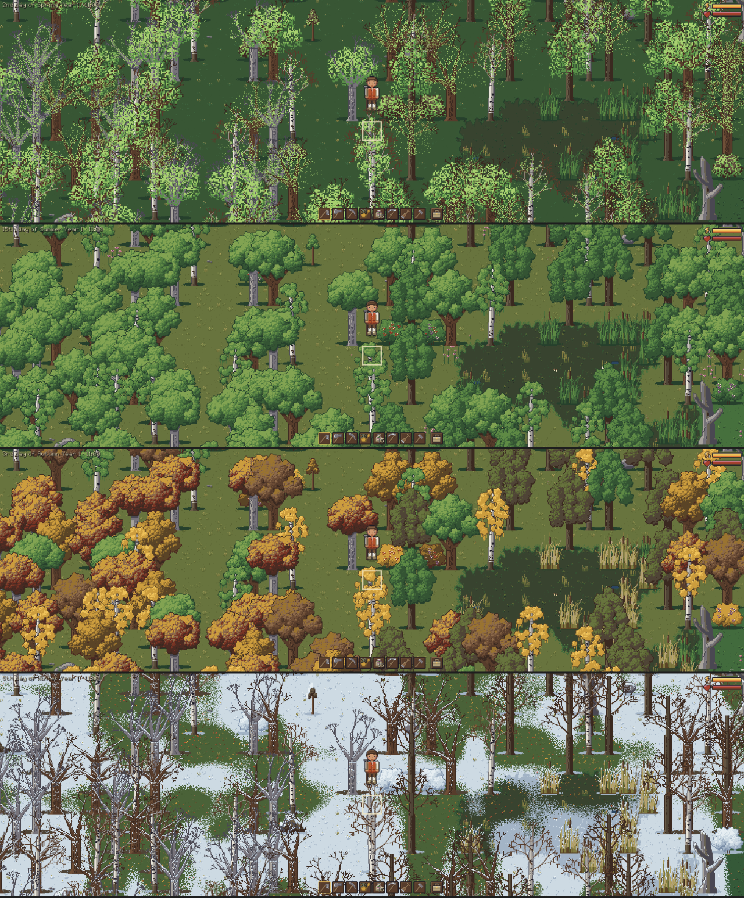

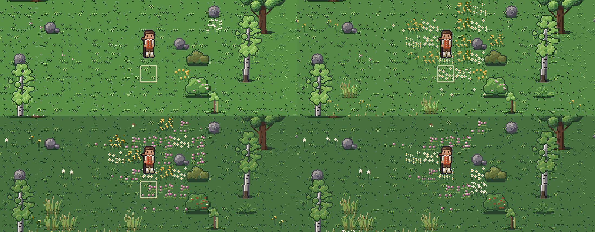

## Paths

- Grass wears where feet go: trodden first, then bare earth.
- It takes days, not just steps: walk a tile ten times or more a day, three days in a row, and
  it is trodden; eight days in a row, and it is a path. A day you skip takes a day off.
- Unused, a path is trodden again after about a week and grass after about ten days.
- Animals and villagers wear paths too.
- A path is only a look: you till and build on it as on grass.
- In rain, worn ground (trodden grass and paths) turns to mud: a few hours of steady rain make
  it, and it dries out again about ten hours after the rain stops. You walk slower on mud, so a
  road that stays dry is worth laying. Villagers and animals are not slowed.
- Walking in snow or in mud (the mud of the rain, or the tidal mud when the tide is out) leaves
  footprints, one for each step, left and right. They fade in a few hours, sooner in rain, fresh
  snowfall or a thaw, and the tide washes the ones on the mud away. Ways (plank walk, stone path)
  take none, and nor does a horse yet. Villagers leave them where you can see them.

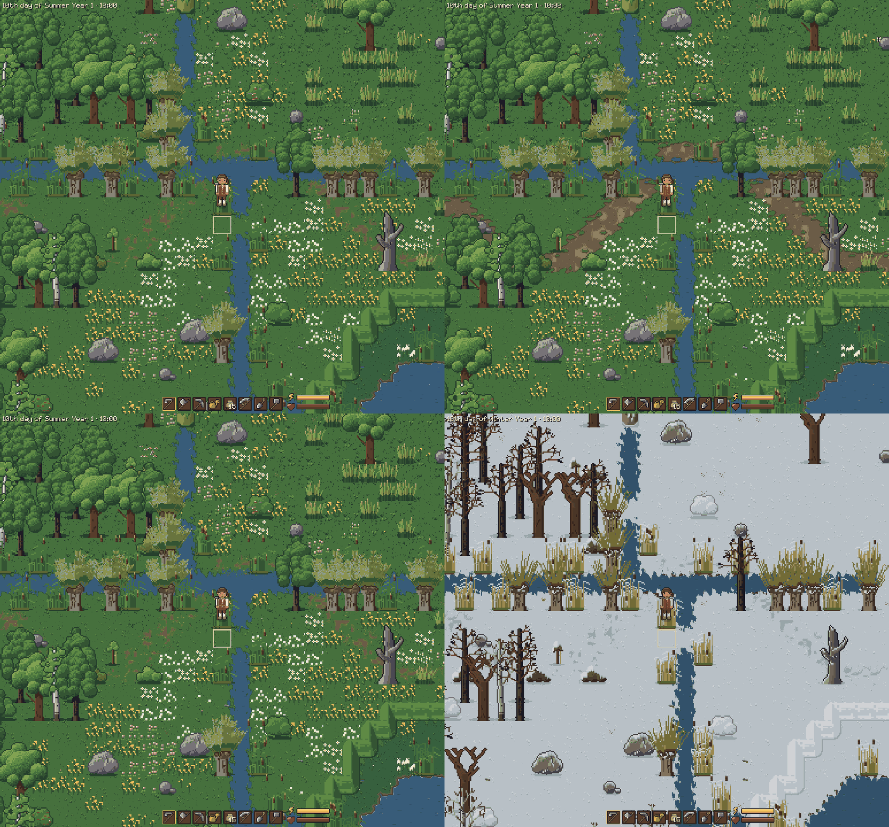

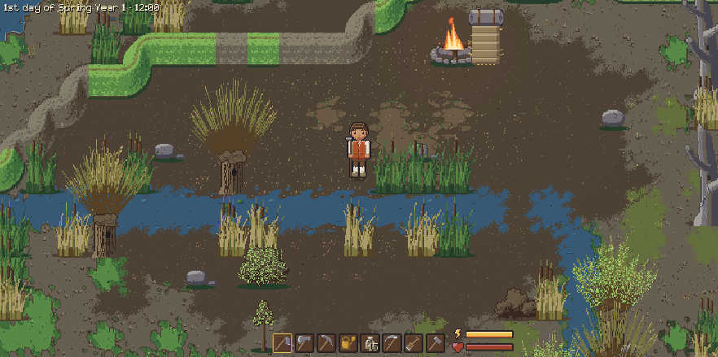

## Dykes, Knicks and willows

- The open land is bare: no fields, fences or ditches stand in it until you or a village make
  them. Only dykes run along the floodplain and the coast.
- A few creeks wind down to the river. You can't swim them: cross at a ford, where the water runs
  shallow over a bed of stones.
- The axe cuts a Knick down for logs and fibre; the pickaxe takes a wall apart for stone.
- Willows grow on wet ground and are felled like other trees.

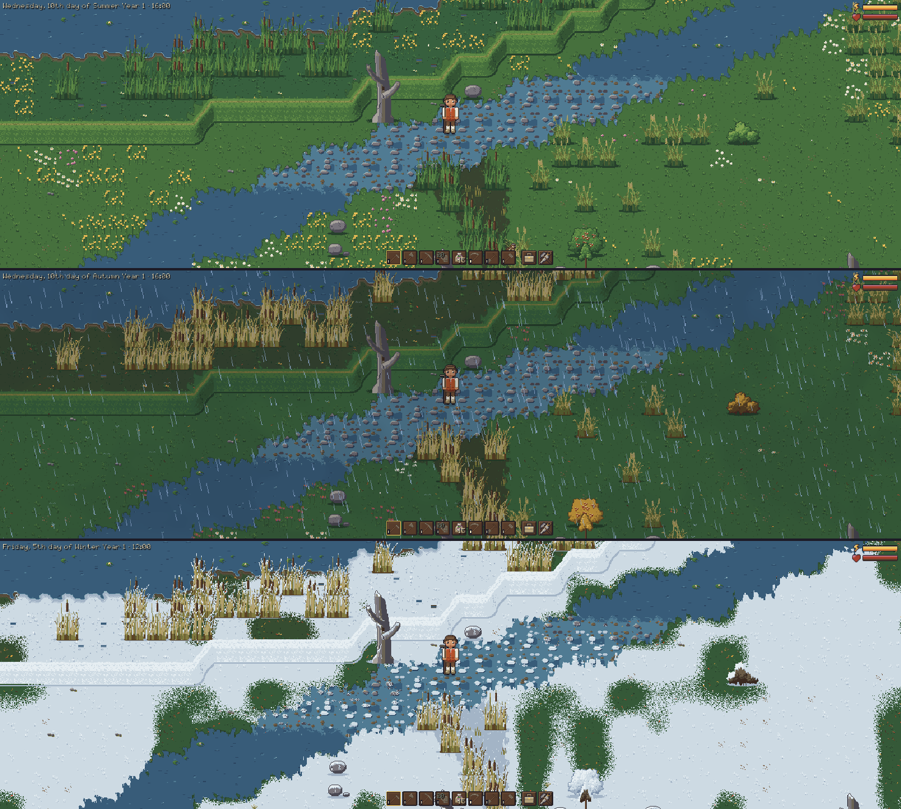

## Wehlsbüll

A new game has the village Wehlsbüll in the world: about 80 by 60 tiles on the coast, west of the
camp, a walk of a minute or two from it (more on some seeds; there is no track yet, the way is
open land and creeks with fords). Type `village` in the [console](console.md) to learn how far and
in which direction it lies and where its town square is, and `tp` takes you there.

- Three farms stand on their own Warften behind the sea dyke (Warft: a raised dwelling mound),
  each with a hall house, a barn, a wattle fence and a gate, and four fields beside them, each
  ringed by a ditch on the marsh and a Knick on the Geest. Nothing is planted in them.
- The church stands on the highest Warft with its churchyard, graves and bell frame, and the
  parsonage and the Krug close by. Six cottages stand along the dyke and the sluice, and the
  landing, with a jetty, a rowing boat and a net frame, is outside the dyke on the salt marsh.
  The place for the post mill is kept free.
- The lanes are trodden paths that stay: they do not grow back, walked or not. So does the town
  square, an open place in the middle that is kept free for a market. Its middle is where the
  villagers meet.
- Eight villagers live here from the start (see [villagers.md](villagers.md)). The other houses
  stand empty.
- The village is not yours: its houses cannot be taken down, and building on its land costs you
  goodwill (see [building-and-crafting.md](building-and-crafting.md)).
- An old save from before the village has none: its world stays as it is.

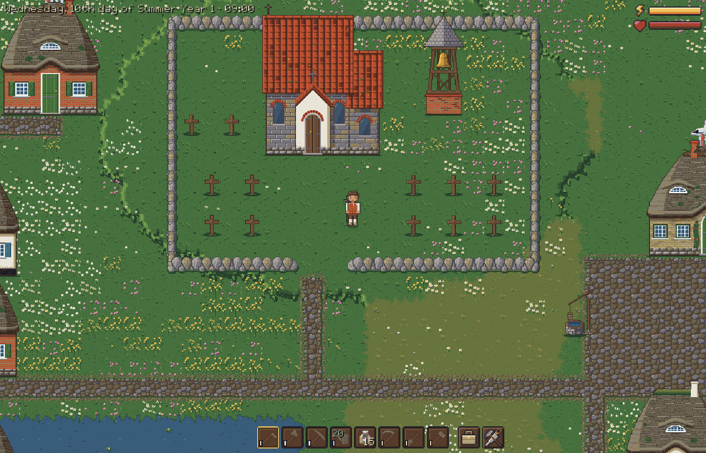

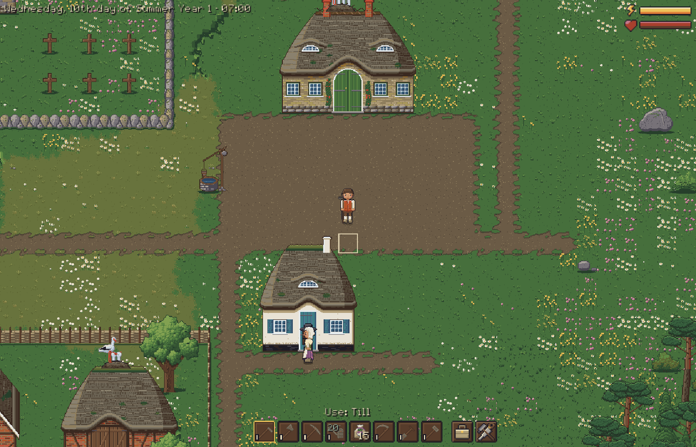

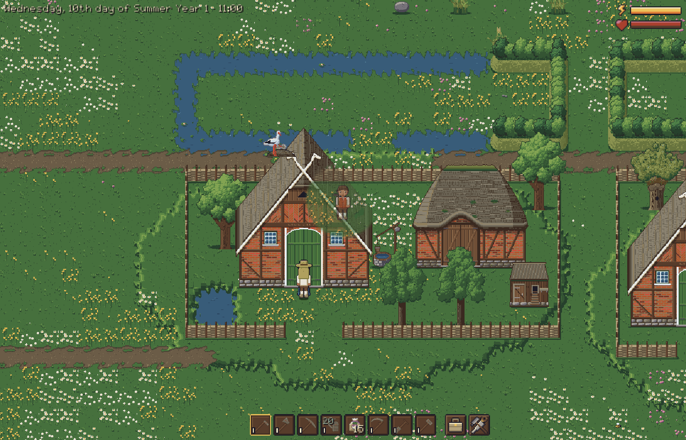

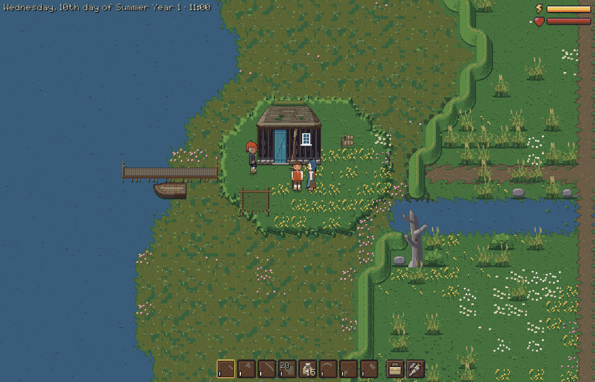

The classic art has the same pictures with `-classic` in the name: `wehlsbuell-church-classic.png` and
the others.

## The coast and the tides

- In the west, a sea dyke runs along the coast. Beyond it lie the salt marsh and the tidal mud
  of the Wadden Sea.
- The tide comes in and goes out twice a day.
- Mud under water is not walked on like dry ground, and the sea and the tideways can't be walked
  on at all. You can wade into flooded mud on foot, but very slowly: a third of your normal speed.
  A horse won't go into it, so get off first.
- If the water catches you, you can wade to the shore. Villagers and animals keep out of flooded
  mud, and leave it if the water rises round them.
- A Warft (a dwelling mound) stands on the salt marsh, and now and then an Ewer (a sailing barge)
  lies on the mud.
- Storks, geese, oystercatchers, gulls and terns live here: see [wildlife](animals.md#wildlife).

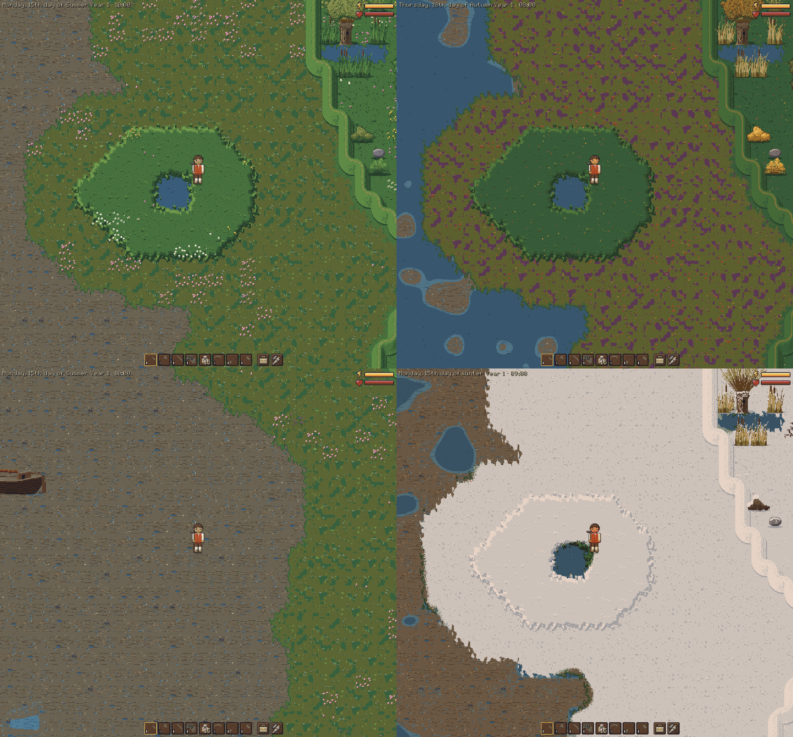

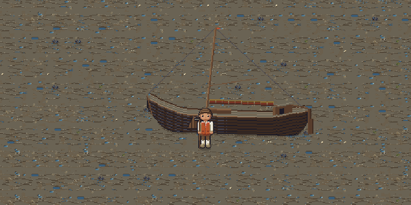

## Weather

- The weather brings rain, snow, fog, wind, storms and thunderstorms with lightning.
- Rain comes as showers and fronts of a few hours, seldom a whole day.
- Autumn is the wettest season, spring the driest.
- The same world seed always gives the same weather.
- Wind sways trees, grass, reeds and crops, and makes the water choppier and the campfire lean.
- In windy autumn, trees near you shed leaves.
- Weather matters to crops: see [farming](farming.md).

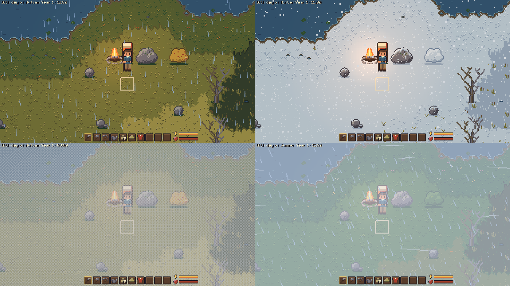

## Day, night and light

- Midsummer has about 16 hours of daylight, midwinter about 8.
- The night is dark: away from a light you see little more than shapes.
- The campfire, the hearth and lit windows glow after dark; clouds dim the daylight.
- A campfire burns the wood in it, a log (3 hours) after the other, also while you sleep or far
  away, and goes out with none left: it gives no light and you can't cook at it until you put wood
  in and light it again (E at the fire). The camp's fire starts with about 12 hours. The hearth in
  a house burns for ever.
- Cloud shadows drift over the ground in partly clouded weather (a look only).
- A setting shrinks or switches off the change in day length.

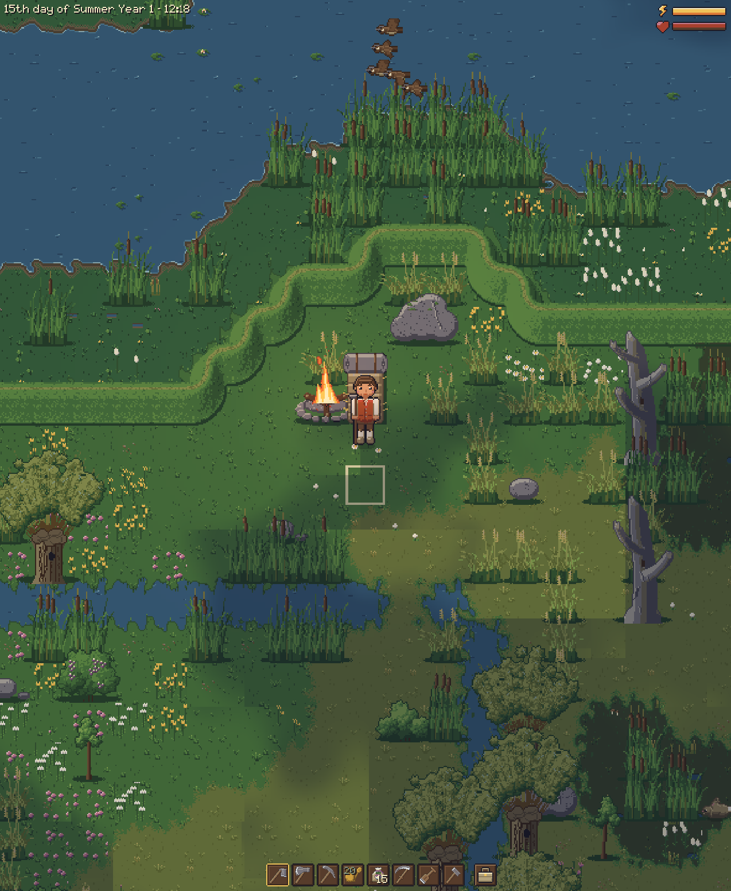

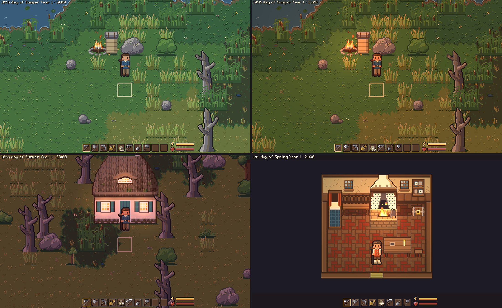

### The lantern

- Make it at the workbench: 2 planks and 2 fibre. It comes without a candle: make candles by
  hand (2 wax and a fibre give 2; get wax with `give wax` in the [console](console.md) until bee
  hives come). See [crafting](building-and-crafting.md#crafting).
- Select it and press the use key (space). With no candle in it, that fits the freshest candle
  from your bag; with one, it lights the lantern or puts it out.
- Right click the lantern in the bag or the hotbar to take its candle out again, as it is (it
  needs a free slot). A burnt candle is a candle of its own and does not stack; hover it or the
  lantern to see how much is left. A dropped lantern or burnt candle keeps its candle.
- Lit, it throws a warm, flickering circle of light around you, and the candle burns down while
  you hold it lit: 24 hours, about three winter nights. A candle that is burnt out is gone, and
  the lantern goes out.
- Going to bed, or passing out, puts the lantern out, so the candle burns nothing in the night.

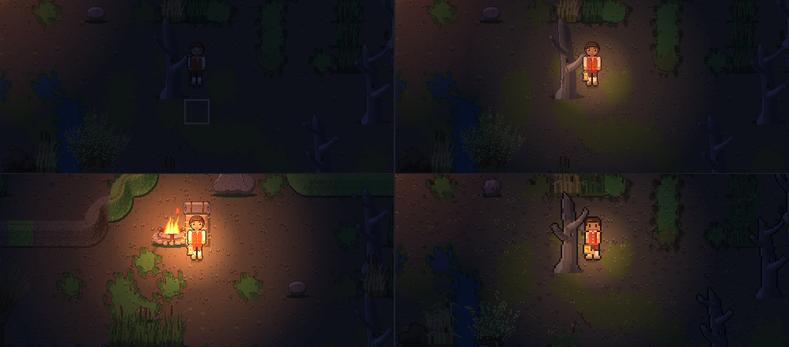
