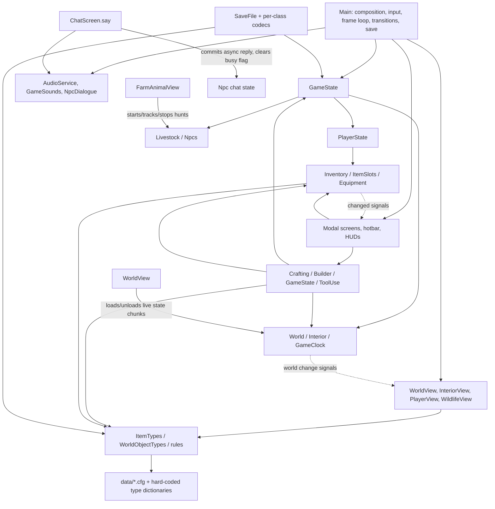

# Technical Architecture Review — 2026-11-09

**Purpose:** an implementation handoff for Claude or another coding agent. This is a technical architecture review, not a request to change game design. No production code was changed.

## Executive verdict

The project has a useful architecture already: plain state classes, mostly one-way scene dependencies, deterministic world generation, explicit save migrations, and substantial headless tests. Keep those foundations. The problem is **incomplete ownership boundaries**, not a need for an ECS, more autoloads, or signals everywhere.

The three most important flaws are:

1. **Item operations have no consistent transaction boundary.** Inventory, equipment, crafting, placement and drops expose different mutation and notification semantics. Observers can see impossible intermediate states; public APIs permit destructive combinations; adding new item behavior means coordinating several subsystems.
2. **Durable gameplay work is owned partly by disposable views, with incomplete teardown.** Chat completion belongs to `ChatScreen`; hunting decisions belong partly to `FarmAnimalView`; chunk residency belongs to `WorldView`. Removing or replacing a view can affect gameplay or leave shared UI state behind.
3. **Content and save data are not validated as a complete graph before becoming live state.** Strict dictionary indexing is not schema validation. Malformed inventories load successfully, references depend on mutable global catalogs, and save failure does not stop “save and quit.”

**Refactor order:** item invariants → save safety → lifecycle ownership → validated content catalog → shared item interaction UI → authoritative actions/events → spatially bounded presentation → simulation/streaming ownership.

“Critical” here means a high-impact architectural risk to address before major feature expansion. It does **not** mean every scenario below is currently reachable through normal player input. Each finding distinguishes reproduced behavior from future failure risk.

## 1. Scope and design constraints

### Sources and baseline

Read the design and architecture documentation before implementation, especially:

- `design/README.md`, `design/tech/{tile-state,world-objects-and-edits,saving,build-and-tools}.md`;
- `design/player/inventory-and-character.md`, `design/crafting/{crafting,professions}.md`;
- `design/villagers/{dialogue,gossip}.md`, `design/presentation/menus-and-hud.md`, `design/world/generation.md`;
- `docs/architecture.md`, `docs/ui.md`, and the November 6 and November 8 code reviews.

Implementation review covered the core state, world, UI, rendering, interaction, networking and persistence paths, with supporting tests and selected asset-generator code. **All `.claude/` worktrees and their editor diagnostics were excluded.**

Initial repository HEAD was `4ff66c3860db99bef801270296fd370b5c90487e`. Other agents were committing during review, so this is a review of the observed working-tree sources, not a claim that the entire review was made against one atomic Git checkout. Runtime verification used a disposable copy under `/tmp/opencode/architecture-review-2026-11-09-snapshot`, excluding `.claude/`. A subsequent comparison found no differences in copied `game/`, `data/` or `tests/` files at that check.

The snapshot contained 188 game scripts. Size hotspots included `main.gd` (846 lines), `world_view.gd` (868), `item_types.gd` (597), and `world_object_types.gd` (812). Size alone is not a finding; the ownership and invariant violations below are.

### Preserve these design decisions

- State and world generation remain usable without a scene tree or renderer. Explicit actions should change authoritative state (`design/README.md:83–87`).
- Seed + persistent edits + buildings remain the world model. Chunk unloading must not discard player changes.
- Hotbar and backpack remain distinct storage regions. Keep matching-stack-first behavior, selected-empty-slot-last pickup, and backpack-first chest transfers.
- Preserve differing teardown policies: an outdoor axe spills contents, an indoor tool refuses if everything cannot fit, and hammer teardown returns items with overflow dropped.
- Character, storage and crafting windows do not pause time; chat and pause menu do. The outdoor world standing still while inside a house is an explicit current design choice, not automatically a bug.
- Keep `Modal`, `ScrollingList`, `SlotView`, `ItemIcon`, `TrashCan`, shared theme and `UiColors`. The recently completed modal consolidation is real and should not be rebuilt.
- Keep the ten-step save-upgrade window. Do not remove migrations or silently reset saves during a structural refactor.
- Gossip is marked **decided, not built**. Recommend usable action events and background-job ownership, but do not implement or redesign that feature as part of this handoff.

## 2. Dependency map and coupling hotspots

### Current major dependencies

Arrows below indicate calls, ownership or direct access; they are not all undesirable. The labeled reverse-pressure edges are the important ones.

### Concrete coupling map

| Producer / caller | Dependency and evidence | Assessment / intended boundary |
|---|---|---|
| `Main` | Instantiates and connects almost everything: `game/scenes/main.gd:124–230`; frame policies at `361–419` | Creation and signal wiring are legitimate composition-root responsibilities. Simulation orchestration, action presentation, map switching and persistence policy accumulating here are not. Extract cohesive responsibilities, not an arbitrary “manager” per method. |
| `CharacterScreen`, `StorageScreen` | Borrow actual `HotbarHud.slot_view()` controls and modify their stacks/alpha; connect click handlers and toggle clickability: `character_screen.gd:76–87,191–205,368–393`; `storage_screen.gd:93–116,222–239` | Two feature screens share ownership of another view's internals. A hotbar interaction binding/presenter should own these temporary visual states, with explicit acquire/release cleanup. |
| Item mutation callers | `Equipment` writes `inventory.slots` and emits its signal; `GameState` clears slots directly: `game/state/equipment.gd:73–95`; `game_state.gd:457–465` | The storage owner does not exclusively enforce its invariants. Use domain mutation/transfer APIs; notify after the complete operation. |
| `Crafting` | Holds all of `GameState`; consumes materials, creates output, updates skills and mutates station work: `crafting.gd:55–112` | A domain service is appropriate, but it must validate its own station/context and commit coherently. Its caller's recipe filtering is not an authority boundary. |
| `ToolUse`, `Builder`, `GameState` | Separate item-return paths: `tool_use.gd:176–180,276–292,384–405`; `builder.gd:144–155`; `game_state.gd:387–395,457–465` | Share item accounting and transfer primitives while retaining the intentionally different gameplay policies. One universal “destroy object” function would obscure those differences. |
| `ChatScreen` | Adds player/reply lines, sets and clears `Npc.is_answering`, starts compaction around an `await`: `game/scenes/chat_screen.gd:145–170` | The window owns the continuation that makes the domain operation finish. A session-owned dialogue/conversation service should commit results; the window should observe them. |
| `FarmAnimalView` | Finds prey, rolls catch chance, calls `Livestock.start_hunt/track_prey/stop_hunt`, and changes a mouse's `is_done`: `game/scenes/wildlife/farm_animal_view.gd:90–126` | This is not just presentation. Keep ambient prey ephemeral if desired, but put hunt coordination in an explicitly owned simulation/ambient controller, not a sprite view. |
| `WorldView` | Calls `world.add_chunk/remove_chunk`: `game/scenes/world_view.gd:271–289,376–383,513–533` | Rendering determines which tiles gameplay can query. Separate residency planning/execution from drawing, preserving existing load and refresh budgets. |
| `InteriorView` | Has no map-change subscription; Main explicitly rebuilds it after particular tool results: `main.gd:499–500`; `interior_view.gd:83–98`; `game/state/interior.gd:41–61` | State changes are visible only if the caller knows to refresh. Put common map-change notifications at the map boundary and subscribe the active view. |
| `PlayerView` → `Appearance` | Writes the held-item layer every frame: `player_view.gd:335–341`; `CharacterScreen` explicitly relies on this at `211–212` | A render callback maintains state used by another UI and serialized by `PlayerState`. Derive held layers in a presentation model or synchronize from inventory selection/content changes independently of rendering. |
| Catalog consumers | `ItemTypes` references object types/equipment; object drops/tools use bare IDs to avoid the reverse initialization dependency: `item_types.gd:171–178,299–360`; `world_object_types.gd:27–30` | A logical cross-reference graph is reasonable. Cyclic initialization pressure and unchecked string-keyed contracts are not. Load definitions, resolve references, validate, then publish. |
| Persistence | `SaveFile.read` invokes constructors after only envelope checks: `game/state/save_file.gd:61–107` | Validate the entire upgraded snapshot before constructing live state. Keep strict internal codecs after that boundary. |

### Where signals help—and where they do not

- **Keep direct calls** for commands with results: move a stack, craft a recipe, place a building, ask whether something fits. Replacing these with fire-and-forget signals would make failures harder to handle.
- **Use signals/explicit result events** for committed facts: an inventory transaction completed, a map object changed, a conversation updated, a deed happened. Observers must not see half-finished state.
- **Use ownership and lifecycle APIs**, not signals alone, for temporary hotbar control, binding to a different world, HTTP jobs and scene teardown.
- Existing world redraw signals and `drop_requested` → `GameState.drop_from_inventory` wiring are good patterns. The missing pieces are consistency and transaction timing, not the total number of signals.

## 3. Top three critical architectural flaws

### F1 — Item invariants and transactions are spread across several owners

**Severity:** high. **Confidence:** reproduced API failures and notification inconsistency; some downstream consequences require new/reentrant observers.

`ItemSlots` already centralizes stacking and ordinary slot movement. The architectural gap is that it does not provide a consistent boundary for **all** item operations.

#### Evidence and failure mechanisms

1. **Transfer observers see duplicated goods.** `ItemSlots.send()` calls `target.add()` first, which emits `target.changed`, and only then reduces the source (`item_slots.gd:47–65,128–136`). A synchronous observer sees 12 logs in the source plus 12 in the target. Probe: observed total **24**, final total **12**. This is not a threading race: Godot's ordinary signal delivery is synchronous. An observer that saves, updates a quest, or performs another transfer can act on an impossible state. Existing rendering-only observers mostly conceal the problem.
2. **A self-send destroys items.** `send(0, self)` with 12 logs finishes with zero logs. `move_to()` guards the same-container/same-slot case; `send()` does not. Current chest UI uses distinct containers, so this is a public-API trap, not a claim that today's Shift+click routinely deletes items.
3. **Equipment exposes intermediate missing/duplicated ownership.** `move_to_equipment()` first calls `unequip()`—which emits—then writes the inventory, then calls `equip()`—which emits again (`equipment.gd:59–80`). `move_to_inventory()` has a similar sequence (`86–95`). An equipment listener can inspect an inventory/equipment combination that never represents the completed move.
4. **Held-item use consumes by item ID, not source slot.** `eat_held()` calls `inventory.remove(food, 1)` (`game_state.gd:298–304`); `remove()` walks backward (`item_slots.gd:79–90`). Probe: berries in selected slot 0 and backpack slot 27; eating leaves slot 0 unchanged and removes slot 27. Plant/place/animal-item consumption follows the same ID-wide pattern in `tool_use.gd:139–191`. Totals are conserved today, but source identity is already wrong and will become more serious with per-stack attributes.
5. **Crafting and station collection also publish partial operations.** Craft removes each material separately, then adds output; station collection adds output before clearing work (`crafting.gd:67–79,95–103`). A future automatic listener could inspect partial costs or re-enter collection before the station is marked empty. No such exploit through the current UI was demonstrated.

#### Architectural consequence

Every new consumer—shops, gifts, item quality, weight limits, automation, multiplayer—must rediscover which mutations are safe to combine and when signals fire. Public mutable `slots` makes it easy to bypass even the rules that already exist.

#### Required boundary

- Storage owns stack validity and mutation; equipment uses the same transfer guarantees through an explicit adapter/API.
- Validate/plan a complete operation, commit affected owners without intermediate public notifications, then notify once per affected owner (and optionally once for the operation).
- Distinguish **consume from this slot** from **pay a material cost across the inventory**.
- Return an explicit outcome: moved amount/remainder, swap, refusal reason, and changed locations as appropriate. Avoid a generic framework with dozens of unused variants.
- Preserve existing save representation initially. A typed stack/snapshot value is useful if it reduces raw dictionary exposure, but do not add durability, quality or unique instances before they are designed.

**Implementation packages:** R1, then R5 and R6.

### F2 — View lifetimes leak into gameplay completion and shared ownership

**Severity:** high. **Confidence:** teardown/rebinding failures reproduced; simulation-to-visibility coupling established by source inspection.

The state layer does not import scene classes, but that alone does not make gameplay independent of presentation. Some state changes only happen because a particular view continues executing.

#### Evidence and failure mechanisms

1. **Freeing a chat view can permanently leave an NPC busy.** `ChatScreen.say()` sets `npc.is_answering = true`, awaits `NpcDialogue.reply()`, then commits the reply and clears the flag (`chat_screen.gd:145–170`). A controlled fake request was held pending, the screen was closed and freed, and the request was then released while both NPC and dialogue service remained alive. Result: **screen freed, `is_answering == true`, one player line, no reply**. Normal close/reopen works because the same screen survives; UI reconstruction or session reuse exposes the missing owner. The HTTP node itself is not the owner of the state completion.
2. **Freeing an open storage window does not release its borrowed hotbar.** `Modal._exit_tree()` clears the open-modal pointer and unpauses, but does not execute subclass close cleanup (`modal.gd:67–71`). `StorageScreen` restores hotbar behavior only in `_on_close()` (`storage_screen.gd:105–116`). Probe: after freeing the open screen, the surviving hotbar remains **clickable on layer 2 instead of idle layer 1**. Node signal auto-disconnection does not undo those mutations.
3. **Rebinding a view leaves old model subscriptions active.** `WorldView.show_world()` assigns the new world and connects it without disconnecting/resetting the old binding (`world_view.gd:196–219`). Probe: after showing world A then world B, both worlds' `tile_changed` signals remain connected to the view. An old-world signal now invokes code that reads the new world. Similar one-time-only assumptions exist in `GroundItemView.show_items`, `CharacterScreen.show_player`, `CraftingScreen.show_crafting`, and `HotbarHud.show_inventory`. These are currently usually called once per process; do not mistake that for a reusable lifecycle contract.
4. **Cat behavior changes when its view exists.** `FarmAnimalView` starts and tracks hunts, rolls catch outcomes, and ends prey life (`farm_animal_view.gd:90–121`). `WildlifeView` creates/frees these views by camera distance and clears them on interior entry (`wildlife_view.gd:86–93,453–475`). Its visual view, not an explicit ambient-simulation owner, decides whether those operations happen.
5. **The renderer controls available simulation tiles.** `WorldView` loads/unloads chunks; `World.tile_at()` returns null for unloaded tiles (`world.gd:137–144`). Main disables the world view indoors (`main.gd:669–681`), and persistent actors use that same loaded map. That policy currently matches parts of the design, but the policy is implicit in view lifetime and camera focus rather than named in simulation code.

#### Required boundary

- Session-owned services/controllers finish or cancel durable work even if all corresponding UI is gone.
- A view has an explicit bind/unbind contract. Rebinding either works idempotently or is explicitly rejected before changing anything; no silently half-reusable APIs.
- Normal close and removal both release borrowed UI state through one idempotent cleanup path, while dependencies are still valid.
- Keep Node parenting and resource ownership distinct. A component that creates nodes under somebody else's `entities` node must have an explicit removal/reset strategy.
- Make camera-dependent ambient simulation an explicit policy. Do not accidentally turn the entire ambient wildlife system into persistent saved entities.

This is primarily a **lifecycle and authority defect**, not proof of a `RefCounted` cycle leak. A basic release probe collected `GameState` successfully. Keep the existing per-call `ToolUse` design and per-call world arguments that deliberately avoid cycles.

**Implementation packages:** R3, R5, R7 and R8.

### F3 — Catalog and persistence trust boundaries are incomplete

**Severity:** high, especially for saved progress. **Confidence:** malformed-state acceptance reproduced; failure handling and reference weaknesses established by source inspection.

Strict codecs are useful **inside a validated boundary**. Currently, “has a supported version” is treated too much like “contains valid game state.”

#### Evidence and failure mechanisms

1. **Malformed inventories load as live state.** `SaveFile.read()` checks parsed JSON, version and presence of `game`, then calls upgrades/constructors (`save_file.gd:61–107`). `ItemSlots.load_slots()` checks count of slots and known item IDs with assertions, but does not validate positive/bounded stack counts (`item_slots.gd:150–158`). `Inventory.from_dict()` accepts any selected slot (`inventory.gd:90–94`). A version-24 save with **-7 logs and selected slot 999** loaded successfully, with no backup/rejection. Subsequent code assumes those values are safe.
2. **Required fields and references are not fully validated first.** Missing nested fields, wrong types, unresolved map references, invalid station recipe IDs or removed object IDs reach strict indexing/assertions rather than a controlled rejection. Assertions are not a release-build input-validation strategy. `GameState._building_of_ref()` asserts if no building matches (`game_state.gd:520–528`). The existing missing-field test deliberately expects an engine error (`tests/test_save_upgrade.gd:33–40`); it checks loudness, not a clean rejected-load result or preservation of the original file. Keep the strictness, improve the boundary.
3. **Content-removal policies disagree.** Unknown equipment is warned about and dropped (`equipment.gd:126–135`), while unknown slotted items assert (`item_slots.gd:156–158`), and objects require their type to exist (`world_object.gd:16–21,33–38`). A future catalog restructuring can therefore fail differently depending on where the same obsolete content was stored.
4. **Catalogs are mutable global dictionaries with distributed contracts.** `ItemTypes.TYPES` and `WorldObjectTypes.TYPES` are built in static initializers (`item_types.gd:545–597`; `world_object_types.gd:763–812`). There is no equivalent complete item/object `problems()` pass. Some contracts are covered by tests, but gameplay code trusts arbitrary keys and IDs directly. Crop-derived entries can overwrite fixed entries during assembly without an explicit collision check. Startup's rules checks occur in `Main._ready()`, after multiple node/static initializers have already consumed definitions.
5. **Save-and-quit ignores failed writes.** `SaveFile.write()` returns a Boolean and already uses a temporary file plus rename (`save_file.gd:38–55`), which is good. Main discards the result and quits anyway (`main.gd:290–293,422–424,787–788`). Disk-full/permission/rename failure can lose the session's progress without an actionable in-game failure state. This was inspected, not fault-injected.

#### Required boundary

- Load definitions → validate local fields and cross-references → publish a stable catalog → construct state/views.
- Parse/validate supported-version envelope → migrate a private data snapshot → validate complete current schema and references → construct state. Reject safely before partially initialized state escapes.
- Keep strict internal `from_dict` implementations. Do **not** “fix” this by scattering `get(..., default)` everywhere.
- State an explicit policy for missing content and renamed IDs; preserve the original save and give a useful diagnostic. Do not silently drop valuable inventory or substitute unrelated objects.
- Surface write failure to the caller and player. “Save and quit” must not claim success and exit automatically after a failed save.

**Implementation packages:** R2 and R4.

## 4. Why adding an item currently spreads across the project

There is no single missing “ItemManager” that would solve this. There are three different concerns to separate:

| Concern | Current locations | What should become shared |
|---|---|---|
| Definition and capabilities | `item_types.gd`; generated crop items in `_with_crop_items`; food in `data/energy.cfg`; placeable targets/drops in `world_object_types.gd`; station membership in `data/stations.cfg` | A validated definition/accessor boundary that resolves references and exposes capabilities consistently. Topic-specific balance files may remain separate. |
| Item accounting | `ItemSlots`, `Inventory`, `Equipment`, `Crafting`, `ToolUse`, `Builder`, `GameState`, `GroundItems` | Shared stack/transfer/consume guarantees and transaction timing, not one giant class that owns every feature. |
| Interaction and display | `CharacterScreen`, `StorageScreen`, `HotbarHud`, `SlotView`, `ItemIcon`, `ItemTooltip`, `PlayerView` | Reusable container presentation, selection/cursor state and hotbar binding. Screens contribute layout and allowed destinations. |

Examples:

- **A resource** needs an item definition plus art registration. The generator unions eight independently maintained icon maps (`tools/art/generate.py:345–351`); `tools/art/items.py:495–522` is only one of them.
- **Food** additionally needs an energy entry. Edibility is inferred by membership in the energy table (`energy_rules.gd:76–81`), and tooltip classification repeats capability selection (`item_tooltip.gd:38–66`).
- **A placeable/station** needs an item→object mapping, an object definition with drops/art/placement attributes, often a recipe, and station membership. These references need one cross-check even if they remain in separate files.
- **A wearable** depends on equipment slots, layer mapping, and standing/portrait/collapse/riding assets. Tests already cover several of these relationships; keep and extend them.
- **A new behavior**, such as a new animal-use item, needs edits to `ToolUse` dispatch, active-item checks, result enumeration, Main's user messages, and often sound mapping (`tool_use.gd:18–64,86–116,183–191,297–301`; `main.gd:493–515`; `sound_events.gd:47–76`). A cfg-only migration does not remove this behavioral fan-out.

One particularly brittle dependency is placement permission inferred from whether an object has an **atlas row** (`tool_use.gd:231–235`). Where an object may exist is gameplay data; how its outdoor picture is packed should not be the authority for that rule.

**Recommended direction:** explicit, validated capabilities with a small number of ordinary behavior handlers as genuinely new behaviors arrive. Do not introduce one script subclass per item or a plugin-style handler registry merely to replace a short readable `match`.

## 5. Additional technical risks

### A1 — World streaming does not bound all presentation or per-frame work

**Priority:** P1 for a large world; not a demonstrated reference leak.

- `GroundItemView.show_items()` creates a sprite for **every** saved pile (`ground_item_view.gd:24–31,58–71`), and `_process()` updates every sprite (`51–55`). Probe: 100 remote piles created 100 sprites despite being far from the player. Leaving their chunks does not remove their sprites.
- `GameState.collect_ground_items()` copies/scans all piles, then `GroundItems.near()` scans them again (`game_state.gd:430–451`; `ground_items.gd:29–38`). Persistent piles are intentional; globally active render objects and full-list scans are not required by that design.
- Main creates an `NpcView` for each NPC, with no distance-based presenter (`main.gd:196–198,624–625`), and each view processes every frame (`npc_view.gd:41–56`). Farm-animal presentation already has an interest window; use that as a conceptual precedent after disentangling gameplay from views.
- `World.add_chunk()` scans all terrain/object edits for each load (`world.gd:106–117`), while `_load_chunk()` scans all tilled tiles for that chunk (`world_view.gd:376–383`). That is a growing-farm cost, not a constant chunk-local cost.
- Wet-soil cells deliberately exist beyond loaded terrain chunks (`soil_wetness.gd:3–7,33–39`). Include them when measuring resident visual state; “the terrain chunk unloaded” is not a complete memory budget.

**Direction:** persistent model storage remains authoritative; spatial indexes and presentation interest windows bound active sprites, queries and chunk-local edit replay. Do not add despawning/expiry of saved drops without a design decision.

### A2 — Command rules depend on UI filtering and cached context

**Priority:** P1. **Reproduced service-boundary failure.**

`CraftingScreen` filters recipes by station (`crafting_screen.gd:77–94`), but `Crafting.craft()` does not verify the supplied station's kind, membership in the current map, or reach (`crafting.gd:55–80`). A kiln brick recipe successfully started on an unattached workbench at `(999,999)` in a probe. Immediate station recipes can also be invoked without a matching station at the domain boundary.

Likewise, Main checks targeting reach before calling tool use (`main.gd:493–496`); `GameState.use_tile()` forwards without that check (`game_state.gd:418–420`). Low-level map mutation APIs may legitimately assume trusted callers, but player-facing action APIs should name and enforce their preconditions. UI, automation, tests and later network callers must not each recreate them.

**Direction:** distinguish trusted low-level mutation from validated player actions. Return reasons from domain commands; let screens format them. This is not about preventing cheating in a single-player prototype—it is about reusable, correct entry points.

### A3 — There is no coherent committed-action observation boundary

**Priority:** P1 before deeds/gossip and other reaction features expand.

Current effects observe different layers: world signals for hits/buildings, `Main._use_on()` for tool-use results, `BuildMode.taken_down` for hammer sound, and polling for modal open/close (`game_sounds.gd:22–60,73–86`). A UI-originated sound event is not an authoritative “the player dismantled an object” fact. Main also manually refreshes the interior only for specific tool result codes.

**Direction:** expose a small committed action outcome/event containing the necessary before/after facts (actor, kind, position/map, affected object/item and counts). Presentation, deeds and reactions subscribe after success. Keep animation timing events such as `tree_landed` in the view; do not mistake them for the simulation fact “tree felled.” No global catch-all event bus or event-sourced save rewrite is needed.

### A4 — Multiple time domains are coordinated in Main and views

**Priority:** P2, but establish a policy before adding many scheduled systems.

Main advances game minutes, movement, collection and actors in different branches (`main.gd:361–419,550–563`). NPC/livestock updates clamp elapsed real time to 0.05 seconds (`npcs.gd:127–138`; `livestock.gd:145–161`), while the clock consumes the full frame delta and player movement substeps it (`player_state.gd:97–106`). Large frames therefore affect movement/activity progress differently from game time. This is deliberate collision protection locally, but not a coherent simulation-wide time policy.

**Direction:** explicitly separate game calendar time, simulation elapsed time, and animation/UI real time. Centralize the existing policy without changing game speed or indoor-freeze behavior; then consider bounded substeps and a documented catch-up limit. Do not blindly move everything into `_physics_process()`.

### A5 — Shared default rules can carry per-session state

**Priority:** P2.

`WildlifeView.show_wildlife()` obtains `WildlifeRules.default_rules()` and then assigns `rules.sun = state.sun` (`wildlife_view.gd:63–69`; `wildlife_rules.gd:115–126`). Creating another session/view in the same process changes the sun used by the first view's shared rules.

**Direction:** keep cached definitions immutable; pass session context to queries or create a small session-bound rules facade. This is cross-session state contamination, not evidence that every `default_rules()` cache leaks.

### A6 — Existing tests cover features better than lifecycle/transaction contracts

**Priority:** address throughout the packages below.

There are useful tests for open/close, world tiling, per-item art, save round trips and model failure. The missing tests are orthogonal: state seen *inside* signals, two containers participating in one operation, removal while awaiting, A→B rebinding, low-resource saves and scale-dependent active-node counts. Passing feature tests did not catch the reproduced probes.

Some tests mutate global type dictionaries and later erase entries, e.g. `tests/test_tree_seeds.gd:21–32` and `test_item_tooltip.gd:53–62`. Make future test catalogs injectable instead of expanding this global mutation pattern.

## 6. Prioritized refactoring handoff

### Shared instructions for every executing agent

1. Re-read current files and relevant design pages: active agents may have changed them since this report. Work only on the assigned package; ignore `.claude/`.
2. Add characterization/regression tests before replacing a path. Preserve gameplay policies, item IDs, save compatibility, art layouts and user controls.
3. Prefer ordinary typed classes and small explicit APIs. No ECS rewrite, universal entity inheritance tree, global service locator, or signal-only command API.
4. Do not conflate data relocation with encapsulation. First define and test the ownership/validation contract; then move data behind it.
5. Keep one implementation path during migration. Temporary compatibility forwards are acceptable; two independently maintained item-transfer algorithms are not.
6. Run focused tests, then `make test` and `make lint`; include screenshot/manual checks when changing UI or rendering. Report failures and any save-format changes explicitly. Do not overwrite or discard other agents' work.

### Package order and dependencies

| Order | Package | Priority | Depends on | Scope / risk |
|---|---|---|---|---|
| 1 | R1 — Item invariants and committed transfers | P0 | None | Medium; broad callers, keep representation stable |
| 2 | R2 — Safe save boundary and failure-aware save flow | P0 | Coordinate stack validation contract with R1 | Medium; protects progress |
| 3 | R3 — Session-owned conversations and explicit lifecycle cleanup | P1 | None | Medium; async and UI teardown |
| 4 | R4 — Validated item/object catalog boundary | P1 | R2's missing-content policy | Medium–large; do accessors/validation before data moves |
| 5 | R5 — Shared container interaction/presentation | P1 | R1; coordinate cleanup with R3 | Medium; UI behavior must remain identical |
| 6 | R6 — Validated actions, committed outcomes, common map notifications | P1 | R1; coordinate capability API with R4 | Medium–large; incremental per action family |
| 7 | R7 — Spatially bounded entity presentation and queries | P1 | Lifecycle contract from R3 | Medium; start with ground piles, then NPCs |
| 8 | R8 — Explicit simulation and residency controller | P2 | R3, R6; coordinate interest policy with R7 | Large; split hunting, time and streaming into separate commits |

P0 means “before substantial new item/economy work,” not permission to bypass tests. R2 and R3 are largely independent of R1, but agents must coordinate overlapping files rather than edit `Main`/`GameState` concurrently without a plan.

### R1 — Item invariants and committed transfers

**Objective:** make conservation, slot identity and notification timing properties of the domain API.

**Primary files:** `game/state/{item_slots,inventory,equipment,game_state,tool_use,crafting}.gd`; inspect `builder.gd` callers. Existing tests: `test_inventory*.gd`, `test_item_slots.gd`, `test_equipment.gd`, `test_held_items.gd`, `test_dropping_items.gd`, crafting tests.

**Deliverables:**

- Safe, explicit stack access/mutation/consume operations and a coherent cross-container/equipment transfer path. Stop external callers from editing live slot dictionaries or emitting another object's `changed` signal.
- A narrow commit/notification mechanism that also supports material payment/output without intermediate public state. Do not leave `Crafting` doing a series of publicly observable partial changes.
- Slot-specific consumption for use/eat/place/animal items; inventory-wide payment stays a distinct operation.
- Make invalid counts/indices and self-transfer semantics explicit; reject invalid input without partial mutation. Preserve all existing destination ordering and overflow policies.

**Acceptance:**

- A listener on *any* affected `changed` signal sees conserved totals across all participating stores; no transient duplicate/missing equipment.
- Self-send is safe; empty/same-slot moves, full destinations, partial merges, swaps and capacity failures lose/duplicate nothing.
- With two stacks of an item, using the selected stack consumes that exact stack.
- Refused crafting changes no inventory, station or skills. Successful multi-material crafting publishes only committed state.
- Tests inspect state from synchronous signal callbacks, not just final totals. Include reentrant-observer coverage and bounded/randomized transfer sequences.

**Out of scope:** new item attributes, new backpack upgrades, world-object persistence redesign, content-file relocation.

### R2 — Safe persistence boundary and failure-aware save flow

**Objective:** valid-or-rejected load, and an honest success/failure contract for save-and-quit.

**Primary files:** `game/state/{save_file,save_codec,game_state,item_slots,inventory,equipment,world_object,station_work}.gd`, relevant `from_dict` callers, and save flows in `game/scenes/main.gd`.

**Deliverables:**

- Validate the supported-version envelope and upgraded current snapshot before live construction, with contextual paths in diagnostics (e.g. which container/slot/reference is invalid).
- Validate item existence/count/limit, selected-slot bounds, object/building/map references, nested field types, and station recipe references. Keep assertions for internal invariants, not external data rejection.
- Document one missing/renamed-content policy. Keep the original unusable save safe; handle backup/rename failures rather than promising preservation unconditionally.
- Propagate save failure to the UI. Preserve the prior good file on failure; do not automatically quit through a failed “save and quit.” Check write/flush/replace success where the engine exposes it.

**Acceptance:**

- A current-version save with -7 items, over-limit stacks, invalid selection, unknown IDs, missing nested fields, invalid map reference or bad station recipe is rejected coherently, never accepted as partially usable state.
- Wrong type for `game` is rejected before any migration runs. Test oldest/current supported versions and the documented ten-step upgrade window.
- Injected open/write/replace failures return failure, retain the previous good save and prevent automatic quit; normal save succeeds.
- Round-trip comparisons retain all valid inventory, equipment, interiors, NPC history and world edits. No silent fallback to empty inventory.

**Out of scope:** save-slot UI, binary saves, generic reflective serialization, pruning additional migrations.

### R3 — Session-owned async work and lifecycle contracts

**Objective:** a window can disappear without leaving durable work or borrowed UI state stranded.

**Primary files:** `game/scenes/{chat_screen,npc_dialogue,model_chat,modal,character_screen,storage_screen,world_view,ground_item_view,hotbar_hud,crafting_screen}.gd`; `language_model_page.gd` for request-lifetime consistency.

**Deliverables:**

- Move conversation submission, reply commit and busy-flag ownership to a session-owned conversation/dialogue controller. `ChatScreen` submits and observes; it does not own the only finishing continuation.
- Associate pending work with a conversation/session identity or generation; define completion/cancellation on session teardown and ignore stale results. Normal window close must preserve today's background reply behavior.
- Establish idempotent bind/unbind and open/close/removal cleanup. Disconnect old subscriptions when rebinding; reset owned caches/nodes or explicitly disallow rebinding before mutation.
- Release hotbar control and visual markings on both close and removal. Ensure teardown order does not dereference dependencies that have already left the tree.
- Retain HTTP timeouts, no-redirect credential safety, and pending compaction data. Bound concurrent/background work at the appropriate owner; do not invent a second competing queue if planned gossip work already supplies one.

**Acceptance:**

- A controlled request resolves after the chat window is freed: the NPC either receives the reply under the live session or is explicitly cancelled, and cannot remain stuck answering.
- Closing chat A, opening chat B, and completing A updates only A's conversation; destroying/replacing the session never applies an old result to a new one.
- Freeing an open storage/character window restores surviving hotbar clickability, layer and alpha.
- Bind A→B and emit A's signals: no old callbacks or old sprites affect B. Rebinding the same model does not duplicate subscriptions.
- Repeat create/open/request/close/free cycles and check object/node/resource counts settle, excluding intentional engine/global caches. A blanket `is_instance_valid` around stale callbacks is not the fix.

### R4 — Validated catalog, then data relocation

**Objective:** adding another item of an existing capability does not require editing runtime feature dispatch or discovering hidden cross-table contracts.

**Primary files:** `game/state/{item_types,world_object_types,crop_rules,energy_rules,station_rules,recipe_rules,item_tooltip,appearance}.gd`; consumers; `game/scenes/asset_check.gd`; relevant generators under `tools/art/`.

**Deliverables, in separate stages:**

1. Introduce one authoritative, read-only definition/accessor boundary and test-catalog injection. Preserve IDs/constants and public compatibility as needed.
2. Validate required fields, numeric ranges, wearable stack=1, tool levels, item↔object/seed/drop/recipe/station references, duplicate/colliding IDs, footprint limits, and required presentation assets/manifests. Current per-item tests are a starting point, not something to discard.
3. Separate gameplay placement capability from atlas availability; keep render metadata usable by views without letting it decide game legality.
4. Move hard-coded definitions behind the boundary into a documented cfg layout. Coordinate with any current data-layout work; do not independently reorganize every entity folder. Add a deterministic asset-manifest cross-check rather than attempting to generate artistic drawing code from definitions.

**Acceptance:**

- An unknown drop/plant/place target, duplicate crop/item ID, invalid stack/weight/tool power, missing sheet/icon or oversized footprint fails with a contextual diagnostic before game construction.
- A new resource, wearable, food, crop seed and station/placeable of existing behavior can each be added using the documented content/art workflow without changing `Main`, container screens or transfer algorithms.
- Catalog consumers cannot mutate definitions through returned dictionaries; tests can supply isolated definitions without editing shared statics.
- Same IDs and data produce the same gameplay, assets and save round trips. Moving definitions alone requires no save version bump unless the representation genuinely changes.

**Out of scope:** a universal `Entity` hierarchy, scripting arbitrary behaviors in cfg, one script per item.

### R5 — Shared container interaction, not another modal framework

**Objective:** character and chest screens share item interaction logic and the hotbar is not painted by several unrelated owners.

**Primary files:** `game/scenes/{character_screen,storage_screen,hotbar_hud,slot_view,item_icon,trash_can}.gd`; R1's domain APIs.

**Deliverables:**

- A reusable container-grid presenter and narrow interaction controller for source selection, swap/merge continuation, cursor icon, picked alpha, Shift transfer, drop request and trash-confirmation intent.
- Equipment is an explicitly constrained destination/source, not a second duplicate selection model embedded in one screen.
- A hotbar binding with one current interaction owner and a release/reset operation. The hotbar owns its slot controls; screens should not directly repaint them through `slot_view()`.
- Keep feature layouts and policies separate. The chest screen can request backpack-first transfers; equipment can reject incompatible destinations; the domain decides what actually changes.

**Acceptance:**

- Existing click, Shift+click, equip, unequip, swap, selected-empty-slot and overflow behavior stays identical.
- A confirmation targets the intended source and verifies it is still the confirmed stack/revision; a changed underlying source cannot destroy an unrelated replacement item.
- Opening, switching tabs, replacing a window, closing or freeing clears cursor/pick/highlight state and restores the hotbar.
- Character/chest screens contain no independent stack-merging, quantity-accounting or equip-swap implementation. Visual regression checks cover UI scaling, small windows, scrolling and classic/new art.

### R6 — Validated player actions and committed map/action outcomes

**Objective:** callers do not have to remember rules or presentation side effects that belong to a successful domain action.

**Primary files:** `game/state/{game_state,tool_use,crafting,builder,interaction,game_map,world,interior}.gd`; `game/scenes/{main,interior_view,game_sounds,build_mode}.gd`.

**Deliverables:**

- Define validated player-facing commands distinct from trusted low-level setters. Enforce reach/map/station/held-item preconditions at the command boundary.
- Commit inventory/world/station changes coherently using R1. Return a useful result and expose one authoritative committed outcome for subscribers.
- Give World and Interior a compatible object/terrain change-notification contract, using the narrowest common signals that their actual consumers need. Views redraw from those notifications, not from Main's `if result == PLACE` knowledge.
- Move presentation formatting out of command logic without removing explicit refusal reasons. Wire sound and later deed observers to successful action outcomes; leave view animation-completion signals alone.

**Acceptance:**

- Kiln work cannot start on a workbench, a detached/wrong-map station, or an out-of-reach target through a player-facing command. Failures have no side effects.
- Tool use invoked outside Main respects the same reach/horse/map rules as input-driven use; intentional debug bypasses are explicit.
- The same action through UI or a non-UI caller produces the same committed state and exactly one outcome; a refusal produces no success/deed event.
- Interior placement/removal initiated outside Main appears correctly without a full caller-requested rebuild. Save/reload/chunk replay does not manufacture player-deed events.

**Out of scope:** implementing gossip, multiplayer, a global string-event bus, or replacing all direct calls with signals.

### R7 — Spatially bounded presentation and queries

**Objective:** old piles and distant villagers remain saved but do not impose a global per-frame visual cost.

**Primary files:** `game/state/{ground_items,game_state,world}.gd`; `game/scenes/{ground_item_view,main,npc_view,soil_wetness,world_view}.gd`. Preserve current farm-animal behavior until R8 removes its view authority.

**Deliverables:**

- Index ground piles spatially and maintain an active presentation set near the required view/simulation interest area. Update spatial membership as attracted piles move, not only when they spawn.
- Use bounded pickup/settling work and indexed nearby queries; preserve dropped-by-player suppression and settling/hop semantics, including save/load behavior.
- Apply a similar presenter lifecycle to distant NPCs without removing or suspending their authoritative state unintentionally.
- Group edit replay by chunk and account for persistent wet-soil visuals. Keep save representation independent of optional runtime indexes.

**Acceptance:**

- A fixture with 10,000 distant piles and a small local set creates/updates sprites proportional to the active set, not 10,000. Report active-node counts and measured costs without hard-coding a machine-specific timing assertion.
- Leaving/returning to the area or a building, saving/reloading, collecting, and switching art keeps every pile/count correct; no duplicate sprites or stale callbacks.
- Adding distant edits does not make every single chunk-load operation scan all edits. Indexes rebuild correctly on load and follow moves/removals.
- No unrequested item expiry, despawn, altered scatter, or gameplay-distance limit.

### R8 — Simulation/residency ownership, in small commits

**Objective:** Main is a composition root and presentation orchestrator, not the implicit definition of simulation existence and timing.

**Primary files:** `game/scenes/{main,world_view,wildlife/wildlife_view,wildlife/farm_animal_view,player_view}.gd`; `game/state/{game_state,livestock,npcs,wildlife_rules}.gd`; `game/world/chunk_streaming.gd`.

**Deliverables:**

1. Move hunt coordination out of `FarmAnimalView`; explicitly decide the ambient prey/controller lifecycle. A view only reflects the chosen outcome.
2. Centralize simulation advancement and its indoor/pause/transition policies. Make elapsed-time handling and catch-up limits consistent without changing designed day speed or indoor freezing.
3. Move chunk-residency execution into a session/controller boundary separate from drawing, retaining `ChunkStreaming.plan` and current budgets. Let gameplay establish required residency independently of whether a renderer is attached.
4. Remove per-frame state repair by `PlayerView` and per-session mutation of default wildlife rules. Keep derived look data synchronized independently of view processing.

**Acceptance:**

- Hunting/state tests run without a `FarmAnimalView`; detaching a view mid-hunt has a defined, non-stranding result. Camera movement alone does not accidentally choose a different saved-animal behavior policy.
- Fixed input/seed fixtures advanced with equivalent elapsed time at different frame partitions obey the documented policy. Pause, sleep, collapse, doors, fast-forward and indoor freeze retain current behavior.
- A headless controller can load the chunks required for an action without constructing `WorldView`; detaching/replacing the renderer does not unload required simulation state.
- Two sessions with different sun variations do not mutate each other's rules; character preview/held state works when `PlayerView` is not processing.
- Screenshot checks preserve world streaming, seasonal refresh budgets, occlusion, tree-fall/hop timing, interiors and art switching.

## 7. Verification and limitations

### Runtime evidence

Godot: `4.7.2.stable.gentoo.ed1daf0bf`. Diagnostic scripts and generated test saves lived only under `/tmp/opencode/`; they were not added to the game. No real player save/settings file was opened or changed.

The direct attempt to run tests from the live tree encountered incomplete imported GUT font resources. Rather than alter the shared import cache while other agents worked, the review copied the required project inputs into an isolated scratch directory and imported/tested there.

| Probe | Setup | Observed result |
|---|---|---|
| Synchronous transfer notification | 12 logs, distinct source/target; inspect both from target's `changed` | Observer sees 24 total; completed transfer has 12 |
| Self-send | `ItemSlots` with 12 logs, send source slot to the same container | 0 logs remain |
| Selected-stack consumption | One berry in selected slot 0, another in slot 27; eat at reduced energy | Slot 0 still holds one; slot 27 becomes empty |
| Station authority | Brick-firing recipe plus materials, detached workbench at `(999,999)` | `STARTED`; workbench becomes busy with kiln recipe |
| Inventory load validation | 28-slot inventory data, -7 logs, selected slot 999 | Both invalid values accepted |
| Full save load validation | Otherwise valid version-24 game with that invalid inventory | Non-null loaded game; no rejection backup |
| Basic state release | Hold `WeakRef`, release a new `GameState` and its temporary crafting service | State collected; no cycle leak demonstrated |
| World rebind | Same `WorldView` shows world A then B | Both A and B still connected to view's redraw handler |
| Distant ground rendering | Bind view to world containing 100 remote piles | 100 sprite nodes created |
| Modal removal cleanup | Free open `StorageScreen`, keep hotbar alive | Hotbar remains clickable on layer 2; idle layer is 1 |
| Async view removal | Controlled reply waits; close/free screen, then release request | Screen invalid/freed; NPC still answering, only player line kept |

The chat teardown probe uses an explicitly released fake request rather than timer races. This tests removal, not ordinary close/reopen; keeping background replies on a normal close remains a required behavior.

### Existing tests

- Focused run: **122/122 tests passed**, 528 assertions, 11 scripts, 19.005 seconds; two reported GUT warnings (inner helper class discovery and a float/int comparison). Covered item slots, inventory/clicks, equipment, drops, save, modals/keys/screens, cats/mice and NPC memory.
- Full isolated run: **1,844/1,845 tests passed**, 220,250 assertions, 189 scripts, 128.450 seconds across eight shards; three warnings, zero reported orphans. Its sole failing test was `test_shader_palette.gd`, because the review's scratch copy initially omitted its source fixture, `tools/art/palette.py`—a review-environment omission, not a demonstrated game regression. After copying the art-tool sources into the scratch project, that test passed independently (**1/1**, 22 assertions). Every test therefore passed across the full run plus that corrected-fixture rerun; no uninterrupted all-green full rerun is claimed.
- Real-model integration was disabled by unsetting `ANTHROPIC_API_KEY`, `SANDBOX_LLM_URL` and `SANDBOX_LLM_MODEL` for the full run. Expected error messages from negative save/data tests were not treated as new defects.
- Passing feature tests do not invalidate the probes: most reproduced boundaries have no equivalent regression test in the current suite.

### Confidence and scope limits

- No reference-cycle memory leak is claimed. Unbounded saved state, globally active sprites, stale subscriptions and cancelled continuations are different problems and need different fixes.
- This was not a long-session memory soak or a release-export audit. Save I/O failure paths were inspected, not subjected to disk-full fault injection; scale risks were traced and the remote-sprite behavior reproduced, not exhaustively benchmarked.
- No visual/art redesign was performed. The report mentions generators only where content registration or validation crosses the runtime boundary.
- Existing reviews recommended some of the same data relocation and Main cleanup. This report adds concrete ownership/transaction failures and acceptance tests; it should supplement those reviews, not restart completed refactors.
- Line references identify the observed sources and may move as active work lands. Re-find the named methods before applying a package.

**Bottom line:** first make an item move a reliably committed domain operation; make a UI window disposable without losing work; and make a saved game valid before it becomes live state. Then consolidate item UI and content definitions on those boundaries. Splitting files or moving dictionaries to cfg before that would make the project tidier without removing its most consequential failure modes.
